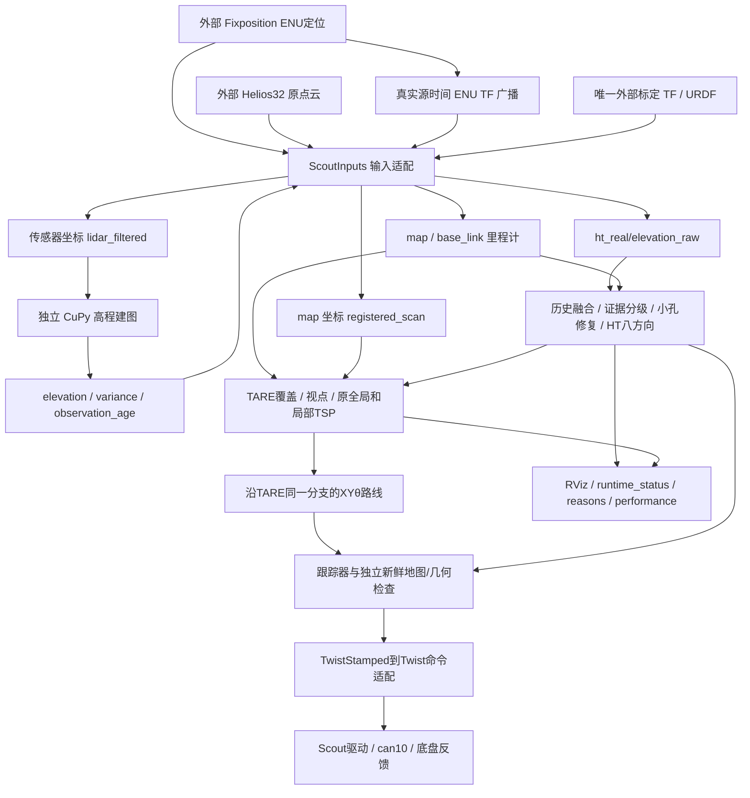

# HT_Explo Project Handoff — Jetson Scout 实车项目上下文交接

> 最新汇总（2026-11-03）：见 `docs/real_vehicle/LATEST_VEHICLE_STATUS_20261103.md`，包含本轮代码、后续离线/实车结果、最终录包与关闭状态。下方交接内容按各自记录时点保留。

> 2026-11-03 地面证据与时效候选：以车端脏工作树为基线保存后，移植远端 `8d0ad9c` 接收优化，省去未使用的源平滑，修复当前边缘覆盖仍携带旧历史时间，新增逐格证据/过滤审计、消费者快照年龄和具体停车原因，更新当前航向显示。已重建安装，离线验证结果见 `docs/real_vehicle/EVIDENCE_LATENCY_FIX_20261103.md`；未启动设备或完成持续探索验收。

> 2026-11-02 后续代码修复：已修复地图校验中到期误发拒绝边，以及 kUseFrontier 未声明导致的未初始化值；两包已重建安装，8 组 C++ 回归通过（104 项通过/4 项历史 fixture 跳过，另 15,241 核心断言）。未启动实车，稳定探索未验收。最新补充见 `docs/real_vehicle/ROUTE_FAULT_FIX.md`；下文交接事实仍按原记录时点保留。

交接日期：**2026-11-02，Asia/Shanghai**。本次约 17:43 起只读核对现场、源码、Git、安装文件及历史日志；随后仅创建本文件。**本次没有构建、安装、拉取、运行测试、启动/停止设备、发布控制指令或修改业务代码。**

项目根目录：`/mnt/nvme0n1/autoware/HT_Explo`。文中的相对路径均相对该目录。虽然 IDE 打开的是邻居项目 `autoware.scout/SCOUT_HANDOVER.md`，用户此前已明确当前目标仓库为 **HT_Explo（探索程序）**。不要把本次交接写成 Autoware 迁移交接。

状态用语：**[已验证]** 表示本次文件/现场检查或明确留存的执行证据；**[历史已验证]** 只适用于记录时的版本、场景和机器；**[未验证]** 没有相应验收；**[推测]** 解释尚未形成因果证据；**[待确认]** 需要后续检查或现场信息。历史报告中的“未验收 ARM”不能抹掉后续 Jetson 执行事实，后续短测也不能代替完整验收。

## 先读：交接时最重要的事实

1. **当前已经没有上轮运行进程。** 本次 `ps` 未发现 HT/TARE/跟踪器、Fixposition、rslidar、mapper、Scout 底盘、RViz、rosbag 录制进程；历史 PID 29748、29749、48159、29755、51242 均不存在。主机本次开机时间为 2026-11-02 17:24:30；`can10`、`can11` 当前均 DOWN / STOPPED、收发计数为 0。不要把 `.git/current_live_check.json` 中的 `running_drive` 当作活状态，不要向旧 PID 发信号。
2. **本地有未提交、已安装且测试过的功能修正。** HEAD 仍是 `b1b73c77bb49a82c5d667c77ab328c334d32585c`，分支 `real/scout-helios32`；其上叠加“起点许可 30→60 秒”和“陈旧高程证据分级/近车射线清理”。新 `height_evidence.py` 尚未跟踪，绝不能 `git clean`、`reset --hard` 或直接 pull 覆盖。
3. **系统能启动并曾实际移动，但没有稳定自主探索验收。** 11 月 1 日最后一次 72.38 秒观察窗口确认底盘自动模式、无故障，轮速积分估计行驶 1.328 m、定位净位移 0.990 m，随后 `NO_EXECUTABLE_ROUTE` 停车。路径阻塞在 60 秒起点许可到期前已出现，不能把停车全归因于到期。
4. **HT 未达到车上 10 Hz。** 正式旧包 1× 回放输出 540 帧/179.43 s≈3.01 Hz；新修正部署时短观察约 2.39 Hz（观察器口径，仅参考）。上游 x86 算子 30 ms 成绩不是 Orin 全链路成绩。
5. **旧高点变成“未知”，不是变成“自由地面”。** 新修正消除了同批 72 帧内车体圈错误硬障碍的均值，但未知格增多；未知依然能阻止起步/连续运动。不能宣称已经解决所有红区、孔洞或停车问题。
6. **本轮用户只要求交接。** 不要因为本文保存了启动命令，就自动启动实车、回放、旧 systemd 作业或下一轮实验。待新任务明确后继续最高优先级工作。

## 1. 项目概述（Project Overview）

### 1.1 名称、目标、最终成果

项目为 `CQULzz/HT_Explo` 的 **Scout Helios32 实车分支**。目标是在本车 Jetson AGX Orin 上，以真实 Fixposition 定位、RoboSense Helios32 点云和独立 CuPy 高程图为输入，实时运行 HT 八方向地形可通过性、保留 TARE 覆盖探索决策，通过 XYθ 局部可执行路线和底盘跟踪完成自主探索，并用 RViz 实时解释地形、路径和停车原因。

要解决的具体问题包括：ARM 构建、真实标定与时间同步、近车自遮挡与自车回波、历史高程残留、缺测/小孔处理、HT 实时性、TARE 提前完成、起点不可行和控制门禁。最终成果应是可复现构建/启动、清晰诊断、持续运动与完成语义正确、完整数据可追溯的实车探索系统，而不是只显示一张 HT 图或偶尔发布非零速度。

### 1.2 技术栈和阶段

- C++ / CMake / ament_cmake：TARE、OR-Tools TSP、HT 地图消费、XYθ 搜索、跟踪器、契约测试。
- Python 3.10 / rclpy / ament_python：实车输入适配、速度适配、运行状态与 RViz 图层、HT 推理和诊断。
- CUDA / CuPy / PyTorch FP32 / NumPy / SciPy / Numba：高程融合、质量筛选、历史窗口、上下文、小孔平面拟合、八方向神经网络。
- ROS 2 Humble、GridMap、PointCloud2、tf2、RViz2、rosbag2 MCAP、SocketCAN / mttcan。
- [已验证] 代码与安装已有 Orin 部署、离线对照和短程闭环运动；[未验证] 长时间连续自主探索、10 Hz、真实非对称地形方向响应和完整整车运动验收。

### 1.3 系统架构与数据流



**工作区分离是关键设计。** HT 主入口只消费外部定位、雷达、TF、高程和底盘驱动；它本身不启动上述硬件。仓库虽带旧 `src/rslidar_sdk` 等，实车独立构建只选 `tare_planner`、`ht_scout_bridge` 两包。独立 mapper 通过 `/ht_real/lidar_filtered` 接收一次自过滤结果；不要再次套旧大包围盒。

## 2. 原始需求与关键决策（Requirements & Decisions）

### 2.1 用户需求演变（保留代码外上下文）

1. 最初要求把 `git@github.com:CQULzz/HT_Explo.git` clone 到 `/mnt/nvme0n1/autoware`，适配 ARM，在本车运行；高程输入先复用 `/home/agx/elevation_map_cupy`，随后指定 `Unmanned-Systems-Lab/elevation_mapping_cupy_2204`。
2. 要求从本车 URDF 查清 `odom/rslidar` 等变换，不接受编造 TF；反复排查 Fixposition GNSS not fixed、网络、CAN 口和底盘模式。`can0/can1` 在本机不存在，实际口为 `can10/can11`。
3. 用户要求完整探索，而非仅 HT；实车试验时同时打开 RViz，显示实时可通过性、规划和原因；不希望为了启动开许多终端，希望助手把相关进程成组管理。
4. 曾要求直接发 `/cmd_vel` 0.2 m/s 判断底盘，再把探索速度提高到 **0.4 m/s**。手工测试和自动程序不能竞争同一速度输出；速度命令不是实测速度保证。
5. HT 八方向定义曾要求去 `Unmanned-Systems-Lab/ZTH` 查，未找到相关训练标签；后来由本机 `/home/agx/ht_trans` 同哈希权重和训练/映射代码核对方向。用户多次问“之前是否已经验证”，必须区分代码映射与实地地形响应。
6. 反复要求参考 `CQULzz/eletranskit_scout`（kit）修复孔洞、近车点云和速度。曾发现车体过滤被误解为可关闭，用户明确：**默认初始位置是好地面，不代表可以关闭自车点云擦除。**
7. 曾要求“best prob，一个方向绿色就能走”。这是历史运行策略；当前分支明确为 `configuration` + 真实航向 XYθ + strict unknown。不能凭旧聊天把现配置改回 max-over-directions 直接执行，也不能把最佳概率显示当任意航向通行许可。若用户要重新改变算法，应明确该行为变更的范围与验证。
8. 初始周围只见 0.6 m，用户要求扩大起点可通行假设；现已做 **固定初始锚点 1.5 m、60 秒**，最近一次明确修改是 **30→60 秒**。0.6 m 是诊断/足迹支持范围，不是当前起点许可半径。
9. 用户现场反馈随试验变化：某次说当前脚下/前方 1 m 平整硬地；之后又说前方有孔洞、台阶或障碍；最近高程诊断明确说 **“车身后面有人，前面和侧面是平地”**。这些反馈只对应当时现场，不能永久作为全地图真值。
10. 用户多次要求长测、录 rosbag 到 `/mnt/nvme0n1/autoware/bags`、演示录像、上传代码到对应 GitHub 分支并打 tag、写更新说明、导出仅代码 ZIP（不要视频/大数据）。历史发布有回执的保持追溯；本轮新修正**未提交/未发布**，不应说已上传。
11. 用户曾大量自行改代码，要求从 GitHub 更新后重新检查。最近拉取目标明确为 HT_Explo，不能因 IDE 打开 Autoware 而更新错仓库。
12. 最新任务是 **完整项目交接，只读核对加创建文档**。此前“重启试试”已经发生过；不要在交接期间再次执行。

### 2.2 必须保留的技术决策

| 决策 | 理由及边界 |
|---|---|
| 保留 TARE 覆盖、视点、全局/局部 TSP 与访问顺序；HT 约束同一原生分支的局部执行 | 不能通过随意换收益目标掩盖路由失败；`tare_waypoint` 是当前模式 |
| `ht_score_semantics=configuration`，查询实际车身 yaw 扫掠 | 倒车不应额外误查位移方向 θ+π；8 个网络方向不等于只有 8 个搜索航向 |
| 物理支撑、模型上下文、硬障碍、小孔插补分别表达 | 神经网络最近邻补齐和插补不代表获得新的实测地面 |
| 0.5 概率门槛、strict unknown、1 秒 HT 地图有效期保留 | 不降门槛、缩足迹或刷新旧图时间戳来制造可行/高频 |
| 固定起点假设 1.5 m/60 s，规划器拥有并通过 StartupPrior 分享 | 不随车移动、不因重发 start/path 续期；不重写测量图；独立碰撞/急停仍有效 |
| 自车几何过滤继续开启，mapper 旧 self_filter 关闭 | 前者按 URDF/CAD 过滤一次；后者避免重复误删地面，不代表自车过滤整体关闭 |
| HT 实车 build_real/install_real；mapper、驱动独立 | 防 overlay 污染、重复节点/TF 和错误二进制；不能把 CuPy 源码并进 HT/src |
| 传感器原始时间戳 + 对应时间 TF | 不能改 frame_id 冒充配准、用最新 TF 掩盖时间不匹配或伪造定位 |
| FP32，TF32 关闭；BN 融合/CUDA/Numba 优化须同输入对照 | 保留行为边界和可追溯性，不把 x86 微基准当 ARM 现场频率 |
| `inspect/preview/drive` 明确区分 | inspect 无速度发布者；preview 仅预览命名空间；drive 才启用 `/cmd_vel` 适配 |

### 2.3 规则优先级与用户偏好

- `AGENTS.md` 保留 10 月 22 日“只做离线、不启动设备”的阶段记录；后续用户反复明确要求实车启动，历史实际工作按较新指令执行。它不是“本车从未启动”的证据。本次只交接的限制仍必须遵守。
- `AGENTS.md` 与 `docs/experiments/ht_iteration_protocol.md` 还规定冻结版本、每轮行为修改完整 600 s 仿真、保存失败/图/视频/全数据、核验 Release 后再下一轮、远端完整备份后本地只保最近两轮。**本轮没有 600 s 验收，也未完成这轮发布闭环**；不能把 72 帧离线和 72 秒实车充数。下一阶段需按最新用户任务判断是否做该完整实验，若受环境限制就明确缺口。
- 不自动合入 `main/develop`；不 force push、不移动实测 tag、不覆盖失败记录，不对整个系统 killall/pkill，不删除未核验数据。
- 少问重复确认，先自主做已授权的可逆工作；用中文说清真实状态，用户需要能看到 RViz 和可执行结果。不要把软件发命令等同于车轮动了。
- 不保存密码、Token/API Key；本交接不含凭据。需要特权操作时按当前运行环境处理，不从历史聊天复制凭据进脚本。

## 3. 当前代码仓库状态（Repository State）

### 3.1 Git 身份、同步边界

- [已验证] 仓库：`git@github.com:CQULzz/HT_Explo.git`；分支：`real/scout-helios32`。
- HEAD：`b1b73c77bb49a82c5d667c77ab328c334d32585c`，提交标题 `Record verified CUDA hole moments and complete experimental assets`；提交时间 **2026-11-01 13:47:07 中国时间**。
- 本地 `origin/real/scout-helios32` 与 HEAD 相同；`.git/FETCH_HEAD` 修改时间 2026-11-01 14:59:22。**本次没联网 fetch，不能声称 11 月 2 日 GitHub 没有新提交。**
- 最近相关父提交：`d1deff3` CUDA 小孔矩阵统计；`8a43789` 历史融合报告；`1c5e621` FP32 历史融合优化；`f69f55b` DDS XML 安装报告。
- 11 月 1 日拉取前做过备份 `/mnt/nvme0n1/autoware/HT_Explo_before_pull_20261101_145944`，当前 stash：`before-github-update-20261101-145944`、`Preserve local HT speed candidate before update 20261031_161330`、`Preserve local Scout changes before GitHub update 20261029_203057`。不要盲目 pop；旧本地 Humble `Clock` 兼容修正已在远端当前代码中。
- 有本地 `backup/scout-before-pull-*` 与旧 `codex/ht8dir-v1` 分支，不是当前执行入口。
- 历史 `HANDOFF.txt` 中“本机导入祖先不能直接推、proper 父提交叠加”针对早先 `/home/lzz/...` 导入工作树。当前 Git 分支已跟踪远端真实分支；后续提交应重新核验祖先，不机械照搬旧 commit-tree 流程或强推。

### 3.2 目录和核心代码职责

```text
HT_Explo/
  AGENTS.md                    阶段规则与实验留存要求
  PROJECT_HANDOFF.md           本次最新上下文快照
  HANDOFF.txt                  早期仿真/离线/发布历史，保留未覆盖
  README.md HT_README.md       分支与总入口（含历史阶段文字）
  docs/real_vehicle/           实车启动、方向、时效、历史和本轮修正文档
  docs/results/               历次冻结候选、证据、报告、发布回执
  docs/experiments/            实验协议、发布索引及历史清理记录
  src/tare_planner/            C++探索、HT消费、XYθ、跟踪、消息、测试
  src/ht_scout_bridge/         Python实车输入、模式、命令适配、显示、配置
  src/rslidar_sdk/ rslidar_msg/ 仓库带的雷达代码，当前两包实车构建不使用
  tools/ht_cupy_bridge/        HT Python主链、模型权重、各后端与测试
  tools/elevation_mapping_fixes/ 独立CuPy补丁和安装清单
  tools/install_elevation_fixes.py 独立工作区补丁安装器
  scripts/                    构建/source/契约/发布/归档脚本
  validation/                 本机检查、失败、回放、实测日志与冻结副本
  build_real/ install_real/ log_real/  当前ARM独立构建产物（忽略）
  build_standalone/ ...        旧仿真/离线产物，不能代替当前real二进制
  .local_deps/ortools-arm64/   本机原生OR-Tools9.8（忽略，迁移须另带/安装）
  .git/current_*.json          运行历史索引，会过期，不在Git源码中
  .git/height_fix_* .git/live_*/ 本车临时编排脚本/配置，不随clone发布
```

| 路径 | 核心入口/作用 |
|---|---|
| `src/ht_scout_bridge/launch/scout_real.launch.py` | `start()` 解析模式/方向证据/实际权重；启动 inputs、CupyToHt、TARE、可选 follower/command bridge/status/RViz；对绝对硬件话题统一重映射 |
| `src/ht_scout_bridge/ht_scout_bridge/node.py` | `ScoutInputs`；enqueue/_drain_kind、convert_odom/cloud/elevation；源时刻 TF、外参一致性、单调时间/队列、体点过滤、两坐标点云、291格高程规范化 |
| `src/ht_scout_bridge/ht_scout_bridge/geometry.py` | 变换、标定、点云过滤、杆臂/协方差、AABB/轮胎几何 |
| `src/ht_scout_bridge/ht_scout_bridge/runtime_policy.py` | `direction_evidence()` 对实际权重哈希/顺序/偏移；`resolve_runtime()` 限定inspect/preview/drive和方向准入 |
| `src/ht_scout_bridge/ht_scout_bridge/command_bridge.py` | `ScoutCommandBridge.reason()/tick()`；唯一命令源、许可/定位/命令时效、停止/时钟故障门禁，TwistStamped→Twist |
| `src/ht_scout_bridge/ht_scout_bridge/runtime_status.py` | `diagnose()` 聚合原因、车旁统计、起点圈和红绿/测量点云；不发布控制；`wheel_motion_confirmed` 当前不是底盘反馈验收 |
| `tools/ht_cupy_bridge/cupy_to_ht.py` | `CupyToHt.on_map()`：质量→历史融合→地面参考/窗口→证据分级→受限孔洞修复→上下文→8通道推理→图层/分阶段诊断；latest pending输入和退出同步 |
| `tools/ht_cupy_bridge/historical_elevation.py` | `HistoricalElevation.fuse()/window()` 多层分块历史、拒绝痕迹、真实选中表面/障碍时间 |
| `tools/ht_cupy_bridge/height_evidence.py` | **新未跟踪文件**；`qualify_height_evidence()` 和 `warmup_evidence_times()`；新鲜确定障碍/陈旧或不确定高度分开 |
| `tools/ht_cupy_bridge/ht_support.py`、`cuda_ht_context.py` | CPU/CUDA 上下文与support/occupied/physical；新增physical_exclusion局部物理未知掩码 |
| `tools/ht_cupy_bridge/local_surface.py`、`elevation_quality.py`、`quality_kernels.py` | 地面参考/质量和Numba质量后端 |
| `tools/ht_cupy_bridge/history_window.py`、`history_fusion.py` | 历史窗口选择/融合编译优化，保留NumPy回退 |
| `tools/ht_cupy_bridge/small_holes.py`、`cuda_small_holes.py` | strict/moderate孔洞平面拟合；矩统计可CUDA，决定仍按既有规则 |
| `tools/ht_cupy_bridge/model.py`、`student_best_epoch_weights.pth` | 固定8方向网络与权重；不可随意换模型 |
| `src/tare_planner/src/sensor_coverage_planner/sensor_coverage_planner_ground.cpp` | 主执行/表示更新/全局局部规划、完成判定、状态/许可 |
| `src/tare_planner/src/sensor_coverage_planner/tare_waypoint_router.cpp` | `RouteTareWaypoint()` 在同一TARE分支选择局部前缀，0.35s共享预算，不能换TSP目标 |
| `src/tare_planner/src/local_coverage_planner/local_coverage_planner.cpp` | 原生视点收益与TSP、完成状态、`TARE_SELECTION`诊断 |
| `src/tare_planner/src/local_coverage_planner/ht_route.cpp` | XYθ局部路线/返回搜索对接 |
| `src/tare_planner/src/ht_cost/ht_cost_map.cpp` | 地图解码/时效、`poseSupport()/motionSupport()`、固定起点许可/同步和导航许可 |
| `src/tare_planner/include/ht_cost/ht_cost_core.h`、`xytheta_planner.h`、`execution_policy.h` | 概率/物理未知足迹判据、不可变搜索图、`INVALID_START`、启动先验/回退策略 |
| `src/tare_planner/src/ht_cost/xytheta_follower.cpp` | 路径跟踪、前进倒车/原地转向、实时HT/点云几何和命令弧检查；拒绝时清空已构造的速度 |
| `src/tare_planner/msg/StartupPrior.msg` | 规划器拥有的固定mission起点、原始开始/截止时间、radius/retired/assume_traversable；两端须同版本构建 |
| `scripts/check_tare_waypoint_contract.py` | TARE原决策/路由契约检查入口 |

### 3.3 关键配置：以当前实际文件为准

| 配置 | 当前值/注意事项 |
|---|---|
| `src/ht_scout_bridge/config/ht_real.yaml` | ht_enabled=true；ht_exploration_mode=tare_waypoint；min_probability=.5；score_semantics=configuration；map_timeout=1.0；sample_step=.02；validity_radius=.6；unknown_policy=strict |
| 同上：起点 | assume_traversable=true；radius=1.5；duration=60.0。C++构造默认仍30s/1.2m，不是实车profile实际值；不要误改所有通用默认 |
| 同上：新证据 | ht_qualify_evidence=true；ht_stale_surface_s=5.0；ht_surface_margin_m=.15 |
| 同上：XYθ | cell=.3，headings=32，turn_angles=[11.25,22.5]deg，drive_step=.4，goal_radius=.35，max_radius=7，单搜索.15s/每周期.35s，max_expansions=8000 |
| 同上：运动 | mission_normal_speed/max_speed=.4；mission_sensor_timeout=1.0；scan_pose_max_skew=.05；kAutoStart=false；fallback参数存在但strict不等于启用geometric_fallback |
| `src/ht_scout_bridge/config/tare_scout.yaml` | 本车视点40×40×1、1.2m间距，kSensorRange=12，kUseFrontier=true，min新增覆盖small40/big60、frontier15；原TARE几何/收益/完成逻辑依然重要 |
| `src/ht_scout_bridge/config/direction_validation.yaml` | mapping.verified=true；order=[0..7]；offset=0；terrain_response.validated=false |
| `src/ht_scout_bridge/config/scout_extrinsics.yaml` | eletranskit_scout@cf0b73d…标定与自车几何；wheel_occlusion默认开启；余量2cm已经计入，不能重复膨胀 |
| `src/ht_scout_bridge/config/mapper_for_ht.yaml` | 0.04m/11.64m即291格；enable_deterministic_fusion=true；visibility_cleanup=true；overlap_clearance=false；max_ray_length=3；订阅lidar_filtered；self_filter_enabled=false；发布elevation/variance/observation_age |
| `src/ht_scout_bridge/rviz/scout_real.rviz` | Fixed Frame=map；测量灰点、HT最佳概率、runtime marker/起点许可、小孔来源（默认关闭）；是当前实车RViz配置 |
| `src/ht_scout_bridge/config/fastdds_large_clouds.xml` | 可选16MiB DDS profile，默认不启用；外部生产者须独立匹配，不能仅改消费者就假定无丢包 |

方向权重 SHA256：`0a79b865d012aa633fbb9913fc4031908dfe188ec9e161ef5a3fbb34a3f8c4d4`。身份顺序：0=+X，1=+X+Y，2=+Y，3=-X+Y，4=-X，5=-X-Y，6=-Y，7=+X-Y，相对高程图坐标。来源与限制：`docs/real_vehicle/evidence/HT_DIRECTION_TRACE_0574439.md`。

### 3.4 未提交与未跟踪清单

本次创建文档前，`git diff --stat` 为 **11 个已跟踪文件，115 insertions / 14 deletions**。它不包含新模块/文档/验证目录。完整 `git status --short` 快照如下（新交接文件自身在创建后也会成为未跟踪文件）：

```text
 M docs/real_vehicle/JETSON_STARTUP.md
 M docs/real_vehicle/SCOUT.md
 M src/ht_scout_bridge/config/ht_real.yaml
 M src/ht_scout_bridge/config/mapper_for_ht.yaml
 M src/ht_scout_bridge/launch/scout_real.launch.py
 M src/ht_scout_bridge/test/test_launch_modes.py
 M tools/ht_cupy_bridge/cuda_ht_context.py
 M tools/ht_cupy_bridge/cupy_to_ht.py
 M tools/ht_cupy_bridge/historical_elevation.py
 M tools/ht_cupy_bridge/ht_support.py
 M tools/ht_cupy_bridge/test_cuda_ht_context.py
?? PROJECT_HANDOFF.md
?? build_ht_model/
?? docs/real_vehicle/HEIGHT_EVIDENCE.md
?? install_ht_model/
?? log_ht_model/
?? tools/ht_cupy_bridge/height_evidence.py
?? tools/ht_cupy_bridge/test_height_evidence.py
?? validation/arm_vehicle/
?? validation/drive_trial_20261031_165447/
?? validation/height_evidence_fix_20261101_163853/
?? validation/height_fix_drive_20261101_170939/
?? validation/ht_speed_2026-10-29_211929/
?? validation/jetson_scout_2026-10-23/
?? validation/live_start_20261101_160424/
?? validation/navigation_completion_2026-10-27/bridge_integration.log
?? validation/navigation_completion_2026-10-27/build.log
?? validation/navigation_completion_2026-10-27/build_final.log
?? validation/navigation_completion_2026-10-27/build_support_final.log
?? validation/navigation_completion_2026-10-27/compare_recorded.py
?? validation/navigation_completion_2026-10-27/enclosed_only_comparison.json
?? validation/navigation_completion_2026-10-27/enclosed_only_small_holes.py
?? validation/navigation_completion_2026-10-27/gap_diagnosis.json
?? validation/navigation_completion_2026-10-27/gap_diagnosis.log
?? validation/navigation_completion_2026-10-27/gap_integration_tests.log
?? validation/navigation_completion_2026-10-27/gap_unit_final.log
?? validation/navigation_completion_2026-10-27/gap_vector_tests.log
?? validation/navigation_completion_2026-10-27/launch_contract.json
?? validation/navigation_completion_2026-10-27/new_launch_ros_tests.log
?? validation/navigation_completion_2026-10-27/new_unit_tests.log
?? validation/navigation_completion_2026-10-27/pre_vector_only_comparison.json
?? validation/navigation_completion_2026-10-27/pre_vector_only_small_holes.py
?? validation/navigation_completion_2026-10-27/python_final.log
?? validation/navigation_completion_2026-10-27/python_regression.log
?? validation/navigation_completion_2026-10-27/recorded_comparison.json
?? validation/navigation_completion_2026-10-27/recorded_comparison.log
?? validation/navigation_completion_2026-10-27/recorded_comparison.png
?? validation/navigation_completion_2026-10-27/recorded_final.log
?? validation/navigation_completion_2026-10-27/recorded_gap_comparison.log
?? validation/navigation_completion_2026-10-27/recorded_gap_final.log
?? validation/navigation_completion_2026-10-27/recorded_support_final.log
?? validation/navigation_completion_2026-10-27/recorded_vector_final.log
?? validation/navigation_completion_2026-10-27/smoke_inspect.log
?? validation/navigation_completion_2026-10-27/smoke_modes.py
?? validation/navigation_completion_2026-10-27/smoke_preview.log
?? validation/navigation_completion_2026-10-27/smoke_results.json
?? validation/navigation_completion_2026-10-27/smoke_summary.log
?? validation/navigation_completion_2026-10-27/support_final_tests.log
?? validation/navigation_completion_2026-10-27/visual_payload_test.log
?? validation/offline_review_2026-10-24/
?? validation/rebuild_20261101_150740/
?? validation/recorded_drive_20261031_170105/
?? validation/replay_20261101/
?? validation/replay_yesterday_20261101_152253/
?? validation/shutdown_20261031_174142/
?? validation/startup_check_20261031_163842/
?? validation/startup_prior_sync_2026-10-24/build.log
?? validation/startup_prior_sync_2026-10-24/build_final_2026-10-27.log
?? validation/startup_prior_sync_2026-10-24/build_retry.log
?? validation/startup_prior_sync_2026-10-24/ctest_2026-10-27.log
?? validation/startup_prior_sync_2026-10-24/follower_test_build_2026-10-27.log
?? validation/startup_prior_sync_2026-10-24/geometry_pose_test.gtest.xml
?? validation/startup_prior_sync_2026-10-24/ht_ros_test.gtest.xml
?? validation/startup_prior_sync_2026-10-24/ht_startup_sync_test.gtest.xml
?? validation/startup_prior_sync_2026-10-24/input_pose_test.gtest.xml
?? validation/startup_prior_sync_2026-10-24/launch_contract.json
?? validation/startup_prior_sync_2026-10-24/launch_contract_2026-10-27.json
?? validation/startup_prior_sync_2026-10-24/planner_input_test.gtest.xml
?? validation/startup_prior_sync_2026-10-24/source_sha256.json
?? validation/startup_prior_sync_2026-10-24/startup_test_final_2026-10-27.log
?? validation/startup_prior_sync_2026-10-24/startup_test_initial_failure_2026-10-27.log
?? validation/startup_prior_sync_2026-10-24/startup_test_rebuild_2026-10-27.log
?? validation/startup_prior_sync_2026-10-24/xytheta_follower_test.gtest.xml
?? validation/tare_recording_20261031_172219/
?? validation/tare_standalone_20261031/
?? validation/tare_standalone_20261031_171638/
?? validation/tare_standalone_20261031_172225/
```

重点新增源码为 `tools/ht_cupy_bridge/height_evidence.py`、`tools/ht_cupy_bridge/test_height_evidence.py` 和 `docs/real_vehicle/HEIGHT_EVIDENCE.md`。`build_ht_model/install_ht_model/log_ht_model` 是旧本地产物，不是要直接提交的源码；`validation/*` 包含大数据/现场诊断，不能 `git add .` 整包上传。`.gitignore` 忽略 `*.mcap`、build_real/install_real/log_real 等，所以 `git status` 不能代表全部实验资产。

**[已验证，本次重核]** 五个核心修正模块（cupy_to_ht、height_evidence、historical_elevation、ht_support、cuda_ht_context）源文件与 `install_real/tare_planner/lib/tare_planner/` 哈希一致；ht_real、mapper_for_ht、direction_validation、scout_extrinsics 和 launch 的源码/安装副本也一致。后续修改仍需重新构建，不能照抄旧哈希结论。

### 3.5 外部依赖工作区的真实位置

| 路径 | 当前角色和已知边界 |
|---|---|
| `/mnt/nvme0n1/autoware/ht_cupy_live_ws_20261029` | **11月1日实际mapper**，不是最初home目录版本；`install/local_setup.bash` + `config/trial_core.yaml`；根目录不是可用Git仓库，内部包版本要另查 |
| `/home/agx/elevation_map_cupy` | 最早输入/传感器launch包环境；仍被sensors.sh source以解析外部包，但独立mapper使用上面NVMe版本；根目录不是可用Git仓库 |
| `/home/agx/fp` | Fixposition安装环境，根目录非可用Git仓库；不要据此编造提交号 |
| `/home/agx/rslidar_sdk` | 外部雷达工作区；本次HEAD=78d2abb7f0c21f789a606d584475c631d5118dc3；未全面审计脏状态 |
| `/home/agx/ele_scout_kit_github_20260827` | 外部实车launch/URDF包；本次HEAD=a3b5c3bf4fe48d32311628be58da27efc3d85374；当前安装、固定标定来源与该HEAD不是同一概念 |
| `/mnt/nvme0n1/autoware/autoware.scout/install/scout_msgs`、`.../scout_base` | 只借这两个已安装包启动底盘，**不source完整Autoware**；与IDE打开的Autoware手册独立 |
| `/home/agx/ht_trans` | 历史方向训练代码核对源，完整训练run溯源仍不足 |

独立 CuPy 补丁支持的上游基线：`Unmanned-Systems-Lab/elevation_mapping_cupy_2204@88f4c0c2eb3542faeb7bd8fa9df2f18bd25eed91`，见 `tools/elevation_mapping_fixes/manifest.json`。这不是本次已核验运行工作区HEAD。

## 4. 已完成工作（Completed Work）

| 工作/状态 | 实现及文件 | 已执行验证 / 结果 / 限制 |
|---|---|---|
| **[历史已验证] ARM独立构建和Humble兼容** | scripts/build_real_scout.sh、real_scout_environment.sh、source_real_scout.sh；tare CMake ARM OR-Tools；command_bridge正确导入Clock/ClockType | 11月1日b1重建397.88s退出0；4组C++、6Python通过；后续修正重建两个包10.2s通过。不能搬x86二进制/Numba缓存到ARM |
| **[历史已验证] 实车TF/参考点/输入规范** | geometry.py、node.py、scout_extrinsics.yaml；源时刻TF、杆臂和协方差、两坐标点云 | 生产订阅/录包回放、几何/输入测试；不是逐点去畸变，也不证明所有物理附件已建模 |
| **[已实现且离线验证] 一次自车几何/轮胎阴影过滤** | geometry.py、scout_extrinsics.yaml | 近车诊断原57600点→过滤/配准43059点；旧46项轮胎回归及新总回归。地面和可见上结构保护；不能盲扩大过滤圈 |
| **[已实现且验证] inspect/preview/drive、命名空间和命令门禁** | runtime_policy.py、launch、command_bridge.py | 模式冲突拒绝、preview输出隔离、钟回退/时效/唯一源测试；inspect部署确认无速度发布者；drive短测真底盘反馈 |
| **[已实现且部分物理核对] HT方向代码映射准入** | direction_validation.yaml、runtime_policy.py、方向证据文档 | 权重/顺序/偏移核验通过；drive默认mapping可启；terrain_response=false，validated模式未满足 |
| **[历史已验证] HT性能优化/诊断基建** | Numba质量/历史、CUDA上下文/小孔矩统计、BN融合、线程限制、latest pending、runtime_manifest/diagnostics | 上游逐帧一致对照、Orin总回归；本机全包回放仍3Hz。不能以“有优化”宣称10Hz |
| **[已实现且离线验证] 原TARE同分支XYθ与configuration语义** | tare_waypoint_router.cpp、ht_route.cpp、ht_cost_map.cpp、xytheta_planner.h、follower | 原TARE契约/合成方向及倒车反例；真实数据仍可能INVALID_START。不是靠换目标或best probability覆盖全部方向 |
| **[已实现且验证] moderate小孔修复** | small_holes.py/cuda_small_holes.py、launch默认moderate | 18cm最近支持、总8点/每象限1、半径16cm、坡度≤.35、RMS≤10mm；跳变/拒绝/障碍/边界不填，不写回历史、不传播新物理支持 |
| **[已实现且验证] 固定起点1.5m/60s** | ht_real.yaml、ht_cost_map.cpp、StartupPrior.msg、startup_sync测试、启动文档 | 30→60仅本地；已安装/服务参数检查确认60，最近drive实际到期；不是0.6m圈；不能在旧任务热续期 |
| **[已实现且离线/部署验证] 陈旧高程证据分级** | 新height_evidence.py、historical_elevation.py、cupy_to_ht.py、ht_support.py、cuda_ht_context.py、launch/yaml | 主353Python、另4launch、3组C++，72帧同输入，JIT前后全数组一致；部署参数/源安装核对；未知增多仍可能停车 |
| **[已实现且分量验证] 3m真实射线旧高点清理** | mapper_for_ht.yaml与实际独立setup；未改生产mapper源码 | 实际CuPy确定性10测；旧高点可被矛盾射线清除、同扫描命中保留；3m分量44.7ms，10m117.3ms；不是全图自由清空 |
| **[已验证] RViz实时显示与原因** | runtime_status.py、rviz/scout_real.rviz | 前次启动有RViz；日志后来记录RViz clean退出；当前已不运行。显示绿/红不等于整条实际航向路线可行 |
| **[部分实现/未验收] 稳定自主探索** | 全链路 | 最近短程有运动后停止；缺测、低分、时效和早完成仍未闭环。不能标为完成 |

### 4.1 本轮陈旧高程修正的精确语义

- 历史窗口额外追踪“实际选中那个高度/障碍模式”的源观测时间，float64 epoch，不能取另一层的较新时间或新消息到达时间。
- 新鲜且已接受的地形原样进入模型。对于已拒绝的候选，只有 **≤5 s 且相对参考地面绝对高差 >.15m** 才保留确定障碍；正/负高差均检查。
- 已接受但陈旧、偏离参考表面的高度退出已知模型输入；其他不确定候选退出确定障碍，成为 `physical_unknown`。
- `ht_uncertain_evidence` 标记这些格；`physical_exclusion` 令其自身 `ht_valid`、`ht_observation_valid` 为0，禁止小孔插补。它不再仅凭一个过期格否决整片51×51模型上下文；物理足迹未知仍独立检查。
- 原可信旧地面仍服从原历史600s有效期。5s/.15m是显式工程参数，**不是新的地形标定结论**。
- 通用独立 `CupyToHt` 的 `ht_qualify_evidence` 默认false，实车profile true；launch `qualify_evidence:=auto|true|false`，false可用于隔离对照。
- 显示用 `/ht_real/historical_elevation` 的组装在新qualification之前；不能把该显示层中仍存在高度直接判断为最终HT使用了它。应联合看 `ht_uncertain_evidence`、上下文导出和最终支持层。
- mapper启用 visibility cleanup，禁整片 overlap clearance；`max_ray_length=3.0`只限制清理射线，不缩短点云测量融合范围。

## 5. 未完成任务（Pending Work）

下列是建议开发待办，不是本次已执行变更。优先级表示接手顺序，不代表用户授权此刻自动运动。

### P0-A：解释并修复最新“移动后仍无可执行路线”

- 当前进度：[已验证] 新修正后短程运动成功；仍有 `HT_PATH_BLOCKED / INVALID_START / NO_EXECUTABLE_ROUTE`。已修标签不等于已获得自由地面。
- 相关：`height_fix_drive_20261101_170939/telemetry.jsonl`、navigation.log，HtCostMap::poseSupport/supportDirected、`ht_cost_core.h`，RouteTareWaypoint、XYθ/follower，height_evidence与local_surface。
- 前置：先冻结保留当前脏修改/模型/参数；使用同一时间地图、TF、odom、当前yaw、物理support、occupied、uncertain和执行路径。当前没有现场进程，新实测需新任务明确启动。
- 步骤：先离线定位第一个阻塞时间（许可到期前）→枚举起点足迹拒绝格和实际航向通道→区分起点不可行、候选unsupported、搜索预算、整条弧/几何阻挡→再核对对应测量年龄/原始点云，建立最小失败反例→只改得到证据支持的一层。
- 完成标准：可复现解释首个停止；修后同输入解除错误拒绝且真实正台阶/负障碍/人员/未知保护保留；新增反例回归；随后授权实车中许可到期后的连续路线成立。不能以延长许可或涂绿未知作为完成。

### P0-B：时效与排队链路审计，恢复连续可用输入

- 当前进度：[已验证] 最后试验出现 BASE_SENSOR_FAULT、HT_MAP_STALE、ODOMETRY_MISSING_OR_STALE；source TF等待与高程重复时间存在，HT远未10Hz。
- 相关：ScoutInputs._drain_kind/lookup、CupyToHt.process_pending/on_map、runtime/performance诊断、TARE更新/执行线程、独立mapper ROS wrapper；`TARE_INPUT_AND_ORIGIN.md`、`HT_LATENCY_DIAGNOSTICS.md`。
- 前置：同负载、同输入、真实源时间；观察器本身不能成为主要瓶颈；区分上游发布、新源帧、处理、序列化和订阅接收率。
- 步骤：读已有正式计数/性能→同包复算源时间与到达时间链→分阶段CPU/GPU/锁/DDS/TF调度测量→先修最慢且可证实模块，保持数值/门禁→报告median/P95/最大gap和地图年龄。
- 完成标准：无重复旧图伪高频；无盲延长1秒地图时效；明确新鲜HT有效输出及控制连续性，若10Hz未达则准确报告瓶颈。

### P1-A：TARE过早“局部覆盖完/返航”

- 当前进度：旧包b1新回放约6.7s即宣告完成、候选3/全已访问；最新短实车却local_complete=0。不同试验不可混为同一根因。
- 相关：viewpoint_manager候选生成、global/grid_world、local_coverage_planner.cpp；sensor_coverage_planner_ground.cpp完成判定；tare_scout.yaml。
- 前置：同一输入/标定/传感器原点，分离HT开关与其他感知差异；保留TARE决策结构。
- 步骤：逐阶段统计视点范围→地形高度→碰撞→连通→已访问→所在探索cell→收益/虚覆盖→队列→local_complete/global_return；核对native与HT两组同源对照；再决定是否修错误过滤/完成守卫。
- 完成标准：已知仍有可达未覆盖空间时不误完成；真实完成可终止；不能靠无限阻止完成或改TSP目标制造探索。

### P1-B：确保完整可部署启动，不依赖隐藏.git脚本

- 当前进度：[部分] 本车上次全栈由`.git`临时脚本编排，公开launch只消费者；重启后CAN引脚/网络/GUI可能失效。
- 相关：scripts、JETSON_STARTUP.md、外部mapper setup/sensorlaunch、current_live_check索引。
- 前置：确认新会话是否要运行/仅开发；确认当前硬件状态、真实模式、唯一TF/控制源。
- 步骤：先记录/抽取当前脚本和参数依赖，不复制密钥→设计可配置的一次启动/停止入口（勿改无关驱动）→processgroup+新日志目录+健康检查→验证inspect零速度发布者→preview隔离→授权drive。
- 完成标准：无需大量终端；只重启自管进程；能定位外部依赖失败；有完整可携带配置/来源和明确运动开关。

### P1-C：完成候选版本留存、正式回归和实验发布缺口

- 当前进度：11个tracked修改+3个核心新文件未提交；353Python/3组C++/10native/72帧验证在本地；无本轮600s和发布回执。
- 相关：本轮validation、docs/real_vehicle/HEIGHT_EVIDENCE.md、AGENTS/实验协议。
- 步骤：核对源码/安装/模型/依赖hash→有选择提交源码和精简报告，勿加大数据/build→按最新任务冻结新候选→补适当完整实验与对照→如用户要求发布，推对应real分支、不可变tag与更新说明，数据按Release和SHA核验。
- 完成标准：可从准确版本复现；每项通过/失败/未测清楚；不把本地保存当上传、不把交接当自动发布授权。

### P2：其他遗留

| 任务 | 现状/位置/建议步骤 | 完成标准 |
|---|---|---|
| 真实方向/模型地形响应 | mapping已核对，terrain_response仍false；direction_validation.yaml；在已知非对称地形收8通道、核yaw/参考点，不能只翻boolean | 真实带条件的验证记录、权重与方向绑定 |
| 融合新障碍迟滞、远处旧高点 | 历史报告合成50cm障碍约1.2s到半高；3mcleanup只近车；独立mapper稳定融合及surface_registration可选候选 | 新鲜障碍快速保留、旧残留仅有反证时清除，重复性/性能无回归 |
| 两个跨工作区测试兼容 | 当前独立mapper API缺TfListenerWorker，测试收集失败；test_cupy_tf_worker_ros.py/test_publication_demand.py | 在匹配外部版本完整执行或明确版本条件，不能删测冒充通过 |
| 可视化语义/诊断可靠性 | max prob不等于当前yaw/足迹；runtime wheel_motion_confirmed不消费轮反馈；TARE_SELECTION use_frontier曾打印13等异常 | 清晰分开测量/未知/插补/方向/先验；诊断不被当真值；不改变控制语义 |
| 长时/多场景与原TARE配对 | 本轮未做600s/重复实车；旧x86阶段47/48有同限幅比较 | 同场景/起点/速度/输入/时长/指标，保存全量失败与完成证据 |
| 硬件急停/掉电停车/滑移制动 | 软件watchdog不等于硬件验收；drive短测不涵盖所有故障 | 独立驱动与硬件看门狗有真实故障测试记录 |
| 文档清理 | README/SCOUT/HANDOFF含历史Jazzy/time层/只离线文字；以本文件+新Jetson入口为准 | 按日期标清历史，别覆盖旧报告的原始成绩/限制 |

## 6. 当前问题与 Bug（Known Issues）

### 6.1 [已验证未解决] 起点无效/路线不可执行

- 表现：`HT_WAYPOINT_SEARCH ... termination=INVALID_START poses=0 expanded=0`；`TARE_ROUTE failed same-goal prefixes`；规划器 `NO_EXECUTABLE_ROUTE` 输出零速度，follower可报HT_PATH_BLOCKED/PLANNER_HOLD。
- 复现依据：`validation/live_start_20261101_160424` 原试验，及新修正后的 `validation/height_fix_drive_20261101_170939`。不是所有“车不动”都同一个原因，先看当轮模式/传感器/HT/路径/许可/命令/轮反馈。
- 原试验：起点许可到期后约0.8s第一次INVALID_START，当前yaw概率约.092、best约.108–.110<.5，.6m圈4未知/6–7障碍；点云最近几何障碍约2.067m，不能说全是近车实体障碍或地图慢。
- 新试验：许可仍有效时发生HT_PATH_BLOCKED，最终body704格/unknown10/context_invalid10/obstacle0，HT年龄.874s，odom年龄.090s；仍NO_EXECUTABLE_ROUTE。body障碍0不证明整条支路可行。
- 已试：改善过滤、CPU/GPU处理、修正configuration倒车语义、moderate小孔、1.5m起点许可、30→60s、新证据分级和cleanup。**实际结果是部分运动改善，停车未根治。**
- 已证实局部原因：旧高程残留、质量拒绝→occupied、过期盲区→context invalid，详见下项。最新每次阻塞的完整足迹/方向归因仍待确认。
- 下一步：保存首个阻塞时刻精确输入与C++support分类，不先改概率门槛、半径或目标顺序。8000展开/时间预算耗尽也不是“物理无路”证明。

### 6.2 [部分修复] 近车陈旧高点、低概率和孔洞

- 证据目录：`validation/live_start_20261101_160424/height_cause_161718/`，先读REPORT与`height_cause_comparison.png`。
- 17.046s原始采集73HT/历史帧、72匹配源帧；同源stamp `1793521055.447003`，odom差-47ms。车旁左侧/左前两格相对地面+.783m/+1.020m，约96s未更新，附近8cm无新回波。一个方差.758m²超.25质量界，另一个历史参考差略超1m；均进入rejected/occupied。
- .6m圈源年龄中位约756s；模型局部高度[-.672,+.346]m、std.271m。并非输入本来就是平地而模型任意涂红。
- 原mapper cleanup/overlap均false；新测量不覆盖处保留高点。自车过滤只删新点，不会清除已落图旧高程。历史max_age600s到期后还留拒绝痕迹，使51×51上下文无效。
- 已尝试的**仅离线反事实**：模型重建最佳.119；只平掉两个旧高点约.099；只替换未知约.116，均不足；全局部平面约.9999；去掉所有局部高位约.582。重建mask仅约96.3%相符，不能声称精确活状态复现；这些替换从未送入车上图。
- 新方案结果：72帧车体硬障碍均值15.72→0；物理未知52→266.43；近1.2m valid2826.65→2461.31。没有把不确定格提升成有效/支撑/插补（均0）。**未知更多是保留证据边界，不能把它描述为全部变通行。**
- 未解决：没有实测支撑的盲区、真实小坑/台阶、CAD外附件和训练模型对邻近高结构的响应；5s/.15m工程参数需更多真实场景验证。旧回波身份无法从17s包倒推96s以前，不可指认都是后方人或车体。
- 下一步：核不同区域真实新测量、参考平面与年龄；保留后方人和真实负障碍。不能简单扩大孔洞填充或把rejected全改绿。

### 6.3 [已验证未解决] HT频率/地图和定位间歇过期

- 最有依据的端到端数据：`validation/replay_yesterday_20261101_152253/REPORT.md`与`formal_bag_audit.json`。输入雷达1778、注册1773≈9.91/9.88Hz；原高程1778消息仅758个被接受新源时间（1020重复或旧）；HT540帧≈3.01Hz，回调median280ms/mean292ms，网络mean75.6ms/小孔40.6ms/历史融合34.3ms。
- 当前代码有BN融合、Numba、CUDA上下文和小孔矩统计；新证据JIT后同批回调212.4→217.9ms（另一个实验负载，不能直接比较3Hz回放）。末段live日志有 map_processing .23–.37s、network .05–.11s，以及TARE global表示更新约264–307ms；只作线索。
- 触发：真实输入/TF排队、不同源时间更新慢、处理/序列化/RViz/录制负载使输出年龄越门限，控制按规则停车。不能先验只归因高程或只归因网络。
- 已排除的错误口径：Python BEST_EFFORT观察器漏大消息，旧统计8.3Hz注册/2.37HzHT不是正式生产率；话题10Hz不等于10Hz新观测；重复发旧图不能提高有效率。
- 许可旧解释需更新：command_bridge默认permission_timeout=3s；follower有1.5s参数，但当前HT启用分支独立验证新地图、当前pose/几何/有界龄路径，**不简单按旧Bool 1.5s停车**（源码tick()的else分支才是非HT许可超时）。不能把历史“一动一顿都是1.5秒许可”套到现在。
- 下一步按P0-B审计全时间链，保留最新输入队列、故障latch、退出同步与源时间，避免高频优化回归安全门禁。

### 6.4 [已验证未解决] TARE暂时无目标就完成

- b1旧包回放179.43s完整播放，正式preview速度3652条全0；约6.7s早完成，TARE_SELECTION candidates=3/visited=3/eligible=0/queue=0/frontier_queue=0。
- `global_return` 表示当前无全局tour，附近cell可能交由local；`local_complete` 来自增量收益/选择队列，不等于世界真的看完。导航锚点可以在complete之后加入，所以有12个route节点不能证明还有探索目标。
- sensor_coverage_planner_ground.cpp 以global_return&&local_complete&&elapsed>5设置finished；`PendingHTCoverageCells`守卫只对 **!tareCoverage** 分支生效，当前tare_waypoint未使用该守卫。不是建议直接改条件，而是定位入口。
- Oct31 standalone对照：某次HT关闭约48.4s完成、HT开启16.4s；另组无HT阻塞未完成而HT完成。感知输入不完全相同，不是干净上游公平比较；不能证明模型必然比TARE差。
- 最新drive日志local_complete=0仍有目标，当前停车主要不是“探索完成”。
- 下一步追候选每阶段丢失原因，保持原决策顺序，勿一上来改收益40→更低。

### 6.5 [当前环境状态] 已关机/重启后的硬件条件不满足

- 当前无栈进程且两CAN口DOWN；这是本次只读发现，不是本次停的。新开机不保留旧pinmux/临时IP设置，底盘模式也不能从旧日志推断。
- 历史能收到帧并运动证明 `scout_base` / can10曾可工作，不能仅凭现在没数据再次认定驱动坏或任意换can11。
- 历史底盘 `control_mode=3` 为遥控、自动速度会被拒绝；`mode=1` 为CAN自动，最新短测mode1/error0。用户说已切换后仍需实际反馈核查，软件发速度不是模式切好。
- Fixposition网络/RTK是否当前正常未做联网检查。GNSS not fixed和设备TCP连接失败是不同故障；没有本次证据不能宣称恢复或归咎驱动。
- 本次读到 `RViz process has finished cleanly` 的历史末段日志；当前应重新核GUI和DISPLAY/XAUTHORITY，不能说窗口还开着。

### 6.6 [未完成兼容] 外部mapper回归收集失败

- 主测试首次全量收集缺外部包，失败记录`full_python_regression.log`；后分离主集合和native测试。
- 外部环境重试仍 `ImportError: cannot import name 'TfListenerWorker' from elevation_mapping_cupy.elevation_mapping_ros`，日志`external_mapper_regression.log`。当前旧独立mapper API没有该类；不能重复相同pytest命令期待成功。
- 原生确定性测试还有Python3.10不支持的 `[k,*tuple]` 语法，**只复制测试并改为[(k,)+tuple]**、固定fixture源目录后10项通过，生产mapper未改。`native_test_adaptation.txt`保存说明。
- 建议固定所针对外部API/版本后补测，不对生产源码加假类来迎合测试。

## 7. 环境与运行方式（Environment & Commands）

**下列命令是交给下一会话的操作参考，本交接没有执行它们。运行硬件/drive前以用户当前任务为准；不要把本文当自动运行脚本。**

### 7.1 本次只读确认的环境

| 项目 | 值 |
|---|---|
| 机器/架构 | Jetson AGX Orin，aarch64 |
| OS/内核 | Ubuntu22.04.5，5.15.185-tegra |
| Jetson发行 | L4T R36 REVISION5.0，kernel_variant=oot |
| ROS | `/opt/ros/humble`；本机未见jazzy，旧README中的jazzy命令不适用 |
| Python | 3.10.12 |
| CUDA | nvcc12.6 / V12.6.68 |
| Python包（pip元数据） | torch2.8.0、cupy-cuda12x13.6.0、numpy1.23.5、scipy1.8.0、numba.58.1、pytest6.2.5 |
| OR-Tools | 9.8，ARM64原生`.local_deps/ortools-arm64`，CMake cache变量TARE_ORTOOLS_ROOT |
| 其他C++/ROS依赖 | Eigen3、PCL/pcl_ros、OpenCV imgproc、grid_map_core/ros/msgs、tf2、rclcpp、消息生成、ament/gtest |
| 空间 | 根盘约4.3GiB可用/93%使用；NVMe约1.6TiB可用，日志/TMP/包写NVMe |

这些包版本是本机现有值，不是干净机器可一键重装的锁文件。不要为“更新”替换JetPack GPU栈、安装不匹配torch或复制x86动态库。Node不是当前核心运行依赖，未检查版本；TensorRT不是此HT主路径的必需推理后端，本次未重新验证版本。

依赖安装参考 `package.xml`、`src/tare_planner/CMakeLists.txt`、`docs/real_vehicle/JETSON_STARTUP.md`、`tools/elevation_mapping_fixes/README.md`；新机再核匹配架构的ROS/CUDA/CuPy/PyTorch/OR-Tools。当前机器不需要在接手第一步重新安装。

### 7.2 构建与环境（新终端，不叠加Autoware）

```bash
cd /mnt/nvme0n1/autoware/HT_Explo
HT_ROS_DISTRO=humble BUILD_JOBS=4 bash scripts/build_real_scout.sh
source scripts/source_real_scout.sh
export ROS_DOMAIN_ID=74 ROS_LOCALHOST_ONLY=1 RMW_IMPLEMENTATION=rmw_fastrtps_cpp
unset CYCLONEDDS_URI
export OPENBLAS_NUM_THREADS=1 OMP_NUM_THREADS=1 MKL_NUM_THREADS=1
export BLIS_NUM_THREADS=1 NUMEXPR_NUM_THREADS=1
```

source脚本清理AMENT/CMake/PYTHONPATH再载ROS，加入CUDA动态库路径；之后只载本工作区local_setup。外部包测试要在它自己的环境，不靠HT终端混source。不要先set -u再source旧ROS脚本。CMake缓存`TARE_ORTOOLS_ROOT`不是任意shell变量；需覆写时按colcon `--cmake-args -DTARE_ORTOOLS_ROOT=...`明确传值/核缓存。

环境变量：ROS_DOMAIN_ID74为旧实车，175为已用离线隔离域（复用前先查冲突）；ROS_LOCALHOST_ONLY1只在本机发现；RMW固定FastDDS；BLAS线程1控制独立进程争用，HT内部torch线程另有参数4；DISPLAY/XAUTHORITY必须从当前桌面会话核实（历史为`:1`和`/run/user/1000/gdm/Xauthority`，重启后不能盲用）；HT_CONTEXT_DUMP/HT_DIAGNOSTICS_DUMP用于导出上下文/诊断；HT_CONFIGURATION_FIXTURE使用`docs/fixes/fixtures/mixed_turn_stop.txt`；TMPDIR/ROS_LOG_DIR指向新NVMe输出目录，先明确任务再创建。

### 7.3 仅消费者的启动/开始/停止命令

```bash
# 地图和诊断，无follower与速度适配
ros2 launch ht_scout_bridge scout_real.launch.py run_mode:=inspect start_rviz:=true

# 有跟踪预览，无底盘速度适配
ros2 launch ht_scout_bridge scout_real.launch.py run_mode:=preview start_rviz:=true

# 会打开速度输出；仅在当前任务明确需要实车运行、外部条件合格时使用
ros2 launch ht_scout_bridge scout_real.launch.py \
  run_mode:=drive direction_acceptance:=mapping start_rviz:=true

# 输入/模式/地图/唯一命令源检查后，只开始一次任务
ros2 topic pub --once /ht_real/exploration_start std_msgs/msg/Bool '{data: true}'

# 停止请求（不是关闭所有传感器进程）
ros2 topic pub --once /ht_real/stop std_msgs/msg/Int8 '{data: 1}'
```

launch本身既不启动外部硬件，也不会自动start探索。start可能在订阅发现前丢失；上次观察器发送2次直到确认先验/任务已开始，不是持续续期。停止后/任务重开需要按实际锁存逻辑重新建任务；**不要重复start试图延长起点60s**。

`direction_acceptance:=validated` 当前terrain_response=false，drive应拒绝，这是预期门禁，不要改一个布尔值绕过。`start_follower/start_command_bridge`显式值必须与mode一致，否则入口报错。

### 7.4 本车上次全栈编排（历史可复用入口，当前均未运行）

索引`.git/current_live_check.json` → `.git/height_fix_drive_170939/`，保存以下shell文件；**这些不随Git clone携带，新机需要正规化，不可漏交配置。**

| 脚本 | 上次具体执行内容 |
|---|---|
| sensors.sh | source ROS、fp/rslidar/home elevation/ele kit各local_setup；执行`.git/live_20261029/live_sensors.launch.py`，`start_mapping:=false start_traversability:=false start_rviz:=false static_pose_fallback:=false`；Fix设备TF重映到`/fixposition/device_tf`及device_tf_static，避免双父TF |
| enu_tf.sh | 执行`.git/live_20261029/enu_tf.py`；只将新鲜、有限、单位四元数的实际ENU odom原样广播FP_ENU0→FP_POI，保留测量stamp |
| mapper.sh | source独立NVMe CuPy local_setup；`ros2 run elevation_mapping_cupy elevation_mapping_node`；core参数`/mnt/nvme0n1/autoware/ht_cupy_live_ws_20261029/config/trial_core.yaml`；setup参数`/mnt/nvme0n1/autoware/HT_Explo/.git/height_fix_deployed_163853/mapper_setup.yaml` |
| chassis.sh | 单独source autoware.scout的scout_msgs/scout_base；`ros2 run scout_base scout_base_node --ros-args -p port_name:=can10 -p read_only:=false -p auto_reconnect:=false -p odom_frame:=scout_wheel_odom -p base_frame:=scout_chassis_link -p odom_topic_name:=/scout/odom -r /tf:=/scout/wheel_tf` |
| navigation.sh | 只source HT真实环境，域74，BLAS线程1，GUI变量，exec消费者drive+RViz |

mapper实际setup是**普通flat YAML**，不是仓库带`/elevation_mapping_node: ros__parameters:`外壳原封不动复制；core_param_file/setup_file是此独立node的参数。它采用cleanup=true、overlap=false、ray3、新地图SQL路径 `validation/height_evidence_fix_20261101_163853/map_state/global_tiles.sqlite3`，不覆盖旧地图。改仓库mapper_for_ht.yaml不会热更新已运行外部mapper，要核actual setup。

原进程按 `start_new_session=True` 启动，root PID=PGID=SID，输出至各validation目录。以后只对核实属于本任务的组发SIGINT；先stop请求、确认实际轮反馈0，再停导航。不要向本文旧PID、整个ROS或其他Autoware进程发信号。传感器/mapper与导航可分开重启，但mapper重启会丢RAM历史，实验需记录。

### 7.5 现场条件与只读诊断

```bash
git status --short
git log -5 --oneline
ps -eo pid,ppid,pgid,sid,etime,args
ip -details -statistics link show can10
ip -details -statistics link show can11
ros2 topic info -v /cmd_vel
ros2 topic echo /ht_real/runtime_status --once
ros2 topic echo /ht_real/input_performance --once
ros2 topic echo /ht_real/ht_performance --once
ros2 topic echo /ht_real/ht_reasons --once
ros2 topic echo /ht_real/ht_execution_status --once
ros2 topic echo /ht_real/ht_follower_status --once
ros2 topic echo /ht_real/command_bridge_status --once
ros2 param get /ht_real/tare_planner_node ht_startup_duration
ros2 param get /elevation_mapping_node setup_file
```

在当前无栈进程时echo会等待；需先按当前用户任务决定是否启动。ROS CLI节点发现1秒可能漏，rclpy观察应给3–5秒；读参数的Python实现可直接用`rcl_interfaces.srv.GetParameters`，本机Humble曾缺期望的rclpy parameter_client接口。

- CAN：本机`can10` parent=`c310000.mttcan`，`can11` parent=`c320000.mttcan`。历史can10以500000bit/s ERROR-ACTIVE并有真反馈；接口UP仅是控制器启用，不能证明收发器/接线/供电/终端/底盘模式正常。
- 历史can10曾需 Orin CAN1 pinmux：`0x0c303010→0x0000C400`、`0x0c303018→0x0000C458`；本次未读取或写入寄存器。不要盲照抄写四个地址，也不要当成USB-CAN通用设置；busybox曾缺失。读板型/针脚和现值后再处理，不能带着失败状态连续发运动命令。
- Fixposition历史地址192.168.1.103:21000；传感器网卡曾192.168.1.102/24；Helios32 MSOP/DIFOP 3344/5566。当前网卡名/路由/地址/RTK未复查，不能直接覆盖默认路由。
- 主要TF：FP_POI→base_link平移[-.2005158179045505,0,-.4242]，base_link→rslidar[.1725,0,.5502]，旋转均0；base_link离地.23479；外部FP_ENU0/map/odom身份关系由真实launch维护。不能另起一个静止FP_POI回退掩盖定位丢失。

命令适配实际限值：linear≤.4m/s、angular≤.8rad/s，command_timeout=.3s，odom≤.5s，permission_timeout=3s，50ms稳定钟watchdog；输入TwistStamped必须base_link、有限且其他非平面分量为0；唯一输入/输出发布者。GUI、topic subscriber存在、cmd非零都不能代替ScoutStatus轮速/错误/模式。

### 7.6 构建后回归命令（建议将来使用，本次未执行）

```bash
cd /mnt/nvme0n1/autoware/HT_Explo
source scripts/source_real_scout.sh
export ROS_DOMAIN_ID=175 ROS_LOCALHOST_ONLY=1 RMW_IMPLEMENTATION=rmw_fastrtps_cpp
export OPENBLAS_NUM_THREADS=1 OMP_NUM_THREADS=1 MKL_NUM_THREADS=1
python3 -m pytest -q -p no:cacheprovider \
  --ignore=tools/ht_cupy_bridge/test_cupy_tf_worker_ros.py \
  --ignore=tools/ht_cupy_bridge/test_publication_demand.py \
  tools/ht_cupy_bridge src/ht_scout_bridge/test
ctest --test-dir build_real/tare_planner --output-on-failure \
  -R '^(ht_core_test|ht_ros_test|ht_startup_sync_test)$'
python3 scripts/check_tare_waypoint_contract.py
```

不要把忽略的两个测试称为通过。native已用测试副本位于`validation/height_evidence_fix_20261101_163853/test_native_fusion_py310.py`，它依赖独立mapper自己的环境和fixture路径，执行前读adaptation说明。全套C++可结合需要使用配置fixture再执行；上次并未把本轮全部8组都重跑。

### 7.7 离线回放与录制入口

- 脚本 `validation/replay_20261101/run_yesterday.py` 保存了完整原速5类输入/clock/preview隔离回放：domain175，仅原始rslidar、FP odom、tf、tf_static、原生高程；不回灌旧HT/任务/路径/控制，不启动底盘。它硬编码日期20261101及原bag，**复用前修改为新输出目录、核env/domain，别原样覆盖旧结果**。脚本会写索引/启动和录制，不属于只读命令，本次未执行。
- 证据分级72帧复算脚本：`validation/replay_20261101/check_height_fix_recorded.py`、本轮`check_height_fix_recorded_v2.py`；从`.git/current_height_fix.json/current_height_diagnosis.json`读路径，创建`<mode>_recorded`并`exist_ok=False`，不要复用已经存在的冻结目录。
- 用户指定录包根目录 `/mnt/nvme0n1/autoware/bags`。将来实测需记录原始输入、TF/静态TF、原生高程、派生HT/诊断/路线/命令/底盘反馈，优先MCAP、新目录、正常close/info/抽样解码。不用`ros2 bag play -a`把旧控制送进实车域。

## 8. 测试与验证状态（Testing & Validation）

### 8.1 实际执行记录

| 轮次/目录 | 实际内容 | 结果与边界 |
|---|---|---|
| `validation/rebuild_20261101_150740` | b1在Humble/ARM重建两包397.88s；依赖ldd、安装hash；4组C++、6Python | 退出0，通过；当时tracked clean；之后本地修正使其不再代表当前完整源码 |
| `validation/replay_yesterday_20261101_152253` | 179.43s原速完整4MCAP，真实原输入→当前HT/TARE，preview+RViz+输出录制 | player0；HT540≈3.01Hz，3652预览速度全0、提前完成；测试结束进程收尾有升级信号，保留失败退出日志。不是新实车，也不是只测模型 |
| `validation/live_start_20261101_160424` | 修正前实车短程，CAN自动、传感器/mapper/导航/RViz | 定位净移约.571m后停，原30s先验到期后INVALID_START；不是稳定探索 |
| `.../height_cause_161718` | 原始/过滤/注册云、高程/历史/HT/TF，17.046s | 73输出/72匹配，定位旧高点与600s过期机制；重建不是逐字节活状态 |
| `validation/height_evidence_fix_20261101_163853/full_python_regression_selected.log` | 主Python集合，不含两个外部mapper测试 | **353 passed /1 TF32 API弃用warning**，100.43s；另最终launch auto参数4项通过见报告，不和总数随意相加为全部独立测试 |
| 同目录`cpp_contract_tests.log` | ht_core_test / ht_ros_test / ht_startup_sync_test | 3组通过，23.53s；不是本轮全8组 |
| 同目录`native_fusion_tests.log` | 独立原生CuPy确定性融合/cleanup，测试语法适配副本 | **10 passed**，15.92s；生产mapper未改 |
| 同目录`external_mapper_regression.log` | 跨工作区TF worker/按需发布测试 | **收集失败**，旧API无TfListenerWorker；不计入通过 |
| 同目录`baseline_recorded/candidate_recorded/candidate_v2_recorded` | 冻结模型/源输入72帧，离线钟source+.05s，publisher sinks，完整contexts | 障碍→未知分级效果明确；未知无提升；JIT版本前后数组一致；无真实运动/无完整先前RAM历史 |
| 同目录`native_cleanup_performance.json/native_cleanup_3m_performance.json` | 同43059点扫描+合成先验分量计时 | cleanup关闭约26.6ms；10m117.3ms；3m44.75ms。不是整链路频率 |
| 同目录`installed_live_verification.json` | inspect部署实际参数/安装hash/24帧图 | qualification true/5/.15、先验60、mapper实际cleanup/3m；速度发布者0；仍body未知261左右；observer≈2.39Hz仅近似 |
| `validation/height_fix_drive_20261101_170939/start_result.json` | 修正后drive72.38s，Scout真反馈+odom+runtime | 确认start，模式1/error0；max线反馈.412m/s、角反馈.584rad/s；轮速积分1.32793m、定位净移.99023m；终止观察时零速/NO_EXECUTABLE_ROUTE。未停止整栈，后来进程不在，不能推断此后全过程 |

最后短测runtime原因采样次数（不是每类独立故障次数/时长）：WAIT_START2，NO_EXECUTABLE_ROUTE29，BASE_SENSOR_FAULT31，COMMAND_SENT_NOT_WHEEL_CONFIRMED54，HT_MAP_STALE17，PLANNER_HOLD1，HT_PATH_BLOCKED1，HT_MAP_MISSING_OR_STALE1，ODOMETRY_MISSING_OR_STALE4。`wheel_motion_confirmed=false`是runtime节点的语义限制，不能推翻另收集的真实ScoutStatus运动反馈。

### 8.2 数据位置与真实性

| 路径 | 数据种类/范围 | 不可误用 |
|---|---|---|
| `/mnt/nvme0n1/autoware/bags/tare_diagnostic_20261031_172219` | 179.4295s，91091消息，287话题，4MCAP，约8.4GB；原始传感器/地图/两个隔离TARE组等 | 基本静止、非持续驾驶；不能把较早7cm短测算入此包 |
| `/mnt/nvme0n1/autoware/bags/ht_exploration_20261031_170105` | 179.0428s，83254消息，143话题，3MCAP，含HT/runtime/cmd | 很多等待/陈旧输入；不是成功完整探索视频素材 |
| `/mnt/nvme0n1/autoware/bags/rosbag2_2026_11_01-17_14_47`和`...17_25_58` | 本次只读metadata：各6消息/2话题、约0.00008s、sqlite3 | 不是长时间有效测试包，不能据目录时间推断运动数据 |
| `/mnt/nvme0n1/autoware/bags/rosbag2_2026_11_01-17_24_18` | 目录存在，本次未见通过glob读到metadata | 完整性/内容待确认，不能称可用rosbag |
| `validation/live_start_20261101_160424/height_cause_161718/capture` | 约1GiB诊断MCAP、同源云/高程/HT/TF | 仅17s，不含96s以前旧回波起源 |
| `validation/replay_yesterday_20261101_152253/replay_output` | 派生MCAP约1.6GiB，状态/性能/预览；另有replay_summary.png、config、identity | 离线计算输出，不能冒充新实车行驶轨迹 |
| `validation/height_evidence_fix_20261101_163853` | baseline源码/patch、baseline/candidate/v2_runtime冻结与SHA、三组72帧contexts/diagnostics、性能、成功/失败日志、actual setup/installed check/map SQL | final_changes.patch仅tracked差异，新未跟踪模块另在冻结目录；不要只留patch漏新文件 |
| `validation/height_fix_drive_20261101_170939` | before_restart.json、start_result.json、telemetry.jsonl、navigation.log、ros_logs | 最近短程观察，不是完整长程MCAP；索引PID已过期 |
| `/mnt/nvme0n1/autoware/bags/*.zip`与1GBparts | 用户历史导出包 | 未逐个重新校验，不随意重复压缩/清理；视频/数据不能混进仅源码ZIP |

### 8.3 还没有验证的内容

- 当前开机后的传感器网络、GNSS质量、TF实时性、CAN收发/底盘模式和GUI，**当前条件不能直接宣称满足启动**。
- 新证据参数在真实孔洞/台阶/人/线缆/高结构多场景中的保真和长时稳定性。
- 新修正后的完整全原始输入长包回放及成组600s闭环对比、正式发布。
- 上游x86完整结果迁移到Orin的性能一致性、10Hz及P95/长gap控制。
- 真实非对称地形方向响应、轮胎滑移/制动、硬件失联急停。

下一步优先用已有数据核首次阻塞与完整时间链；不必无改动重复所有已过测试，更不能重复相同收集失败假装推进。

## 9. 重要上下文与踩坑记录（Critical Context）

1. **不要拿旧索引当现场。** `.git/current_live_check.json`、current_height_fix/current_height_diagnosis是方便定位历史资料的索引；PID会复用、status会过期。当前检查已经证实进程不存在，CAN DOWN。
2. **起点许可不涂绿实测图。** RViz车旁仍可能红/黄；1.5m/60s仅任务级执行假设。0.6m诊断圈、物理支持半径、模型感受野、概率额外裕量各有语义，不可互相代换。
3. **默认起点好位置≠整个行程平地。** 用户确认只适用于当时位置；曾明确前方有孔洞/台阶/障碍。不能把新缺测一路填成地面、也不能靠启动先验移动跟车。
4. **自车过滤必须开着。** mapper self_filter=false是防重复过滤，ScoutInputs仍用14类盒/4轮等几何和有界轮胎阴影。不能用关过滤“增加有效率”或盲扩范围删掉环境人/障碍。2cm余量已经计入一次。
5. **best probability是显示/筛选上界，不是当前yaw路线证明。** 一格绿不能证明旋转、倒车、整个足迹/扫掠、物理支撑或未来路径可行。当前configuration通道按车体yaw，不按位移方向θ+π额外阻挡倒车。
6. **方向代码映射确已核对，物理坡面尚未验收。** ZTH找不到训练定义；本机ht_trans同权重推导来源清楚。静态墙曾像“方向反了”，历史查明参考点在车头前缘（约.4825m）影响，不能直接把通道转180°。旧桥接参考点补偿与当前新pipeline须据实际代码判断，不可把历史说明当已实现当前偏移。
7. **不要混入其他工作区输出。** HT只source自己的real环境，外部mapper各自env；底盘只source两个包。FP驱动TF重映后由真实ENU桥负责FP_POI父变换，不能同时开静止回退。map点云改名rslidar不是配准。
8. **observation_age必须是实际接受的源测量年龄。** 旧SCOUT/HANDOFF中`time→observation_age`历史段已被后续真实年龄契约取代。291×291/4cm是模型原生输入，241×241为中心输出9.64m；不要缩放旧250格图或给全部年龄写0。
9. **神经补全不等于物理支持。** `ht_measured_valid`可含质量认可历史观测；`ht_observation_valid`含既有近邻支撑语义，也不等于本帧逐格直接命中；`ht_interpolated`不持久写历史、不二次传播许可；`ht_uncertain_evidence`明确未知。
10. **不要重走已失败修法。** 只平掉两个高点/只填未知不足以恢复；新旧XYθ在真实坏起点都曾全INVALID_START；再改目标/降.5/缩足迹/抬预算不是证据化修复。旧“仅扩大20cm过滤”也已被有界轮胎方案替代。
11. **旧高点不是当前人/自车归因的证据。** 17s包无法还原96s前回波身份；无人新回波不代表自由地面。全模型平面输入高分只是离线反事实，不可发布伪平图。
12. **重启清图会干净，但不能证明cleanup有效。** 新mapper使用新SQL并清RAM，故分量测试和同输入冻结对照必须独立保存。
13. **生产率计数口径。** observer BEST_EFFORT漏大图、rostopic hz受订阅负载影响；以生产累积计数/正式MCAP/唯一源stamp/完整播放时长交叉核对。9.9Hz雷达并不说明HT有9.9Hz新地图。
14. **软件状态不是轮反馈。** COMMAND_SENT_NOT_WHEEL_CONFIRMED、订阅存在、motor_output_enabled、drive标签均不证明车动；control_mode3遥控与mode1CAN曾反复切错；真反馈/实际定位分别记录，轮速积分有滑移误差。
15. **本机GPIO/CAN名不通用。** can10能工作，can0/1没有；两口UP也可能0帧。pinmux、收发器、接线、供电、500k、终端、档位要分层判断，别因此反复换驱动。
16. **Humble/Python3.10坑。** command_bridge要`from rclpy.clock import Clock, ClockType`（当前已有）；参数服务可用GetParameters；外部测试Python3.11 starred索引只改测试副本；source会重置PYTHONPATH，外部包需正确overlay；当前只有Humble。
17. **诊断打印自身也可能有问题。** 最近TARE_SELECTION use_frontier曾出现13/224等异常，原日志`%d`直接传use_frontier_；尚未验证根因，不能解读成有效前沿数量/人为禁用配置。runtime偶见WAIT_START也需查状态年龄/默认回落，不能仅凭一行认定重开任务。
18. **历史仿真结果有参考价值，但不是当前实车成绩。** `HANDOFF.txt`保留阶段47室内原TARE188.19m/4116.125m³、HT190.53m/5027.125m³；阶段48校园原223.53m/17048.250m³、HT218.28m/17722.250m³，均600s且COMPLETED_WITH_ISSUES。原版采后退出/加速度等问题未隐去；不同感知网格与单轮对比不能证明单模型普适优劣。报告/发布索引在旧文档，不应让新会话重新跑旧job。
19. **发布和清理保守留证。** 不直接向Git塞MCAP/NPZ大产物，不移动实测tag，不删失败/未上传数据；Release要大小/SHA回执，源码ZIP不含视频/数据/build/install。SSH推送可用不等于API附件上传可用。
20. **不要接手就回滚本轮。** 当前height_evidence新文件未跟踪，但安装依赖它；只restore tracked会产生混合版本。先完整保留、查hash再做候选。旧stash和上游最新各有不同意义，不盲恢复。

## 10. 下一步执行计划（Next Steps）

### 第一步：接手只读自检，不做自动运动

1. 读本文件、AGENTS、`docs/real_vehicle/JETSON_STARTUP.md`、`HEIGHT_EVIDENCE.md`。
2. `git status/log/branch`确认b1+本地修正是否仍在；核新模块存在、source/install哈希；当前分支不要切main。
3. 核进程/boot/CAN/当前GUI，明确用户新任务。`.git/current_live_check.json`仅找历史路径，不信running/PID。
4. 读最新start_result、telemetry前80秒和navigation首个HT_PATH_BLOCKED/INVALID_START；读本轮REPORT及baseline/candidate摘要。
5. 成功标准：准确说出“已实现/仍未解决/当前没运行/未发布/未做600s”，不启动旧job、不丢任何本地差异。

### 第二步：当前最高优先级是定位首个真实执行拒绝

1. 对齐72秒短测中首次阻塞（约48s附近）与原始采样。先检查是否有足够同时间的完整HT/源图/TF；最新telemetry只有摘要，不足就明确缺数据，不能编造格子。
2. 已有17s capture可复现旧残留机制，72帧candidate验证已完成；不要再次把旧捕获当最新运动停止全因果证明。
3. 若新任务允许继续采集/运行，先inspect健康→preview→明确drive试验；新目录保存完整输入和派生状态，在先验60s前后均采。人员位置/真实坑洞现状需当轮记录。
4. 输出拒绝格坐标、年龄、actual yaw通道、physical/occupied/uncertain、几何、TARE原目标/同分支前缀、XYθ终止码和时序；再选择最小修正。
5. 建议首先只增加缺失的只读诊断（如确需）：HtCostMap/support、tare_waypoint_router、follower当前pose/path拒绝；不要先修改global TSP/模型/门槛。

### 第三步：按证据修改，再冻结验证

1. 若是错误残留/年龄关联：优先查height_evidence/historical_elevation、参考地面、外部实际setup；若是源TF/排队超时：优先node.py和外部TF生产链；若是足迹边界/方向：先C++最小反例；若确无观测：保留unknown，不能软件凭空补测。
2. 只修改有反例的模块，保留generic默认与real profile分离。同步新增CPU/CUDA掩码、float64时间、新鲜正负障碍、孔洞不升支持等回归。
3. 构建real两包，跑相应Python/C++；完整同输入baseline/candidate输出和性能分布；freeze全部新文件/参数/模型/二进制。不要在同一轮实验中继续改源码。
4. 实车/长测与发布按用户最新任务和AGENTS实验规范处理，缺的验收如实标记，不自动上传或清理。

### 第四步：并行于逻辑排序的后续工作（非要求启动多agent）

先解决P0路线与时效，再审计P1 TARE候选稀少/完成；随后补正式启动编排、长时/方向验证和发布。可以逐项独立做，但不要将多个行为候选混成不可归因实验。本会话没有启用子agent，后续也不要仅因“并行”二字擅自委派。

### 暂时不要改动

- 固定外参、车体/轮胎几何、模型权重/方向顺序、1.5m/60s用户设置。
- 0.5阈值、strict未知、1秒地图时效、唯一控制源和真实源时刻TF要求。
- 原TARE覆盖/TSP/访问顺序；不要把best probability显示直接变成所有航向执行许可。
- 历史冻结目录、原始包/SQL、失败日志、旧版本tag、远端发布回执。
- 外部整个Autoware/kit/驱动、GPU系统依赖、无关业务代码。若证据证明必须改其中一项，再明确记录原因、影响和验证，不因“顺手优化”重构。

## 11. 给新 Codex 的启动指令（New Session Instructions）

可将下段原样粘贴到新对话；它要求先理解现状，不自动授权车辆运动：

```text
请接手 /mnt/nvme0n1/autoware/HT_Explo，先完整阅读根目录 PROJECT_HANDOFF.md、AGENTS.md、docs/real_vehicle/JETSON_STARTUP.md 和 HEIGHT_EVIDENCE.md，再检查真实 Git/文件/安装/进程/CAN 状态，不要只依赖聊天或 .git/current_live_check.json 的 running/PID。IDE 可能打开 autoware.scout，但任务仓库是 HT_Explo。

交接基线 real/scout-helios32@b1b73c77bb49a82c5d667c77ab328c334d32585c，上面有未提交且已安装验证的起点 1.5m/60s、height_evidence 分级和 mapper 3m visibility cleanup 修正。height_evidence.py 等仍未跟踪，禁止 reset/clean/盲 pull/盲 pop stash。2026-11-02 交接时机器已新开机，无导航/传感器/mapper/底盘/RViz进程，can10/11均DOWN；索引里11月1日的 running_drive 已过期。请重新核实现状。

先读 validation/height_evidence_fix_20261101_163853/REPORT.md、installed_live_verification.json，以及 validation/height_fix_drive_20261101_170939/start_result.json/telemetry.jsonl/navigation.log。353主Python、3组C++、10项原生CuPy和72帧离线对照通过；两个外部mapper测试收集失败，未做600s或稳定探索验收。最后短实车确有轮反馈，估计里程1.328m、定位净移.990m后NO_EXECUTABLE_ROUTE，路径阻塞在60s先验到期前已出现。HT仍约3Hz，绝非已达10Hz。

保留原TARE覆盖/TSP/访问顺序、configuration实际车身yaw语义、strict未知、.5阈值、1秒地图时效、自车几何过滤、真实源时间TF、独立build_real/install_real与外部mapper架构。不确定旧高程是unknown不是free；默认起点好位置不代表可关闭自车过滤或一路补平地。代码映射已核对，真实地形响应仍未验收，勿简单翻方向布尔值。

确认已完成/未完成后，优先用已有数据追踪最新首次HT_PATH_BLOCKED/INVALID_START：对齐地图/源年龄/odom/yaw/物理支撑/occupied/uncertain/路径/几何/许可，建立最小失败反例，再进行得到证据支持的最小修正和同输入回归。同时核真实处理/排队/TF/DDS时间链，不能靠延长时效、重复旧图、降阈值、改TSP目标或无差别填孔解决。不要重复文档已证明无效的平两个高点/只填未知/旧mapper缺API测试尝试；不要擅自重构无关代码。

仅先做检查和离线分析；若我的新任务明确要求实车运行，再按当下模式/反馈/健康条件启动新任务并打开RViz、新目录录包，不能因为本文有命令就自动动车或恢复旧作业。源码/数据/失败记录保留，提交/发布/清理均按当前任务范围与核验记录处理，不输出凭据。
```

---

本文件保留了 `HANDOFF.txt` 和邻居 `autoware.scout/SCOUT_HANDOVER.md` 的适用上下文，没有覆盖它们。新会话对具体事实有疑问时，优先查当前源码、实际进程/配置和本轮带身份的证据；对历史实验则保持其原始版本和限制，不用当前HEAD补填未知。
