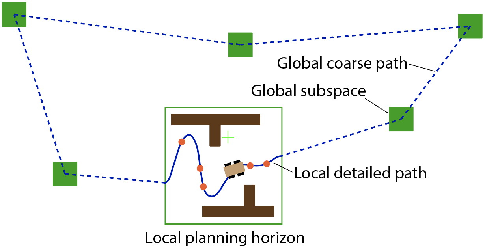
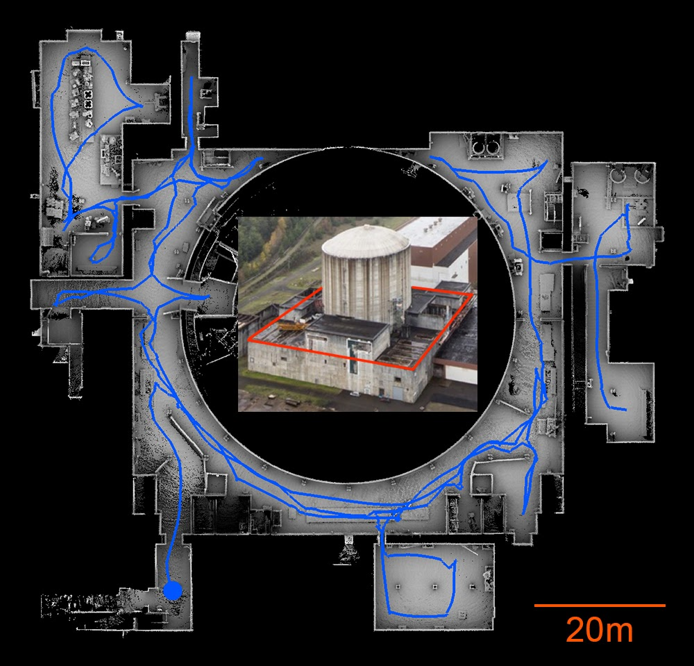

# 阶段41：原TARE决策与HT航点路由

阶段41保持原TARE覆盖/TSP/航点顺序，修正HT掩码与BFS同步和近家HOME优先级。完整车库600秒181.31m/8660.125m³，较39+33.6%、较40+2.3%。搜索时间上限34次、展开上限57次，最长完全停车0.25s，末60秒新增671.645m³/移动16.56m；末尾EXPLORING。 [报告](docs/results/ht_tare_boundaries_10min_2026-10-20/REPORT.md) · [视频](docs/results/ht_tare_boundaries_10min_2026-10-20/garage/camera_h264.mp4) · [历次图册](docs/results/ht_tare_boundaries_10min_2026-10-20/history/index.html)。完整数据待本轮Release远端核验；不宣称追平原版。

---

# 阶段40：原TARE顺序与HT路由

阶段40已按先行计划恢复原TARE多视点覆盖/TSP，HT只路由当前航点。完整车库600秒192.93m/8467.000m³，较39体积+30.6%。XYθ搜索超时42次；最长完全停车0.75s，末60秒新增731.724m³/移动20.80m；末尾EXPLORING。 [报告](docs/results/ht_tare_waypoint_10min_2026-10-20/REPORT.md)，[视频](docs/results/ht_tare_waypoint_10min_2026-10-20/garage/camera_h264.mp4)，[历次图册](docs/results/ht_tare_waypoint_10min_2026-10-20/history/index.html)。全原始数据待Release远端校验；不宣称追平原版。

构造回归另有失败：HT删点后原BFS仍标记另一侧连通/候选，但实际最短路为空。近家rush-home也存在前视无输出时被包装层错误拦住的源条件反例；本轮没有触发返航。

---

# HT_Explo：HT方向可通过性与XYθ探索规划

**[每轮实验：改动、提升、缺陷与原始数据](docs/experiments/ITERATIONS.md)** · **[版本总览：每版改动、功能、验证和问题](VERSIONS.md)** · [阶段标签](https://github.com/CQULzz/HT_Explo/tags) · [发布说明](https://github.com/CQULzz/HT_Explo/releases)

**阶段39：搜索支配边提前剪枝；仍未补全TARE覆盖路线能力。** 同车库600秒199.69m/6483m³，较38体积+11.6%、搜索超时81→65；但末分钟新增553.75→274.515m³、完全停车3.73%→4.84%，单次结果不证明整体普遍提升。[为什么仍落后TARE](docs/analysis/2026-10-20_tare_gap.md) · [实验、图和视频](docs/results/ht_successor_pruning_10min_2026-10-20/REPORT.md) · [25页历次图册](docs/results/ht_successor_pruning_10min_2026-10-20/history/all_comparisons.pdf)。HT分支当前是单目标XYθ路线，原版局部多视点TSP及拓扑绕行接力没有完整保留；尚无运动约束完全对齐的新原版配对。

当前是实验原型，已实现HT硬约束XYθ规划、历史高程融合与独立跟踪。**阶段35完整室内600秒：169.10m、近似观测自由体积2674.75m³，末分钟仍走17.36m、最长全零4.2s；诊断退出修复后13项采集检查和全部快照完整性通过。** [室内报告、历史对比与视频](docs/results/ht_atomic_context_10min_2026-10-19/REPORT.md)。仍有搜索超时、地图时效及整体探索收益波动，未完成全场景真值/当前版本多环境验收，不能称稳定或无缺陷。

**阶段36车库补测：同一导航/建图版本完整600秒，187.25m、7900.375m³，末分钟20.805m；13项采集检查通过。** 历史车库统一源秒重算4028.250m³，单次轨迹向更远区域推进，仍有71次搜索超时、地图/路径过期、最长全零4.95s。[车库报告、历史对比与视频](docs/results/ht_frozen_garage_10min_2026-10-19/REPORT.md)。这是调度修复前版本的记录；当前阶段39仅车库已测。

阶段34录满600秒但退出时一份诊断NPZ损坏；[原始异常和坏文件](docs/results/ht_checked_connections_10min_2026-10-19/REPORT.md)保留，没有改称全部通过。用户确认GitHub保存全部完整数据、本机只留最近两轮；[保存政策与校验回执](docs/experiments/LOCAL_DATA.md)。

历史执行修正包括“HT拦截后仍发送非零候选速度”，以及真实冻结地图中32航向找出16航向漏路。[早期原因与证据](docs/results/ht_completion_cause_audit_2026-10-18/REPORT.md)。阶段21室内/隧道各600秒的历史结果为6.64m/432.875m³与79.00m/621.375m³，不能代表当前版本。[历史视频](docs/results/ht_zero_twist_fine_heading_10min_2026-10-18/REPORT.md)。

历史五环境各10分钟记录中，车库/校园/森林持续推进，室内原参数及隧道返航受阻；它们不是当前代码重新通过五环境的证明。[历史六段15fps视频、曲线和问题报告](docs/results/ht_multiscene_10min_2026-10-17/REPORT.md)。

室内视点细化为0.3m、100×100，保持30×30m范围与HT硬门槛。另测10分钟，里程3.11→145.28m、近似观测348→1900m³，但最长仍停约40秒，低收益回访和隧道返航问题未解决。[修改前后对比](docs/results/ht_indoor_sampling_comparison_2026-10-17/REPORT.md)。

跨目标、关停与线程修复见[改动说明](docs/fixes/2026-10-17_endurance_followup.md)；[历史60分钟报告](docs/results/ht_endurance_progress_2026-10-17/REPORT.md)与本轮独立10分钟测试分别保留。

下文保留原版TARE介绍及早期验证入口；当前HT功能和历史差异请先看版本总览。

---

TARE planner involves a hierarchical framework for highly efficient exploration - one level in the framework maintains data densely and computes a detailed path within a local planning horizon, another level maintains data sparsely and computes a coarse path at the global scale. The paths at both levels are joined together to form the exploration path. The framework draws the insight that detailed processing is most effective close to the vehicle, while coarse processing provides sufficient utility far away from the vehicle. The framework trades-off details at the global scale for computational speed. In practice, the framework prioritizes the exploration in the surroundings of the vehicle while keeping the global picture in mind.

本仓库的 HT 8dir 修复及 CMU Jazzy 车库实测说明见 [VALIDATION.md](VALIDATION.md)。其中包含 OR-Tools 依赖修复、运动停滞修复、复现命令及测试记录。HT 的模型接口和限制见 [HT_README.md](HT_README.md)。

后续探索效率实验、重复运行中发现的拐角停滞及修复复测见 [EXPERIMENT_REPORT.md](EXPERIMENT_REPORT.md)；实验协议和运行工具见 [experiments/README.md](experiments/README.md)。

Campus 仿真中 HT 地图超时和小车停走问题的 15 分钟长测、修复前后对照、曲线、原始数据及视频见 [通俗测试报告](validation/results/HT_long_run_report_2026-10-11.md)。测试使用独立的 CuPy 建图工作空间；本仓库只保存 HT/TARE 修改和测试证据。

道路通过性筛选应使用误放行、误拒绝、危险暴露和绕行代价评价；[固定通过性评测脚本](experiments/traversability/README.md)支持一条命令出报告及真实标注 CSV 接入。平坦车库覆盖率不能证明这一能力。

Please use instructions on our [project page](https://www.cmu-exploration.com/tare-planner).

<p align="center">
  
</p>

## Usage

The repository has been tested in Ubuntu 22.04 with ROS2 Humble and Ubuntu 24.04 with ROS2 Jazzy. Previously, due to usage of [OR-Tools](https://developers.google.com/optimization) library, the code only supports AMD64 architecture. A recent upgrade to the library made it compatible with both AMD64 and ARM computers. On ARM computers, please download the corresponding [binary release](https://github.com/google/or-tools/releases) for the target platform, for example, [or-tools_arm64_debian-11_cpp_v9.8.3296.tar.gz
](https://github.com/google/or-tools/releases/download/v9.8/or-tools_arm64_debian-11_cpp_v9.8.3296.tar.gz), extract it, and replace the ```include``` and ```lib``` folders under ```tare_planner/src/tare_planner/or-tools```. 

Follow instructions in [Autonomous Exploration Development Environment](http://cmu-exploration.com) to setup the development environment. Make sure to checkout the branch that matches the computer setup, compile, and download the simulation environments.

To setup TARE Planner, clone the repository.
```
git clone https://github.com/caochao39/tare_planner.git
```
In a terminal, go to the folder, checkout the 'humble-jazzy' branch, and compile.

```
cd tare_planner
git checkout humble-jazzy
colcon build --symlink-install --cmake-args -DCMAKE_BUILD_TYPE=Release
```
To run the code, go to the development environment folder in a terminal, source the ROS workspace, and launch.
```
source install/setup.sh
ros2 launch vehicle_simulator system_garage.launch
```
In another terminal, go to the TARE Planner folder, source the ROS workspace, and launch.
```
source install/setup.sh
ros2 launch tare_planner explore_garage.launch
```
Now, users should see autonomous exploration in action. To launch with a different environment, use the command lines below instead and replace '\<environment\>' with one of the environment names in the development environment, i.e. 'campus', 'indoor', 'garage', 'tunnel', and 'forest'.
```
ros2 launch vehicle_simulator system_<environment>.launch
ros2 launch tare_planner explore_<environment>.launch
```
To run TARE Planner in a [Matterport3D](https://niessner.github.io/Matterport) environment, follow instructions on the development environment page to setup the Matterport3D environment. Then, use the command lines below to launch the system and TARE Planner.
```
ros2 launch vehicle_simulator system_matterport.launch
ros2 launch tare_planner explore_matterport.launch
```

## Publications

- C. Cao, H. Zhu, Z. Ren, H. Choset, and J. Zhang. Representation Granularity Enables Time-Efficient Autonomous Exploration in Large, Complex Worlds. Science Robotics. vol. 8, no. 80, 2023.

- C. Cao, H. Zhu, H. Choset, and J. Zhang. TARE: A Hierarchical Framework for Efficiently Exploring Complex 3D Environments. Robotics: Science and Systems Conference (RSS). Virtual, July 2021. **Best Paper Award and Best System Paper Award**.

- C. Cao, H. Zhu, H. Choset, and J. Zhang: Exploring Large and Complex Environments
Fast and Efficiently. International Conference on Robotics and Automation (ICRA), Xi'an, China, June 2021.


## Application

TARE Planner was used by the [CMU-OSU Team](https://www.subt-explorer.com) in attending [DARPA Subterranean Challenge](https://www.subtchallenge.com). In the final competition which took place in Louisville Mega Cavern, KY, the team's robots conducted the most complete exploration across the site (26 out of 28 sectors) among all teams, winning a "Most Sectors Explored Award". Below is the result from Urban Circuit which took place in Satsop Nuclear Plant, WA. Our vehicle traveled over 886m in 1458s to explore the site, fully autonomously.
<p align="center">
  
</p>

## Author

[Chao Cao](http://caochao.me) (ccao1@andrew.cmu.edu)

## Credit

[OR-Tools](https://developers.google.com/optimization) is from Google
