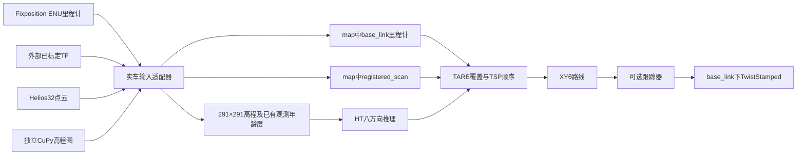

# HT_Explo · Scout Helios32 实车分支

**当前分支：`real/scout-helios32`。** 这里维护实车外参、输入转换和独立启动入口。`main`保留原仿真/实验归档基线，`develop`保留通用开发候选；本分支不会自动回写这两个分支。

实车外参来自用户指定的`CQULzz/eletranskit_scout`固定提交`cf0b73d`。用户于2026-10-22确认：FP_POI与fixposition_link同位、支架0.1162m高度均已实车核验。本次只做代码及离线验证，**没有启动仿真、传感器或车辆，没有实车通过结论**。

[实车接入说明](docs/real_vehicle/SCOUT.md) · [离线结果和剩余问题](validation/real_vehicle_scout_2026-10-22/REPORT.md) · [外参配置](src/ht_scout_bridge/config/scout_extrinsics.yaml)

## 最新实车版本与实验

实车代码使用 **`real/scout-helios32`** 分支；完整探索源码包含下方的TARE、HT和XYθ规划，并非只有视频工具。

| 固定版本 tag | 主要内容 | 对应资料 |
|---|---|---|
| `real-scout-system-foundation-20261030` | 候选：HT实际运行身份、有界在线诊断/全量实验归档、地形历史索引；351帧模型输入及输出一致，8组C++与50项Python检查通过；不约束调度HT回调P95未通过，按用户明确要求上传，未验收ARM/实车 | [复核与实验报告](docs/results/real_system_foundation_2026-10-30/REPORT.md)、[完整数据与失败记录](https://github.com/CQULzz/HT_Explo/releases/tag/real-scout-system-foundation-20261030)、[诊断使用说明](docs/real_vehicle/HT_RUNTIME_DIAGNOSTICS.md) |
| `real-scout-ht-performance-20261030` | 静止录包每有效扫描一张HT，新旧各3次：离线处理整链路中位76.72→63.10ms、P95 80.51→66.53ms；1923帧新版的地图、掩码及0.5判定一致，未验收ARM/车上频率 | [性能报告](docs/results/real_ht_performance_release_2026-10-30/REPORT.md)、[完整实验数据、代码与离线对照视频](https://github.com/CQULzz/HT_Explo/releases/tag/real-scout-ht-performance-20261030) |
| `real-scout-rear-red-audit-20261029` | 车后残余红区原因复核：捕获181帧输入，区分孤立高格、邻近高结构与缺测显示；仅诊断，运行代码不变 | [8页证据图、报告与完整诊断数据](https://github.com/CQULzz/HT_Explo/releases/tag/real-scout-rear-red-audit-20261029) |
| `real-scout-wide-replay-20261029` | 最新大视野离线复测：从两段原始录包重新计算，181帧与上一轮修后结果一致；增加环境显示和录像工具，未更改规划/建图算法 | [视频、完整数据与报告](https://github.com/CQULzz/HT_Explo/releases/tag/real-scout-wide-replay-20261029) |
| `real-scout-wheel-shadow-20261029` | 默认启用有界轮胎阴影过滤，并保护近地面与可见上部结构；46项检查通过 | [修复代码、对照实验与视频](https://github.com/CQULzz/HT_Explo/releases/tag/real-scout-wheel-shadow-20261029) |

[版本、提交与资料对应表](docs/real_vehicle/VERSIONS.md)。上述为实车录包离线验证，尚未完成实车闭环验收；静止盲区和移动末段低分仍有遗留问题。

## 实车数据链



外部工作区继续提供定位、雷达、TF和CuPy。本分支提供`ht_scout_bridge`输入适配器、已有HT推理及TARE/XYθ规划；不会重复启动定位驱动、雷达、TF广播器或原仓库的HT显示节点。

## 实际用到的外参

`T_parent_child`把child中的坐标变换到parent。以下平移单位为米，旋转均为零：

| 变换 | xyz |
|---|---|
| FP_POI → base_footprint | (-0.2005158179045505, 0, -0.65899) |
| base_footprint → base_link | (0, 0, 0.23479) |
| **FP_POI → base_link：规划参考点** | **(-0.2005158179045505, 0, -0.4242)** |
| **FP_POI → rslidar** | **(-0.0280158179045505, 0, 0.126)** |
| base_link → rslidar | (0.1725, 0, 0.5502) |

定位通过矩阵组合变为车辆参考点，速度加入角速度与杆臂的叉乘项，协方差按参考点变化传播。点云按原扫描时间查询TF并应用LiDAR外参，保留强度等字段；采用源配置的车体点过滤。不是单纯改`frame_id`。

## 独立构建和入口

```bash
bash scripts/build_real_scout.sh
source /opt/ros/jazzy/setup.bash
source install_real/setup.bash
ros2 run ht_scout_bridge check_scout_calibration \
  "$PWD/install_real/ht_scout_bridge/share/ht_scout_bridge/config/scout_extrinsics.yaml"
```

实车消费者入口为`ros2 launch ht_scout_bridge scout_real.launch.py`。默认跟踪器不启动，命令出口为`/ht_real/cmd_vel_stamped`；需要核对底盘实际消费接口后配置。HT八方向校准仍独立保留，传感器外参确认不等于方向/概率阈值已经标定。

外部建图使用本分支的[mapper_for_ht.yaml](src/ht_scout_bridge/config/mapper_for_ht.yaml)作为独立参数文件：原生0.04m/格，291×291，发布`elevation/variance/observation_age`。观测年龄须来自实际接受点云的源时间，旧`time`定时累加层不能冒充；不合约输入会被拒绝。模型中心裁剪输出241×241，即9.64m见方；不缩放250×250图，不伪造年龄。当前两终端集成方式、独立CuPy发布补丁及性能限制见[JETSON_STARTUP.md](docs/real_vehicle/JETSON_STARTUP.md)。

构建使用本工作区的`build_real/install_real`，HT终端只source ROS和本工作区install。两个独立工作区通过ROS话题通信，不互相source构建产物。

完整探索源码仍在[src/tare_planner](src/tare_planner)，HT模型和历史融合在[tools/ht_cupy_bridge](tools/ht_cupy_bridge)，新增实车专用代码在[src/ht_scout_bridge](src/ht_scout_bridge)。原实验资料和标签保留于Git历史及[归档索引](https://github.com/CQULzz/HT_Explo/blob/main/docs/experiments/catalog/INDEX.md)。
