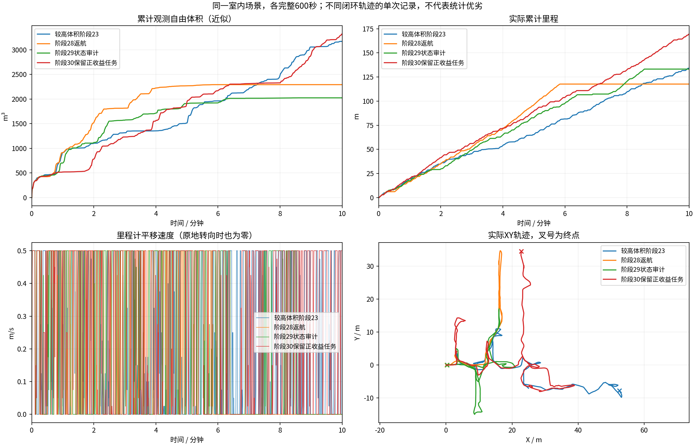

# 阶段41：原TARE决策与HT航点路由

阶段41保持原TARE覆盖/TSP/航点顺序，修正HT掩码与BFS同步和近家HOME优先级。完整车库600秒181.31m/8660.125m³，较39+33.6%、较40+2.3%。搜索时间上限34次、展开上限57次，最长完全停车0.25s，末60秒新增671.645m³/移动16.56m；末尾EXPLORING。 [报告](../results/ht_tare_boundaries_10min_2026-10-20/REPORT.md) · [视频](../results/ht_tare_boundaries_10min_2026-10-20/garage/camera_h264.mp4) · [历次图册](../results/ht_tare_boundaries_10min_2026-10-20/history/index.html)。完整数据待本轮Release远端核验；不宣称追平原版。

---

# 阶段40：原TARE顺序与HT路由

阶段40已按先行计划恢复原TARE多视点覆盖/TSP，HT只路由当前航点。完整车库600秒192.93m/8467.000m³，较39体积+30.6%。XYθ搜索超时42次；最长完全停车0.75s，末60秒新增731.724m³/移动20.80m；末尾EXPLORING。 [报告](../results/ht_tare_waypoint_10min_2026-10-20/REPORT.md)，[视频](../results/ht_tare_waypoint_10min_2026-10-20/garage/camera_h264.mp4)，[历次图册](../results/ht_tare_waypoint_10min_2026-10-20/history/index.html)。全原始数据待Release远端校验；不宣称追平原版。

构造回归另有失败：HT删点后原BFS仍标记另一侧连通/候选，但实际最短路为空。近家rush-home也存在前视无输出时被包装层错误拦住的源条件反例；本轮没有触发返航。

---

# 每轮修改、实验与问题

维护分支：[codex/ht8dir-v1](https://github.com/CQULzz/HT_Explo/tree/codex/ht8dir-v1)。每轮导航行为候选至少记录600秒，失败轮也保留。下面各轮同为室内原生起点、0.5m/s上限、源秒采样与0.5m自由体素并集近似；体积不是全场景真值覆盖率，单次闭环比较不等于单项因果收益。

| 轮次/实测代码 | 修改 | 里程(m)/自由体积(m³) | 实际结论 | 数据、视频、证据 |
|---|---|---|---|---|
| 阶段21 `67ade71` | 32航向、晚HT拒绝发零 | 6.64 / 432.875 | 约30s后长期BLOCKED；细角度不是全部根因 | [报告](../results/ht_zero_twist_fine_heading_10min_2026-10-18/REPORT.md) |
| 阶段22 `12d85d8` | 11.25°/22.5°混合动作、旋转终点锁定 | 17.82 / 778.000 | 约74s后长期BLOCKED；同图54次查询均失败、未耗尽搜索预算 | [报告](../results/ht_mixed_turns_10min_2026-10-18/REPORT.md) · [原始记录与MP4](https://github.com/CQULzz/HT_Explo/releases/tag/ht-stage-20261018-mixed-turns) |
| 阶段23 `149566d` | HT车辆配置得分与物理障碍分层、启动先验支持修正 | 134.00 / 3170.500 | 最后60s仍走10.93m；BLOCKED抽样88.0%→7.8%；最终约2s BLOCKED、最长全零6.20s，未完成探索 | [报告](../results/ht_configuration_gate_10min_2026-10-18/REPORT.md) · [原始记录与MP4](https://github.com/CQULzz/HT_Explo/releases/tag/ht-stage-20261018-configuration-gate) |
| 阶段24 `bada7ba` | 同规则复跑，补CuPy锁/回调与规划分项记录 | 23.86 / 993.125 | 最后明显平移79.503s；几何层拒绝根状态，搜索展开0状态；再次长期BLOCKED | [报告](../results/ht_latency_diagnosis_10min_2026-10-18/REPORT.md) · [数据和视频](https://github.com/CQULzz/HT_Explo/releases/tag/ht-stage-20261018-latency-diagnosis) |
| 阶段25 `43069a7` | 连续车位几何检查、保留安全距离并加余量；补耗时与显示 | 65.80 / 1959.875 | 264s后HT未知长期停滞，旧几何反例通过但未稳定 | [报告](../results/ht_continuous_geometry_10min_2026-10-18/REPORT.md) · [完整数据/视频](https://github.com/CQULzz/HT_Explo/releases/tag/ht-stage-20261018-continuous-geometry) |
| 阶段26 `22c2749` | 有限融合后拒绝高度保留为硬障碍，完整网络输入记录 | 116.15 / 1258.000 | 最后约95s仍BLOCKED；里程增加但较上轮体积下降35.8%，整体未通过 | [报告](../results/ht_postfilter_obstacles_10min_2026-10-18/REPORT.md) · [完整数据/视频](https://github.com/CQULzz/HT_Explo/releases/tag/ht-stage-20261018-postfilter-obstacles) |

| 阶段27 `4721764` | 等价几何查询提速、搜索退出原因、可靠几何记录 | 41.90 / 815.625 | 136.5s后长期几何INVALID_START；里程/体积均退步 | [报告](../results/ht_geometry_index_10min_2026-10-18/REPORT.md) · [完整数据/视频](https://github.com/CQULzz/HT_Explo/releases/tag/ht-stage-20261018-geometry-index) |

| 阶段28 `65efef7` | 执行端几何硬检查、名义平移跟踪余量 | 117.66 / 2292.750 | 352.425s内部完成返航；覆盖判据未独立验真，体积仍低于阶段23 | [报告](../results/ht_execution_geometry_10min_2026-10-18/REPORT.md) · [完整数据/视频](https://github.com/CQULzz/HT_Explo/releases/tag/ht-stage-20261018-execution-geometry) |

| 阶段29 `b601015` | 逐单元判定日志、安全遍历almost列表 | 133.17 / 2025.125 | 内部返航完成；正收益未登记/移出邻域核销已复现，尚待修正规则 | [报告](../results/ht_cell_audit_10min_2026-10-18/REPORT.md) · [完整数据/视频](https://github.com/CQULzz/HT_Explo/releases/tag/ht-stage-20261018-cell-audit) |

| 阶段30 `ce7202b` | 正收益登记并跨局部窗口保留全局待办 | 169.57 / 3321.250 | 600秒仍EXPLORING，末分钟17.829m；尚有无候选核销/搜索超时 | [报告](../results/ht_pending_gain_tasks_10min_2026-10-18/REPORT.md) · [完整数据/视频](https://github.com/CQULzz/HT_Explo/releases/tag/ht-stage-20261018-pending-gain) |

| 阶段31 `b05ed9e` | 有效收益记忆、候选缺失延期与完成守卫 | 162.71 / 2703.875 | 19单元延期/4次解除登记，无候选误核销0；体积退步18.6%，末刻EMPTY_PATH | [报告](../results/ht_deferred_gain_tasks_10min_2026-10-19/REPORT.md) · [完整数据/视频](https://github.com/CQULzz/HT_Explo/releases/tag/ht-stage-20261019-deferred-gain) |

| 阶段32 `867ba1f`（导航仍b05ed9e） | 相同程序/参数复测，恢复调度审计 | 5.66 / 419.750 | 14秒后长期停滞；482轮恢复目标未获搜索机会，稳定性未通过 | [报告](../results/ht_deferred_gain_repeat_10min_2026-10-19/REPORT.md) · [原始数据/视频](https://github.com/CQULzz/HT_Explo/releases/tag/ht-stage-20261019-deferred-repeat) |

| 阶段33 `ba7942c` | 普通恢复目标提前搜索，预算不增 | 151.57 / 2480.000 | EXPLORING；末分钟15.525m，仍有停顿 | [报告](../results/ht_recovery_search_slot_10min_2026-10-19/REPORT.md) · [数据/视频](https://github.com/CQULzz/HT_Explo/releases/tag/ht-stage-20261019-recovery-slot) |

| 阶段34 `391fa0f` | 先验算简单SE2连接，受阻继续图搜索 | 168.77 / 2169.875 | EXPLORING；末分钟14.826m，最长全零3.600s | [报告](../results/ht_checked_connections_10min_2026-10-19/REPORT.md) · [数据/视频](https://github.com/CQULzz/HT_Explo/releases/tag/ht-stage-20261019-checked-connections) |

| 阶段35 `445b5c1`（导航391fa0f） | 诊断原子写入、SIGINT完成回调后退出 | 169.10 / 2674.750 | EXPLORING；最长全零4.200s，13项采集通过 | [报告](../results/ht_atomic_context_10min_2026-10-19/REPORT.md) · [完整数据/视频](https://github.com/CQULzz/HT_Explo/releases/tag/ht-stage-20261019-atomic-context) |

## 同一冻结版本的多环境验证

| 轮次 | 环境/实际代码 | 里程m/近似自由体积m³ | 结论与问题 | 证据 |
|---|---|---:|---|---|
| 阶段36 | 车库 `7b4c358`，导航391fa0f/桥接445b5c1 | 187.25/7900.375 | 末尾EXPLORING；13项采集通过，最长全零4.95s，仍有地图/路径过期及71次搜索超时 | [报告](../results/ht_frozen_garage_10min_2026-10-19/REPORT.md) · [全部数据/视频](https://github.com/CQULzz/HT_Explo/releases/tag/ht-stage-20261019-frozen-garage) |

阶段36是车库环境，不属于上表的同室内对照。历史车库统一源秒重算4028.250m³（原4027.375/569帧，原报告不改），本轮7900.375m³；里程接近，轨迹向更远区域推进。不能把多个组件和闭环变化当作单项因果提升。

阶段37 `d6d8787`：CuPy地图回调串行、TF独立接收，完整车库600秒179.78m/4522.625m³；13项采集通过。地图年龄最大4.117→1.840s、最长停车4.95→1.15s，过期控制状态为0；**体积下降42.8%、转向与回访增加，不是探索整体改善**。[报告](../results/ht_serial_mapper_10min_2026-10-19/REPORT.md) · [完整数据/视频](https://github.com/CQULzz/HT_Explo/releases/tag/ht-stage-20261019-serial-mapper) · [全部版本24页图册](../results/ht_serial_mapper_10min_2026-10-19/history/all_comparisons.pdf)。按用户本次要求，完成图表与上传后停止自动迭代。

阶段38 `16bdbe4`：以全局任务ID/EXPLORING状态保持引导，修复巡游列表与局部委派语义错位。车库600秒202.58m/5807.000m³；相比37体积+28.4%、末分钟新增8.375→553.750m³、回访29.2%→14.7%，引导切换34→6。仍低于36、超时47→81、最长停车1.15→1.40s。[报告](../results/ht_guide_handoff_10min_2026-10-19/REPORT.md) · [25页图册](../results/ht_guide_handoff_10min_2026-10-19/history/all_comparisons.pdf) · [完整数据/视频](https://github.com/CQULzz/HT_Explo/releases/tag/ht-stage-20261019-guide-handoff)。

阶段39 `6fc7549`：终点键/成本支配检查前移，所有可接受边仍逐段硬验证。车库600秒199.69m/6483m³，体积较38+11.6%、超时81→65；但末分钟新增553.750→274.515m³、完全停车3.73%→4.84%。13项采集/4项CTest通过。[报告](../results/ht_successor_pruning_10min_2026-10-20/REPORT.md) · [完整数据/视频](https://github.com/CQULzz/HT_Explo/releases/tag/ht-stage-20261020-successor-pruning) · [为何落后TARE](../analysis/2026-10-20_tare_gap.md)。单目标与欧氏引导结构未改，没有同控制约束新原版配对，不宣称追平。

## 当前问题与证据状态（阶段39车库已完整实测）

| 问题 | 证据与当前状态 | 后续核查 |
|---|---|---|
| HT配置得分重复按点障碍膨胀 | 阶段23分离配置与物理层；同场景冻结图54查询0→36，物理足迹/未知/0.5阈值保留 | 单次路线可达不代表覆盖真值或统计优越 |
| 视点量化碰撞误判实际根位置 | 阶段25实际C++复现后改连续坐标检查，原0.5m边界加半格对角余量；回归保留 | 不放行真实重叠；新增场景继续验证 |
| 有限质量拒绝高度制造大块UNKNOWN | 阶段26保留有限拒绝高度为硬障碍上下文，八方向强制0，真正未知仍拒绝；58/59份上下文及冻结模型一致性通过 | 记录一致不等于物理模型真值 |
| 规划查几何但执行只查HT | 阶段28补实际圆弧/路径几何与跟踪余量；阶段30实际1次几何晚拒绝配对全零，471份采样无边界重叠 | 0.12m预留不是误差上界证明，窄通道/动态与实车未验收 |
| 正收益UNSEEN不登记、移出邻域就核销 | 阶段29逐单元及两项实际C++复现；阶段30有收益UNSEEN33→0、almost移出核销5→0；600秒末仍探索 | 继续检查其他核销分支，不能把局部目标选择当作全部任务清单 |
| 候选消失被误报覆盖 | 阶段30有5次该分支，3次前1～3秒仍有收益；两项实际C++复现失败 | 阶段31完整600秒，19单元延期/4次重新评估解除登记，无候选误核销0；18项回归通过。完成守卫动态组合未触发；仍须分析不可达与回访 |
| 搜索短暂停车 | 阶段32反复主要超时挤掉恢复；阶段33该现象482→0，12次主失败后选择恢复路线；仍有232次TIME_LIMIT和最长全零35.8s | 阶段33长停车约180～216s，恢复/回退也43次超时；冻结实际场景，核对目标与运动搜索耗时，不直接放宽预算或硬门槛 |
| 地图与路径时效 | 阶段30健康1Hz抽样最大2.848s，但20Hz控制有1次HT_MAP_STALE/4次PATH_STALE；此前最大4.096s | 继续分离CuPy锁/排队、推理、覆盖CPU开销；抽样最大值不能证明全时刻低于3s |
| 巡游列表移除误当任务失效 | 阶段38按全局任务状态交接；221个in_tour=0/pending=1周期保持引导，真实解除/到达/无进展仍可换目标 | 单轮仍有回访与搜索超时，跨场景/独立覆盖真值未验证 |
| 全局任务暂不可达、完成真值 | 当前任务登记/核销依赖观测收益和图连接；内部COMPLETED不代表全场景真值覆盖 | 区分暂时无观察、图未连接、物理不可达；收益证据不能自动授权行驶或支持无限重试 |
| 复测范围 | 阶段30为169.57m/3321.25m³；阶段31为162.71m/2703.875m³，末分钟12.462m，体积退步18.6% | 仍需同源码重复及garage/campus/forest/tunnel各600秒，独立真值和完整动力学未验收 |

每轮发布回执位于[publications](publications/)。回执给出完整记录包、逐文件清单、视频的远端大小和SHA256。原始目录包含全部已录制数据，录制本身仅含抽样激光和周期地图快照；不是所有传感器无损记录。各轮具体采集核验与缺陷见对应报告，版本功能总览见[VERSIONS.md](../../VERSIONS.md)。

阶段25下一步：核查融合后有限高度拒绝为何未按源输入拒绝规则保留硬障碍上下文；保留未知/障碍足迹和HT硬门槛，再做同场景600秒。见对应报告的42/41/1逐格核对。

阶段26：58份神经上下文与发布图一致、三份模型重放差0；末段仍停。冻结图HT-only查询16个目标可达10个，细化控制也未增加。下一轮必须核查实际几何与目标/失败记忆、搜索终止原因；不是直接放宽HT或删除障碍。

阶段27：末段几何拒绝起点，非预算耗尽。控制器只重新检查HT而规划器检查几何+HT；最近有效路线只留约8mm余量、实际横向偏差约12mm，首次重叠还在移动。需要对齐两层约束并留跟踪余量；不能放宽已有安全边界或据此宣称物理接触。

阶段28：完整600秒，352.425秒返航完成而不是故障卡住。相同实际几何边界下307份录制点云未见参考点重叠；新增几何拦截闭环0次，只以ROS回归验证分支。内部待探索计数归零不证明真实全覆盖；必须核查单元状态转移并做同版重复、多环境。较阶段23体积仍低27.7%，地图年龄仍有3.563s长尾。

阶段29：451.695s仍有19个覆盖/63个前沿收益视点的(24,0)单元，452.889s因移出邻域置COVERED、453.023s触发结束。两个实际C++最小复现失败，证实收益与局部选中/邻域状态混用；下一轮修正登记和保留待办，不改硬门槛。

阶段30：收益UNSEEN33→0、移出邻域核销5→0，600秒仍移动，体积3321.25m³。还有5次无候选旧分支，其中3次此前刚有收益；应保留最后有效收益并区分暂不可观察/不可达，而非再次核销。102次TIME_LIMIT与地图/路径时效仍需解决。

旧轮原始记录的本地无损压缩与恢复说明：[LOCAL_DATA.md](LOCAL_DATA.md)。报告/视频仍可直接浏览；完整数据同时保留于已校验Release附件。

阶段31：19个单元延期、4次有效评估解除登记，其中2个仍导航占位EXPLORING；不要误说全都完成覆盖。结束后清理约20.2GB pip可重下载HTTP缓存；下一轮源码/二进制不变复测，披露磁盘可用量增加，避免把环境差异当代码收益。

阶段32：同导航二进制/配置/权重复跑仍失败，约14秒后持续停车。482轮主要目标全超时且仍有排队替代目标却未尝试恢复；已有预留只照顾backtrack，普通恢复被排在主要目标后而耗尽预算。先修调度，不声称替代目标必然可达；保持硬约束/速度/总预算，再做600秒。

阶段33：恢复目标提前获得搜索机会，完整600秒151.57m/2480.000m³，末分钟15.525m；总预算/安全门槛未变，仍有232次TIME_LIMIT，最长全零35.800s。应继续同版复测及多环境，不能只选阶段32差轮作为普遍提升依据。

阶段34：固定HT/几何公开输入中，简单恢复路线原需6709/8633次查询；逐段相同检查的连接112/126次通过。完整600秒168.77m/2169.875m³、最后一分钟14.826m；仍有42次TIME_LIMIT、最长全零3.600s。需要同版重复、多环境与地图时效/全局待办核查，不宣称无限稳定。

阶段35：旧SIGINT压缩中断复现BadZipFile/seek of closed file；5项回归通过，完整600秒169.10m/2674.750m³，13项采集/全部诊断CRC通过、无坏文件/partial。导航二进制仍391fa0f；体积变化不能归因于诊断修复。GitHub完整保存、本机最近两轮按用户确认执行，先校验远端再清理。

阶段36：与阶段35共同62项冻结文件一致；完整车库600秒187.25m/7900.375m³。13项采集通过，无损坏上下文；仍有地图时效与搜索超时，当前版校园/森林/隧道继续待验。历史体积已统一源秒重算，来源和MCAP哈希随本轮保留。
