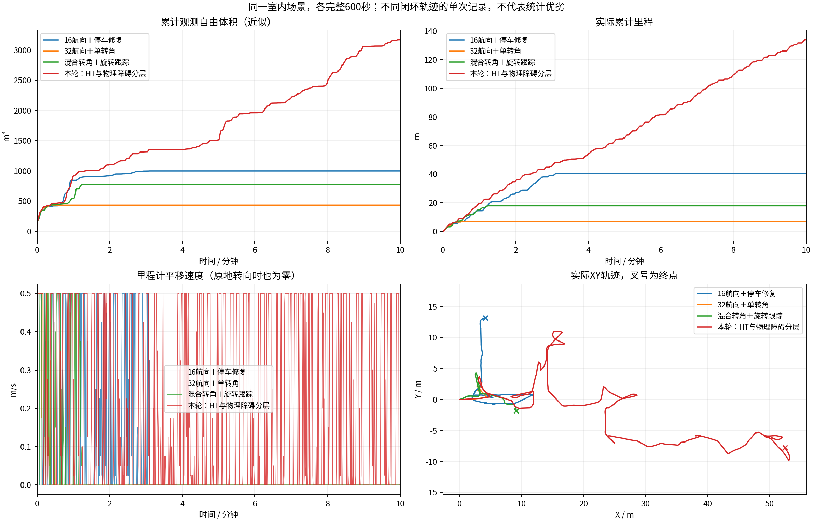

# 每轮修改、实验与问题

维护分支：[codex/ht8dir-v1](https://github.com/CQULzz/HT_Explo/tree/codex/ht8dir-v1)。每轮导航行为候选至少记录600秒，失败轮也保留。下面各轮同为室内原生起点、0.5m/s上限、源秒采样与0.5m自由体素并集近似；体积不是全场景真值覆盖率，单次闭环比较不等于单项因果收益。

| 轮次/实测代码 | 修改 | 里程(m)/自由体积(m³) | 实际结论 | 数据、视频、证据 |
|---|---|---|---|---|
| 阶段21 `67ade71` | 32航向、晚HT拒绝发零 | 6.64 / 432.875 | 约30s后长期BLOCKED；细角度不是全部根因 | [报告](../results/ht_zero_twist_fine_heading_10min_2026-10-18/REPORT.md) |
| 阶段22 `12d85d8` | 11.25°/22.5°混合动作、旋转终点锁定 | 17.82 / 778.000 | 约74s后长期BLOCKED；同图54次查询均失败、未耗尽搜索预算 | [报告](../results/ht_mixed_turns_10min_2026-10-18/REPORT.md) · [原始记录与MP4](https://github.com/CQULzz/HT_Explo/releases/tag/ht-stage-20261018-mixed-turns) |
| 阶段23 `149566d` | HT车辆配置得分与物理障碍分层、启动先验支持修正 | 134.00 / 3170.500 | 最后60s仍走10.93m；BLOCKED抽样88.0%→7.8%；最终约2s BLOCKED、最长全零6.20s，未完成探索 | [报告](../results/ht_configuration_gate_10min_2026-10-18/REPORT.md) · [原始记录与MP4](https://github.com/CQULzz/HT_Explo/releases/tag/ht-stage-20261018-configuration-gate) |

| 阶段24 `bada7ba` | 同规则复跑，补CuPy锁/回调与规划分项记录 | 23.86 / 993.125 | 最后明显平移79.503s；几何层拒绝根状态，搜索展开0状态；再次长期BLOCKED | [报告](../results/ht_latency_diagnosis_10min_2026-10-18/REPORT.md) · [数据和视频](https://github.com/CQULzz/HT_Explo/releases/tag/ht-stage-20261018-latency-diagnosis) |

| 阶段25 `43069a7` | 连续车位几何检查、保留安全距离并加余量；补耗时与显示 | 65.80 / 1959.875 | 264s后HT未知长期停滞，旧几何反例通过但未稳定 | [报告](../results/ht_continuous_geometry_10min_2026-10-18/REPORT.md) · [完整数据/视频](https://github.com/CQULzz/HT_Explo/releases/tag/ht-stage-20261018-continuous-geometry) |

## 当前问题与下一轮证据要求

| 问题 | 已有证据 | 当前状态/下一步 |
|---|---|---|
| 低HT配置得分作为点障碍整车膨胀，封死旧出口 | 同一停止地图54次查询0→36可达；物理障碍/未知足迹及0.5阈值保持 | 阶段23一轮恢复推进，但阶段24同规则复跑暴露另一类几何拒绝；不能称为稳定通过 |
| 地图超时 | 阶段23抽样7次>3s；最严重图进入HT回调前已旧5.79s，该帧回调处理0.20s | 已定位延迟并非单纯网络推理；继续分离CuPy融合、排队、地图锁和系统调度，保留3秒保护 |
| 另一类持续停滞 | 阶段24 HT允许，几何拒绝根状态；0.3m视点和0.2m碰撞量化的同点云反例 | 阶段25实际C++回归已修正；600秒继续暴露HT UNKNOWN，未将所有停车归为几何误判 |
| 规划慢与短暂停车 | 规划P95 1.616s；PATH_STALE 61条跟踪反馈；26段BLOCKED，前25段恢复 | 暂无单一已证实根因；核对运行耗时分项和控制/地图时间线，不能直接加大超时 |
| 最终无可执行目标 | 598.22～600s BLOCKED；最后HT位姿KNOWN | 缺未来观察，不能认定长期死锁或已经恢复；同版重复/延长观察并审计候选失败原因 |
| 参考点、方向与车辆动力学 | 当前为SE2运动学搜索与执行限速/限加速度；本轮未重新独立物理标定 | 未完成完整动力学或实车验证，不作为已解决项目 |

每轮发布回执位于[publications](publications/)。回执给出完整记录包、逐文件清单、视频的远端大小和SHA256。原始目录包含全部已录制数据，录制本身仅含抽样激光和周期地图快照；不是所有传感器无损记录。各轮具体采集核验与缺陷见对应报告，版本功能总览见[VERSIONS.md](../../VERSIONS.md)。

阶段25下一步：核查融合后有限高度拒绝为何未按源输入拒绝规则保留硬障碍上下文；保留未知/障碍足迹和HT硬门槛，再做同场景600秒。见对应报告的42/41/1逐格核对。
