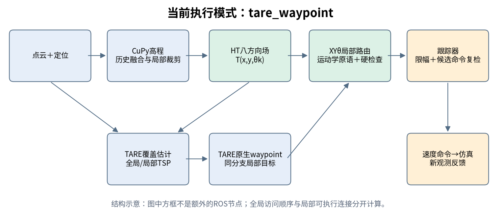
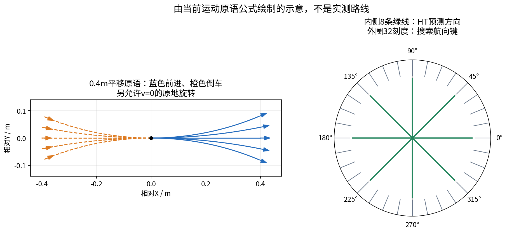
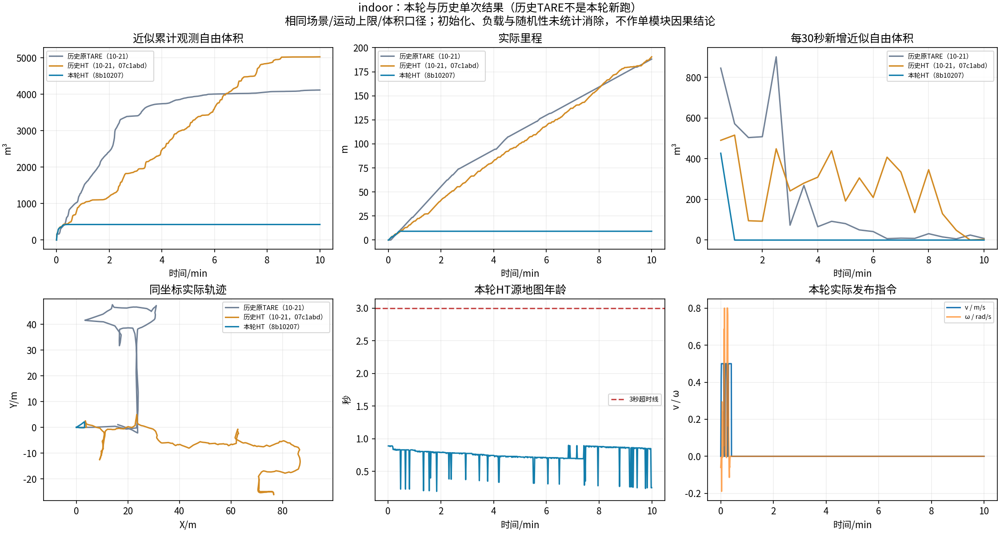
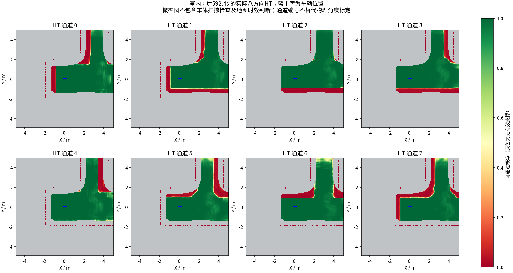
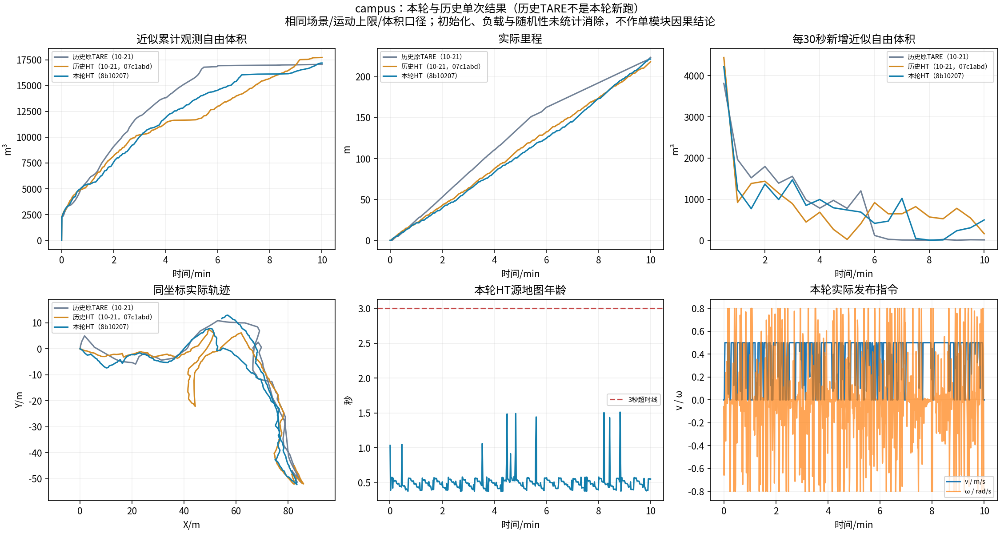
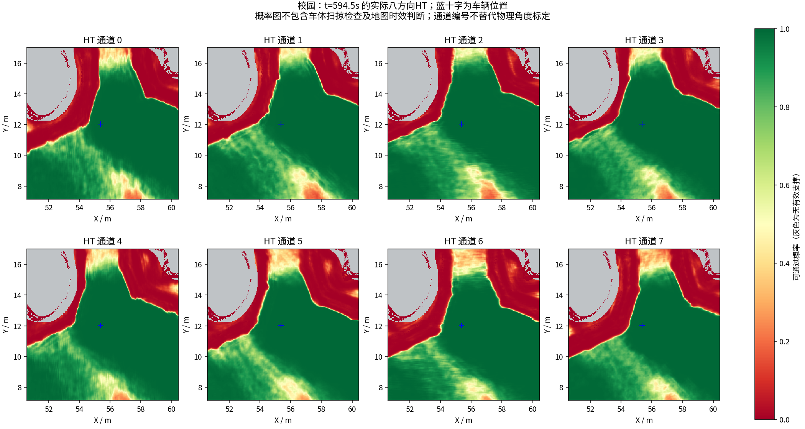

# HT + TARE 规划原理与仿真复测报告

**本轮结论：校园持续探索；室内存在很早触发完成/返航的明显问题，不能判为全部无问题。**

室内和校园各完整测量600秒。室内9.16m、427.25m³，约14秒触发返航；校园221.56m、17181.875m³，结束时仍探索。两场均未出现地图超过3秒，指令上限与常规变化率检查通过。体积是近似观测自由体积，不是真值覆盖率。

以下先解释实际规划机制，再附完整实验结果、历史对比图与待确认原因。

# HT + TARE 探索规划原理与实现边界

日期：2026-10-22。对象为本次仿真版本，算法基线 `develop@8b10207`，运行冻结提交 `e640c0c`；本次入口见 `validation/sim_check_2026-10-22/PLAN.md`。本文解释仓库实际执行的 `tare_waypoint` 模式，不把仍保留的旧 `legacy_xytheta_greedy` 分支当成当前架构。仿真检查结果见[本轮实验报告](../results/ht_sim_check_2026-10-22/REPORT.md)。

**核心流程：TARE 决定去哪、按什么顺序访问；HT 判断不同车头方向能否通行；XYθ 路由连接当前位姿与 TARE 同一访问分支上的局部目标；跟踪器把路线变为速度命令并再次检查。**



## 1. 全局探索和局部行驶是两件事

TARE 维护已观察/未覆盖信息、候选视点与全局探索子空间。全局 TSP 安排待探索子空间的访问顺序，局部覆盖问题选择能够观察未覆盖点和前沿的视点，再由局部 TSP 排序。拼接全局/局部路线后，沿用原前瞻点逻辑生成原生 waypoint。

本项目保留六个原关键函数的函数体：`SolveTSP`、`SolveLocalCoverageProblem`、`UpdateCellStatus`、`SolveGlobalTSP`、`ConcatenateGlobalLocalPath`、`GetLookAheadPoint`。原函数对应的 ROS2 适配参考是 `b6760adb`，不是整个官方 ROS1 仓库字节相同。检查脚本为 `scripts/check_tare_waypoint_contract.py`。

改变地形输入会改变候选视点、连通图和路径长度，因此即使 TSP 求解方法未改，其输入和最终访问顺序仍可能与原版不同。不能把“保留 TSP 算法”理解成“两套系统必然选出同一条巡回路线”。

| 层级 | 原TARE配套系统 | 当前HT系统 |
|---|---|---|
| 探索决策 | 未覆盖/前沿、分层覆盖、TSP和前瞻点 | 保留关键函数，地形输入会改变可选集合 |
| 地形判断 | CMU地形分析的高度/障碍规则 | 历史高程＋八方向HT硬门槛 |
| 到航点的局部运动 | CMU localPlanner及pathFollower | XYθ路由＋独立跟踪与复检 |

因此“保留原TARE决策”是准确的，“整个系统只换了地形分析，其余完全不变”不准确。

依据：`src/tare_planner/src/{local_coverage_planner,grid_world,sensor_coverage_planner}/tare_original.cpp`，以及 `local_coverage_planner.cpp`、`sensor_coverage_planner_ground.cpp` 中的 `tareCoverage()` 分支。

## 2. 高程数据如何变成 HT 的局部输入

仿真中的 CuPy 节点将地图坐标点云融合为滚动高程图，发布 `elevation / variance / observation_age`。HT 桥接检查坐标系、精确尺寸、数据布局、循环缓存索引和图层长度；不合格输入不会进入历史融合。

地图坐标点云和里程计由仿真系统提供；HT/TARE消费这些输入，本次不负责定位或SLAM。仿真可运行不能替代实车定位、外参和时间同步验证。

CMU的原地形分析仍为模拟车体的高度/姿态计算运行，但在HT模式下被重映射到 `/simulation/terrain_map*`；导航的地形提示由HT数据提供。不能仅因进程仍在就认定导航还在同时使用两套地形判别。几何障碍检查另行保留。

桥接端另外维护固定 map 坐标网格上的稀疏历史：按 64×64 格瓦片分配，每格最多保留4种高度模式，区分地面、障碍物上表面等不同观测。局部规划每帧提取291×291窗口；不同高度模式不会直接平均成“可走的中间高度”。历史默认有效期600秒、上限1024瓦片，达到上限会报错；它不是无限容量、永不过期的全球地图，也不是完整三维占据体素图。

观测时间由 `图消息时间戳 - 每格 observation_age` 恢复。同一旧观测在滚动窗口反复出现时，不重复计为新观测、不刷新年龄。关联到同一高度模式的新观测使用受限增益更新均值和方差：

```text
K = clip(P / (P + R + 1e-5), 0.05, 0.5)
z_new = z_old + K × (z_observed - z_old)
P_new = max(0.0001, (1-K) × P + K × R)
```

这是代码采用的相关观测融合规则，不能等同于已证明独立噪声条件下最优的标准卡尔曼滤波。局部地面参考、方差/稀疏噪声检查和近期障碍边缘保护之后，才构造模型输入。数值填充仅供网络计算；物理观测支持和未知掩码独立保留，填充值不等于已经观测到地面。

依据：`tools/ht_cupy_bridge/historical_elevation.py`、`elevation_quality.py`、`local_surface.py`、`ht_support.py`、`cupy_to_ht.py`。

## 3. XYθ 地形场到底是什么

HT 输入是一张高程窗口；学生网络输出8个方向的分数，每个方向又有可行/不可行两类 logits。softmax 后形成：

```text
T(x, y, θk), θk = 0°, 45°, …, 315°
```

这里 θ 是车头方向，不是物理高度。八张 XY 图按方向堆叠，构成离散的 XYθ 地形场。同一地形在不同方向下可能有不同分数；平整或近似各向同性的区域，各层接近也可能正常。分数并非已完成实车统计校准的成功概率。

本次仿真分辨率为 **0.0409356725m/格**：原生291×291约 **11.912m见方**。模型感受野51×51，不补外边界；中心输出241×241约 **9.865m见方**。这是裁剪，未放大或缩小栅格。八方向共464648个分数；另有 `ht_valid / ht_observation_valid / ht_obstacle / ht_elevation` 四层。实车分支的0.04m配置与本次仿真不同，不能混用尺寸说明。

**32个搜索航向桶不等于网络提供32方向预测。** 搜索以11.25°划分航向键；HT 查询仍选最近的45°通道，并考虑地图姿态/方向偏置与通道顺序。转动跨越通道边界时会拆分检查经过的方向区间，没有凭空生成新的方向信息。

依据：`tools/ht_cupy_bridge/model.py`、`cupy_to_ht.py`；`src/tare_planner/include/ht_cost/ht_cost_core.h` 中的 `cellAndChannel()` 和 `ht_cost_map.cpp` 中的 `motionSupport()`。

## 4. HT 是硬约束，几何检查也参与

实际位姿允许条件可以概括为以下条件的交集：HT/定位输入有效且足够新；位姿处在连续规划范围；对应方向分数至少0.5；车体不碰实测障碍、边界或禁行区；所需地面有物理观测支持；当前运动未被近期执行失败记忆拒绝。

低于门槛的边直接不进入可执行搜索图。通过后的搜索代价使用行驶时间，倒车时间乘1.15；**没有通过增加软代价让低分危险地形仍可被选中**。分数采用车辆参考点处的 configuration 语义；物理障碍和缺测按车体范围检查，不把邻近位姿的低分重复膨胀成障碍物。

HT 接收侧将物理障碍/未知区域预计算为足迹掩码，线段采用 supercover 网格遍历，包括擦过格点角落的相邻格。XYθ 的每段同时检查车头方向与平移方向。几何碰撞云仍用于挡住已测障碍，不能把“HT 分数高”当作全部安全条件已满足。

这也意味着倒车时，除车头对应通道外，当前实现还检查反向的平移通道；它可能比只查询车头配置更保守。本文记录这项实际规则，不据此断言它就是本轮停滞或低收益的根因。

用于 TARE 探索引导的二维地形提示会聚合可行方向，并对未知前沿保留探索乐观性；执行层对未知严格检查。否则将所有未观察区域都判为永不可达，会把探索前沿封死。两者角色不同，因此 TARE 可以提出一个当前仍无法执行的目标。

仿真另外保留初始位置固定1.2m、限30秒的启动先验；它不会跟着车不断重新画出自由圆，也不会越过已知障碍。这个假设不适用于未核验的实车地面。本次 `ht_require_reversible_motion=false`，因此没有“走过去一定能回来”的保证；系统具有返航逻辑也不等于已证明不会陷入方向性陷阱。

依据：`src/tare_planner/src/ht_cost/ht_cost_map.cpp`、`include/ht_cost/measured_collision_field.h`、`src/viewpoint_manager/viewpoint_manager.cpp`、`src/local_coverage_planner/ht_route.cpp`。

## 5. 如何从 odom 连接到 TARE waypoint

系统先保留 TARE 原路线、前瞻点及扩展 waypoint，在该路线中定位机器人到目标的连续分支。由于 HT 只有局部窗口，执行路由先尝试该分支沿程4/3/2/1m处的局部目标；失败后在同一分支自适应加密目标，不另选覆盖视点，也不改 TSP 顺序。过近目标或无 HT 支撑的目标会被过滤。

随后以真实连续 odom 的 `(x,y,yaw)` 为起点，对这个局部目标运行 XYθ 搜索。成功发布 `/ht_xytheta_path`；执行一段后随新观测重新规划。这是滚动局部连接，不是一次在全局 XYθ 图上求出整个巡回路线。目标接受条件主要为XY距离≤0.35m，没有强制指定最终车头角。

当前没有为所有视点对计算XYθ代价后再重新求TSP，因此TSP的巡回长度不是实际XYθ执行时间。如果所选分支的局部目标都不可执行，本轮路由会停车等待，而不是偷偷用另一种收益函数改写访问顺序；这也是可能限制探索效率的一处架构边界。

搜索先尝试经过同样硬检查的“原地转向＋直行/倒行”直接连接；不可行再展开 Hybrid A*。状态保存连续浮点位姿，去重键为0.3m的XY桶和32个航向桶；不是把车的真实位置强制吸附到粗格中心。有限控制集包含直行、倒行、左右圆弧、原地旋转；圆弧转角包括11.25°和22.5°，平移原语长度0.4m。保留小角度圆弧同时保留较紧圆弧，避免只剩一种转弯半径。

单目标搜索预算0.15秒、最多8000次展开；同一规划周期内各局部目标共享约0.35秒搜索预算。TARE 更新视点、覆盖和求 TSP 另外耗时，不能把0.15秒当作整套规划周期。预算检查是软件轮询，不是硬实时截止保证。更便宜的同离散键路径会剪去被支配候选，搜索不遍历全局所有体素。

```text
g = 各运动原语时间之和（倒车原语时间 × 1.15）
h = 到局部目标的平面距离 / 前进速度
搜索优先级 = g + h
```

直接连接采用先可行先返回，搜索也有时间/展开截断；连续状态按键合并会丢失细节。因此本实现不提供连续空间全局最优性或任意窄通道完备性保证。

依据：`src/sensor_coverage_planner/tare_waypoint_router.cpp`、`include/ht_cost/tare_waypoint_route.h`、`src/local_coverage_planner/ht_route.cpp::PlanHTReturn()`、`include/ht_cost/xytheta_planner.h`（以上路径相对 `src/tare_planner`）。



## 6. 路线怎样满足车辆运动约束

规划采用差速/滑移车辆的平面单车运动学近似：

```text
dx/dt = v cosθ，dy/dt = v sinθ，dθ/dt = ω
```

每个原语使用恒定 `(v,ω)` 积分，圆弧用解析形式；`v=0` 表示原地转动，`v<0` 表示倒车。当前上限前进0.5m/s、倒车0.25m/s、角速度0.8rad/s。曲线被分段，每段通过 HT 与几何检查，不只验证目标点。

其中HT检查覆盖采样段经过的格，几何检查针对采样位姿和保守余量；它仍是采样与栅格近似，没有连续碰撞无遗漏的形式化证明。

跟踪器约20Hz运行，先检查输入、许可、路径及其前方约1m，再根据方向/姿态误差生成 `v,ω`。常规指令线加速度限0.5m/s²、角加速度限1.2rad/s²；当前版本依据两次发布间的单调时钟间隔限幅，并把用于增量的dt上限截到50ms，避免积压后突然跳大指令。明确停止/输入故障可以直接置零，需与常规加速度审计分开解释。

最后对实际候选速度向前滚动一段反应与制动时间，检查预测运动弧；它可能偏离名义路径，因此需要再次验证。被拒绝的边反馈到路由，最多记忆32条、约6秒冷却，促使下次搜索避开同一失败运动；不把整块地形所有方向永久涂红。

**已实现的是运动学可行原语、速度上限、指令变化限幅和预测弧检查。** 搜索状态没有速度、轮胎力、摩擦/打滑、侧翻或电机扭矩，也没有把速度连续性并入整个搜索。因此不能宣称实现了完整动力学最优规划、实车轨迹必然可跟随或所有制动工况安全。

依据：`include/ht_cost/xytheta_planner.h`、`include/ht_cost/input_pose_buffer.h::CommandInterval`、`src/ht_cost/xytheta_follower.cpp`。

## 7. 为什么会停车、慢或探索量变平

| 现象 | 应查证据 | 不能直接得出的结论 |
|---|---|---|
| 车停住 | mission / execution / follower 状态，输入年龄，路径、几何与搜索终止原因 | 不一定崩溃，也不一定探索完成 |
| 图上地面很平但路线被拒 | 八方向分数、未知足迹、障碍云、噪声/层面选择、地图时间 | 平地外观不等于全部检查允许 |
| 出现 HT_MAP_STALE | 当前时钟减 HT 源时间戳；比较产生、到达、处理各环节 | 3秒不是“每3秒才规划一次”，也不必然是GPU推理太慢 |
| 累计近似观测自由体积平了 | 实际轨迹、返航/完成状态、最后60秒新体素与有效扫描数 | 不能仅凭曲线判断卡死或真值已全覆盖 |
| 频繁原地旋转 | TARE目标方向、HT可行方向、直接连接比例和跟踪状态 | 不代表运行了完整动力学优化 |

本轮仿真使用3秒 HT 地图超时配置，按图的源时间戳判断；通用 `ht.yaml` 默认1秒不能代替实际运行参数。HT 推理当前在 CPU，CuPy 建图使用 GPU，XYθ/TARE 在 CPU。是否卡顿必须用实际日志和时间分布解释。

## 8. 汇报时可以准确怎样说

“保留 TARE 的分层覆盖探索与 TSP 决策，引入历史高程融合和八方向 HT 硬约束；对 TARE 指定分支上的局部目标，在连续位姿、离散去重的 XYθ 空间中搜索满足差速运动学的路线，并由独立跟踪器限幅和复检。”

目前不宜声称：全局 TSP 已在完整 XYθ 图上求解、网络有32个独立方向、单次仿真证明全面优于TARE、完全动力学可行或已经完成实车验证。


---

# 仿真复测结果：室内与校园各600秒

**本轮测试结果须与下方异常一起阅读；完整录制通过不等于探索任务没有问题。**

冻结提交：`e640c0c1867fbe9408007c9f7b3e51bb9e66b801`；算法基线为`develop@8b10207`。实车分支和外参未参与本轮。
每场独立重启，同一版本、原生起点，前进0.5m/s、倒车0.25m/s、角速度0.8rad/s；测量期间未修改算法和参数。

| 场景 | 实际时长/s | 实际里程/m | 近似观测自由体积/m³ | 触发返航/s | 到家完成/s | 地图年龄P95/s |
|---|---:|---:|---:|---:|---:|---:|
| indoor | 600 | 9.16 | 427.250 | 14.00 | 27.60 | 0.886 |
| campus | 600 | 221.56 | 17181.875 | 未触发 | 未触发 | 0.573 |

## 同场景历史参照

- indoor：历史HT近似体积 5027.125m³、里程 190.53m；本轮体积相对变化 -91.50%。历史同运动上限原TARE为 4116.125m³。
- campus：历史HT近似体积 17722.250m³、里程 218.28m；本轮体积相对变化 -3.05%。历史同运动上限原TARE为 17048.250m³。

历史为单次参照，配置/代码变化和运行随机性同时存在，不能据此证明某个模块造成提升或退步。

## 已发现的现象与可确认原因

### indoor

内部任务末状态 `COMPLETED`。返航触发：约14.00秒；完成驻留：约27.60秒。
地图年龄超过3秒的采样 0 次；最长采样全零指令区间 576.0s。停车必须结合任务状态判断。
源时间戳指令审计：速度上限通过，常规加速度超限 0 次。显式全零停止按原口径单列。
XYθ搜索日志共 24 次：`{'REACHED': 22, 'EXHAUSTED': 2}`；成功直接连接 16 次。日志计数不等于TARE总规划周期。

返航判定的直接证据：t=13.817s 时 `global_return=1`、`local_complete=1`、全局顺序节点 0，仍统计到未覆盖点 96 / 前沿 139。
代码中的完成条件据此设置exploration_finished并转入返航。局部完成表示没有被选出的、满足条件的收益视点，不要求未覆盖点/前沿计数归零。为什么剩余区域没有进入可选择视点或全局探索子空间，仍需覆盖/候选图的更细证据；不能仅据本次日志认定为某一阈值或某次输入修正造成。

**本轮很早结束且里程明显偏短，持续探索能力需要复核；不能把后续长时间零指令当成“稳定探索了10分钟”，也不能把内部COMPLETED当成环境已全部探索的真值。**



[GitHub完整10分钟视频](https://github.com/CQULzz/HT_Explo/releases/download/ht-sim-20261022-input-contracts/ht-sim-20261022-input-contracts-indoor.mp4)；本机文件为`indoor/camera_h264.mp4`。

### campus

内部任务末状态 `EXPLORING`。返航触发：未触发；完成驻留：未触发。
地图年龄超过3秒的采样 0 次；最长采样全零指令区间 1.0s。停车必须结合任务状态判断。
源时间戳指令审计：速度上限通过，常规加速度超限 0 次。显式全零停止按原口径单列。
XYθ搜索日志共 597 次：`{'REACHED': 536, 'TIME_LIMIT': 53, 'EXPANSION_LIMIT': 8}`；成功直接连接 387 次。日志计数不等于TARE总规划周期。



[GitHub完整10分钟视频](https://github.com/CQULzz/HT_Explo/releases/download/ht-sim-20261022-input-contracts/ht-sim-20261022-input-contracts-campus.mp4)；本机文件为`campus/camera_h264.mp4`。

## 测试与数据说明

独立编译通过；99项Python桥接回归通过，6/6 CTest目标通过，其中GTest为79通过、4个缺历史录制样本的用例跳过；不把跳过算通过。
初次Python收集缺CuPy测试依赖，随后两项回归缺sparse checkout样本；补齐对应环境与Git样本后重跑通过，未改断言。裸终端CuPy预检未带NVRTC库路径失败；使用实际runner相同CUDA环境后通过。
保存原始MCAP、CSV、地图/模型输入、参数JSON、日志、源/二进制哈希和完整解码视频。录制范围为全部发布控制/HT/状态，激光按源秒采样和周期快照，不是全频原始传感器无损记录。
体积口径：0.5m自由体素并集、0.25m射线步长、15m截断、回波前0.25m排除；属于近似观测量，不是真值覆盖率。历史曲线为已存在的单次运行；没有在本轮重新运行原TARE。
任务/地图状态为1Hz采样，运动表为0.5秒采样；表中完成时间是首次采样时间，不能解释为毫秒级状态转换测量。
本轮不更改导航算法以追求好看的测试结果。源码相同不保证无限时间、任意场景或实车无问题。
[规划原理报告](2026-10-22_planning_principles.pdf) · [逐项审计](../results/ht_sim_check_2026-10-22/analysis.json) · [历史输入与SHA256](../results/ht_sim_check_2026-10-22/comparison_provenance.json)
