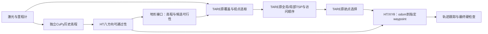

# 原版TARE探索决策 + HT局部路由：实施计划书

日期：2026-10-20。用户要求：先提交计划，再执行。此文写入与提交先于行为代码修改；不增加一轮批准流程。

## 目标与边界

恢复原版TARE的覆盖任务决策。TARE选择视点、做全局/局部TSP、决定访问顺序和当前waypoint；HT提供高程/方向可通过性，XYθ搜索只负责从当前odom到该waypoint的可执行局部轨迹。不能再由HT按单点gain/time、回访惩罚、全局欧氏距离自行换目标或重排访问顺序。

“原版不变”的验收对象是探索决策函数和规则：多视点选取、10轮采样、原距离矩阵/TSP求解、全局巡游、全局/局部拼接、航点方向与前视点选择、完成判断。输入地形变了，闭环选点/实际访问序列自然可能变化；不能要求不同地形输入下输出序列也完全相同。

必要接口差异明确保留：用户指定odom→waypoint路由由HT/XYθ替换，因此局部轨迹带朝向，沿用现有已验证的逐姿态跟踪和最终HT/几何拦截，不能由CMU另一个局部规划器改写。此执行链路不宣称与原CMU控制器逐行相同；本轮不提高速度/角速度/加速度，不把控制更快混作覆盖层修复。

## 数据流

## 1. 固定原版参照，恢复探索层

本机独立ROS2基线工作区的TARE提交b6760adb4280b379567c76f4e684ce628e28ef71作为原版函数参照，记录原始文件/函数哈希。该基线本身包含ROS2适配，不冒称官方ROS1源码逐字相同。

- 恢复原局部SolveTSP、SolveLocalCoverageProblem的采样次数、按路径长度比较、完整访问序列及selected标记。
- 恢复原全局任务更新、全局/局部拼接、GetLookAheadPoint等决策函数；不让旧HT任务记忆/单目标承诺/停滞换引导改变新模式的目标选择。
- 引入明确模式`ht_exploration_mode=tare_waypoint`为新默认；旧单目标分支仅以显式legacy模式保留复现实验，不能默认启用。历史回归说明所属模式。
- 固定输入下检验原版函数及新模式实现的归一化函数正文一致；新增TSP调用、采样次数、原始顺序、TARE目标与HT实际局部终点日志/话题，证明不是只有类名叫TSP。

## 2. 地形接口替换，保持信息语义

- 在HT输出中提供同源高程层；保留原八方向分数、观测有效性和物理障碍层。模型/高程融合公式不在本候选内更改。
- TARE候选点高度来自CuPy/HT同源高程历史。已知地形若所有朝向均不允许，可作为候选不可行信息；有方向可行的地形不能按最差方向一律删除。方向相关边最终在XYθ中严格验证。
- 地形接口的全局历史只用于覆盖层候选/导航引导，不把旧图当作当前执行许可；当前运动仍要求新鲜局部HT、足迹、几何及传感器健康检查。
- 新模式不消费CMU terrainAnalysis的地形判定；保留原激光碰撞几何、遮挡/覆盖建图、定位等独立用途。启动参数明确区分原版基线和HT地形模式，避免两个地形源混用。
- 不把学习到的车辆配置低分重复膨胀成“实测点障碍”，不为追求覆盖体积放行未知区。

## 3. 只为TARE指定航点找路

- 读取TARE原函数输出的waypoint及其对应路线分支，起点使用当前odom和yaw；不按收益在其他视点之间比较。
- 航点位于当前HT可规划范围时，直接做受硬约束的XYθ搜索；不要求终点固定某个yaw，除非TARE或任务明确给出终态朝向。
- 航点超出局部HT时，按TARE已选路线的顺序，截取当前地图内的前缀作为本次局部终点；分段终点不是新探索任务，最终目标仍是原waypoint。不用“朝远目标画直线”取代TARE绕行。
- 搜索失败：发零/保留任务，等待原TARE正常重规划及新地形；不擅自跳到后续视点，不标成已访问/已覆盖。允许在同一条选中路线前缀内缩短局部段，但不能挑另一个收益目标。
- 原语继续为差速/滑移底盘的前进、倒车、旋转与曲线，保持现有线/角速度、采样、未知支撑、物理余量和执行拦截。仍是有界SE2运动学，不能称完整轮胎动力学证明。

## 4. 验证与实验

编码前计划提交；编码完成后统一编译/回归，冻结一个候选，再进行完整600秒车库测试，期间不改行为源码、参数、模型或二进制。

回归包括：原TSP/10轮恢复与原版函数一致性；TSP完整输出多视点；HT路由没有收益重排；沿选中路线前缀分段（含折线、双向分支、起终点重合）；超范围/无路/未知不跳目标；同源高程和地图坐标；历史安全/几何/跟踪回归。基线模式与legacy模式明确标注，不能为了让旧测试通过修改新模式的原版决策。

实测记录：TSP输入/顺序、原waypoint、局部目标与轨迹、HT拒绝原因、里程/累计近似观测自由体积/每分钟新增、回访、转向/停车、搜索与地图时效、任务状态、资源、源文件/二进制哈希、MCAP、地图快照与600秒视频。至少与阶段39同场景同口径比较；原版历史不当作当前同控制约束新配对。若补新原版配对，单独记录全部运动与感知差异。

不能以“录满600秒”“持续在动”“TSP类被调用”代替功能验收；若出现停滞/完成/采集失败，完整保留并解释，不删坏轮，不宣称已追平原版。

## 5. 交付与保存

交付：计划书、基线函数/差异清单、实现、回归证据、实验报告、多角度对比图、视频、原始录包、GitHub Release与逐文件校验回执。先核对远端大小/SHA256，再按既定政策本机只保留最近两轮完整数据；旧报告、视频和必要回归样本继续保留。

本候选目标是落实“原TARE决定访问顺序，HT负责到达当前目标”，并验证指定环境下真实工作。不借机提高速度、更改模型、改全局收益规则或增加新的HT探索决策器。
