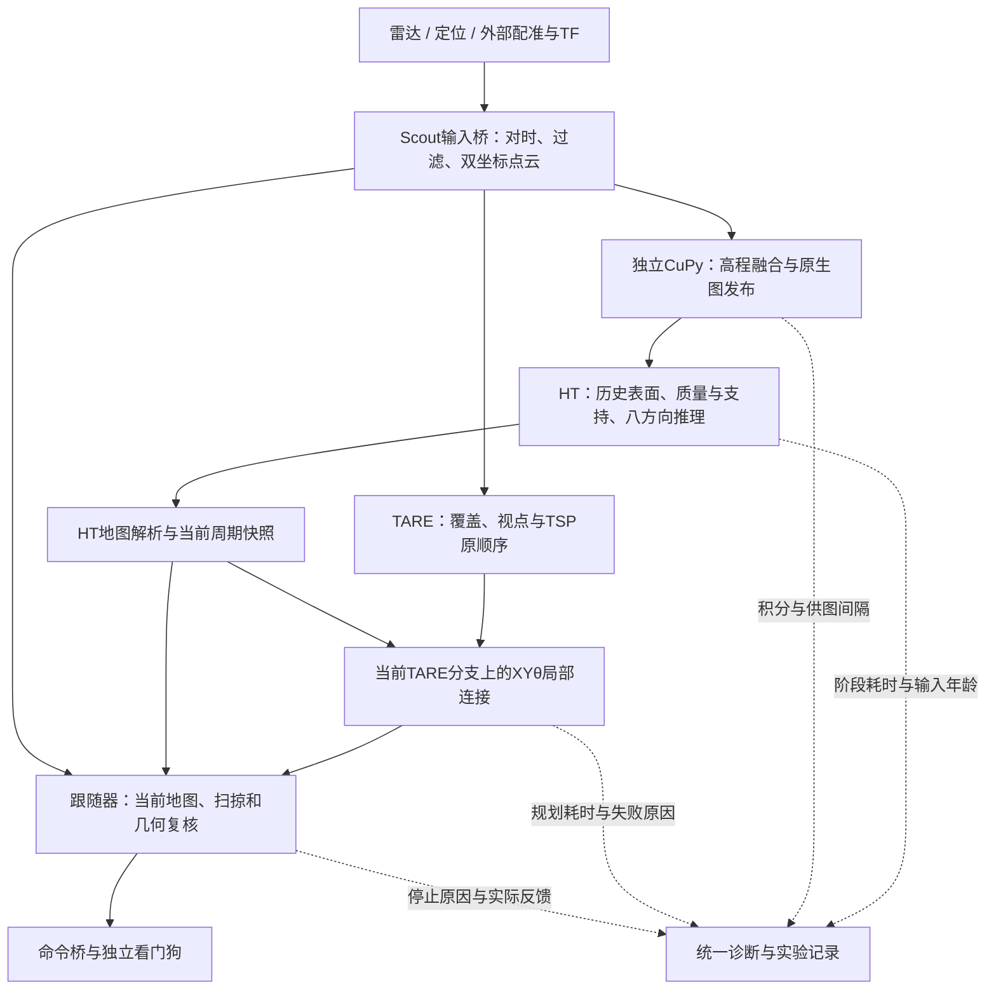

# HT_Explo系统优化方案书

版本：V1.0　日期：2026-10-30　性质：代码审阅与实施建议，尚未实施

审阅对象：HT实车工作树、独立CuPy工作区，以及已经保存的离线实验。本文不代表实车验收，不触发算法修改、实验、部署或上传。

## 一、建议与立项目标

**项目有明确优化空间，下一步应按“确认整条链路的真实瓶颈 → 保证近车地图可解释 → 控制长期资源增长 → 加速高占比阶段 → 验证可执行路线”的顺序推进。** 单独继续优化神经网络，无法保证解决车上的约2.2Hz，也无法保证红区减少后车辆能够正常探索。

已有系统值得保留的基础包括：确定性CuPy融合、HT八方向输出、严格未知与物理支持检查、原始TARE目标顺序、XYθ局部路径，以及执行端独立的过期和碰撞停车机制。建议做模块化改进，不整体重写，不替换探索框架。

建议围绕四个目标立项：

1. **及时：** 地图来自新的有效观测；降低源消息到可用HT的延迟与抖动，避免重复发布旧图制造高频。
2. **可信：** 区分测到障碍、模型低分、缺测、历史过期和上下文不足；能把拒绝通行追溯到具体证据。
3. **可扩展：** 地图、诊断和查询的资源消耗有边界，长距离任务不随历史长度持续变慢。
4. **可交付：** 代码、权重、参数、安装来源和结果一一对应；桌面离线收益与ARM、DDS、实车收益分别验收。

首批推荐实施A、C、B中的显示与诊断部分，随后根据剖析结果选择D或E。TensorRT和模型重训作为后续候选，不作为首批工作的依赖。

## 二、审阅范围与版本口径

| 对象 | 本次口径 |
|---|---|
| HT工作树 | `/home/lzz/my test/HT_Explo-real-review-20261028` |
| 本地历史 | 分支`real/scout-review-20261028`，HEAD `dfd8c7c29de6541d50687ba1301d8c9eadfa33e7`，包含已发布优化对应的未提交文件 |
| 已发布优化 | 代码提交`1f3523606b7c24fdca1ca133697c2443fbebad5d`；发布回执提交`b90e5e405d511eacc970c5b6faea07873ca14384`，取自既有核验回执，本次未重新访问远端 |
| 冻结版本 | `real-scout-ht-performance-20261030` |
| 独立CuPy | `/home/lzz/my test/ht_cupy_gpu_ws_20261028`，独立源码及build/install |
| 核心入口 | `src/ht_scout_bridge/launch/scout_real.launch.py` |
| 审阅证据 | 当前实际文件和已归档报告；源文件SHA256另见同目录`2026-10-30_system_optimization_sources.json` |

本地导入历史与GitHub历史不同，不能把本地HEAD直接推送远端。本文不将本地HEAD当作全部当前源码的唯一版本标识。HANDOFF中的暂停状态早于后续授权与发布记录；历史事实按各报告的时间和实验条件解释。

当前只授权代码与离线阶段。方案中ARM观测、仿真、设备与车辆闭环均列为未来阶段，需要任务范围允许后再安排。已有外部配准和TF不能因仓库未包含其总launch就判定不存在。

## 三、从系统角度看数据流

这是一条多级流水线。稳态新图频率受上游供给、最慢服务阶段和调度共同约束；串行离线处理能力不能直接换算为车上频率。地图每秒发布多少次，与新障碍多久进入执行端，也是两个不同问题。

当前实车配置选择`ht_exploration_mode: tare_waypoint`。因此规划优化应先审查`RouteTareWaypoint`和`PlanHTReturn`，再评估另一种局部候选调度模式；不能只优化`ht_route.cpp`中的候选打分循环，就认定改善了当前默认链路。

## 四、已经知道什么，尚不能断言什么

| 发现 | 证据强度与限制 | 对方案的影响 |
|---|---|---|
| 离线整链路中位76.72→63.10ms，P95 80.51→66.53ms | 同一静止数据，新旧各3次；x86/RTX5060Ti，直接调用，未含DDS与在线TF等待 | 已有优化保留，作为后续基线 |
| 修改版1923帧的地图、输入、掩码与0.5判定无差异；最大概率差4.47e-6 | 仅该数据和条件，存在浮点舍入 | 性能优化继续做语义对照，不能只测速度 |
| 旧现场点云约10.14Hz、raw高程约1.80Hz、HT约1.63Hz | 旧包接收时间统计；不是当前车上的完整测速 | 首先核对上游供图与实际部署版本 |
| HT组件的历史/质量、支持/小孔处理仍占显著时间 | 组件候选中位约17.38ms、17.62ms；网络约8.43ms；各阶段中位不能简单相加 | 优先剖析CPU与数据处理，不先假设GPU不足 |
| 较早组件实验的P95曾从64.74退步到93.21ms | 与后续整链路实验条件不同，失败与慢帧均保留 | 后续必须覆盖长尾、负载与持续运行 |
| 近车残留红区有多种来源 | 既有审计识别缺测、孤立偏高格、邻近高结构；物理身份未全部确认 | 按原因治理，不能统一压平或扩大过滤 |
| 旧严格查询0/1664可达 | 208起点复用、关闭起步先验，非独立实车试验，也非当前实车配置闭环 | 必须补可执行性证据，不能把颜色改善当任务完成 |
| 方向索引映射已核验，真实非对称地形响应尚未验收 | `direction_validation.yaml`：mapping verified，terrain_response validated=false | 区分软件映射正确和实际方向判别可靠 |

已有实验详情见[整链路发布报告](../results/real_ht_performance_release_2026-10-30/REPORT.md)、[HT组件报告](../results/real_ht_frequency_2026-10-30/REPORT.md)、[近车红区审计](../results/real_rear_red_audit_2026-10-29/REPORT.md)及[严格查询报告](../results/real_cupy_stable_2026-10-28/REPORT.md)。

最近一次整链路实验的修改版阶段中位数为：点云处理11.31ms、CuPy积分与发布9.11ms、高程适配0.55ms、完整HT处理41.98ms。各项中位数不必相加等于整链路中位数，但它们表明本机下一轮仍应优先剖析HT整体，不能把HT全部耗时等同于网络推理。来源为该轮`SUMMARY.json`。

## 五、建议工作包

### A．P0：建立运行版本与整链路时序账本

**证据。** 当前标准launch默认CUDA，直接HT脚本默认CPU；旧包HT节点名称与当前入口不同。已有`/ht_real/ht_performance`包含源间隔、发布间隔和替换数，但独立mapper、DDS接收、规划和执行尚缺统一的逐消息关联。

**建议修改。** 生成运行清单，记录实际执行路径、源码/权重/参数哈希、设备、CUDA、历史后端、ROS/RMW及独立mapper版本。沿源时间戳关联输入桥、积分、raw发布、HT接收/完成、规划采用时间和控制采用时间。分别报告服务时间、等待时间、输入年龄、丢弃/替换原因和真正新图数。跨主机统计先核对时钟；本机耗时用单调时钟，地图新鲜度保留源时钟语义。

按话题审查QoS与队列。高频最新状态、必须保留的任务状态和实验完整采集应有不同策略；不把所有话题统一改为best effort或大队列。ROS官方说明QoS不兼容可使消息无法传递，传感器配置倾向及时接收最新样本，具体仍须核对发布与订阅两端。[官方QoS说明](https://raw.githubusercontent.com/ros2/ros2_documentation/jazzy/source/Concepts/Intermediate/About-Quality-of-Service-Settings.rst)

**验收。** 同一输入能生成逐阶段时序表；发现2.2Hz时能够区分“供图不足、计算饱和、TF等待、传输排队、版本不符”。运行清单缺项要显式标记，不猜测补齐。

**投入/回退。** 预计2～3人日；先增加只读诊断和采样，不改变通行策略。保留诊断开关，测量诊断本身的开销。

### B．P0：把近车“全红”拆成可验证原因

**证据。** `ht_valid`与`ht_observation_valid`语义不同，原显示曾把缺物理观测支持的低分格也显示成红色。51×51输入窗口内的真实高结构能影响旁边地面评分；孤立9.8cm高格的真实身份尚未确认。方向软件映射已核验不代表地形响应已经标定。

**建议修改。** 建立统一原因层：已观测硬障碍、支持充分但模型低分、脚下缺测、上下文不足、历史过期、表面选择拒绝。图例与离线统计使用同一套定义，原始八方向分数保留。对起点和路径首次拒绝位置，导出输入窗口、贡献扫描时间、物理支持、方向及拒绝链路。

已确认的车体/有限轮胎阴影过滤保持原边界。孤立回波先做来源和时序一致性审计，有独立证据再设计异常测量判据。对可评分但物理不可观测区，明确保持未知。物理方向标定使用非对称坡面、台阶、横坡和倒车对照，作为后续数据采集任务，当前不启动设备。

**验收。** 既有代表帧能按原因复现；显示修改前后原始概率和规划输入完全一致。模型分数不是经实车真值校准的事故概率，报告不作此解释。真实障碍负例不得被过滤或补全为可通行。

**投入/回退。** 显示及拒绝追溯2～4人日；真实地形验证另排。先交付诊断，不同步引入测量删除规则。

### C．P1：让历史地图与诊断适合长时间运行

**证据。** `CupyToHt.diagnostics`逐帧append，未见容量控制；C++ `terrain_history_`持续积累，`terrainWindow`持锁遍历全部历史；Python历史瓦片虽有1024上限，但达到后抛`MemoryError`，没有自动换出。读取年龄限制也不等于释放存储。

**建议修改。** 在线诊断改固定容量环形缓冲；完整实验记录走独立追加文件与轮转，不为控制线程阻塞写盘。地形历史用空间瓦片索引，窗口只查询相交瓦片，缩小锁覆盖。区分覆盖/拓扑长期记忆与局部执行所需密集高程；密集历史采用有上限的热缓存与可校验归档，必要时保留固定任务边界，而非悄悄丢弃全部旧任务信息。

换出后没有可恢复测量的区域回到未知；禁止为了省内存把旧区域默认自由。最初可只实现诊断有界化与空间索引，缓存换出单独迭代，避免一次改变过多地图语义。

按默认4层、64×64、三组float32/float32/float64主数组估算，每瓦片约256KiB，1024瓦片约256MiB；这不含拒绝记录、Python对象、其他地图与GPU内存，也不是实际RSS测量。

**验收。** 固定窗口内容下，远处历史扩大时查询耗时不再随全部历史线性增长；容量受控，长时间RSS增长有可解释上界；回到旧区域时，恢复内容与参考重建一致或明确未知；达到资源边界时行为可诊断且保持拒绝策略。

**投入/回退。** 第一部分2～3人日，分级缓存另3～5人日。新索引与原始实现做逐窗口对照，保留原实现选择开关。

### D．P1：优化HT前后处理和数据搬运

**证据。** 已完成Numba历史选择、小孔候选减负、BN融合、点云单次解析、限制BLAS线程、最新输入替换和无订阅发布跳过。仍有CPU预处理、多层地图打包及主机/GPU往返。不能把这些已完成项目再次计算成新增收益。

**建议修改。** 先用分阶段剖析识别分配、数组复制、质量/支持计算和打包的真实占比，再选择固定尺寸缓冲复用、合并重复统计、编译适合的逐格逻辑或批量填充消息。控制地图与可视化输出分开限速；不降低控制所需观测更新。若考虑减少GPU往返，先核算跨独立进程传输与同步代价，再决定是否值得改消息边界。

增量计算仅作为后续候选：历史年龄、表面选择、滚动中心和障碍上下文都可能改变输出；不能只按新增点云格标记脏区。网络输出受51×51感受野影响，所有相关依赖都必须纳入失效范围。

**验收建议。** 固定权重、几何、分辨率、阈值与输入，非概率层一致、0.5决策差异为0、概率误差不超过预先冻结门槛；三次配对，整链路中位下降≥10%，P95不退步超过5%。这是下一轮建议门槛，不是收益预测；低于门槛可保留研究记录而不部署。

**投入/回退。** 3～5人日；每次只选一个主要瓶颈，保留参考路径。不要一次把全部CPU处理迁到GPU，也不直接重写整个Python链路。

### E．P1：减少局部规划的重复验证，保持原TARE顺序

**证据。** 默认`RouteTareWaypoint`已经共享0.35s总预算，先尝试同一分支的4/3/2/1m前缀，再适配更短前缀；XYθ有单次时间和扩展数限制。跟随器已有当前地图、物理几何、路径、里程计及扫描新鲜度独立检查。因此问题不是缺少超时或缺少停车检查。

**建议修改。** 先统计当前默认路由的候选次数、几何查询、HT扫掠、扩展数和超时原因。优先在同一地图快照内缓存重复姿态/运动段检查；键必须包含HT与几何版本、方向、车辆模型和策略参数，连续坐标量化须保持保守。复用旧路径时仅作为搜索热启动，每个待执行段仍在新地图下复核。

地图时间戳不足以唯一表示内容，可增加内容revision；缓存也不能跨越新鲜度过期、起步先验失效或失败记忆变化。若收益不足，不引入跨周期缓存。原TARE目标及访问顺序、原地转向、倒车、真实车头方向检查保持不变。

**验收。** 同批地图/目标/起点下，返回路线仍满足原约束；受影响区域新增障碍后旧缓存不能继续放行；总预算与停车行为不退步。以规划P95和每次成功连接的计算量评估，不能只看扩展节点减少。

**投入/回退。** 3～5人日；先做周期内缓存。跨周期增量搜索另立候选，不把另一探索模式的收益冒充默认链路收益。

### F．P1/P2：统一观测时间、TF与障碍更新语义

**证据。** 输入桥按源时刻查询TF；独立mapper在精确TF失败时存在使用最新TF的分支，其中普通点云分支未见相同的显式偏差门槛，registered-cloud传感器位姿另有0.3s偏差限制。历史高程可以保留旧观测，但发布新图不等于这些格子得到新测量。

**建议修改。** 先记录每次实际TF时间、查询时间、回退次数及偏差。为独立mapper设计严格源时刻模式：有界等待，超界跳过并说明原因；兼容回退模式必须显式启用并受偏差约束。离线严格模式和在线兼容模式分别记录，不能把现有离线精确查询结果当在线TF已经合格。

后续设计独立的近场障碍更新通道或层，使新障碍快速进入执行拒绝，不被长期地面融合迟滞掩盖。障碍消失需新观测、射线或清空证据；超时通常退回未知，而非自动自由。先做“新障碍出现—进入地图—HT/几何拒绝—执行停车”的因果时序，再决定融合规则修改。

**验收。** 合成TF迟到、缺失和时间回退下，拒绝或等待行为可复现；在已有数据可支持的范围内追踪观测年龄。新障碍响应不能因追求地图稳定而变慢；占据移除不能只靠重复发布或无观测计时。

**投入/回退。** 对时诊断与策略3～4人日；动态层5～8人日且需要额外数据。所有补丁仍留在独立CuPy工作区并固定来源哈希。

### G．P2：在目标ARM平台评估推理后端

**证据。** 已用GPU；桌面组件中网络约8ms并非唯一主要开销。CUDA Graph已测收益约1.7%，ROI动态裁剪明显变慢且出现门槛翻转，channels_last在当前CUDA环境明显变慢；均不应直接采用。TensorRT尚未验证，目标ARM性能未知。

**建议修改。** 先确认车上JetPack/CUDA/框架兼容组合，在独立环境建立相同291输入、241×241×8输出的FP32参考；仅当目标硬件剖析确认网络占比较高时比较TensorRT。冻结精度与TF32设置，检查概率、临界0.5判定、安装缓存和冷启动。选择与车上JetPack匹配的版本，不因文档latest版本较新就升级整套环境。

FP16/INT8属于精度变更候选，需要更丰富的临界和真实地形数据，放在FP32验证之后。NVIDIA官方说明低精度可能产生舍入、溢出和敏感运算误差，不能仅凭网络平均误差决定上线。[TensorRT精度说明](https://docs.nvidia.com/deeplearning/tensorrt/latest/inference-library/accuracy-considerations.html)

用Amdahl定律判断收益上界：若网络只占整链路15%，即使网络耗时降为0，总体也只能约1.18倍加速。这是条件举例，不是当前ARM占比测量。

**验收。** 最终以目标硬件整链路、稳定运行尾延迟与数值决策验收；本机网络微测无法替代。资源、功耗或温度配置先记录，未经明确任务授权不调整设备模式。

**投入/回退。** 平台可用后3～5人日，兼容性问题另估。旧FP32 PyTorch作为可切换基线；没有明确整链路收益就不增加部署负担。

### H．P1：收敛模块边界、配置和发布流程

**证据。** `cupy_to_ht.py`同时承担接收、历史、预处理、推理、发布、诊断；TARE主实现约1853行，已有部分路由拆分。仓库有C++/Python测试及安装后检查，但本工作树未见`.github`自动化配置；不能据此断言其他外部CI不存在。

**建议修改。** 分阶段把HT处理核心与ROS适配分离，输入为明确的地图契约，输出为概率、掩码和诊断结构；先建立接口对照再移动代码。TARE保留已有框架，只继续抽取有独立职责的地图适配与路由诊断，不做大规模改名重排。

统一模型契约：源层名称/单位、分辨率允许范围、291输入/241输出、8方向顺序、configuration语义、年龄定义和未知策略。当前输入允许0.040～0.042m，既有离线使用0.04m，独立试验配置还存在其他尺寸；应把组合写进可验证版本清单，不能无依据将所有配置强行改成一个值。

建立分层检查：CPU逻辑与输入契约、可选GPU数值检查、安装后来源核验、固定录包回归。外部CuPy补丁继续采用已知源哈希与幂等安装，模型/标定/配置变更单独版本化。发布始终区分代码提交、数据Release和回执，保留失败记录和回滚版本。

ROS官方明确：多线程executor不保证同一互斥组内回调并发。因此线程数、回调组和共享状态一起审阅；已完成的输入桥并发分组继续保留，不以增加线程数代替分析。[回调组说明](https://raw.githubusercontent.com/ros2/ros2_documentation/jazzy/source/How-To-Guides/Using-callback-groups.rst)

**验收。** 清洁环境按文档可构建，实际安装入口和源文件哈希一致；契约错误启动即明确拒绝；纯重构使用相同输入产生相同输出。真实分支、仿真分支及独立CuPy的源码/构建隔离保持不变。

**投入/回退。** 2～4人日建立最小自动化；结构重构分次实施，禁止和算法改动混在同一候选中。

## 六、分阶段推进与决策门槛

下列为单人有效开发工作量估计，不含设备等待、真实数据采集或额外兼容性排查；工作包可部分复用，不能简单求和当作工期承诺。

| 阶段 | 推荐范围 | 预计投入 | 交付与进入下一阶段条件 |
|---|---|---:|---|
| 1：建立可判断基线 | A、B诊断/显示、C有界诊断、H最小版本清单 | 5～8人日 | 运行身份明确；关键拒绝原因可追溯；在线记录有界 |
| 2：解决已定位瓶颈 | C空间索引；按阶段1证据选择D或E；F对时诊断 | 5～8人日 | 固定输入对照通过，性能及尾延迟达预设门槛 |
| 3：补地图因果性 | F融合/障碍候选、B标注与响应验证、必要缓存归档 | 5～10人日，数据另排 | 新障碍和未知行为可解释，性能未以削弱检查换取 |
| 4：目标平台验收 | G及整链路部署观测 | 3～5人日，平台可用后 | ARM、DDS及持续负载下有实际证据，再决定是否部署 |
| 后续：闭环任务评价 | 用户允许后安排仿真/设备/车辆任务 | 单独制定 | 覆盖效率、可执行性、停车原因与任务完成一起评价 |

每个候选都执行“冻结源文件/参数/二进制 → 同输入对照 → 记录提升与退步 → 决定保留或回退”。当前这份方案书只完成审阅与文档，不自动启动阶段1。

## 七、建议统一的验收指标

| 维度 | 必测指标 | 建议规则 |
|---|---|---|
| 计算 | 整链路与阶段中位/P95/P99/最大值，样本数和超时率 | 至少3次配对，预热与排除规则事先冻结，保留所有其他慢帧 |
| 时效 | 新源图Hz、发布Hz、输入/执行采用时年龄、替换数 | 不以旧图重复发布提高指标；必须说明源时钟与接收时钟 |
| 数值 | 地图、输入、几何、未知/支持/障碍掩码、0.5判定 | 纯加速先要求语义一致；概率容差事前约定，临界翻转单列 |
| 扩展性 | RSS/显存、瓦片数、历史长度、窗口查询和锁耗时 | 固定局部窗口时，远处历史增加不应拖慢全量扫描 |
| 感知有效性 | 新障碍首次有效检测时间、漏检/误拒、未知比例 | 需要可核验真值；未知不算障碍误检，也不算已知自由 |
| 规划执行 | 规划成功率、P95、首次拒绝原因、路线复核 | 同场景同目标，保留原TARE顺序，控制正负例都必须通过 |
| 任务效果 | 覆盖量、实际里程、有效推进时间、完成率 | 只在允许闭环后评估；状态消息条数不能充当持续时间 |

“不再2.2Hz”建议定义为：在约定的目标平台、输入供给和持续负载下，新有效HT频率达到预先确定目标，地图年龄与超时率也达标。目标Hz应在阶段1确认供图能力后冻结；目前没有证据承诺某个ARM频率。

更高Hz也不自动允许更高车速。后续应结合实际制动能力与总响应年龄核对保护距离，可用`v×响应年龄 + v²/(2×有效减速度) + 余量`作初步预算，再用目标车辆验证；本方案不更改现有0.4m/s等限制。

## 八、数据与实验资产复用方案

第一层，固定回归直接复用已验证22话题子集及641帧整链路结果，不重复解压原11.4GB数据库，不覆盖六轮实验。已有完整291输入和概率、掩码用于快速数值对照；已有失败布局、ROI与CDR填充误报记录作为反例保留。

第二层，利用已有移动数据和原始回波审计扩展时序测试，分别覆盖滚动窗口、历史年龄、TF缺失、孤立高格与跨帧高结构。不同ROI和不同协议的绝对格数不能直接当改进百分比。

第三层，当前资料不足的场景另列采集清单：新障碍进入/离开、低矮障碍、负障碍、坡面/横坡、窄通道、倒车、原地转向和长距离返回。不能声称静止包已经覆盖这些条件；新增数据采集需后续授权。

固定开发集与保留验收集；涉及规则选择或训练时，不用验收集反复调参。无需为低影响文档或机械重构铺设大量镜像测试，重点验证时间语义、未知、方向、资源边界与部署来源等真实风险。

## 九、暂缓项与明确边界

- 暂缓再次尝试已证实不合适的CUDA channels_last与当前动态ROI实现；CUDA Graph的小收益不足以优先增加复杂度。目标平台证据改变时可重新立项。
- 暂缓FP16/INT8、模型压缩、重训，以及整条Python链路重写为C++。先获得目标瓶颈与真值数据，再评估成本收益。
- 不通过降低0.5门槛、放宽新鲜度超时、扩大过滤或给走过区域补绿来提高成功率。起步先验不是实测自由地面，应继续保持固定范围、寿命及真实障碍否决。
- 不把历史指导图的乐观策略传播到局部执行；执行仍需当前可用证据。缓存和稳定化不能跳过跟随器复核。
- 本次不改生产代码、不运行新实验、不启动或终止既有任务、不操作待审周报，也不提交或上传方案。后续实施与发布按用户指定范围执行。

## 十、建议先做的三个交付物

1. **运行身份与时序报告：** 回答当前每一级真实供图/服务/采用频率、年龄与版本，先定位约2.2Hz属于哪一段。
2. **近车拒绝原因报告：** 同一帧同时给出原始八方向概率、物理观测、历史年龄、硬障碍和首个路径拒绝位置，减少凭颜色猜根因。
3. **有界资源候选：** 先把在线诊断改为有界，给C++历史增加空间索引；以相同输入证明语义一致，再做持续运行与规模测试。

这三个交付物分别补齐“哪里慢”“为什么不能走”“是否越跑越慢”的证据。完成后再选择HT处理、局部规划或ARM后端中的最高收益候选。

## 附录：主要代码与证据入口

| 主题 | 仓库相对位置 |
|---|---|
| 实车总入口与运行参数 | `src/ht_scout_bridge/launch/scout_real.launch.py` |
| 输入队列、对时与并发 | `src/ht_scout_bridge/ht_scout_bridge/node.py` |
| 点云解析、坐标变换与过滤 | `src/ht_scout_bridge/ht_scout_bridge/geometry.py` |
| HT主链与诊断积累 | `tools/ht_cupy_bridge/cupy_to_ht.py`，`diagnostics`初始化/append及`on_map` |
| 历史资源上限与表面选择 | `tools/ht_cupy_bridge/historical_elevation.py`，`_tile`、`fuse`、`window` |
| 编译历史选择与小孔 | `tools/ht_cupy_bridge/history_window.py`、`small_holes.py` |
| 地形历史与空间查询 | `src/tare_planner/src/ht_cost/ht_cost_map.cpp`，`receive`、`terrainWindow` |
| 当前默认TARE局部连接 | `src/tare_planner/src/sensor_coverage_planner/tare_waypoint_router.cpp` |
| XYθ连接与另一候选模式 | `src/tare_planner/src/local_coverage_planner/ht_route.cpp`，`PlanHTReturn`及候选调度 |
| 执行端独立检查 | `src/tare_planner/src/ht_cost/xytheta_follower.cpp` |
| 底盘命令适配看门狗 | `src/ht_scout_bridge/ht_scout_bridge/command_bridge.py` |
| 模型方向与默认约束 | `src/ht_scout_bridge/config/direction_validation.yaml`、`ht_real.yaml` |
| 独立CuPy时间策略 | CuPy工作区`src/elevation_mapping_cupy_2204/elevation_mapping_cupy/script/elevation_mapping_cupy/elevation_mapping_ros.py` |
| 自动化与安装来源 | `src/tare_planner/CMakeLists.txt`、`tools/install_elevation_fixes.py`及已有安装核验报告 |
| 发布事实与旧数据结果 | `docs/results/real_ht_performance_release_2026-10-30/`，尤其`REPORT.md`、`FINAL_REMOTE_CHECK.json` |

本文中耗时和数值结果来自上述本地归档报告；外部文档只支持ROS调度/QoS与精度设计原则，不证明本项目已经取得新的性能收益。
