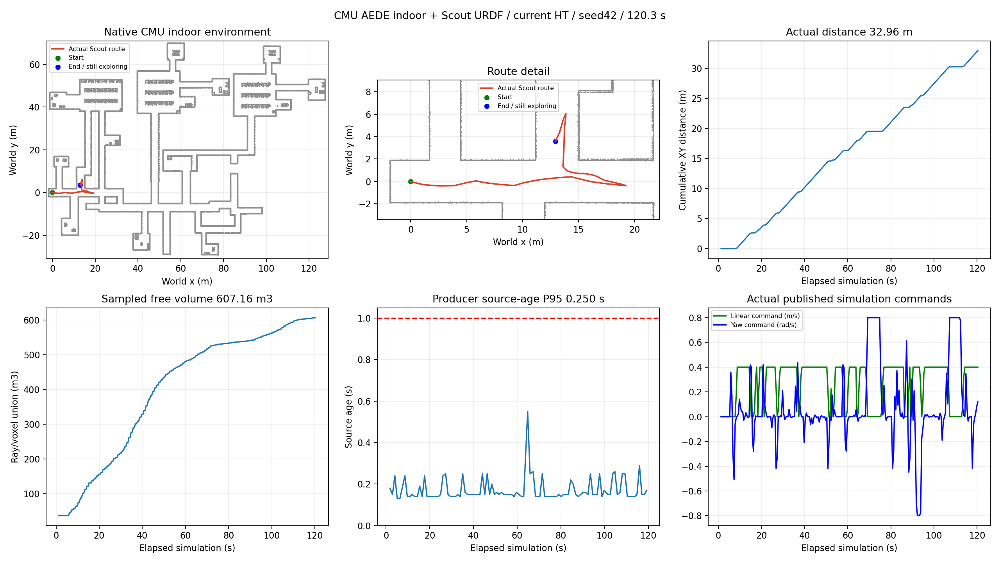

# CMU indoor Scout HT 120秒测试

用户授权使用本机CMU autonomous environment进行测试。本轮完整采集120.3秒，实际里程32.9579m，近似观测自由体积607.160m³，末30秒继续行驶9.0520m。结束时EXPLORING / HT_ASSISTED / DRIVING，全部进程及ROS launch子节点正常退出，冻结文件变化0。当前阶段已停止本批测试。

## 配置与实际测试范围

导航来源为接续分支fix/scout-wsl120-20261105，测试提交09e0fff。本机CMU工作区8314318d784c0db75b299b2c14161652c19275a5，选择其indoor原生完整环境模型、碰撞网格和纹理，参考点云597647点，场景范围x[-2,128]、y[-30,70]米。prepare_cmu_scene.py在独立目录复制资产并记录SHA。

本轮选择“CMU indoor环境模型+Scout URDF/动力学”的组合，沿用当前Scout建图、TF/定位适配及HT控制链。Scout使用Gazebo重力动力学、0.01秒物理步长；观测来自其GPU激光，32线角间隔近似、5Hz，定位来自仿真真值。CMU预览点云用于画图及范围/起点地面参考，mapper实时输入来自仿真激光。

种子42，HT worker、mapper single及独立TF，源龄主指标为生产者1Hz source_age_at_publish_s。导航边界内缩1.5m；在3.0秒收到已应用边界回执、新鲜odom/scan/map且持续就绪1秒后启动。启动记录对应odom2.95秒、scan/map2.8秒。

## 结果与诊断

- 106个生产者源龄样本P95=0.250秒，最大0.550秒，HT处理服务时间P95约0.0524秒。
- 3.52秒出现初始几何阻塞，4.52秒为PLANNER_STALE/BLOCKED，5.72秒进入EXPLORING/HT_ASSISTED。后续任务状态持续探索，采样全零指令最长4.5秒，包含启动等待。转向期间存在平移暂停。
- 114条完成判据诊断均为completion_ready=false，114条路由诊断均为ROUTE_FOUND。末条记录候选视点102个、表面残余160、前沿残余285，复用视点4个，原始表面/前沿收益候选7/9个，局部路线56节点。
- 完成120秒窗口时车辆仍有前进指令，最终位置约(12.9201,3.5805)，最后30秒实际里程9.0520m。完整场景覆盖能力及同种子重复性仍待后续实验核验。
- 此轮是在不同环境中的一次种子42测试。观测体积为共同射线/体素采样指标，结果按该CMU场景单独记录。

## 失败记录及修复

首次c01_ht42在创建新输出目录时FileNotFoundError，尚未启动任何Gazebo/子进程。失败保留于独立账本和runner.log，计为第一次尝试。启动器改为创建缺失的父目录，新增正常入口离线回归，相关11项检查通过。第二次c02_ht42完成上述120.3秒窗口，使用完本批2个尝试名额。

## 数据核验与保留

MCAP逐消息核对统计计数、可用CRC与文件SHA；原轨迹视频241帧全部解码。测量窗口12个HT输入上下文与同源发布地图11层逐元素配对，支撑/障碍掩码独立重建通过。实际/sim/cmd_vel逐消息核验在前进0.4、倒车0.25m/s和角速度0.8rad/s上限内。所有自有进程组已退出。

CMU原工作区Git状态干净，原Linux CuPy8个实现文件SHA一致。代码及精简证据推送接续分支，原始MCAP/CSV/NPZ/视频保存在`/home/lzz/HT_cmu_indoor_cycle9_20261106`，完整远端备份待办。

本地轨迹视频为地图上的实际仿真位姿和遥测动画。

- 原始录包及视频位于`runs/c02_ht42/`。
- 放大轨迹视频位于`analysis/trajectory_zoom.mp4`。
- [完整指标](SUMMARY.json)、[诊断](DIAGNOSIS.json)、[启动记录](START_GATE.json)、[预算](BUDGET.json)。
