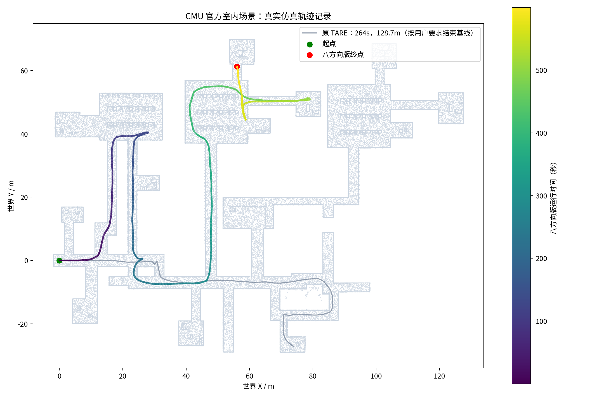
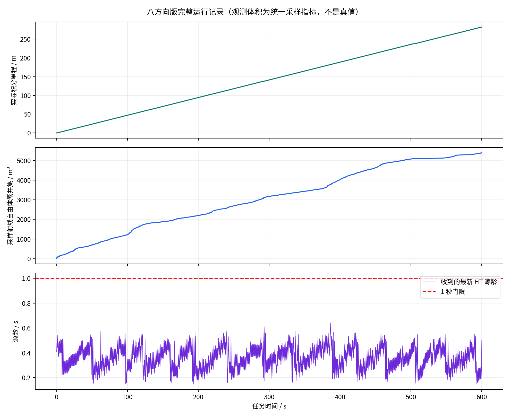
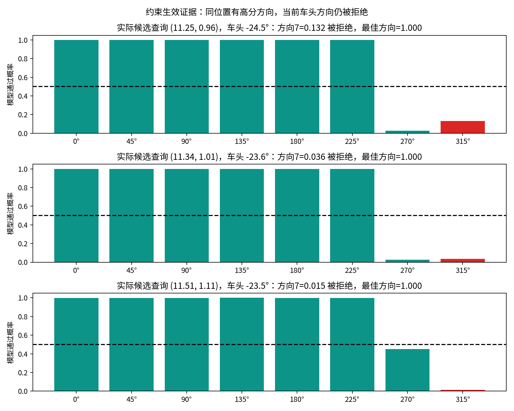

# 原 TARE + 八方向可通过性：CMU 仿真交付记录

日期：2026-11-10。工作分支：`sim/cmu-tare-8dir-20261110`。

**已完成本次收敛目标的单场景验证：上游 TARE 正常探索；增加八方向约束后完整运行600秒、行驶281.925米，结束时仍在探索；实际低分方向受到拒绝，已许可候选命令的独立录包复核未发现越限。**

本次使用 CMU 官方 indoor 环境。结果适用于本轮共同仿真传感配置和简化底盘，不代表完成全场景探索或实车验收，也不用于宣称性能优于原 TARE。

## 实现收敛到哪里

上游 TARE 的目标选择、覆盖收益、TSP、访问顺序和返航算法保持原有实现。原生组与八方向组使用**同一个上游 TARE 可执行文件**和 `indoor.yaml`。上游 ROS2 入口缺少 `kUseFrontier` 声明，补一行使其已有 YAML 参数生效；补丁独立保存。

新增 `src/cmu_local_planner_ht`，以 CMU 原生 `localPlanner.cpp`、`pathFollower.cpp` 为来源，只增加：

1. 对原生候选路径逐位置、逐实际车头方向查询八方向地图；低分、未知、占据或过期时拒绝。
2. 对将要输出的命令检查反应及停车轨迹，包括中间转向方向。倒车仍使用实际车头，不额外要求反向行驶通道。
3. 原跟踪命令不满足约束时，保留原生线速度，尝试减小转向量；每个候选通过同一套门禁才可选用，无可行候选则停车。

没有接入项目历史上的 Hybrid A*、新探索目标排序、启动区域放行或小孔放宽。

| 运行参数 | 本次值 |
|---|---:|
| 八方向概率门限 | 0.5 |
| 源图龄门限 | 1.0秒 |
| 通道顺序/角度偏移 | 0…7 / 0弧度 |
| 物理包络半径 | 0.45米，另加原有 `sqrt(2)*resolution` 网格余量 |
| 规划车体尺寸 | CMU 原生0.6×0.6米 |
| 最大线速度 | 两组均0.5米/秒 |
| 命令停车检查 | 100毫秒反应段；线减速度2.5米/秒²、角减速度3弧度/秒² |

0.45米来自 CMU 原生路径碰撞库的 `searchRadius`，大于0.6×0.6米规划尺寸的外接圆半径0.4243米；没有把实车Scout的0.6米包络直接套给CMU底盘。CMU仿真直接应用速度，拒绝时立即输出零速度；上述停车包络用于本仿真，实车制动能力需要独立标定。

## 实际结果

| 项目 | 结果 |
|---|---:|
| 原 TARE 共同配置基线 | 264.031秒 / 128.730米，仍在探索 |
| 八方向最终轮 `ht_600s_06` | **600.003秒 / 281.925米，仍在探索** |
| 八方向最终30秒里程 | 13.868米 |
| 最新收到HT图的源龄P50 / P95 / P99 | 0.243 / 0.338 / 0.366秒 |
| 采样观测自由体素并集 | 5408.0立方米 |
| 回归检查 | 17项通过 |
| 正式采集期间源码/参数/二进制冻结 | 一致 |

基线按用户“能正常跑一两次即可，主要做八方向”的要求主动结束，不能称完整600秒基线。此前另有原生传感配置短检查，30秒行驶14.25米。两组路线存在原生随机采样差异，时长也不同，本报告不计算性能提升倍数。

观测体积是统一采样口径：0.5米体素，约1Hz、1024条端点射线、12米范围的累计并集，仅使用源时位姿匹配的扫描。最终轮匹配463帧，不能当作完整自由空间真值或模型准确率。





## 八方向确实参与控制的证据

离线读取实际MCAP，使用每条候选命令所引用的**精确源时间地图**，重新计算对应车头方向、物理足迹、上下文、概率和停车轨迹：

- 核验30,008次候选命令检查，其中30,000次获许可，29,987次为非零运动候选。
- 已许可候选未发现门禁越限，未匹配到源地图的命令为0。
- 已许可停车轨迹上的最低概率为0.505343，最大源图龄为0.931360秒。
- 265条限频拒绝记录都满足“所查询方向低于0.5，同时同位置存在其他高分方向”；其中263条在流式核验时匹配到原始八通道地图，所选分数逐值一致。
- 实际发生5次经检查的转向量调整。每个调整后的候选仍经过同一门禁。

这证明执行链读取了对应车头通道，而不是把最佳方向概率作为所有方向的许可。候选检查次数、限频记录条数和独立停车事件是不同口径。完整结果见 `COMMAND_AUDIT.json`。



## 本次发现并修正的问题

| 轮次 | 记录 | 处理 |
|---|---|---|
| `native_600s_01` | MCAP缺运行库，正式计时未开始 | 补齐并单独验证Zstd写入/读回；失败日志保留 |
| `ht_600s_02` | 450.289秒/30.467米，转向锁死 | 新接入错误按1秒恒定命令外推，预测转过目标；改为反应+停车轨迹，增加正反例 |
| `ht_600s_03` | 428.676秒/123.540米，额外占据拒绝 | 校正误沿用的Scout包络，与CMU规划几何统一 |
| `ht_600s_04` | 401.496秒/90.933米，后退起步锁死 | 原路径可行，但跟踪器先转后退；增加逐候选校验的转向量调整 |
| `ht_600s_05` | 319.684秒/72.664米，HT输出停止 | 输入端锁定时钟回退，主机同窗口发生首次NTP同步；等待同步稳定后整链重启，未绕过保护 |
| `ht_600s_06` | 600.003秒/281.925米 | 本次完整通过轮 |

前几轮为诊断或中断轮，不算完成600秒测试；对应MCAP、原源码及二进制快照、日志和原因记录全部保留。最终轮与第05轮导航源码相同，区别为主机时钟同步后整链重新启动。

## 环境、资料与复现

- 官方CMU Humble：`158e67b31b644ed1e8b06eb1d7f70e183cc62591`。
- 上游TARE：`b6760adb4280b379567c76f4e684ce628e28ef71`，另有一行Frontier参数声明补丁。
- 本项目基础：`a0bac4d8c067c9af7def0a9996f812987e10737e`；模型权重保持原文件，SHA见 `tools/cmu_minimal/SOURCES.json`。
- 主机Ubuntu22.04/Humble、MX450 2GB。Gazebo11及缺失依赖安装在本任务用户目录，独立构建/安装；原实车工作树未覆盖。
- 官方indoor模型、纹理及参考点云从官方下载归档提取，8个文件全部通过ZIP CRC。共同传感适配为64线、向下75°至向上15°，去除被传感器射线误检的仿真自车碰撞体，世界碰撞网格不变；原生传感配置保留。此配置不是Helios实车标定。

本机主要入口：

```bash
source /home/lzz/cmu_test_20261110/env.sh
source /home/lzz/cmu_test_20261110/install_cmu/setup.bash
source /home/lzz/cmu_test_20261110/install_native/setup.bash
source /home/lzz/cmu_test_20261110/install_gate/setup.bash
source /home/lzz/cmu_test_20261110/install_mapper/setup.bash
# 只复核现有数据，不重新启动仿真
/home/lzz/cmu_test_20261110/venv/bin/python \
  tools/cmu_minimal/audit_commands.py \
  /home/lzz/cmu_test_20261110/runs/ht_600s_06 --radius .45
```

完整数据：`/home/lzz/cmu_test_20261110/runs/ht_600s_06/`，30段MCAP、333429条消息，录制612.584秒（包含启动等待），约14GiB。完整候选命令及HT图已解码复核。源码/安装快照、参数、CSV、实际命令和退出日志均保留。录像为601帧、1000×800的10倍速**记录轨迹图回放**，完整解码通过，不冒充RViz现场画面。

交付预览与视频：`/home/lzz/cmu_test_20261110/delivery/`。历史失败轮和新原始数据尚无完整远端备份，未清理。没有自动部署硬件或发布Release。

## 尚存边界

600秒运行阶段未出现进程异常退出，车辆结束时仍在探索；完整场景完成和多轮稳定性尚未验收。独立复核验证的是约束执行，不证明神经模型分数等于真实物理可通过性。

采集结束、录包关闭后的SIGINT清理中，CMU部分原生循环及其控制器副本出现ROS context销毁异常，日志保留；外层launch返回0不能冒充全部子节点正常退出。本轮不将清理异常写成导航阶段故障，也没有为此继续扩展导航改造。任务相关仿真、建图、模型和控制进程已停止。

来源：[CMU项目官网](https://www.cmu-exploration.com/)、[CMU官方Humble代码](https://github.com/HongbiaoZ/autonomous_exploration_development_environment/tree/158e67b31b644ed1e8b06eb1d7f70e183cc62591)、[上游TARE](https://github.com/caochao39/tare_planner/tree/b6760adb4280b379567c76f4e684ce628e28ef71)。
