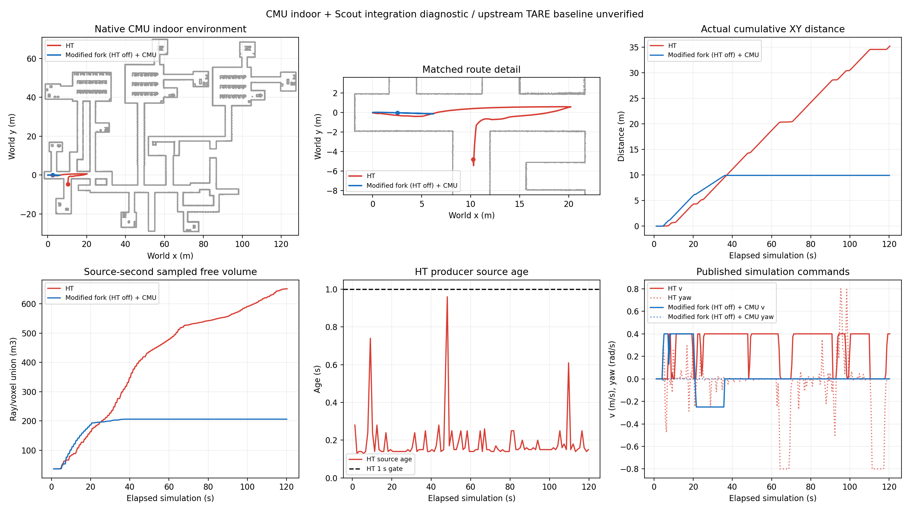

# CMU indoor接入诊断与基线复核

**2026-11-06复核更正**。当前TARE接入加载Scout实车参数，关闭HT后仍经过项目改写的返航逻辑，原生TARE基线有效性尚未通过。旧数据用于两个接入配置的诊断，原HT优于TARE的性能归因撤回。[核查与更正](baseline_audit/CORRECTION.md)

本批完成3次采集，首轮为配置诊断，正式配对采用p02 TARE及p03 HT。每次请求120秒，计时器末帧使实际窗口分别为120.1及120.3秒。预算3/3已关闭，所有原始记录保留。

## 已记录的两组配置结果

| 指标 | 当前HT | 当前仓库关闭HT的改装几何分支＋CMU局部规划/跟踪 |
|---|---|---|
| 运行 | p03_ht42 | p02_tare42 |
| 实际采集 | 120.3秒 | 120.1秒 |
| 累计实际XY里程 | 35.240930米 | 9.938757米 |
| 精确对齐到elapsed=120秒的插值里程 | 35.120936米 | 9.938757米 |
| 近似观测自由体积 | 651.240立方米 | 206.000立方米 |
| 末30秒实际里程 | 6.904954米 | 0.000003米 |
| 最终任务/执行/跟踪 | EXPLORING / HT_ASSISTED / DRIVING | BLOCKED / NO_EXECUTABLE_ROUTE / TARE_BLOCKED |
| 完成探索及返航 | 未完成 | 未完成 |
| HT发布源龄P95 / 最大 | 0.275 / 0.960秒 | 无HT推理 |

两个接入配置的终点累计里程比为3.55、采样自由体积比为3.16，原生TARE基线未通过有效性核查，这些比值的算法性能归因已撤回。TARE约36.13仿真秒后持续停车，HT末30秒仍推进。体积采用共同源秒抽样激光射线/0.2米体素并集，依赖射线覆盖与采样，完整场景覆盖率尚无测量。实际完成计量的扫描数为HT120帧、TARE119帧。里程包含启动沉降/滑移，两组首次记录位姿完全相同。一次种子配对的结果范围限于本配置与场景。[统一配置/指令审计](PAIR_AUDIT.json)

## 场景与对照范围

环境为本机CMU AEDE的完整indoor模型、碰撞网格及纹理，范围x[-2,128]、y[-30,70]米。组合使用Scout URDF/Gazebo重力动力学，0.01秒物理步长，32线近似GPU激光5Hz，仿真真值定位。建图实时接收模拟激光。点云预览用于画图和地面参考。两组复用循环9冻结runtime，种子42、起点、场景边界、采集器、CuPy single、独立TF和指标一致。

控制上限前进0.4、倒车0.25米/秒、角速度0.8弧度/秒，底盘插件共有限角速度0.5弧度/秒、角加速度1弧度/秒平方。逐消息核对两组各2491条/sim/cmd_vel，全部有限且在共同输出上限内。TARE实测指令角速度最大仅0.0381弧度/秒，主要沿初始走廊前进后倒退。HT存在原地转向。

TARE采用当前仓库关闭HT的几何分支和CMU terrainAnalysis/terrainAnalysisExt/localPlanner/pathFollower，含当前分支既有返航和安全门控修改。HT采用当前神经门控、XYTheta及HT跟踪器。TARE地形输入terrain_map_ext，HT输入traversability，各自控制器/地形处理不同，此处为端到端系统对照。两组均运行CuPy建图，HT额外运行推理及10秒稀疏上下文采集。

TARE测试提交5dfdd12，HT测试提交2b1e04a，两个提交之间只有本轮结果文档差异。实际运行共同导航安装为Linux循环8的独立安装，CMU为独立生命周期修复安装。共同冻结文件415个哈希全部相同，单次冻结变更均为0。TARE额外冻结81个CMU安装文件，逐运行scene_config路径不同但内容相同。两组启动门均在3.0秒释放，里程计2.95秒、扫描/地形2.8秒，持续就绪1秒并收到边界应用回执。[两组manifest及原始CSV见运行子目录](p03_ht42/manifest.json)

## 首轮时效差异与接口修正

p01使用72ab90a，120.3秒、8.485427米、199.152立方米，49.06秒进入COMPLETED。发现TARE仿真命令桥硬编码几何/路径1秒期限，几何更新中位数1秒、P95约2秒，而HT相应期限为3秒。将该隔离仿真桥两个期限参数化并显式配置为3秒。HT神经地图1秒期限、命令0.3秒、里程计0.5秒、碰撞包络和未知障碍规则继续沿用。

这是本轮对照配置变更。原桥在1.2秒几何源龄真实ROS回归中复现停车，修正后5项检查通过，3.2秒数据继续停车，恢复后可移动。首轮246次几何时效拒绝在修正后p02消失，随后仍出现规划无路径。首轮完整保留为配置诊断，额外尝试名额调整用于修正后配对，总次数上限仍为3。旧首轮COMPLETED状态与新首轮BLOCKED均完整记录。[首轮诊断与精确回放限制](PRELIMINARY.md)

## 停车原因及剩余问题

TARE在20.23秒进入RETURNING_HOME，此时global_return=1、local_complete=1、可选全局任务0、局部未覆盖表面/前沿收益0。36.13秒转为BLOCKED/NO_EXECUTABLE_ROUTE，随后保持约84秒。结束位置约(2.515,-0.029)，尚未到达起点；末次覆盖规划局部路线1节点，候选视点7个，多数视点被碰撞/边界或断连标志过滤。

状态代码把无有效lookahead且未到返航终点映射为BLOCKED/NO_EXECUTABLE_ROUTE。当前分支返航经过关键位姿图检查点、前视点与可见/碰撞前缀检查，现有诊断没有记录每个返航前缀的拒绝原因。本轮可定位到返航路线/前视点链路，进一步区分检查点、可见性及碰撞拒绝仍需增加诊断。局部收益为零也没有证明整个indoor已经探索完成。[TARE完整摘要](p02_tare42/PAIR_SUMMARY.json)

HT本轮115条完成诊断全部completion_ready=false。末条仍有112个候选视点、77个未覆盖表面点和168个前沿点，局部路线42节点。源龄满足本轮P95小于1秒目标，完整探索、长期稳定性及到家能力仍未验收。运行状态中也保留初始几何阻塞和短时地图/里程计过期，累计量详见摘要。[HT完整摘要](p03_ht42/PAIR_SUMMARY.json)

同种子补充观察中，循环9 HT为32.957872米/607.160立方米，本轮35.240930米/651.240立方米，分别变化约+6.93%/+7.26%。共同运行导航、模型、建图/推理实现一致，变更的共同工具文件仅TARE专用入口及测试。ROS/GPU调度和收到的传感帧仍有差异，固定种子无法消除该波动。补充复跑只有HT一组。[同种子补充比较](HT_REPEAT.json)

## 核验、交付和本机数据

三次MCAP均逐消息核对统计、可用CRC和SHA，消息数依次42344、42726、37066。每次原视频241帧均可解码。HT测量窗口12组推理输入/掩码及对应发布地图11层精确配对全部通过，窗口后上下文单独保留。两组所有受管进程与launch子节点正常退出，EGL实际使用RTX5060Ti。原Linux定制CuPy8文件SHA一致，原CMU工作区HEAD与干净状态保持一致。[HT上下文核验](p03_ht42/CONTEXT_VERIFICATION.json)

代码、精简结果、CSV、哈希清单及对比图提交推送fix/scout-wsl120-20261105。原始MCAP、上下文和视频完整保存在`/home/lzz/HT_cmu_pair_cycle10_20261106`，完整远端备份待办。并排视频`analysis/HT_TARE_seed42.mp4`使用相同elapsed=0..120秒时间轴，共241帧，显示记录位姿在静态环境上的二维轨迹和遥测。每帧已解码核验。[视频核验](PAIRED_VIDEO_VERIFICATION.json)

预算3/3已关闭。[账本](BUDGET.json)
