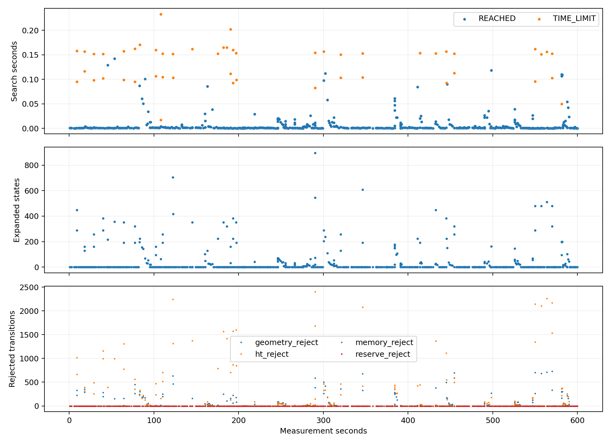
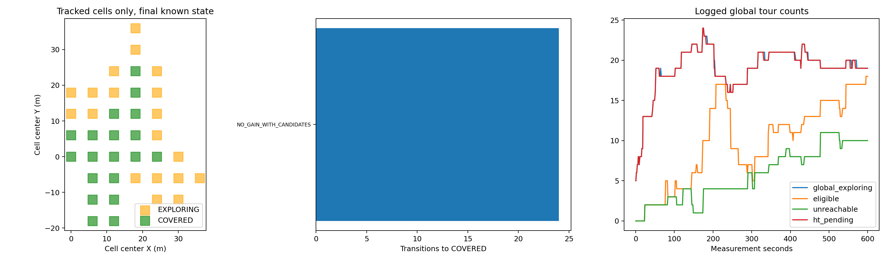
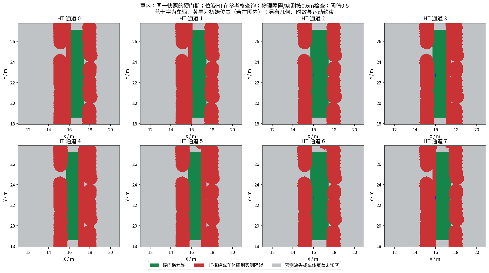
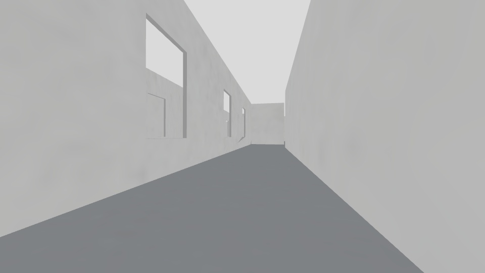
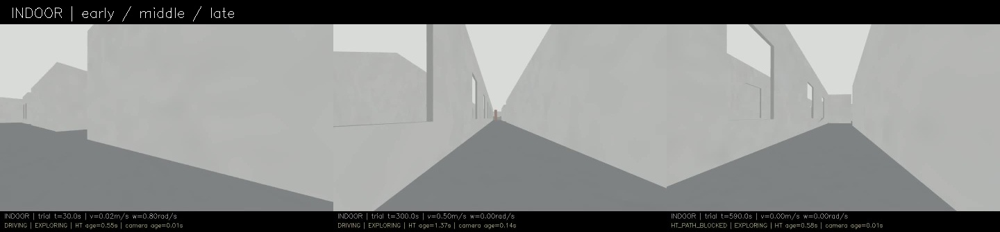
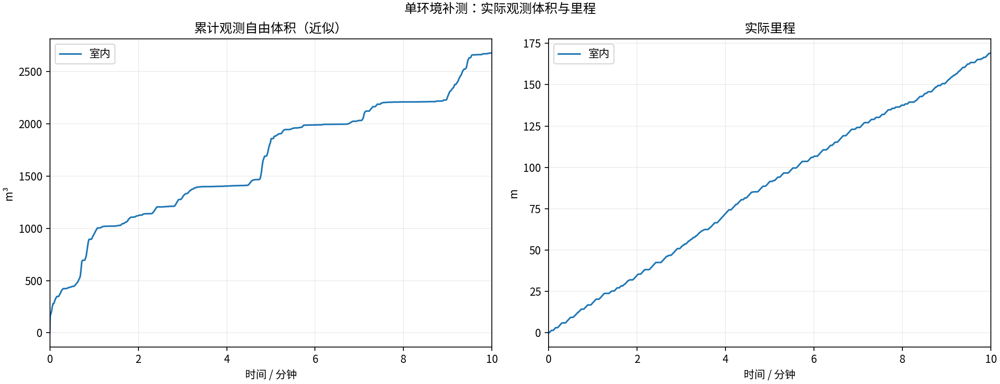
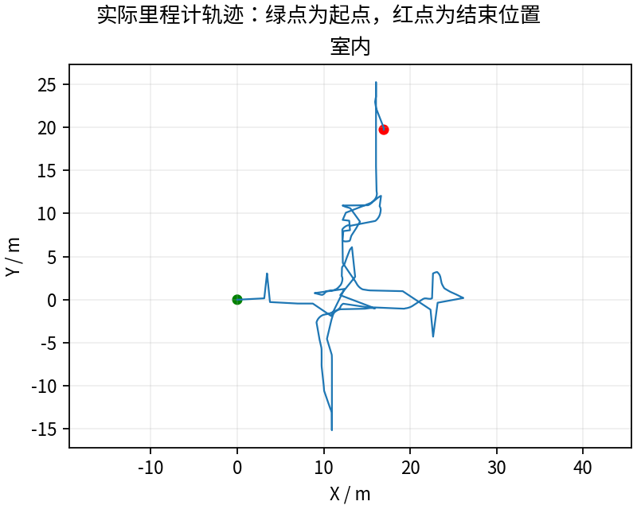
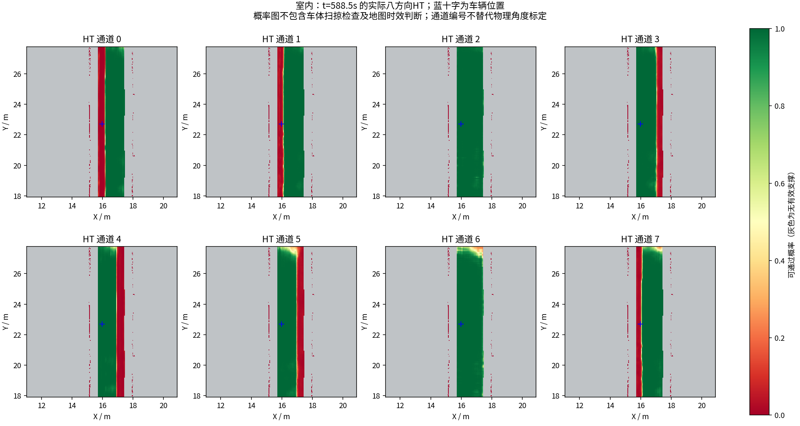

# 退出时完成诊断写入：同导航二进制完整600秒复测

**169.10米 / 2674.750立方米，末尾任务EXPLORING。** 最后一分钟17.364米，最长全零4.200秒，最后平移指令600.003秒。没有把定时录制完成解释成场景全部探索完毕。

## 修复什么、有没有改导航

阶段34录满600秒，但最后一份神经诊断NPZ在SIGINT期间压缩中断，出现BadZipFile及ZipFile析构seek of closed file；12/13检查通过，坏文件和失败状态已完整发布，没有补造诊断数据。

新实测`445b5c1`：SIGINT只请求停止，当前单线程回调完成后再退出、保存历史图和日志；诊断写临时文件并关闭ZIP后原子发布，绝不覆盖旧时间戳。异常半文件保持.partial并由审计判失败。[具体原因和边界](../../fixes/2026-10-19_context_shutdown.md)。

四项文件回归和一项实际bridge main ROS信号回归通过：包括数组写入期间真实SIGINT、快照/历史/日志完成、信号恢复、异常中断只留临时文件和竞争时不覆盖。[完整前后日志](regression/)。这组测试只针对本轮Python写入/退出变化，C++导航没有重编译或更换。

实际导航控制仍为391fa0f，C++程序、模型和所有规划/控制参数哈希一致；65份冻结清单中只变更桥接Python、冻结脚本和新增IO模块。[逐文件/实际参数对照](configuration_comparison.json)。单线程事件循环和IO时序仍可能改变，不能把本轮当完全无环境差异的随机重复。

## 完整退出与文件检查

13/13项采集/冻结/退出核验通过。全部61份完成的上下文NPZ进行ZIP CRC核对通过，损坏文件0，遗留.partial为[]；最终历史高程NPZ CRC通过。[文件完整性](indoor/context_integrity.json)。

59份测量窗口内上下文与同源发布图一致，三份冻结模型重算通过；本轮overall核验为True。[模型/支撑层核验](indoor/context_consistency.json)。只验证已保存的约10秒样本，不是假称每一帧或物理模型真值都正确。

视频8999帧、599.933333秒，完整解码。[完整视频](indoor/camera_h264.mp4) · [原始采集核验](indoor/suite_validation.json)。首次CLI参数查询短暂未发现控制节点，实时控制仍更新，重试成功；没有据此推断导航节点重启或运行数据丢包。[查询记录](indoor/parameter_capture_attempts.json)。

## 同场景历史对比

| 版本 | 里程m | 近似自由体积m³ | 备注 |
|---|---:|---:|---|
| 阶段30 | 169.57 | 3321.250 | 历史较高体积，仍有停顿 |
| 阶段33 | 151.57 | 2480.000 | 最长全零35.8s |
| 阶段34 | 168.77 | 2169.875 | 最长3.6s；退出一份快照损坏 |
| 本轮阶段35 | 169.10 | 2674.750 | EXPLORING |

本轮与阶段34使用相同导航二进制，但旧录包经用户授权清理后可用磁盘增加约14.85GB、Python退出/文件IO时序改变。曲线差异不等于诊断修复带来的探索提升；需区分闭环路径波动。体积为600个源秒激光的0.5m自由体素并集近似、跳过0，不是真值覆盖率。

748次搜索中575次验算连接成功，退出{'REACHED': 697, 'TIME_LIMIT': 51}；搜索最大0.233278秒。当前导航仍含简单连接优先/原图回退，不保证最短时间；地图/路径时效、全局未连接或不可观察任务、目标回访与整体收益仍需分析。最长停车记录见[实际停顿与对应搜索](indoor/stop_episodes.json)。

实际晚拒绝是否发零见[拦截核查](indoor/blocked_commands.json)，几何录制样本见[几何分析](execution_geometry_audit/summary.json)。采样检查不能证明所有时刻的物理安全、完整轮胎/滑移动力学或任意环境稳定。仍需同版多环境、独立覆盖真值与实车验收。

## 数据保存

用户确认GitHub保留全部完整录包，本机只保留最近两轮。旧轮先核对Release附件与逐文件SHA256再清理，报告/视频/回归样本保留。[清理回执](../../experiments/local_raw_retention.json) · [保存与下载说明](../../experiments/LOCAL_DATA.md)。本轮完整MCAP/CSV/日志/周期图/模型上下文和MP4发布后再推进下一轮。激光源秒抽样、地图周期快照，不是所有传感器无损采集。

---

# HT 室内10分钟补测

每组测量 600 秒，从首个具备里程计和激光输入的TARE运行周期开始计时；初始化不计入。
每个场景独立启动、独立高程历史，上一组完全退出且视频处理结束后再启动下一组。车速上限均为0.5m/s，HT硬约束与3秒时效保护相同。
采用对应场景TARE参数；车库沿用历史配对起点，其余使用各自仿真原生起点。因此这不是相同场景的算法优劣对照。
相机原生960×540、15fps，视频含状态条并裁去初始化；重复帧代表真实图像更新间隔，不做插帧。

| 环境 | 状态 | 实际里程(m) | 近似观测体积(m³) | 末尾任务状态 | 视频 |
|---|---|---:|---:|---|---|
| 室内 | RECORDED | 169.10 | 2674.75 | EXPLORING | [播放/下载](indoor/camera_h264.mp4) |

[全部视频播放列表](videos.m3u) · [实时状态与校验](suite.json)

每个场景仅一次10分钟测试，不能据此证明更长时间、所有环境或实车稳定。定时记录完成不等于探索完成。观测体积是抽样激光射线的自由体素并集近似，不是真值覆盖率；跨场景体积不可直接作为算法优劣排名。

## 实际出现的问题

下表保留暂停和地图延迟，不把“节点未崩溃”当作“没有问题”。地图年龄为1Hz抽样，完整控制消息保留在本地MCAP中。全零指令表示既不平移也不转向；原地转向单独统计。

| 环境 | HT年龄P95/最大(s) | 年龄>3s样本 | 全零指令占比 | 最长全零指令(s) | 全局引导无进展释放 | 验证失败项 |
|---|---:|---:|---:|---:|---:|---|
| 室内 | 1.82 / 3.28 | 2 | 13.6% | 4.20 | 2 | 无 |

遇到旧HT地图时仍执行3秒时效保护；没有为让车持续前进而放宽硬约束。全局引导释放说明该段目标没有持续接近，不能解释为该目标已经到达或覆盖完成。

| 环境 | 实收激光/600s | 平均频率(Hz) | 最大接收间隔(s) | 同源对齐检查点 | 观察器与建图器计数差恒定 |
|---|---:|---:|---:|---:|---|
| 室内 | 2987 | 4.98 | 0.54 | 13 | True |

计数差恒定只支持这些对齐区间内没有新增相对漏收；不能证明源端始终连续发布，也不能排除两个订阅者同时漏收。各场景均保留完整扫描计数和原始时间戳检查点。

### 室内末段实际HT

[同期接收的相机画面](indoor/late_camera.jpg) · [原始图层快照](indoor/late_map_snapshot.npz) · [时间与坐标元数据](indoor/late_map_snapshot.json)

全部视频按15fps、600秒裁剪，时长校验允许1帧误差，完整解码通过；实际帧数和时长见各组video_validation.json。各组共有源文件的65项哈希一致，各组自身冻结文件核验见suite_validation.json。

相机年龄是图像接收后的年龄；相机仿真时间戳与导航墙钟不同，不能把该数值解释为传感器端到端延迟。原始MCAP、全高程历史和输入诊断保存在suite.json所列本地目录；本次只发布选取的数据与视频。
