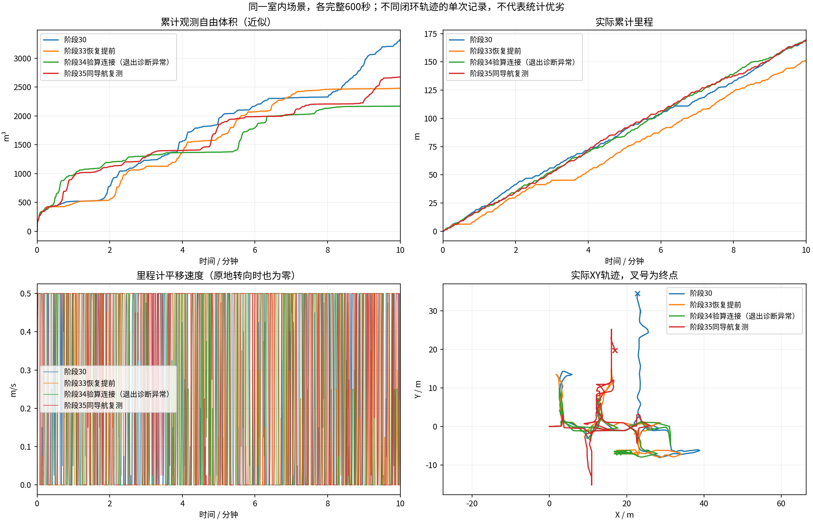

# 同场景版本10分钟对比

各组600秒；同场景原生起点、相同速度上限和体积统计定义。计时起点允许5cm/0.02rad差异，实际位姿保存在JSON中。不同闭环轨迹的单次试验，不能独立归因或证明普遍优劣。
体积是0.5m自由体素并集近似，不是真值覆盖率。平移速度为零也可能是在原地转向。

| 版本 | 代码 | 里程(m) | 观测自由体积(m³) | 最终状态 | BLOCKED抽样占比 | 规划P95(s) |
|---|---|---:|---:|---|---:|---:|
| 阶段30 | `ce7202b` | 169.57 | 3321.250 | EXPLORING | 8.2% | 1.469 |
| 阶段33恢复提前 | `ba7942c` | 151.57 | 2480.000 | EXPLORING | 16.8% | 1.378 |
| 阶段34验算连接（退出诊断异常） | `391fa0f` | 168.77 | 2169.875 | EXPLORING | 3.5% | 1.540 |
| 阶段35同导航复测 | `445b5c1` | 169.10 | 2674.750 | EXPLORING | 3.2% | 1.509 |

原始目录、输入CSV和记录校验文件的哈希保存在[comparison.json](comparison.json)。
视频、原始MCAP与地图快照在各运行目录；历史结果中的精选归档可能只含视频、CSV和末段快照。

- 阶段30：`/home/lzz/my test/HT_Explo-fixposition/docs/results/ht_pending_gain_tasks_10min_2026-10-18/indoor`

- 阶段33恢复提前：`/home/lzz/my test/HT_Explo-fixposition/docs/results/ht_recovery_search_slot_10min_2026-10-19/indoor`

- 阶段34验算连接（退出诊断异常）：`/home/lzz/my test/HT_Explo-fixposition/docs/results/ht_checked_connections_10min_2026-10-19/indoor`
  采集未全部通过：no_child_or_cleanup_exception；完整保留异常，不能称为通过稳定性验收。

- 阶段35同导航复测：`/home/lzz/my test/HT_Explo-fixposition/docs/results/ht_atomic_context_10min_2026-10-19/indoor`
