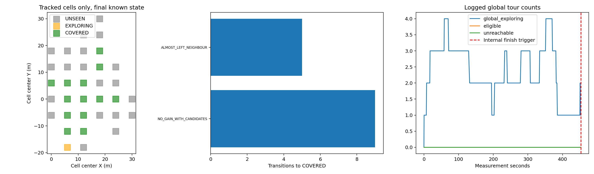
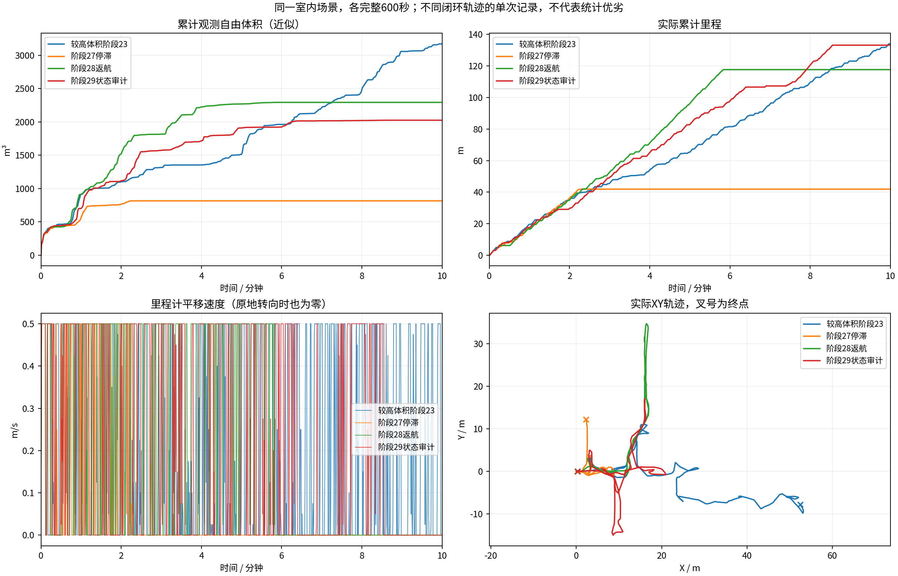
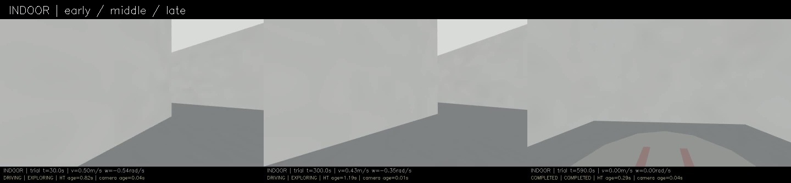
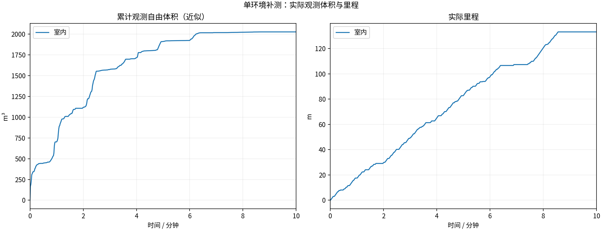
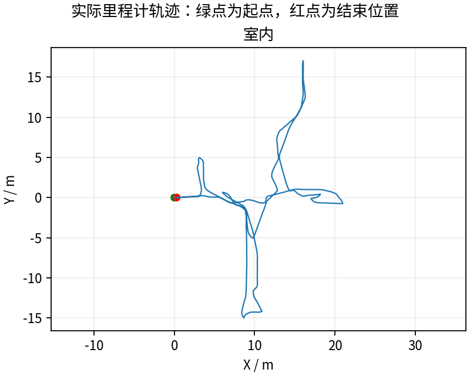
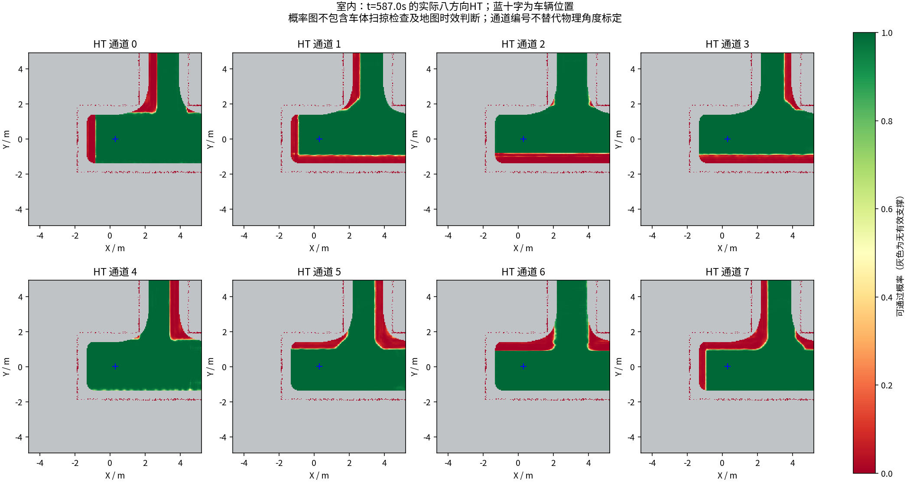
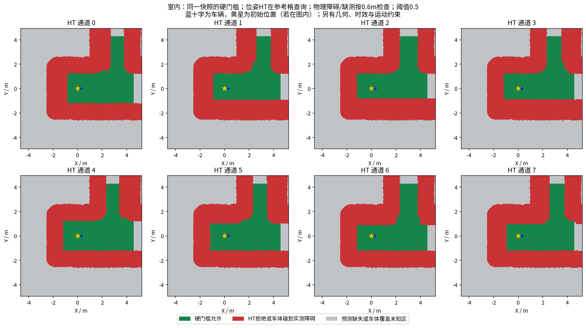

# 全局任务遗漏已取得逐单元证据

**完整600秒133.17m、2025.125m³，内部453秒结束探索、517.244秒完成返航。** 比阶段28的2292.75m³减少约11.7%，短时BLOCKED健康抽样93/600；不是性能改善或稳定版。

实测`b601015`。增加逐单元判定日志，并修复range-for遍历时erase同一vector的迭代器失效；保留覆盖阈值和原设计分类。本轮不宣称改好了任务遗漏。全部4个CTest目标通过；下一修正所需的两个期望行为测试则在现代码上明确失败，失败日志保留。

## 核心证据

5709条单元日志、29次状态转移。全程33个单元存在候选收益却保持UNSEEN；结束时12个单元最后已记录的收益仍为正，未加入全局EXPLORING集合。部分记录较旧，不直接当作当前物理未覆盖真值，但任务系统没有保留待复查记录。

更直接的是(24,0)m单元：451.695秒仍有129个候选，19个超过覆盖收益阈值、12个超过大收益阈值、63个超过前沿阈值，最高覆盖收益235，没有当前局部选中视点。452.889秒仅因移出全局局部邻域，从EXPLORING变COVERED；453.023秒便触发内部完成。约1.2秒前的正收益没有通过新观测被核销。

[完整单元日志与时序](cell_coverage_audit/summary.json) · [五次移出邻域转移及前一条记录](cell_coverage_audit/outside_transitions.json)。五次该分支都有前沿收益留存；其中两次(24,0)转移仍有覆盖/前沿收益。另9次COVERED来自候选收益归零，不能把所有COVERED都判错。

## 根因核对

GridWorld原来主要靠ViewPointSelected登记UNSEEN→EXPLORING；XYθ输出只选当前一条路的终点，其他有收益候选未必被选。另一方面，EXPLORING且当前未选中时，旧逻辑不检查剩余收益就放进almost_covered；一移出邻域便置COVERED。这把本轮不执行与真正完成覆盖混在一起。

使用实际编译的ViewPointManager与GridWorld做两个最小C++复现：正收益未选中的UNSEEN单元仍未登记；正收益EXPLORING单元移出邻域便错误变COVERED。**两项旧行为复现均失败于期望断言，原始日志见[pending_cell_regression](pending_cell_regression/)。** 使用235覆盖点/63前沿点的单候选最小输入验证状态规则，非整轮点云或聚合候选计数的逐值重放；不依赖放宽HT/几何门槛。

下一候选应基于实际收益登记待探索单元，并让仍有收益的单元保留全局待办。当前不可规划、未被局部选中与收益已核销要分开，不能靠降低HT阈值、放行未知或强行无限行驶掩盖。

## 版本比较与其他缺陷

| 轮次 | 里程m | 近似自由体积m³ | 最终内部状态 |
|---|---:|---:|---|
| 阶段23 | 134.00 | 3170.500 | BLOCKED |
| 阶段27 | 41.90 | 815.625 | BLOCKED |
| 阶段28 | 117.66 | 2292.750 | COMPLETED |
| 本轮阶段29 | 133.17 | 2025.125 | COMPLETED |

414份录制几何样本未发现参考点进入原安全半径，新增几何执行拒绝0次；14次晚HT拒绝全部配对零Twist，未匹配0。16次PATH_DISCONTINUITY、地图时延尾部仍需核查，不能只看完成信号。

最后mission为COMPLETED，但execution状态为HT_MAP_STALE，零速度保持；不能称为所有数据链路健康。HT健康抽样年龄P95约2.043s，最大4.096s；runtime P95约1.567s、最大1.934s。59份神经上下文同源输出一致，首/中/尾三次模型重算差0。源码冻结、完整录制和退出等13项核验通过，视频实际8999帧/599.933333秒，完整解码并满足600秒约定容差。

[视频](indoor/camera_h264.mp4) · [有效参数](indoor/planner_parameters.yaml) · [修改说明](../../fixes/2026-10-18_cell_coverage_audit.md)。整轮MCAP、CSV、逐单元日志、模型上下文、周期图、源码与失败复现均保存Release，激光为源秒采样，不是全传感器无损记录。多环境、独立真值覆盖、窄通道与完整动力学仍未验收。

---

# HT 室内10分钟补测

每组测量 600 秒，从首个具备里程计和激光输入的TARE运行周期开始计时；初始化不计入。
每个场景独立启动、独立高程历史，上一组完全退出且视频处理结束后再启动下一组。车速上限均为0.5m/s，HT硬约束与3秒时效保护相同。
采用对应场景TARE参数；车库沿用历史配对起点，其余使用各自仿真原生起点。因此这不是相同场景的算法优劣对照。
相机原生960×540、15fps，视频含状态条并裁去初始化；重复帧代表真实图像更新间隔，不做插帧。

| 环境 | 状态 | 实际里程(m) | 近似观测体积(m³) | 末尾任务状态 | 视频 |
|---|---|---:|---:|---|---|
| 室内 | RECORDED | 133.17 | 2025.12 | COMPLETED | [播放/下载](indoor/camera_h264.mp4) |

[全部视频播放列表](videos.m3u) · [实时状态与校验](suite.json)

每个场景仅一次10分钟测试，不能据此证明更长时间、所有环境或实车稳定。定时记录完成不等于探索完成。观测体积是抽样激光射线的自由体素并集近似，不是真值覆盖率；跨场景体积不可直接作为算法优劣排名。

## 实际出现的问题

下表保留暂停和地图延迟，不把“节点未崩溃”当作“没有问题”。地图年龄为1Hz抽样，完整控制消息保留在本地MCAP中。全零指令表示既不平移也不转向；原地转向单独统计。

| 环境 | HT年龄P95/最大(s) | 年龄>3s样本 | 全零指令占比 | 最长全零指令(s) | 全局引导无进展释放 | 验证失败项 |
|---|---:|---:|---:|---:|---:|---|
| 室内 | 2.04 / 4.10 | 5 | 39.6% | 86.60 | 3 | 无 |

遇到旧HT地图时仍执行3秒时效保护；没有为让车持续前进而放宽硬约束。全局引导释放说明该段目标没有持续接近，不能解释为该目标已经到达或覆盖完成。

| 环境 | 实收激光/600s | 平均频率(Hz) | 最大接收间隔(s) | 同源对齐检查点 | 观察器与建图器计数差恒定 |
|---|---:|---:|---:|---:|---|
| 室内 | 2989 | 4.98 | 0.25 | 11 | True |

计数差恒定只支持这些对齐区间内没有新增相对漏收；不能证明源端始终连续发布，也不能排除两个订阅者同时漏收。各场景均保留完整扫描计数和原始时间戳检查点。

### 室内末段实际HT

[同期接收的相机画面](indoor/late_camera.jpg) · [原始图层快照](indoor/late_map_snapshot.npz) · [时间与坐标元数据](indoor/late_map_snapshot.json)

全部视频按15fps、600秒裁剪，时长校验允许1帧误差，完整解码通过；实际帧数和时长见各组video_validation.json。各组共有源文件的63项哈希一致，各组自身冻结文件核验见suite_validation.json。

相机年龄是图像接收后的年龄；相机仿真时间戳与导航墙钟不同，不能把该数值解释为传感器端到端延迟。原始MCAP、全高程历史和输入诊断保存在suite.json所列本地目录；本次只发布选取的数据与视频。
