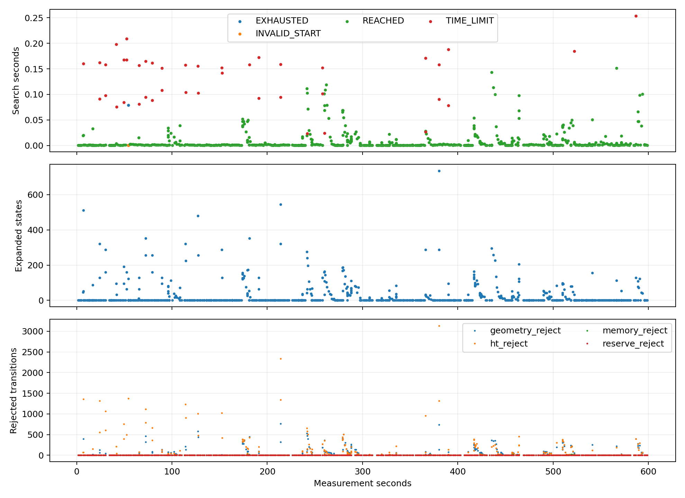
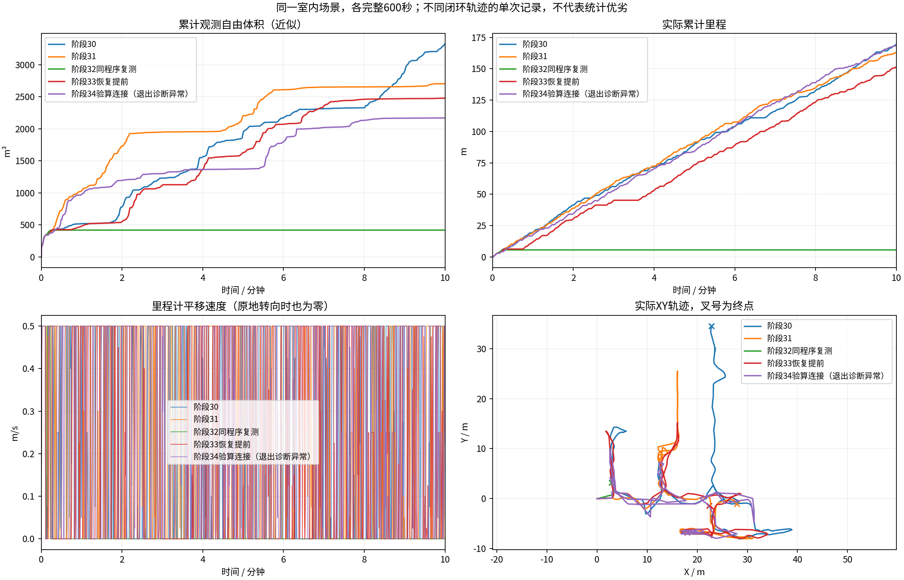
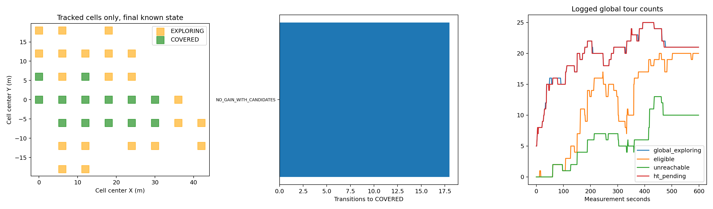
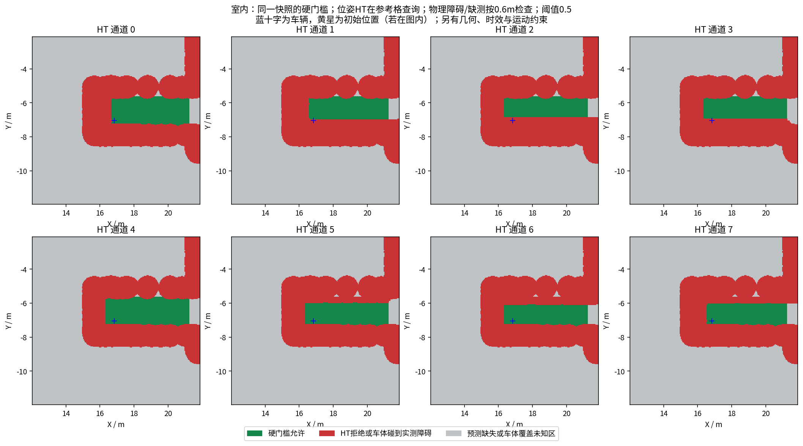
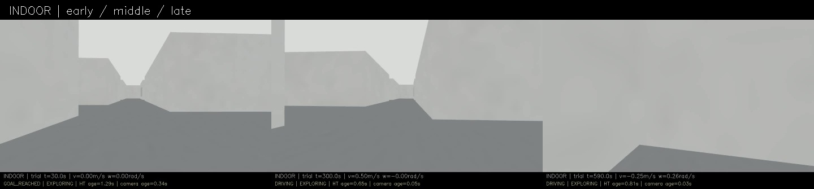
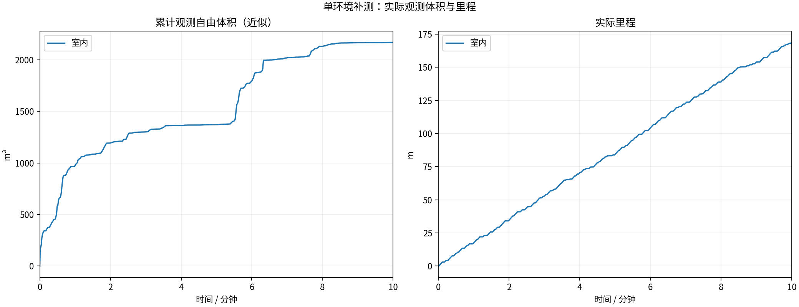
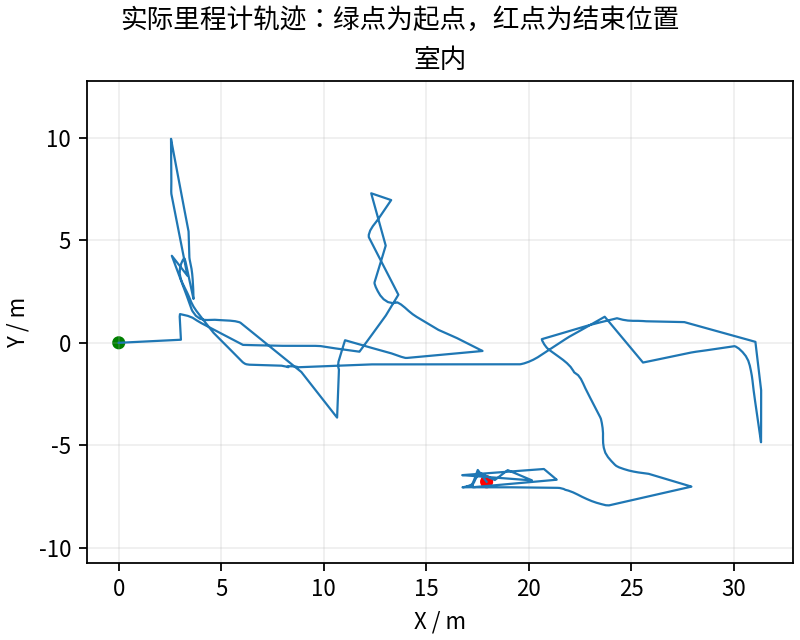
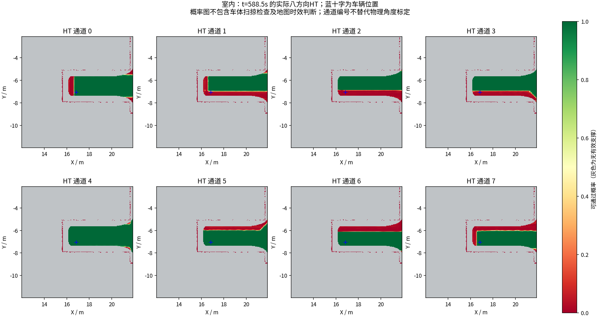

# 先验算简单SE2连接：完整600秒，但退出诊断快照损坏

**168.77米 / 2169.875立方米，末尾任务EXPLORING。** 相较阶段33体积下降约12.5%、里程增加约11.3%；不能把局部顺畅直接当成探索收益提高。最后60秒14.826米，最后平移指令600.001秒，最长全零3.600秒。前轮阶段33是151.57m/2480m³、最长全零35.8秒，不能只凭路线变了就宣称稳定。

## 本轮采集异常必须保留

本轮12/13项采集检查通过，`no_child_or_cleanup_exception=false`，原始suite仍RECORDED_WITH_ISSUES/COMPLETED_WITH_ISSUES，没有改成通过。退出时源时间598.711秒的一份NPZ压缩写入被打断，出现ZipFile析构的seek of closed file；最终历史图保存完成，全部子进程正常退出且无遗留。600秒MCAP、轨迹、源秒激光与9000帧600秒视频均保留，但不能称全部诊断完整。坏文件原样保留于[损坏样本](damaged_context/)，SHA256/原始检查见[异常清单](recording_issues.json)。

57份可读上下文同源检查及三份模型重算通过；overall all_checks_passed仍为false。对比图特意标注退出诊断异常，不能混成无异常成功轮。需修复中断写入后再做新的完整600秒。

## 已确认的原因和改动

阶段33最长停车里，恢复目标也反复超时，已不是普通恢复完全未获得机会。按实际HT源时间戳、公开碰撞/候选视点和车位冻结复核：目标(12.75,2.85)和(13.05,2.25)可由相同硬检查通过的转向后直行/倒车连接到达；原图搜索需6709和8633次谓词检查，在较小恢复预算下超时。公开话题重建不能完全恢复内部回调/滚动原点；不把此结果称作精确当时内部状态重放。

新实测`391fa0f`，先尝试“原地旋转+沿车身轴前进/倒车”，每0.05rad/0.05m用原HT、几何、未知、失败记忆和航向检查验算；受阻则回原Hybrid A*。连接朝向是连续连线角；原图搜索32航向键和11.25°/22.5°曲线动作保留，不能说全部路线都只有32档角度。没有侧移，速度/角速度上限与总搜索预算保持；不是完整轮胎/滑移动力学证明。

[原因、微基准及边界](../../fixes/2026-10-19_direct_connection.md) · [原输入、探针和回归](regression/) · [实际参数和哈希对照](configuration_comparison.json)。本轮只有导航程序、XYθ规划头文件和HT路由源码三份清单项改变；全部实际参数一致。

## 实际运行中的作用

754次搜索中513次使用通过检查的直接连接（direct=1），其余仍可进入原图搜索；退出原因{'REACHED': 704, 'TIME_LIMIT': 42, 'EXHAUSTED': 1, 'INVALID_START': 7}。简单连接展开数可以为0，表示逐段验算成功，不表示跳过HT或几何。[每次搜索的次数、耗时和直接连接标记](search_audit/searches.csv)。

几何检查墙钟约占搜索92.8%（含调度等待），搜索P95=0.098941s、最大0.253844s。连接和图搜索共用单目标截止；原图每32次展开和昂贵单次谓词的截止长尾仍可能发生，不作硬实时保证。

## 同场景五轮比较

| 版本 | 里程m | 近似自由体积m³ | 备注 |
|---|---:|---:|---|
| 阶段30 | 169.57 | 3321.250 | 历史较高体积，仍有停车 |
| 阶段31 | 162.71 | 2703.875 | 末刻EMPTY_PATH |
| 阶段32同程序复测 | 5.66 | 419.750 | 早期长期停滞 |
| 阶段33恢复提前 | 151.57 | 2480.000 | 最长全零35.8s |
| 本轮阶段34 | 168.77 | 2169.875 | EXPLORING |

单次闭环路径不同，不能据此证明统计优越或每项改动的独立因果收益。体积为600个源秒激光、0.5m自由体素并集近似，跳过0，不是真值全域覆盖。总里程还包括回访、绕行和恢复。

## 核验与仍需处理的问题

全部4个CTest目标通过，核心新增禁行中间姿态、无侧移/采样上界、真实倒车、无效起点、半径/时间预算、连接受阻后曲线绕障。12/13项采集/冻结/退出核验通过，退出诊断异常未通过；视频9000帧、600.000000秒完整解码。[视频](indoor/camera_h264.mp4) · [核验](indoor/suite_validation.json)。

最长五段停车及对应搜索见[停车审计](indoor/stop_episodes.json)；边界是0.5秒CSV估计，完整20Hz指令统计才用于最长全零数值。恢复选择的实际周期见[逐次证据](indoor/recovery_wins.json)。晚HT/几何拒绝发零检查见[拦截审计](indoor/blocked_commands.json)，有限几何采样见[几何分析](execution_geometry_audit/summary.json)。

57份可读上下文与同源发布图一致、另有1份损坏，三份冻结模型重算见[模型核验](indoor/context_consistency.json)，这不证明物理模型准确。地图/路径时效、全局未连接或不可观察任务、重复/多环境、独立真值覆盖和实车仍需验收。简单连接可能选择更多原地转向、比其他曲线路线慢，不保证全局最短时间，也不宣称所有长期停滞已解决。

完整已录制MCAP/CSV/日志/周期图/模型上下文及视频按Release保存；激光源秒抽样、地图周期快照，不是全部传感器无损采集。

---

# HT 室内10分钟补测

每组测量 600 秒，从首个具备里程计和激光输入的TARE运行周期开始计时；初始化不计入。
每个场景独立启动、独立高程历史，上一组完全退出且视频处理结束后再启动下一组。车速上限均为0.5m/s，HT硬约束与3秒时效保护相同。
采用对应场景TARE参数；车库沿用历史配对起点，其余使用各自仿真原生起点。因此这不是相同场景的算法优劣对照。
相机原生960×540、15fps，视频含状态条并裁去初始化；重复帧代表真实图像更新间隔，不做插帧。

| 环境 | 状态 | 实际里程(m) | 近似观测体积(m³) | 末尾任务状态 | 视频 |
|---|---|---:|---:|---|---|
| 室内 | RECORDED_WITH_ISSUES | 168.77 | 2169.88 | EXPLORING | [播放/下载](indoor/camera_h264.mp4) |

[全部视频播放列表](videos.m3u) · [实时状态与校验](suite.json)

每个场景仅一次10分钟测试，不能据此证明更长时间、所有环境或实车稳定。定时记录完成不等于探索完成。观测体积是抽样激光射线的自由体素并集近似，不是真值覆盖率；跨场景体积不可直接作为算法优劣排名。

## 实际出现的问题

下表保留暂停和地图延迟，不把“节点未崩溃”当作“没有问题”。地图年龄为1Hz抽样，完整控制消息保留在本地MCAP中。全零指令表示既不平移也不转向；原地转向单独统计。

| 环境 | HT年龄P95/最大(s) | 年龄>3s样本 | 全零指令占比 | 最长全零指令(s) | 全局引导无进展释放 | 验证失败项 |
|---|---:|---:|---:|---:|---:|---|
| 室内 | 2.01 / 3.44 | 4 | 14.7% | 3.60 | 3 | no_child_or_cleanup_exception |

遇到旧HT地图时仍执行3秒时效保护；没有为让车持续前进而放宽硬约束。全局引导释放说明该段目标没有持续接近，不能解释为该目标已经到达或覆盖完成。

| 环境 | 实收激光/600s | 平均频率(Hz) | 最大接收间隔(s) | 同源对齐检查点 | 观察器与建图器计数差恒定 |
|---|---:|---:|---:|---:|---|
| 室内 | 2983 | 4.97 | 0.41 | 58 | True |

计数差恒定只支持这些对齐区间内没有新增相对漏收；不能证明源端始终连续发布，也不能排除两个订阅者同时漏收。各场景均保留完整扫描计数和原始时间戳检查点。

### 室内末段实际HT

[同期接收的相机画面](indoor/late_camera.jpg) · [原始图层快照](indoor/late_map_snapshot.npz) · [时间与坐标元数据](indoor/late_map_snapshot.json)

全部视频按15fps、600秒裁剪，时长校验允许1帧误差，完整解码通过；实际帧数和时长见各组video_validation.json。各组共有源文件的64项哈希一致，各组自身冻结文件核验见suite_validation.json。

相机年龄是图像接收后的年龄；相机仿真时间戳与导航墙钟不同，不能把该数值解释为传感器端到端延迟。原始MCAP、全高程历史和输入诊断保存在suite.json所列本地目录；本次只发布选取的数据与视频。
