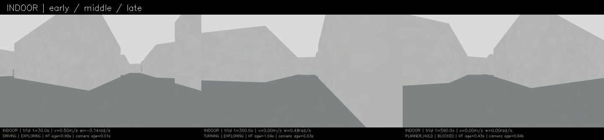
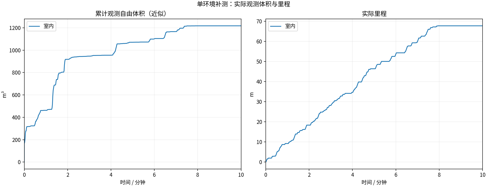
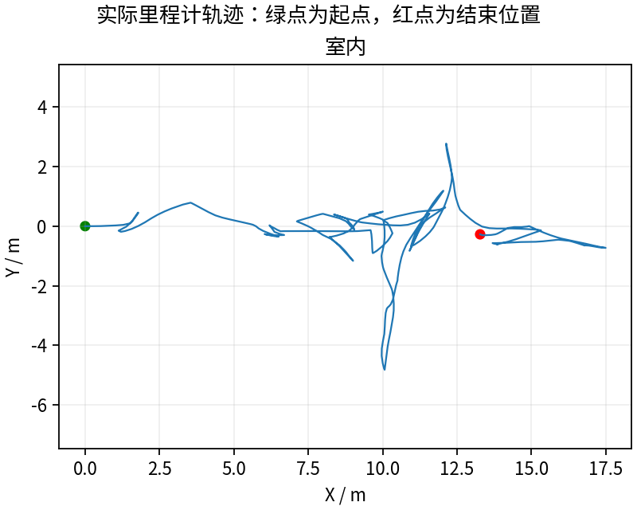
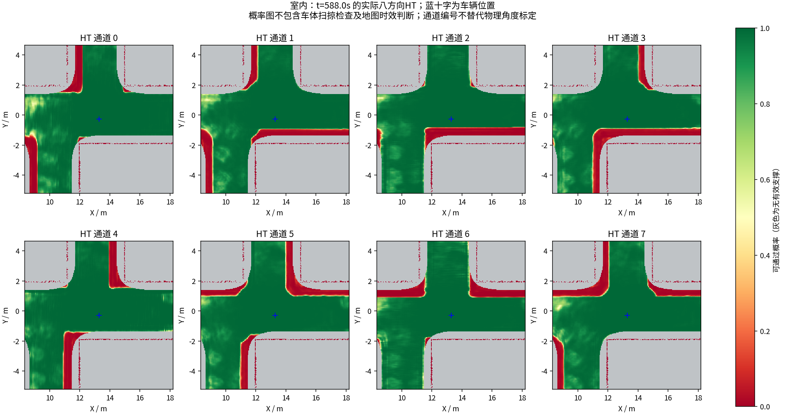
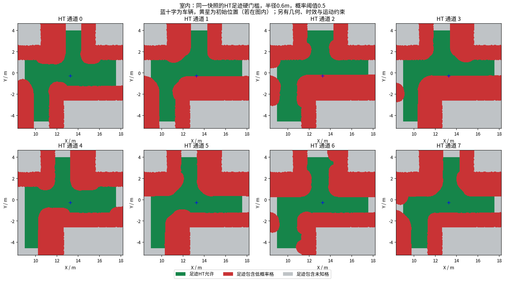

> 失败候选：室内476.36秒后卡住，末尾BLOCKED；146次晚拦截仍发布非零速度。联合约束不能代替控制消息修复。

# HT 室内10分钟补测

每组测量 600 秒，从首个具备里程计和激光输入的TARE运行周期开始计时；初始化不计入。
每个场景独立启动、独立高程历史，上一组完全退出且视频处理结束后再启动下一组。车速上限均为0.5m/s，HT硬约束与3秒时效保护相同。
采用对应场景TARE参数；车库沿用历史配对起点，其余使用各自仿真原生起点。因此这不是相同场景的算法优劣对照。
相机原生960×540、15fps，视频含状态条并裁去初始化；重复帧代表真实图像更新间隔，不做插帧。

| 环境 | 状态 | 实际里程(m) | 近似观测体积(m³) | 末尾任务状态 | 视频 |
|---|---|---:|---:|---|---|
| 室内 | RECORDED | 67.69 | 1217.25 | BLOCKED | [播放/下载](indoor/camera_h264.mp4) |

[全部视频播放列表](videos.m3u) · [实时状态与校验](suite.json)

每个场景仅一次10分钟测试，不能据此证明更长时间、所有环境或实车稳定。定时记录完成不等于探索完成。观测体积是抽样激光射线的自由体素并集近似，不是真值覆盖率；跨场景体积不可直接作为算法优劣排名。

这是原中止批次中已完成600秒记录的子集，未完成场景不计入验收。详见EXPORT.json。

## 实际出现的问题

下表保留暂停和地图延迟，不把“节点未崩溃”当作“没有问题”。地图年龄为1Hz抽样，完整控制消息保留在本地MCAP中。全零指令表示既不平移也不转向；原地转向单独统计。

| 环境 | HT年龄P95/最大(s) | 年龄>3s样本 | 全零指令占比 | 最长全零指令(s) | 全局引导无进展释放 | 验证失败项 |
|---|---:|---:|---:|---:|---:|---|
| 室内 | 1.97 / 2.73 | 0 | 43.4% | 123.63 | 13 | 无 |

遇到旧HT地图时仍执行3秒时效保护；没有为让车持续前进而放宽硬约束。全局引导释放说明该段目标没有持续接近，不能解释为该目标已经到达或覆盖完成。

| 环境 | 实收激光/600s | 平均频率(Hz) | 最大接收间隔(s) | 同源对齐检查点 | 观察器与建图器计数差恒定 |
|---|---:|---:|---:|---:|---|
| 室内 | 2987 | 4.98 | 0.25 | 24 | True |

计数差恒定只支持这些对齐区间内没有新增相对漏收；不能证明源端始终连续发布，也不能排除两个订阅者同时漏收。各场景均保留完整扫描计数和原始时间戳检查点。

### 室内末段实际HT

[同期接收的相机画面](indoor/late_camera.jpg) · [原始图层快照](indoor/late_map_snapshot.npz) · [时间与坐标元数据](indoor/late_map_snapshot.json)

全部视频按15fps、600秒裁剪，时长校验允许1帧误差，完整解码通过；实际帧数和时长见各组video_validation.json。各组共有源文件的55项哈希一致，各组自身冻结文件核验见suite_validation.json。

相机年龄是图像接收后的年龄；相机仿真时间戳与导航墙钟不同，不能把该数值解释为传感器端到端延迟。原始MCAP、全高程历史和输入诊断保存在suite.json所列本地目录；本次只发布选取的数据与视频。

体积沿用当时评估口径；重复采样问题及同包更正见[原因核查](../ht_completion_cause_audit_2026-10-18/REPORT.md)。
