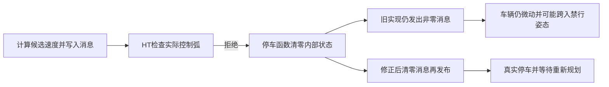
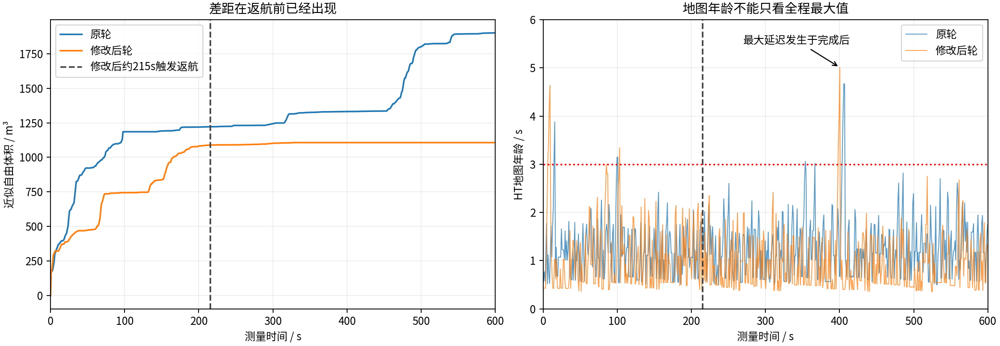
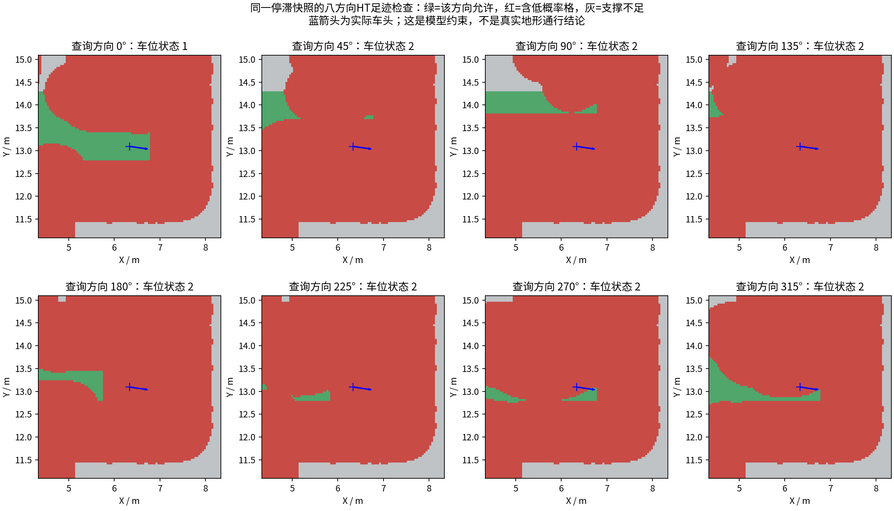
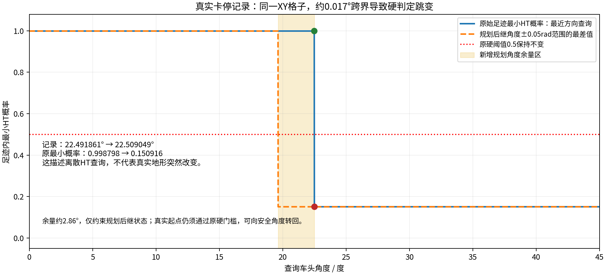
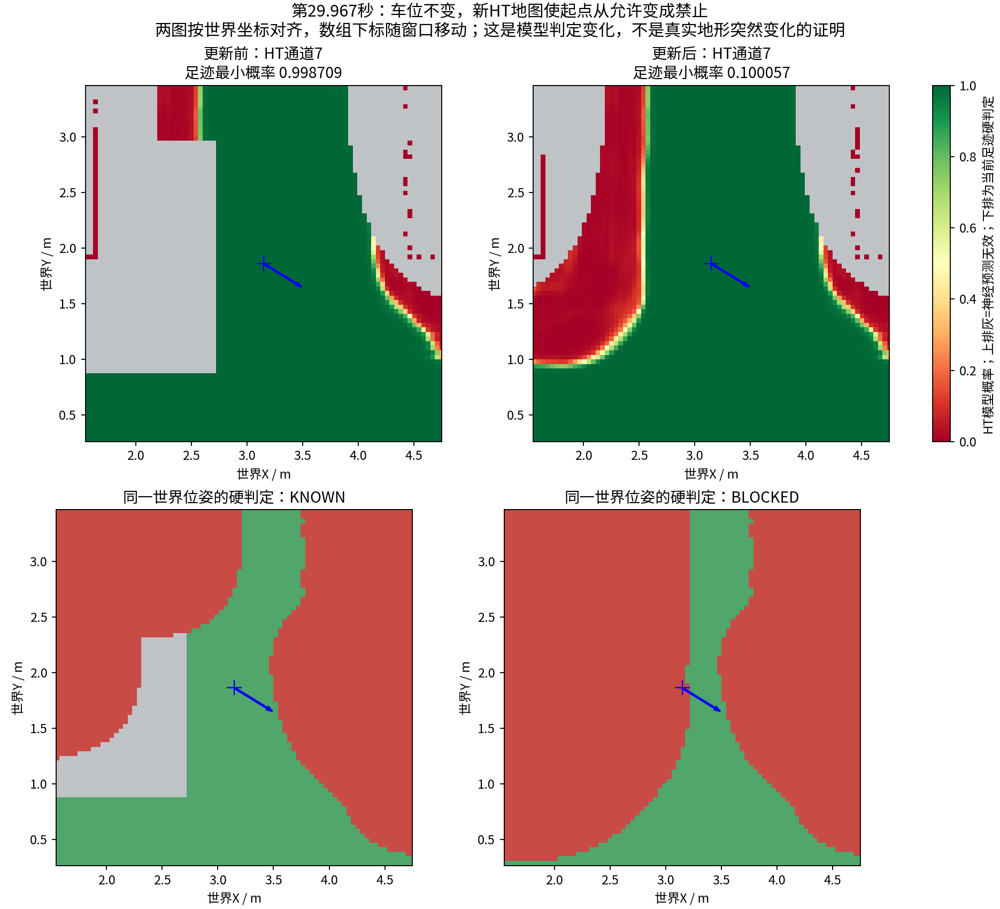
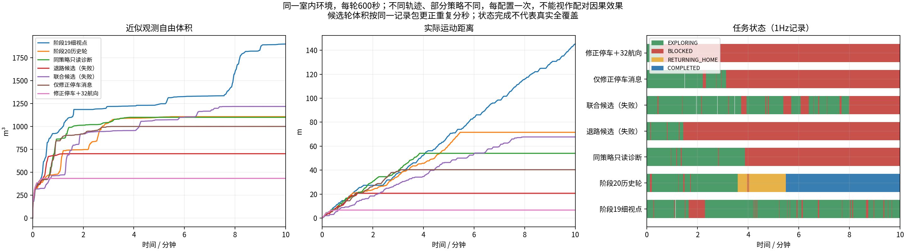

# 停滞与提前收尾：原因核查，而不是凭现象改参数

最终复测：**隧道返航完成，室内仍失败。**室内剩余停滞已进一步定位到“新有效的8个HT邻格进入足迹硬门槛”，车位中心预测基本未变。以下区分已修正的实现错误、已排除的解释和仍未修改的地图接口问题。

**找到了一个真实的执行错误：跟踪器判定候选速度被HT拦截后，仍把那条非零候选速度发给了车。**联合候选室内记录中有146次这种事件，临近最终卡死前连续发送0.025m/s、−0.06rad/s；新增回归测试在旧实现上失败，修正后通过。这比“加退路约束”“加航向余量”的解释更直接，因此关闭两项尚未验证有效的默认约束，优先修正发送错误。

另外，体积评估有一次重复分秒采样的问题，导致本轮600帧只处理576帧；已经用同一包验证改正后处理600帧。这是评估错误，不是车辆停车原因。

此前的“215秒收尾”和新复现的“HT约束下卡住”仍须区分，不能把这个执行错误未经复核地用于解释所有历史收尾。以下保留完整的排查过程、失败候选与反例。

## 直接根因：拦截函数没有清空已经写好的消息

旧代码先执行`cmd.twist.linear.x=linear_`和`cmd.twist.angular.z=angular_`，再检查实际控制弧。检查失败后调用`hold()`，它清零的是`linear_`、`angular_`内部状态，却直接发布已写有候选速度的`cmd`。较早的停车分支执行时`cmd`还未赋值，所以之前“过期地图会停车”等测试无法发现这个晚分支错误。

这也解释了反复微动：晚检查失败后内部速度归零，下一周期重新从加速度步长开始计算，又把被拒的小速度发出。实际包中最后数次是0.025m/s和−0.06rad/s，与线加速度0.5m/s²、角加速度1.2rad/s²和50ms控制周期吻合。最后车辆航向跨过157.5°方向边界，当前姿态随后被HT拒绝；搜索从这个已被拒绝的起点出发，不能再生成正常路线。

修正为在所有`hold()`分支发布前明确执行`cmd.twist=geometry_msgs::msg::Twist()`，清零实际消息的全部六个速度分量。控制修复提交`8e8d2b7`，记录/评估修复`37f0d42`。没有通过降低HT门槛来让车越过被拒区域。

证据：[146次非零拦截事件](blocked_nonzero_commands.json) · [旧实现回归失败](regression/late_hold_before.log) · [修正后完整回归](regression/zero_hold_ctest.log) · [逐例结果](regression/zero_hold_cases.log) · [最后一次同图方向跨界](combined_indoor_pose_changes.json)。核心384检查、ROS20例及跟踪器8例通过，三个真实快照用例没有跳过。

这是确定的实现错误及其可复现触发，不等于所有停滞都由它独立造成。物理通行真值、方向标签语义与其他无路情形仍保留以下限制。

## 1. 先纠正此前可能误导的解释

| 解释 | 核查结果 | 能说明什么，不能说明什么 |
|---|---|---|
| 室内最终观测量少41.8%，全是215秒返航造成的 | 不能成立 | 60秒时两轮已经是936.754与480.193m³，早于返航；轨迹已不同。后续停车可能影响最终量，但没有反事实实验，不能算出其独立贡献。 |
| 地图最坏延迟5.01秒导致215秒返航 | 时间顺序不成立 | 最坏值在400.240秒，任务已COMPLETED；不能解释215.002秒的决策。 |
| `global_return=1`就是全图没有任务了 | 不成立 | 全局层会把本地EXPLORING单元交给局部层，自己没有外部行程时也可发返航提示；还必须结合局部完成条件。 |
| 只是记录短了或观测体积口径变了 | 现有归档不支持 | 两轮都600秒、处理600帧体积扫描、跳过0帧，体素/射线/位姿口径一致。不能由此证明全频激光从未漏帧。 |
| TARE虚拟覆盖让HT有收益目标被误判为完成 | 没有复现 | 只读诊断545行里没有局部完成和返航触发。原215秒现场缺少这些内部队列证据，尚不能确认或排除。 |

[量化核查](pair_audit/audit.json) · [逐项假设与边界](hypotheses.json)

## 2. 第一类新停滞：当前硬约束留下的可达分量很小

保持原导航决策，只增加观测日志的600秒室内复测，在约230秒后卡在(6.333,13.093)m。最终54.02m、1099.750m³、BLOCKED，**没有发出任务完成**。节点没崩溃不等于探索成功。

固定这个现场输入后，车体足迹内物理未知格为0，强制八方向置零格为0；通道0允许，但其余方向足迹内均有低概率格。例如相反的180°方向包含278个低概率格。因此，“车底看不到”并不是这次停滞的解释，HT硬约束确实在拒绝回退或转向。

实际C++地图查询和XYθ搜索在同一输入上做6种分辨率×9个目标，共54次：16/32/64航向，以及更短运动步长、更细XY栅格，全部失败。各次仅展开8至120个状态，毫秒内耗尽，远没用完0.7秒和80000次展开预算。**对这个快照，单纯加算力或调细搜索没有找出路。**这不是连续空间完全不可达的数学证明，也不能推及其他停滞。

[原始HT与位姿](captured_stop/map.npz) · [足迹计数](captured_stop/footprint_evidence.json) · [54次搜索日志](captured_stop/resolution_audit.log) · [600秒失败视频与数据](../ht_completion_diagnostic_10min_2026-10-18/REPORT.md)

## 3. 第二类停滞：极小航向变化跨过HT方向分档

退路检查候选的84.262秒现场提供了更明确的配对证据：**同一张地图、同一个XY格子**，位置仅移动约0.125毫米，航向从22.491861°变成22.509049°。因为查表方向从0°通道切换到45°通道，足迹最小概率从0.998798跳到0.150916，随后跟踪器报告`HT_CURRENT_POSE_BLOCKED`，搜索起点也被拒绝，展开0个状态。

这证明该次拒绝来自方向分档切换，不需要假设地图变旧或地形突然变化。但它**没有证明哪个通道符合真实物理通行情况**。八方向HT预测与当前足迹规则共同产生了这个跳变。

[边界原始输入](heading_boundary/map.npz) · [精确数值](heading_boundary/boundary_numbers.json) · [完整消息回放审计](candidate_pose_changes.json)

审计使用MCAP接收顺序，跟踪器内部的回调顺序可能不同。最近一条已记录速度命令的常值外推，终点落到另一个格子，而不是该危险格。**不能只检查外推终点就断言跟踪器漏检，也不能从日志接收顺序声称已知道它当时使用的精确快照。**原跟踪器本来就检查分段扫掠；这部分的进入机制仍需内部快照证据。

## 4. 根据证据做的候选修改，以及它们的反例

1. **可选同弧退路检查**：保留实际行驶方向、车头方向和扫掠检查，另要求同一段反向行驶也通过。没有平均正反概率或降低0.5门槛。它比“存在别的绕行退路”更保守，也不能保证新观测后仍可退回。
2. **可选航向余量**：未来规划采样点还检查θ±0.05rad，避开上述分档边界；搜索用32个航向。实测根状态仍必须满足原HT硬规则，只豁免额外余量，避免根状态本来合法却无法向内转。它不能让原本被HT禁止的起点重新合法。

单独试验的反例必须保留：退路检查仍在84秒遇到方向边界卡死；航向余量单独试验在约38秒到达一处当前姿态合法、却没有搜出后续路线的位置。后者没有进行原快照那样的54种搜索审计，不能声称已经排除分辨率或预算影响。两项约束只限制运动，不会自动创造出口，更不保证探索收益上升。

| 试验 | 实测代码 | 记录时长 | 当前证据 |
|---|---|---:|---|
| 原策略加只读诊断 | `9fec037` | 600秒 | 54.02m；1099.750m³；约230秒后持续BLOCKED；未触发完成。 |
| 仅同弧退路检查 | `fde3736` | 室内600秒 | 20.66m；702.375m³；约84秒方向分档后持续BLOCKED；失败。原批次隧道被中止，未称作600秒。 |
| 仅航向余量和32航向 | `966f3ff` | 约212秒，中止 | 约38秒后持续无可执行路线；不是600秒验收，不参与600秒成绩排名。 |
| 联合候选 | `77cd87c` | 室内600秒；隧道约314.5秒后中止 | 室内67.69m，原评估1217.250m³，纠正重复采样后1218.250m³；476.36秒同图跨界后卡住。确认拦截仍发非零命令后中止隧道，不称作600秒通过。 |
| 仅修正发零速度 | `37f0d42` | 室内600秒；剩余批次中止 | 40.34m，1000.125m³，约186.5秒后持续无路线。37次晚拦截全部配对、非零0次，漏发停车已消失，但16航向仍漏掉新快照的出口。 |

[退路单项600秒失败归档](../ht_reversible_candidate_10min_2026-10-18/REPORT.md) · [航向余量单项回放审计](reserve_only_pose_changes.json)

[联合候选室内完整失败视频](../ht_combined_candidate_10min_2026-10-18/REPORT.md)。联合候选的全零指令最长123.63秒，记录末段BLOCKED、未触发完成；不能因67.69m或体积增加就称为稳定。两项额外约束现均默认关闭，保留可选代码和反例供后续独立研究。

## 5. 还需检验的更深一层：HT输出的含义

部署权重与训练记录的权重SHA-256完全相同。这套八方向学生由教师蒸馏，加载器包含约0.44m的教师/学生参考点偏移和明确的图像Y轴约定。本地标签生成代码同时涉及向前运动进度、roll/pitch安全、耗时、横向偏差以及静态失败样本。**低概率不能独立区分“前进失败”与“当前静态姿态危险”，也不是实际障碍物真值。**

这里存在值得审计的接口假设：当前`poseSupport`把车头方向HT当作姿态前提，倒车还检查相反行驶方向，再对概率图施加0.6m足迹检查。训练时预测位置的参考点、模型已包含的车体范围及正反运动语义，需要逐项与部署对齐。现有资料没有完整逐样本原始仿真轨迹，不能凭一个疑点直接改坐标、取消足迹或允许从被拒起点开走。

[输入文件哈希、权重对应关系与限制](label_semantics_audit.json)。本轮没有根据这项待验证假设绕过HT安全门槛。

## 6. 保留下来的诊断能力

- 完成决策记录实际全局队列分类、本地覆盖队列、收益阈值和通过HT搜索的真实目标；不会把全局返航提示单独解释为完成。
- 后续试验MCAP记录全频HT输出，用同图、同位姿对照分开“地图更新”与“车辆移动”的影响。高程历史仍保存，但原始CuPy和全部原始激光没有全频入包，不能称作全部输入无损回放。
- 保存真实卡死快照做C++地图/规划回归；原硬门槛、碰撞、未知区、3秒新鲜度保护均保留。

测试通过只能证明这些可复现输入下的行为，不能代替闭环稳定性验收。已经失败的候选不应标注为“问题已解决”。

## 7. 独立发现的体积统计错误

记录器每个绝对整秒保留第一帧激光；旧评估器又按“时间戳减实验起点”的相对整秒挑第一帧。当起点含小数秒、帧间时间有抖动时，两个已保留扫描可能落入同一相对秒，另一个相对秒为空。并非输入漏收，却会被再次舍弃。

时间戳审计：联合候选室内600个绝对秒、600帧，对应576个相对秒，评估额外丢24帧；退路单项同样600帧，却只对应596个相对秒。此前两个历史对比轮及只读诊断轮恰好都对应600个相对秒，因此**这个错误不能解释此前41.8%的差异**。

修正后的长测评估按原记录器的绝对源秒去重，只按实验窗口筛选，不再重新分秒。对完全同一联合候选数据包，处理数576→600，跳过0，体积1217.250→1218.250m³，指令数及轨迹不变。原始归档不覆盖，离线更正另存。常规原TARE配对评估仍保留其原采样选项，新长测明确采用`source_second`并记录评估脚本哈希。

[600个源时间戳与分箱审计](combined_scan_bins.json) · [正式修正评估的同包重算](corrected_metrics/combined_indoor/comparison.json)。这修复了评估一致性，不能让车辆多走一米，也不是安全或覆盖率提升的证据。

## 8. 再次反驳自己的解释：新的停滞确实有HT合法出口

关闭额外约束、只修正停车消息后，室内又在(4.198,13.142)m停住。不能因为第一张旧快照加细搜索都失败，就把这次也认定成不可达。

固定这张新地图再做同样54次C++审计，结果不同：16航向只能到一个很近的测试检查点，8个2m方向目标均失败；只把航向细化为32、保留原0.3m XY键和0.4m行驶原语，就能到达其中4个2m目标。换成更短步长但仍16航向，依然没找到这4条路线。因此，这张地图上，**航向离散确实漏掉了HT允许的转向组合**。32航向各次搜索最长约25.5ms；更细并不总更快，64航向某次约264ms。

这也是对“只是HT图无路”的反例。原图与新图的结论都保留，不能挑一张图代表所有场景。[新快照、54次结果和日志](zero_only_indoor_stop/resolution_audit.json) · [足迹计数](zero_only_indoor_stop/footprint_evidence.json)。该离线查询仅检查HT，不含TARE几何碰撞及实时执行，仍须闭环验证。

下一步选择有直接现场依据的32航向搜索，保留正确的零速度停车。额外航向余量和同弧退路要求都不启用，以减少混杂。HT本身仍是原8通道；32是搜索航向数，不是重新训练了32方向HT，也不是凭空增加模型角度精度。

32航向同时细化了搜索键和原语的转角步长，并不是所有旧原语的严格超集，不能从一张快照推广成任何场景都更好。新版本`67ade71`通过384核心检查、21个ROS用例、8个跟踪器用例，四个真实快照均参与；新快照回归明确断言16失败、32成功且完整路径通过原HT硬门槛。[完整回归](regression/fine_escape_ctest.log) · [逐例记录](regression/fine_escape_cases.log)。闭环结果另列。

[只修正发零命令的600秒失败视频及数据](../ht_zero_twist_only_10min_2026-10-18/REPORT.md) · [37次晚拦截实际消息核查](zero_only_blocked_commands.json)。这轮没有触发完成，不能将后段停车解释为“探索已完成”。

## 9. 最终两场景各600秒：隧道返航完成，室内失败

同一源码`67ade71`、同一HT模型和硬门槛，独立启动两个环境，每组实际记录600秒；相同控制/处理源文件哈希在两组一致，各13项采集核验通过。没有在测量期间修改控制代码、配置或二进制。

| 场景 | 实际里程 | 近似自由体积 | 末尾任务状态 | 晚HT拒绝次数 | 拒绝时非零速度 / 未配对 |
|---|---:|---:|---|---:|---:|
| 室内 | 6.64m | 432.875m³ | BLOCKED，约30秒后持续停滞 | 6 | 0 / 0 |
| 隧道 | 79.00m | 621.375m³ | 约230.53秒到家COMPLETED | 13 | 0 / 0 |

两组都处理600帧源秒采样激光，跳过0帧。19次晚拒绝均实际发零，说明已确认的速度消息错误在这两轮记录中没有再出现。室内仍失败，因此不能说整个探索系统已经改好，不能把离线快照回归当作闭环验收。室内本轮成绩比只修消息的单轮对照更差，但轨迹和观测不同，不能由此单独量化32航向的因果效果。

隧道约195.69秒触发收尾时，全局待探索单元0、本地原始新增点估计38（低于原40阈值）、前沿0，没有发现“局部完成但仍存在满足原收益阈值的HT实际路线”的冲突。约230.53秒确认到家，后段停车属于完成后停车；这依然不是物理环境真实全覆盖的证明。

### 室内剩余停滞的直接触发已有配对证据

在第29.967秒，用**同一世界位姿**(3.147996,1.863036,−0.551187)查询更新前、后的HT地图：

- 当前查询通道均为7，车位、车头不变；数组行列因窗口移动而不同，审计按世界坐标重新索引，没有拿相同数组下标硬比。
- 足迹最小概率从0.998709降为0.100057，状态由KNOWN变成BLOCKED；最新已记录速度为全零。
- 新图在该事件时的源时间年龄约0.336秒，远小于3秒。因此，这个停止不能归因于旧图超时，也不是前面已经修正的非零拦截消息。
- 当前起点随后被拒绝，实际规划日志展开0个状态、HT拒绝1次、几何拒绝0次；不是搜索算力预算耗尽，也未触发任务完成。

[更新前原始HT](final_indoor_map_update/before.npz) · [更新后原始HT](final_indoor_map_update/after.npz) · [事件、源时间戳与全零命令](final_indoor_map_update/transition.json) · [完整回放审计](final_indoor_pose_changes.json) · [该停滞位置的实际相机画面](fine_heading_indoor_stop/camera.jpg)。车体区域物理未知和强制置零均为0；这不等于原始高程没有噪声，也不能证明低概率一定是误判。

### 再细分：中心预测没变，8个新有效邻格改变了足迹门槛

逐格按世界坐标核对两张原始HT图，发现不能把上面那个足迹最小值简称为“车位中心概率”：

| 项目 | 更新前 | 更新后 |
|---|---:|---:|
| 车位中心、通道7的概率 | 0.999846458 | 0.999846339 |
| 造成新足迹拒绝的8个邻格 | 神经网络预测无效，均为NaN | 预测开始有效，均低于0.5 |
| 这8格更新前的物理观测 | 全部已有效 | 未知变有效并非物理地面首次出现的同义词 |

中心输出基本完全相同。真正改变的是：**先前没有神经预测、因而没有进入低概率足迹掩码的8格，新图中得到低概率预测；0.6m足迹加栅格余量的聚合把它们纳入，否决了当前位置。**当前实现对真实物理缺测做足迹拒绝，但不会把足迹内每个神经预测缺测格同样拒绝；新预测范围扩展后，原来允许的位置可能变成禁止。这个机制由已有HT输入即可证实，不必猜测某个高度噪点。

[8格的精确世界坐标、前后有效性及概率](final_indoor_map_update/new_support_cells.json)。这里比较的是共享世界栅格上的相同位置，脚本还检查两图分辨率和世界格点对齐，避免窗口移动导致错位比较。

这使剩余问题更集中在**HT模型输出的参考点/车体含义、神经预测有效范围与再次足迹膨胀的接口**。如果模型本身已描述整车姿态，再按车体半径膨胀其低概率区域是否重复计算车体范围，需要结合原训练参考点核对；不能直接把它当成已证实的重复膨胀错误。反过来，简单要求所有邻格先有神经预测，也可能重现历史的上下文缺测停滞，不能不做原快照回归就替换。

**尚未越过的证据边界：** 没有全频保存这两次推理的全部原始CuPy输入、历史融合中间层和最终模型张量，不能声称已确定某束噪声、某个高度融合错误或真实物理危险。上述接口仍未修改；本轮没有直接豁免被拒绝起点、缩小足迹或降低阈值来让车看起来能走。

这些是不同轨迹的单次试验，主要用于核对停滞发生时间和任务状态，不是算法性能的配对因果排名。尚未满600秒的航向余量单项及各批次中止场景没有放进这张600秒比较图。

[最新两段视频、数据、HT图及曲线](../ht_zero_twist_fine_heading_10min_2026-10-18/REPORT.md) · [机器可读结果](final_results.json)。室内视频9000帧/600秒，隧道8999帧/599.933秒，在1帧裁剪容差内，完整解码通过。下载目录原“播放HT多环境10分钟视频.sh”入口现指向这两组，并明确提示室内失败，保留历史播放选项。
