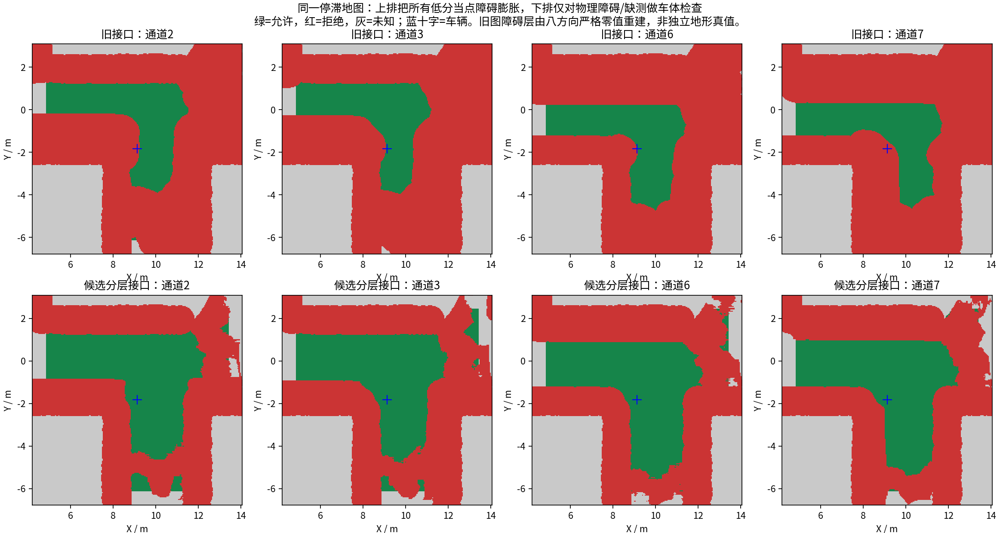
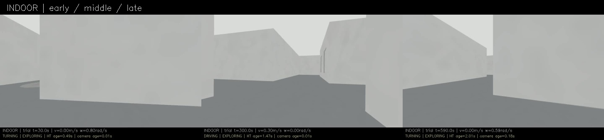
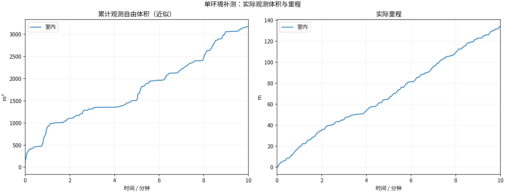
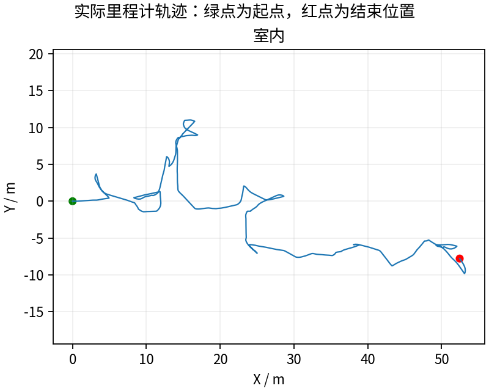
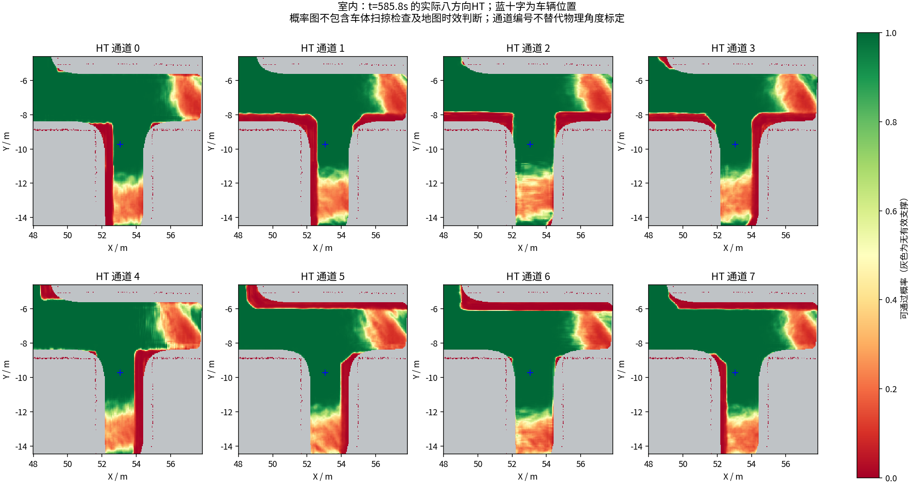
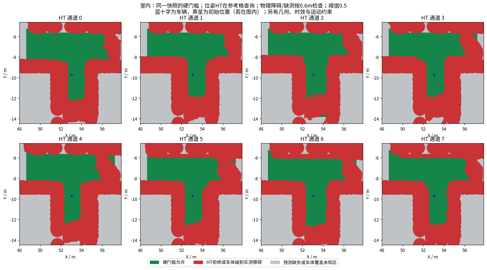

# 室内停滞原因修正：完整10分钟结果

**找到并修改了一处造成旧停滞的规划接口错误。本轮134.00m、3170.500m³，未再出现旧版数百秒不推进的情况；仍有短时阻塞，不能称为完全无阻塞或已完成探索。**

## 为什么旧版会停

旧代码把两种不同的量混在同一组概率图中：HT网络对整车方向/参考位置的预测，以及实测障碍格的八方向置零。规划器随后把全部低概率格按0.6m车体半径再次膨胀。结果，邻近车辆参考位置得分低，也会否决当前车辆的位姿与出口。

在上轮真实停止快照(9.133,-1.822)m上做同图对照：保留0.6m的障碍/缺测检查及0.5硬门槛，只改变学习得分的查询方式，同一混合动作库由8个2m目标全部不可达变为其中6个可达。6种搜索配置共54次查询由0次到达变为36次到达。旧图没有独立障碍层，对照保守重建原桥接的“八方向严格零”覆盖；这个对照不是独立物理通行真值。

[同图对照与限制](diagnosis/root_cause.json) · [54次结果](diagnosis/ablation.json) · [原始查询日志](diagnosis/configuration_query.log) · [修改说明](../../fixes/2026-10-18_configuration_gate.md)

## 改了什么

- 新增独立ht_obstacle层。实测障碍和物理观测缺失仍检查原0.6m车体范围。
- HT作为车辆方向/参考位置得分，在沿途参考格按原0.5硬门槛查询，不再把别处车辆配置的低分当成点障碍做整车膨胀。
- 保留32航向、11.25°/22.5°混合动作、实际指令弧检查和TARE几何碰撞检查。没有改变模型权重、高程融合、方向次序或参考偏移。
- 新接口缺少独立物理观测、障碍层时拒绝地图；未预测的参考位置不直接放行。
- 回归另抓到启动先验分支混用神经预测与物理观测的漏洞，已修正并统一栅格足迹范围。这是额外发现，不把它当成74秒停车的原因。

代码版本149566d。390项核心检查、25个地图/规划用例、11个跟踪器用例全部通过；五个实际快照均参与。Python支撑检查3例通过。修正前暴露缺测问题的失败测试也保存在[regression](regression/)，未删除失败记录。

参考点偏移和独立物理方向标定并未在本轮重新验证；当前仍是运动学搜索，不能表述为已经证明完整实车动力学可行性。

## 与之前三轮比较

每轮同一室内场景、原生起点、0.5m/s上限，记录完整600秒；自由体积统一为源秒采样、0.5m自由体素并集近似，不是真值覆盖率。不同闭环轨迹的单次试验，不用于独立量化某项修改的因果收益。

| 版本 | 里程(m) | 近似观测自由体积(m³) | BLOCKED任务抽样占比 | 最终任务状态 |
|---|---:|---:|---:|---|
| 16航向＋正确停车 | 40.34 | 1000.125 | 70.3% | BLOCKED |
| 32航向＋单转角 | 6.64 | 432.875 | 94.8% | BLOCKED |
| 混合转角＋旋转跟踪 | 17.82 | 778.000 | 88.0% | BLOCKED |
| **本轮HT/物理障碍分层** | **134.00** | **3170.500** | **7.8%** | **BLOCKED** |

本轮最后60秒仍行驶10.93m，最后平移指令在约598.00秒。任务1Hz抽样共有26段BLOCKED，前25段均观察到恢复；最后约598.22～600秒为BLOCKED，因定时结束，未测量其之后是否恢复。最长连续全零指令6.20秒；含原地旋转的最长无平移指令9.65秒。**最终BLOCKED不能隐去，也不能仅凭这约2秒就认定又发生长期卡死。**

最终已记录HT图对最后位姿仍判为KNOWN，参考方向概率约0.999841；末尾TARE没有选出可执行目标。原始消息接收顺序不等于节点内部的精确回调顺序；没有把该短时拒绝归因成新的确定根因。

[完整视频](indoor/camera_h264.mp4) · [最终相机画面](indoor/final_camera.jpg) · [原始对比CSV及来源](comparison/REPORT.md) · [阻塞片段](indoor/blocked_episodes.json) · [按新接口复核的位姿/地图审计](indoor/pose_admission_audit.json)

## 仍存在的问题

- 地图年龄1Hz抽样7次超过3秒，最大5.673秒；规划探针记录最大约5.996秒。时效保护保留，不能宣称实时性问题已消失。
- 规划运行时间P95为1.616秒，上轮0.831秒。轨迹与观测规模不同，未单独归因，后续仍需剖析规划、地图处理与调度耗时。
- 全零指令约占23.5%，原地转向约16.7%；局部到达、重规划、HT拒绝与超时都会产生暂停。没有把所有停车归为同一个原因。
- 没有触发探索完成或返航；本轮只验证了600秒的探索进展，不能作为全场景、长时间或实车稳定通过。

## 数据已保留

13项采集/冻结/退出检查全部通过，控制代码、参数和二进制测量期间未改动；没有节点重启。实收激光2988帧，体积评估使用600帧源秒扫描，跳过0帧。212次晚HT拦截全部配对到实际零速度，非零0次、未配对0次。

视频H.264、15fps、9000帧、600秒，完整解码通过。仓库归档包含录像、CSV、实际生效参数、末段和最终HT地图、额外障碍层、源码快照、对照证据及回归日志。完整MCAP、全部周期快照和融合历史在本机独立目录保留，路径和字节数见[EXPERIMENT.json](EXPERIMENT.json)，未复制成Git文件。

下面保留自动采集报告和原始检查明细。

---

# HT 室内10分钟补测

每组测量 600 秒，从首个具备里程计和激光输入的TARE运行周期开始计时；初始化不计入。
每个场景独立启动、独立高程历史，上一组完全退出且视频处理结束后再启动下一组。车速上限均为0.5m/s，HT硬约束与3秒时效保护相同。
采用对应场景TARE参数；车库沿用历史配对起点，其余使用各自仿真原生起点。因此这不是相同场景的算法优劣对照。
相机原生960×540、15fps，视频含状态条并裁去初始化；重复帧代表真实图像更新间隔，不做插帧。

| 环境 | 状态 | 实际里程(m) | 近似观测体积(m³) | 末尾任务状态 | 视频 |
|---|---|---:|---:|---|---|
| 室内 | RECORDED | 134.00 | 3170.50 | BLOCKED | [播放/下载](indoor/camera_h264.mp4) |

[全部视频播放列表](videos.m3u) · [实时状态与校验](suite.json)

每个场景仅一次10分钟测试，不能据此证明更长时间、所有环境或实车稳定。定时记录完成不等于探索完成。观测体积是抽样激光射线的自由体素并集近似，不是真值覆盖率；跨场景体积不可直接作为算法优劣排名。

## 实际出现的问题

下表保留暂停和地图延迟，不把“节点未崩溃”当作“没有问题”。地图年龄为1Hz抽样，完整控制消息保留在本地MCAP中。全零指令表示既不平移也不转向；原地转向单独统计。

| 环境 | HT年龄P95/最大(s) | 年龄>3s样本 | 全零指令占比 | 最长全零指令(s) | 全局引导无进展释放 | 验证失败项 |
|---|---:|---:|---:|---:|---:|---|
| 室内 | 2.09 / 5.67 | 7 | 23.5% | 6.20 | 5 | 无 |

遇到旧HT地图时仍执行3秒时效保护；没有为让车持续前进而放宽硬约束。全局引导释放说明该段目标没有持续接近，不能解释为该目标已经到达或覆盖完成。

| 环境 | 实收激光/600s | 平均频率(Hz) | 最大接收间隔(s) | 同源对齐检查点 | 观察器与建图器计数差恒定 |
|---|---:|---:|---:|---:|---|
| 室内 | 2988 | 4.98 | 0.50 | 14 | True |

计数差恒定只支持这些对齐区间内没有新增相对漏收；不能证明源端始终连续发布，也不能排除两个订阅者同时漏收。各场景均保留完整扫描计数和原始时间戳检查点。

### 室内末段实际HT

[同期接收的相机画面](indoor/late_camera.jpg) · [原始图层快照](indoor/late_map_snapshot.npz) · [时间与坐标元数据](indoor/late_map_snapshot.json)

全部视频按15fps、600秒裁剪，时长校验允许1帧误差，完整解码通过；实际帧数和时长见各组video_validation.json。各组共有源文件的59项哈希一致，各组自身冻结文件核验见suite_validation.json。

相机年龄是图像接收后的年龄；相机仿真时间戳与导航墙钟不同，不能把该数值解释为传感器端到端延迟。原始MCAP、全高程历史和输入诊断保存在suite.json所列本地目录；本次只发布选取的数据与视频。
