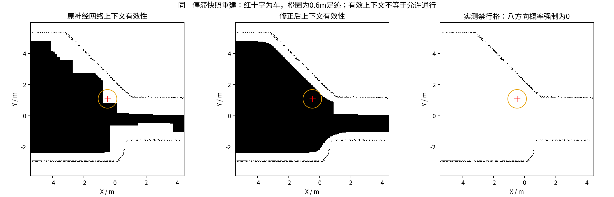

# HT停滞：根因、修改与失败记录

这轮修复针对“地图持续更新，车辆却找不到可执行路线”，没有降低HT的0.5阈值、缩小0.6m足迹、放宽3秒时效或删除几何碰撞检查。

## 找到的问题

1. **把网络输入范围当成了车体缺测。** 原`ht_valid`检查51×51格、约2.1m宽的神经网络上下文，消费端又按0.6m车体半径膨胀一次。这会把网络背景缺测误当成车身下缺测。原隧道停止快照中，车辆及返航路线的实际高程有支撑，但重复膨胀阻断了返航。
2. **旧数据的方差增长会反过来否定历史。** CuPy保留的高度没有新雷达回波时，方差仍可能随时间增加；原逻辑每帧都把质量拒绝传播到历史裁图。另有真正更新过、但质量不合格的墙面测量，也会使周围整个51格网络上下文无效。两类情况不能都用“整片未知”处理。
3. **没有普通新目标时，回退候选也在到达冷却期内。** 所有近期到达点均被排除，可能没有可用脱困方向。全局目标原60秒进展预算也不能及时处理小范围原地停滞。
4. **一轮会连续启动多个搜索，CPU线程也存在开销。** 单目标0.15秒不等于整轮0.15秒；多个搜索叠加容易拖慢重规划。

## 已修改

- 新增`ht_observation_valid`描述物理观测支撑；`ht_valid`继续表示网络上下文有效。车体缺测只膨胀前者，当前位置的网络预测仍须有效；足迹中任一有效低概率格仍硬封锁。缺少新图层的旧地图继续走原严格检查。
- 按每格实际观测时间记录接受和拒绝。同一个已接受回波不能只因后续方差老化而被重新否定。真正更新的坏测量先覆盖旧地面，直到更新的合格回波才能解除。
- 对有实际有限高度的坏测量、当前地面不兼容表面，仅保留其高度作为**禁行上下文**，该格八方向概率强制为0。它不进入地面融合，不会被补成可通行地面。真正无测量、证据过期、缺少有限高度的拒绝仍为未知。
- 新鲜地图条件下，在0.1m范围内停滞12秒可释放全局引导；缓慢连续前进不触发。普通候选均无安全路线时，最多保留两个近期到达点供回退，仍执行相同HT/碰撞检查，也不绕过实际失败目标的冷却。
- 一轮Hybrid A*目标查询共用0.35秒搜索预算，保留有限回退时间。这个预算**不包含**地图转换和视点更新，不能当作整轮规划耗时保证。
- CPU推理改用4个PyTorch线程、channels-last布局，BLAS仍为1线程。没有更换模型权重。10张真实地图的最大概率差约4.12×10⁻⁶，0.5硬阈值翻转为0；这是样本数值核验，不是所有输入的严格等价证明。
- 修复一个回归测试暴露的初始化挂起：参数检查失败前不再提前启动TF监听线程，避免异常析构卡住。

## 没有隐藏的失败轮

第一版修改`73cae0b`在隧道诊断中仍停滞，约195秒时主动停止，**不是完成600秒测试**。原始任务状态、关停、地图、历史高度、日志保存在[failed_trial](failed_trial/)；未运行的室内组仍标为PENDING。停止时初步判断为方差老化；后续检查进一步区分出了真正更新的坏测量，因此最终还增加了禁行上下文处理。

本目录另保留了当时停止说明的原文。它是当时的诊断记录，不替代上述修正后的结论。

## 停滞快照回归



这张图从失败轮最后快照及保存的历史高度重建。红十字为车辆，橙圈为0.6m足迹。原车位的上下文无效，修正后有效；足迹中真正未知格为0，但部分方向仍包含低概率格，所以“上下文有效”不等于“所有方向都能走”。

[重建数据与数值](reconstruction/audit.json)明确记录来源、哈希和时间：历史最新时刻比快照晚约3.4秒，因此这是停止场景的离线重建，不是逐帧反事实闭环实验。对重建地图运行实际C++硬门槛和XYθ规划器，可找到到原点的路线；去掉物理观测层会再次失败，见[实际测试日志](regression/reconstructed_return.log)。另一个回归使用原先五场景试验停止时的HT概率，不重算概率，也能复现旧规则失败、新规则找到返航路径。

复现（在本仓库自己的ROS工作区构建后）：

```bash
python3 presentations/audit_ht_context_recovery.py \
  docs/results/ht_context_diagnostics_2026-10-17/failed_trial/stopped_snapshot.npz \
  docs/results/ht_context_diagnostics_2026-10-17/failed_trial/historical_elevation.npz \
  --robot-z 0.75 --output /tmp/ht-context-reconstruction
source /opt/ros/jazzy/setup.bash
HT_TUNNEL_FIXTURE=/tmp/ht-context-reconstruction/cpp_fixture.txt \
  ROS_DOMAIN_ID=229 ROS_LOCALHOST_ONLY=1 \
  build_standalone/tare_planner/ht_ros_test \
  --gtest_filter=HtRosTest.CapturedTunnelReturnKeepsRiskThresholdAndReachesHome
```

Python回归覆盖坏观测不能恢复成旧地面、过期不能变自由空间、楼层切换、坡面、真实台阶/障碍和未知空洞。C++回归覆盖侧边低概率、实际缺测、旧地图兼容、停滞恢复及跟踪器故障保护。完整测试结果见[regression](regression/)。

闭环结论必须以[后续两场景各10分钟录像](../ht_recovery_10min_2026-10-17/REPORT.md)和[同场景前后比较](../ht_recovery_comparison_2026-10-17/REPORT.md)为准。离线能找到路径不等于实车可行、全图探索完成或所有环境通过。

本轮实验冻结清单遗漏了`lidar_downward.sdf`与`robot_sensor_mask.sdf`（文件已在测量源码提交内）。本目录补存文件，雷达文件在测试期间补记的起止哈希一致；没有改写原manifest。后续实验脚本已把两者加入冻结清单。这是记录协议补全，不是本轮改了雷达或车体模型。
