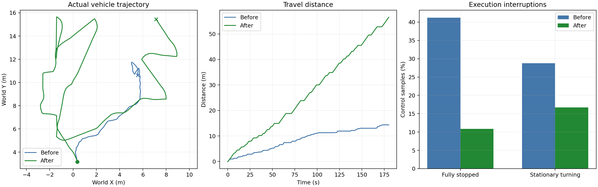
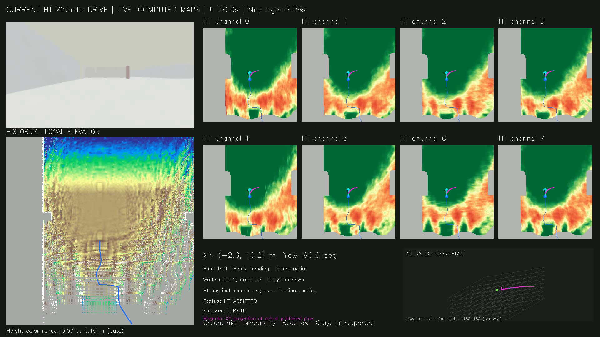
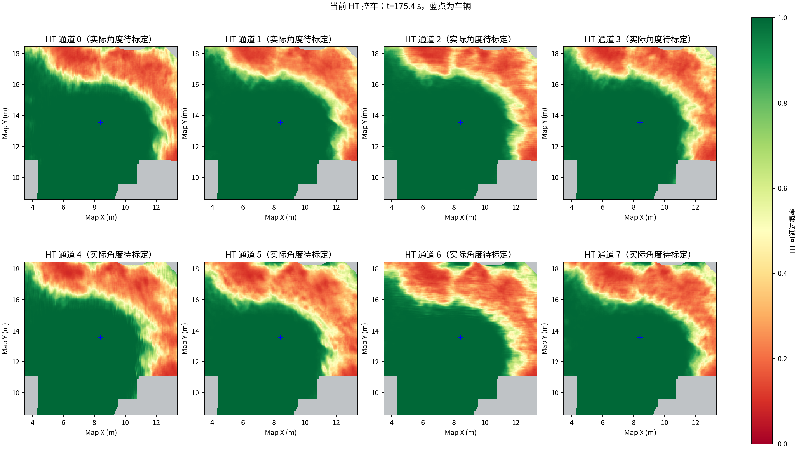

# HT / XYθ 局部徘徊修复验证

针对车辆在一个位置反复转向、短距离移动的问题，修改了目标保持、候选搜索和路径执行衔接。下表对比修复前与最终版本的两轮180秒Garage运行，均由当前HT/XYθ实际控车，速度上限均为0.5m/s。对照不是原版TARE。

| 指标 | 修改前HT | 本次修改后HT |
| --- | ---: | ---: |
| 行驶距离 | 14.35m | 56.54m |
| 到访1米轨迹格 | 13 | 55 |
| 完全停车指令比例 | 41.22% | 10.86% |
| 原地转向指令比例 | 28.75% | 16.69% |
| 前目标尚未抵达时，目标方向反转 | 9次 | 0次 |
| 最后60秒行驶距离 | 3.02m | 20.31m |

方向反转按实际发布路径端点与当时里程计计算：新旧目标都离车超过0.8米，且相对车的位置夹角超过90°。合法避障也可能触发该指标，所以它不是错误次数的形式化定义。到访格只统计车辆位置，不是探索面积或体积。

## 改动及作用

1. 按世界坐标保持局部目标。已选目标仍合法且持续接近时继续执行；目标完成、求解失败或12秒无进展才释放，停滞目标短期冷却。滚动网格索引变化不会直接改变目标身份。
2. 保持全局引导点，补齐全局路线为空时的启动引导。先检查候选终点是否有HT支持的方向，再做完整XYθ搜索；其他有收益的视点也参与筛选。
3. 普通候选没有路线时，搜索侧向恢复目标。它可以暂时不缩短到远方目标的直线距离，优先选择尚未到访的位置；整条路线仍须满足几何与HT硬约束。
4. 跟踪器独立读取最新HT图，在20Hz控制回调中检查当前姿态、前方路径和指令弧线。同一路径重复发布时保留进度，新路径按位置和车头方向衔接。
5. 旧规划许可超过1.5秒不再单独触发停车。路径仍须在3秒内、定位须在0.5秒内，地图与扫描仍须新鲜；明确禁止、障碍和未知区仍按原硬约束处理。没有降低HT门限、没有提高速度上限。

详细参数与运行方式见[执行逻辑说明](../../xytheta_execution_continuity.md)。

## 这轮还存在什么问题

探索尚未完成（exploration_finished=False）。轨迹仍有回访路段，不能宣称已解决全局探索完整性。最后仍有位移的记录在180.002秒，说明本轮后半段没有像中间版本那样长期停止。

上层状态回调统计：{'HT_ASSISTED': 321, 'NO_EXECUTABLE_ROUTE': 5, 'HT_MAP_STALE': 1}。这是状态消息数，不是故障事件数。执行端完全零速指令为391/3600；按录包接收顺序关联的原因：{'DRIVING': 22, 'GOAL_REACHED': 266, 'HT_MAP_STALE': 19, 'PLANNER_HOLD': 70, 'TURNING': 2, 'ALIGNING': 12}。不同话题存在接收顺序误差，状态切换附近可相差一个控制样本。

剩余停车主要包括到达局部目标后等下一轮规划、上层明确禁止和短暂地图超时。实时校验会继续拒绝不满足约束的动作。八通道物理方向仍需实车标定；本实验不证明实车碰撞安全，也不是多场景、多随机种子的统计结论。

## 数据及验证

- 相同源时间窗口内，录包988帧点云，建图端接收988帧；成功融合窗口录包987帧，完成融合987帧。末帧在主动结束时被中断，接收与融合应分别核对。
- 212组保存的CuPy、历史高程与HT快照时间戳严格一致。视频为1920×1080、10fps、1800帧，共180秒，已检查开头、中段、结尾可解码。视频事后按录包时间合成，地图与控制均来自运行时计算。
- Release构建通过；149项HT核心检查、13项HT ROS测试、4项控制器ROS回归测试通过；Python编译及git diff检查通过。
- 调试中保留了两次启动失败记录、一轮中间完整实验（26.07m，后半程无路停车），以及一次候选筛选调试中止记录（8.51m）。这些结果未冒充最终验证，原始日志均留在本机。

完整视频及原始bag保留在本机，未上传Git：`presentations/scheduled_results/ht_continuity_escape_2026-10-15/visuals/current_ht_exploration.mp4`。

[控制与接收审计](delivery_and_pause_audit.json) · [对比指标](comparison.json) · [本轮指标](summary.json)

复现：`python3 presentations/run_ht_validation.py --duration 180`。当前结果目录同时保留了控制程序哈希、运行前Git差异和源代码快照。
