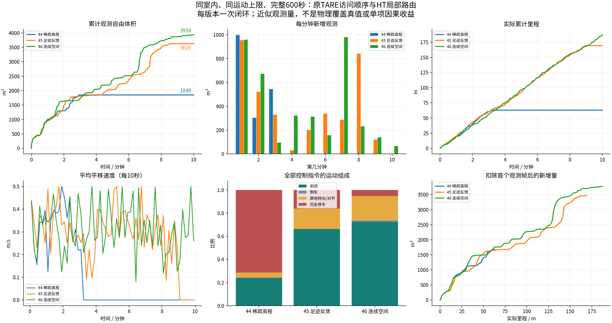
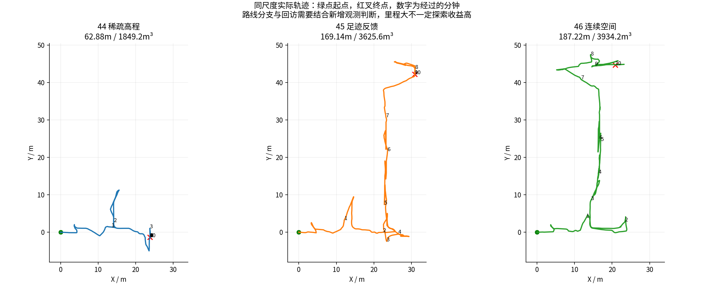
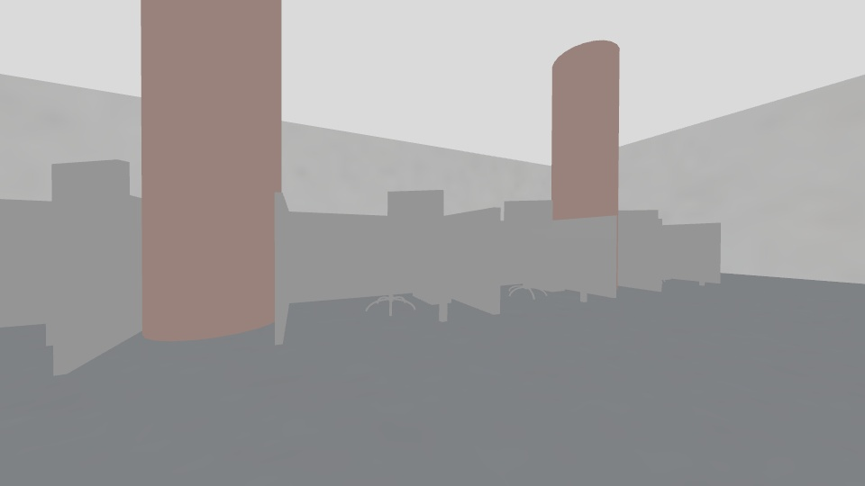
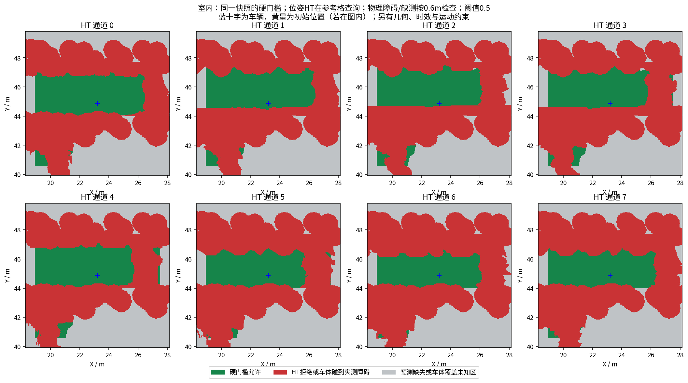
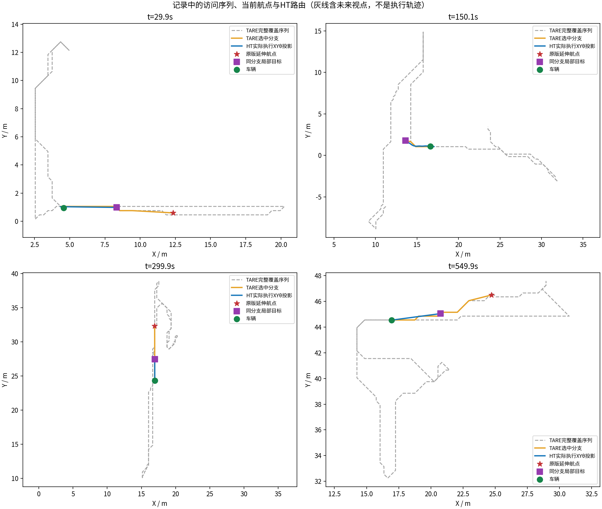

# 阶段46：连续XYθ空间范围解耦，室内600秒复测

实测冻结提交`07c1abd334f83cb8d602e2234134b4286862c916`，基线为阶段45`15e197eca16bee3dea1fcd3870a05ee84f2ecd12`。原TARE六函数/TSP/访问顺序、HT权重/预处理/0.5门槛、车体尺寸、搜索预算与运动上限保持。

## 原因与修改

阶段45末段真实位姿HT为KNOWN，几何高度范围内最近障碍0.8014m，超过0.641421m几何半径；最近覆盖格却非候选、非碰撞标签。连续范围错误依赖覆盖标签导致INVALID_START。新增连续空间范围接口；原TARE覆盖范围语义不变，物理障碍/边界/HT硬门槛仍检查。
[原因、反例与回归](../../fixes/2026-10-21_continuous_domain.md) · [早期四场景及地形接口反例图](../ht_sparse_height_4scene_10min_2026-10-21/REPORT.md)。

## 同场景实际比较

| 版本 | 实测s | 里程m | 近似观测体积m³ | 末60s里程m | 最长完全停车s | 规划P95s | 地图年龄P95s | 末任务 |
|---|---:|---:|---:|---:|---:|---:|---:|---|
| 44 稀疏高程 | 600.0 | 62.88 | 1849.250 | 0.00 | 412.529 | 1.536 | 1.269 | BLOCKED |
| 45 足迹反馈 | 600.0 | 169.14 | 3625.625 | 0.00 | 65.060 | 0.875 | 0.862 | BLOCKED |
| 46 连续空间 | 600.0 | 187.22 | 3934.250 | 18.80 | 2.149 | 0.962 | 0.958 | EXPLORING |

高程和速度设置相同；每版本单次闭环，不保证统计优越或排除所有随机路径差异。体积为抽样激光自由空间体素并集近似，不是物理覆盖真值。

## 实际路线和剩余问题

- 森林8000次展开上限与隧道53s结束线索本轮未复测，不能宣称已解决
- 单次600s不证明所有环境、长时运行或真实车辆稳定；无新增同限制原版TARE配对

本轮同目标前缀保持日志0周期，其中未进入搜索0周期。终点允许不代表完整路径可达，原TARE粗图也不等于全局SE2可达保证。

[运行文件变化](runtime_changes.json) · [全部分工/时间戳/模型输入审计](COLLECTION_REPORT.md)。四项最终CTest和六函数SHA通过，具体耗时见本候选证据；空几何但覆盖标签无效的旧代码失败反例保留。

[视频](indoor/camera_h264.mp4) · [采集校验](indoor/suite_validation.json)

完整已录数据发布后以stage46.json逐资产远端大小/SHA回执为准。未验证原始数据不删除。
