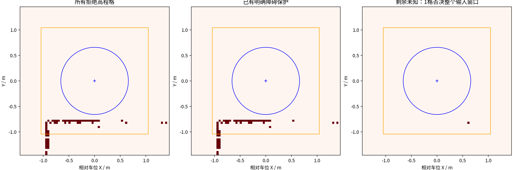
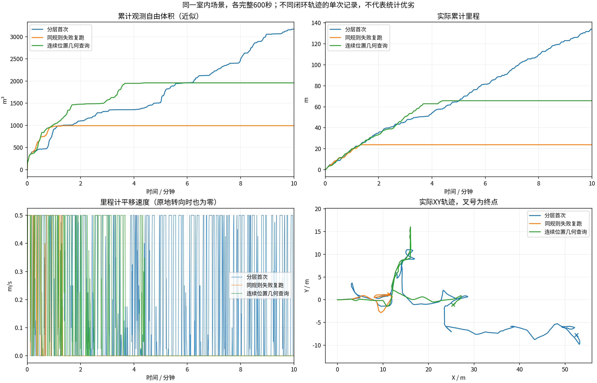
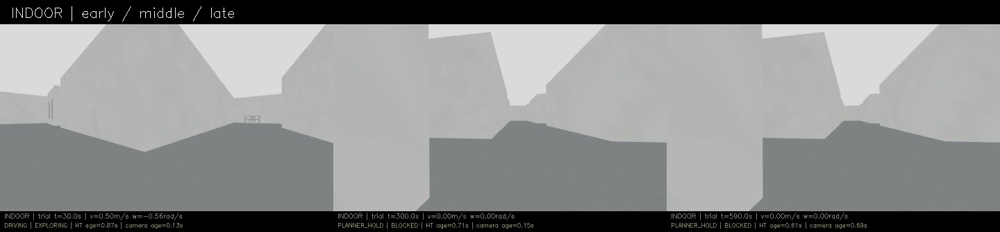
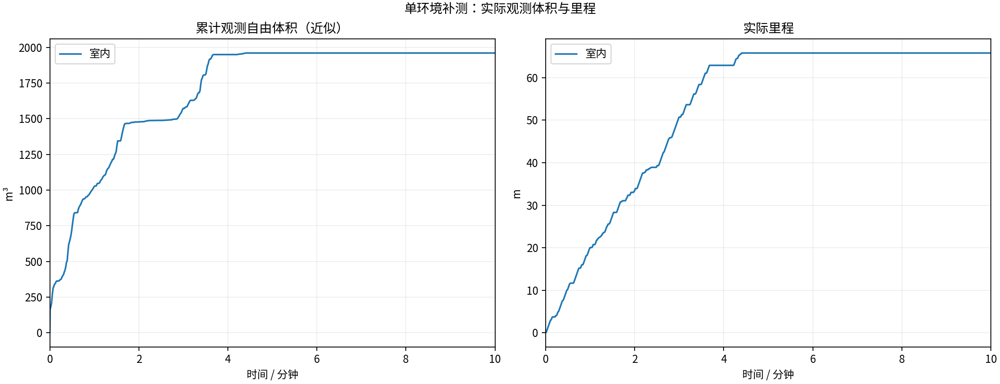
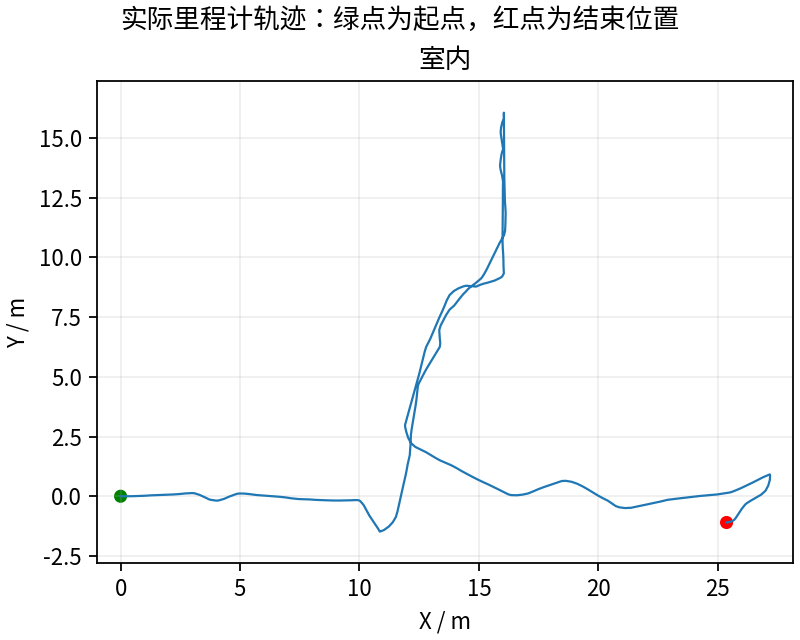
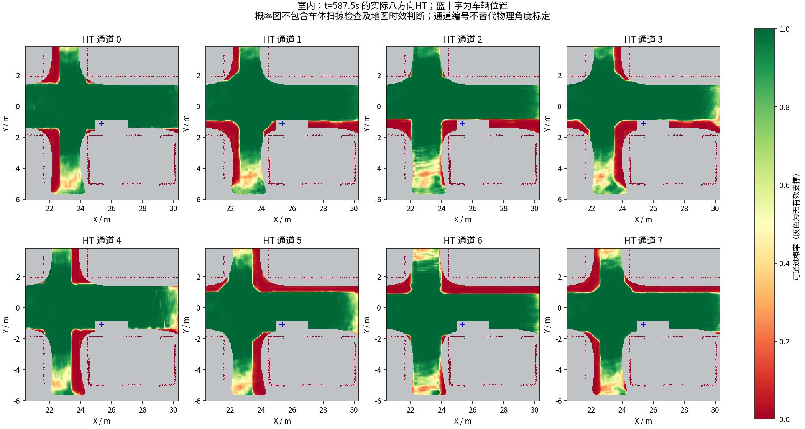
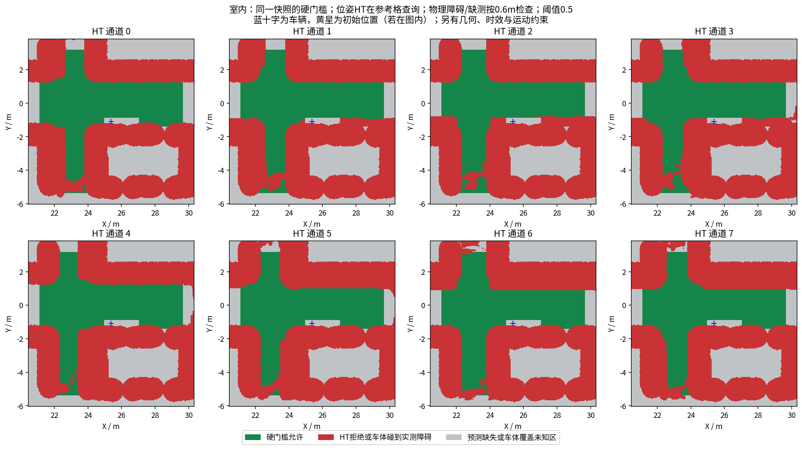

# 连续位姿几何修正：原反例通过，闭环仍有下一类阻塞

**完整600秒65.80m、1959.875m³，最终BLOCKED。** 相比上轮同场景23.86m/993.125m³推进增加；但264.001秒后停止明显平移，最后60秒里程0、最长全零约335.13秒。不能说已经解决长期停滞，也没有超过阶段23首次134m的表现。

## 改动与回归

测试代码`43069a7`。XYθ连续路线不再继承0.3m覆盖视点的碰撞标记，而在实际连续位置查询同份实测碰撞点云，保留原占用格点数门槛、0.5m水平安全距离并额外增加0.1414m栅格余量，垂直门槛、HT物理足迹/0.5概率/3秒时效保持。禁入区域和真正碰撞的根状态仍拒绝。覆盖视点与全局图的旧标记不变。另修正误标碰撞可视化，补HT搜索与表示更新时间。

原C++在保存的真实点云回归上误判失败，新连续查询通过；真障碍、禁入边界、非有限位置和范围外仍拒绝。390核心、25ROS、11跟踪器用例和新增几何回归通过，五个历史HT快照参与。[修改说明](../../fixes/2026-10-18_continuous_geometry.md) · [旧失败及新通过日志](regression/)。

## 本轮剩余停滞与进一步核对

本轮停车位(25.364,-1.099)m，几何层`collision=0`，HT起点是UNKNOWN，展开0状态由HT拒绝。因此没有把新停车继续归因于上一轮的几何误判。物理足迹无缺测，周围最近体高碰撞点约0.766m。

最初看到网络窗口有一组拒绝高程格。进一步逐格核对，最终快照42格中41格已经作为已知障碍保留，真正令整个51×51输入窗口无效的是**1个**距车1.02339m、原始高度0.45962m、方差0.007708m²的融合后孤立点。它被高程质量滤波拒绝后，原始有限高度没有像源输入拒绝那样进入独立障碍上下文，而留下了全窗口未知遮罩。不能把所有拒绝格都称为没有障碍保护，也没有证据将其归因为600秒历史过期。

[逐格数值与快照](geometry_capture/context_rejection.json)。下一轮先核对源质量过滤与融合后质量过滤的处理是否一致；若保留有限拒绝高度，也必须作为硬障碍，不能填成自由地面或删除未知约束。

## 比较与实时性

当前规划耗时统计已补入HT专用搜索，旧统计遗漏，因此跨版本`/runtime`数值不能直接视为纯性能收益。原`/runtime_breakdown`的overall墙钟、分项日志及所有原始数值保留。[本轮完整计时](latency_audit/audit.json) · [表示更新分项](latency_audit/representation.json)。覆盖可见性与已覆盖区域更新占有明显耗时，仍待针对性优化。

HT年龄抽样最大4.417秒，时效保护仍保留；这不是后续数百秒停车的解释。13项采集/冻结/退出核验通过；25次晚拦截实际均发零，未配对0。视频600秒/15fps/9000帧完整解码通过。[视频](indoor/camera_h264.mp4) · [实际在线规划参数](indoor/planner_parameters.yaml) · [实际在线执行参数](indoor/follower_parameters.yaml)。

完整记录包、MCAP、周期快照、独立CuPy/仿真源码快照将发布本轮Release；源秒抽样激光不是全频无损数据。每轮失败结果保留并上传。当前尚未完成重复、多环境稳定性、完整动力学或独立方向/参考点物理标定。

---

# HT 室内10分钟补测

每组测量 600 秒，从首个具备里程计和激光输入的TARE运行周期开始计时；初始化不计入。
每个场景独立启动、独立高程历史，上一组完全退出且视频处理结束后再启动下一组。车速上限均为0.5m/s，HT硬约束与3秒时效保护相同。
采用对应场景TARE参数；车库沿用历史配对起点，其余使用各自仿真原生起点。因此这不是相同场景的算法优劣对照。
相机原生960×540、15fps，视频含状态条并裁去初始化；重复帧代表真实图像更新间隔，不做插帧。

| 环境 | 状态 | 实际里程(m) | 近似观测体积(m³) | 末尾任务状态 | 视频 |
|---|---|---:|---:|---|---|
| 室内 | RECORDED | 65.80 | 1959.88 | BLOCKED | [播放/下载](indoor/camera_h264.mp4) |

[全部视频播放列表](videos.m3u) · [实时状态与校验](suite.json)

每个场景仅一次10分钟测试，不能据此证明更长时间、所有环境或实车稳定。定时记录完成不等于探索完成。观测体积是抽样激光射线的自由体素并集近似，不是真值覆盖率；跨场景体积不可直接作为算法优劣排名。

## 实际出现的问题

下表保留暂停和地图延迟，不把“节点未崩溃”当作“没有问题”。地图年龄为1Hz抽样，完整控制消息保留在本地MCAP中。全零指令表示既不平移也不转向；原地转向单独统计。

| 环境 | HT年龄P95/最大(s) | 年龄>3s样本 | 全零指令占比 | 最长全零指令(s) | 全局引导无进展释放 | 验证失败项 |
|---|---:|---:|---:|---:|---:|---|
| 室内 | 1.91 / 4.42 | 4 | 69.7% | 335.13 | 16 | 无 |

遇到旧HT地图时仍执行3秒时效保护；没有为让车持续前进而放宽硬约束。全局引导释放说明该段目标没有持续接近，不能解释为该目标已经到达或覆盖完成。

| 环境 | 实收激光/600s | 平均频率(Hz) | 最大接收间隔(s) | 同源对齐检查点 | 观察器与建图器计数差恒定 |
|---|---:|---:|---:|---:|---|
| 室内 | 2981 | 4.97 | 0.43 | 46 | True |

计数差恒定只支持这些对齐区间内没有新增相对漏收；不能证明源端始终连续发布，也不能排除两个订阅者同时漏收。各场景均保留完整扫描计数和原始时间戳检查点。

### 室内末段实际HT

[同期接收的相机画面](indoor/late_camera.jpg) · [原始图层快照](indoor/late_map_snapshot.npz) · [时间与坐标元数据](indoor/late_map_snapshot.json)

全部视频按15fps、600秒裁剪，时长校验允许1帧误差，完整解码通过；实际帧数和时长见各组video_validation.json。各组共有源文件的62项哈希一致，各组自身冻结文件核验见suite_validation.json。

相机年龄是图像接收后的年龄；相机仿真时间戳与导航墙钟不同，不能把该数值解释为传感器端到端延迟。原始MCAP、全高程历史和输入诊断保存在suite.json所列本地目录；本次只发布选取的数据与视频。
