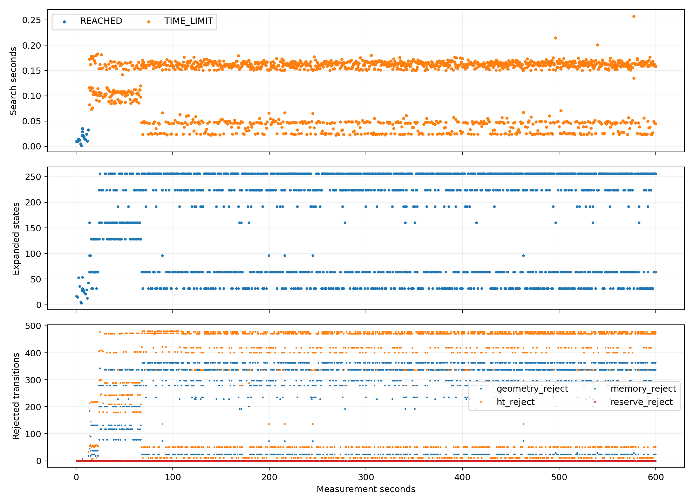
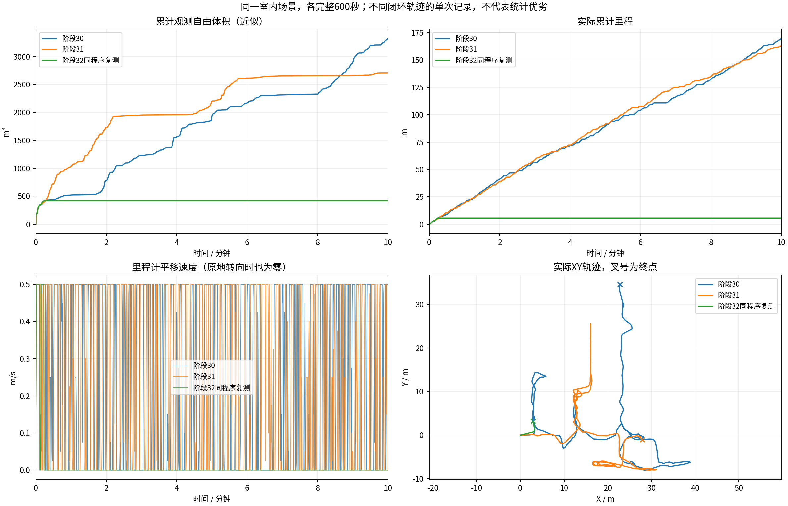
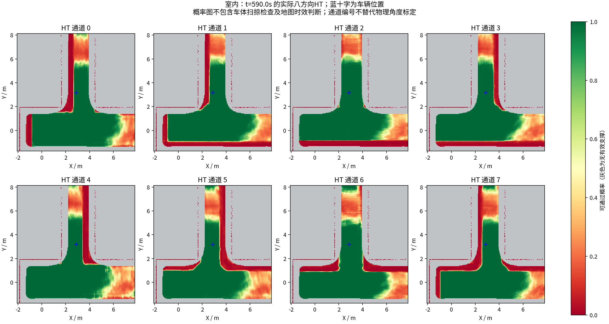
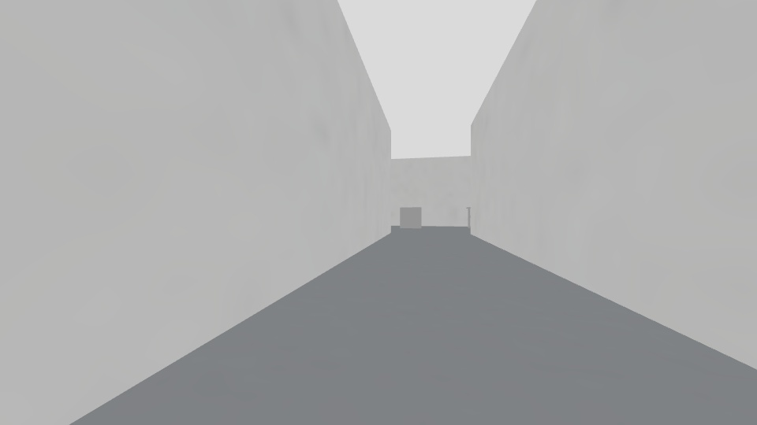
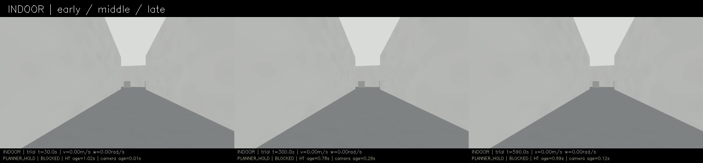
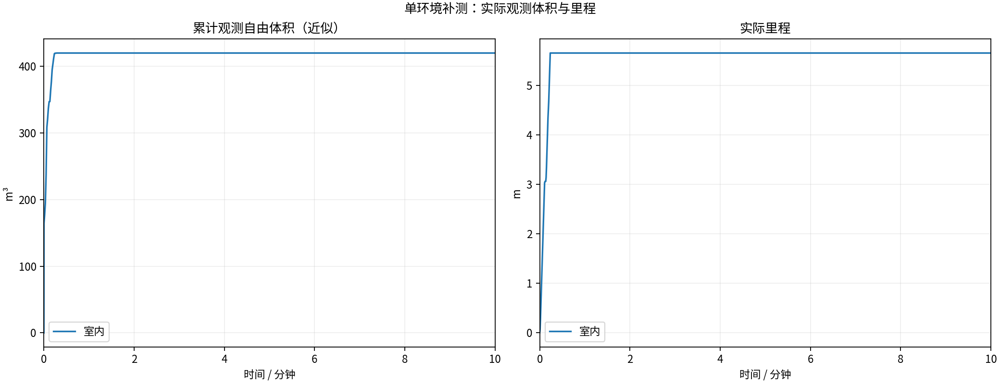
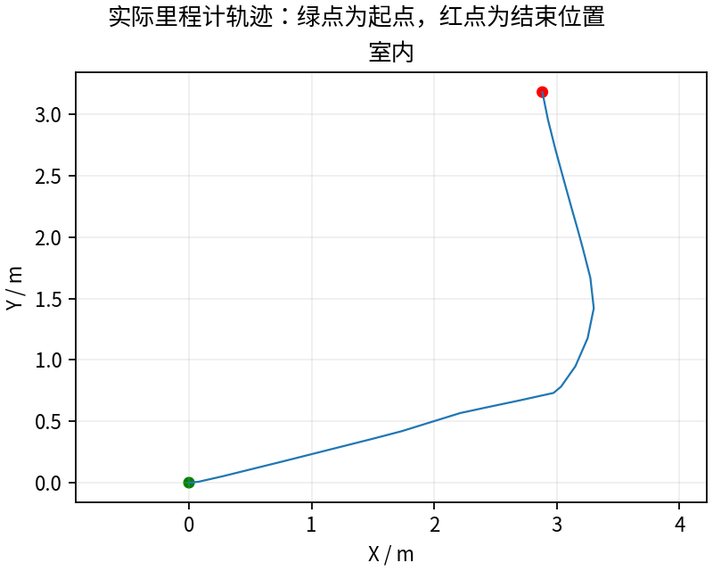
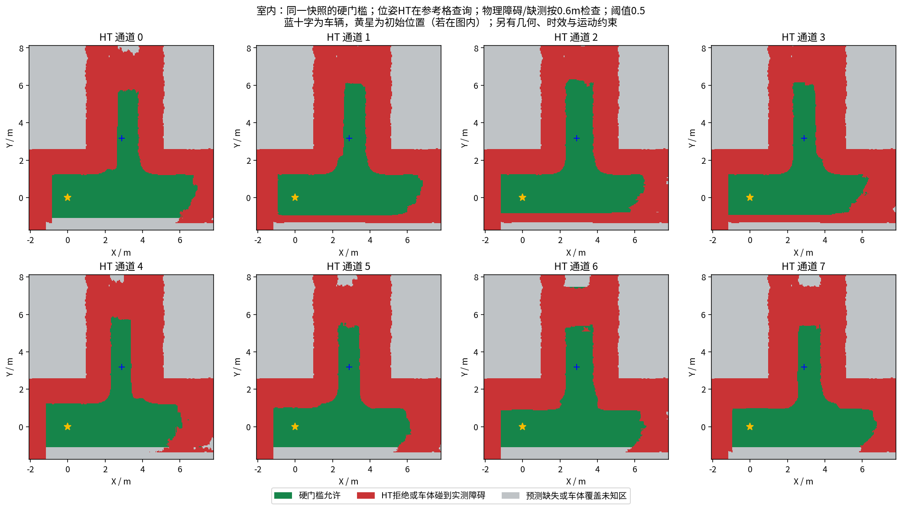

# 相同导航程序复测：早期长期停滞，未通过稳定性检查

完整600秒，**5.66米 / 419.750立方米**。末尾任务BLOCKED，最后实际移动样本约13.502秒；末分钟0.000米。这是失败复测，定时录制完成不代表导航通过，更不是探索已经结束。

## 是否改了导航

实测提交`867ba1f`，导航行为代码仍为阶段31`b05ed9e`。63份源文件/配置/程序/模型哈希完全相同，实际planner/follower参数比对结果为{'planner_parameters.yaml': True, 'follower_parameters.yaml': True}。本轮未重编译或调参数，只增加文档、发布回执和播放入口。上一轮结束后清理可重新下载的pip HTTP缓存，本轮可用磁盘较多；这是一项环境差异，不能单独归因于代码或磁盘。[逐文件核验](indoor/repeat_provenance.json) · [复测分析](repeat_analysis.json)。

## 已证实的问题与未证实的解释

搜索1597次，退出原因{'REACHED': 16, 'TIME_LIMIT': 1581}。几何检查计时占搜索墙钟约94.9%；计时含调度等待，不能等同纯CPU计算占比。

**482轮出现“主要目标全部已尝试者超时、仍有排队替代目标、没有尝试恢复目标、无输出路线”。** 60秒之后482/489轮符合该条件，恢复目标尝试7次。[逐周期证据](scheduling_audit/cycles.csv) · [搜索详情](search_audit/searches.csv)。

源码先排列主要目标，再排列恢复目标；0.35秒周期预算常被前两个0.15秒搜索及第三个剩余预算耗尽。现有预留只针对backtrack，普通恢复目标没有预算保障。这能解释替代目标长期得不到评估，但**尚不能证明替代目标一定可达**，也不能证明仅靠调度就能修复停滞。不同运行最初路线为何分岔仍未单独归因。

## 与前两轮比较

| 记录 | 导航版本 | 里程m | 观测自由体积m³ | 结论 |
|---|---|---:|---:|---|
| 阶段30 | ce7202b | 169.57 | 3321.250 | 结束时仍移动，仍有停顿 |
| 阶段31 | b05ed9e | 162.71 | 2703.875 | 末刻EMPTY_PATH |
| 本轮阶段32 | b05ed9e，同二进制 | 5.66 | 419.750 | 早期长期停滞 |

同源码两次差异很大，不能以单轮成功宣称稳定。体积为601个源秒激光扫描、0.5m自由体素并集近似，跳过0；静止时也会重复观察，不是真值覆盖率。

## 采集核验与后续修改边界

13/13项采集/冻结/退出检查通过；视频9000帧、600.000000秒，完整解码。[视频](indoor/camera_h264.mp4) · [采集核验](indoor/suite_validation.json)。58份神经上下文同源核验；三份冻结模型重放见[上下文记录](indoor/context_consistency.json)。实际晚拦截发零及几何采样见[执行检查](indoor/blocked_commands.json)和[几何分析](execution_geometry_audit/summary.json)。这些检查通过不代表车辆稳定或全场景覆盖。

本轮发布完整记录后，下一候选优先保证普通恢复目标能获得实际搜索机会，并加预算调度回归；维持0.35秒总预算、0.15秒单目标上限和所有硬约束，不直接降低碰撞余量/HT门槛。候选仍需新的完整600秒与本轮比较。搜索速度、地图时效、不可达任务及其他环境仍未全部解决。

---

# HT 室内10分钟补测

每组测量 600 秒，从首个具备里程计和激光输入的TARE运行周期开始计时；初始化不计入。
每个场景独立启动、独立高程历史，上一组完全退出且视频处理结束后再启动下一组。车速上限均为0.5m/s，HT硬约束与3秒时效保护相同。
采用对应场景TARE参数；车库沿用历史配对起点，其余使用各自仿真原生起点。因此这不是相同场景的算法优劣对照。
相机原生960×540、15fps，视频含状态条并裁去初始化；重复帧代表真实图像更新间隔，不做插帧。

| 环境 | 状态 | 实际里程(m) | 近似观测体积(m³) | 末尾任务状态 | 视频 |
|---|---|---:|---:|---|---|
| 室内 | RECORDED | 5.66 | 419.75 | BLOCKED | [播放/下载](indoor/camera_h264.mp4) |

[全部视频播放列表](videos.m3u) · [实时状态与校验](suite.json)

每个场景仅一次10分钟测试，不能据此证明更长时间、所有环境或实车稳定。定时记录完成不等于探索完成。观测体积是抽样激光射线的自由体素并集近似，不是真值覆盖率；跨场景体积不可直接作为算法优劣排名。

## 实际出现的问题

下表保留暂停和地图延迟，不把“节点未崩溃”当作“没有问题”。地图年龄为1Hz抽样，完整控制消息保留在本地MCAP中。全零指令表示既不平移也不转向；原地转向单独统计。

| 环境 | HT年龄P95/最大(s) | 年龄>3s样本 | 全零指令占比 | 最长全零指令(s) | 全局引导无进展释放 | 验证失败项 |
|---|---:|---:|---:|---:|---:|---|
| 室内 | 1.77 / 2.71 | 0 | 97.7% | 586.04 | 15 | 无 |

遇到旧HT地图时仍执行3秒时效保护；没有为让车持续前进而放宽硬约束。全局引导释放说明该段目标没有持续接近，不能解释为该目标已经到达或覆盖完成。

| 环境 | 实收激光/600s | 平均频率(Hz) | 最大接收间隔(s) | 同源对齐检查点 | 观察器与建图器计数差恒定 |
|---|---:|---:|---:|---:|---|
| 室内 | 2991 | 4.99 | 0.47 | 65 | True |

计数差恒定只支持这些对齐区间内没有新增相对漏收；不能证明源端始终连续发布，也不能排除两个订阅者同时漏收。各场景均保留完整扫描计数和原始时间戳检查点。

### 室内末段实际HT

[同期接收的相机画面](indoor/late_camera.jpg) · [原始图层快照](indoor/late_map_snapshot.npz) · [时间与坐标元数据](indoor/late_map_snapshot.json)

全部视频按15fps、600秒裁剪，时长校验允许1帧误差，完整解码通过；实际帧数和时长见各组video_validation.json。各组共有源文件的63项哈希一致，各组自身冻结文件核验见suite_validation.json。

相机年龄是图像接收后的年龄；相机仿真时间戳与导航墙钟不同，不能把该数值解释为传感器端到端延迟。原始MCAP、全高程历史和输入诊断保存在suite.json所列本地目录；本次只发布选取的数据与视频。
