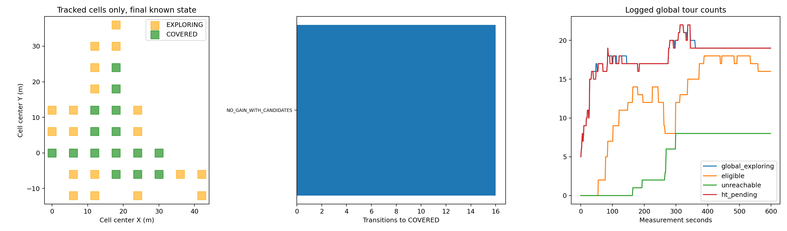
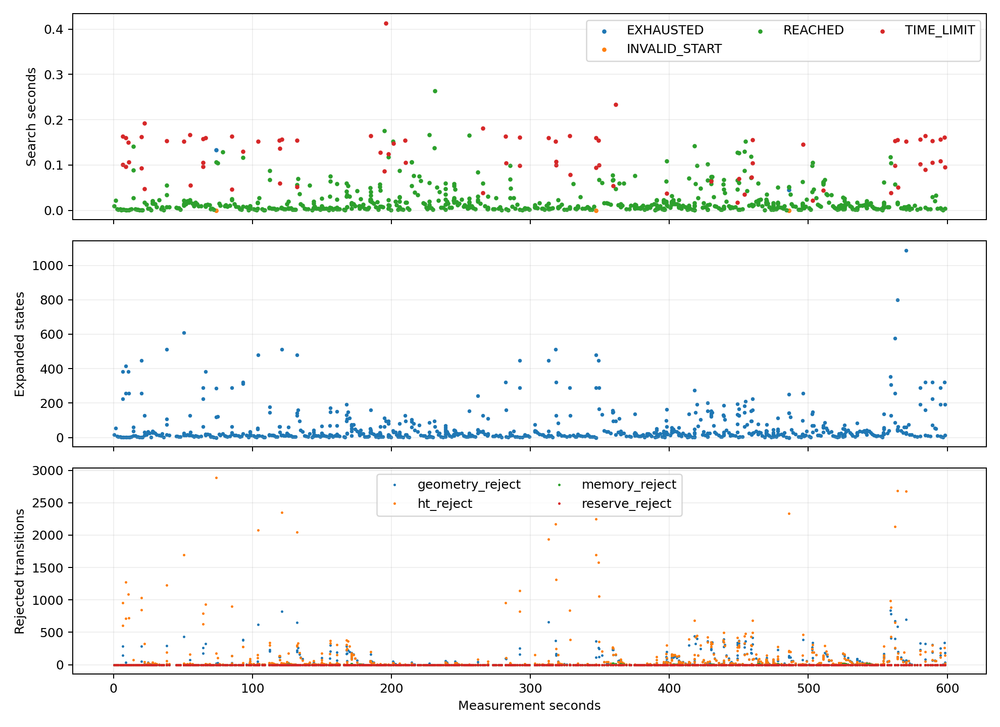
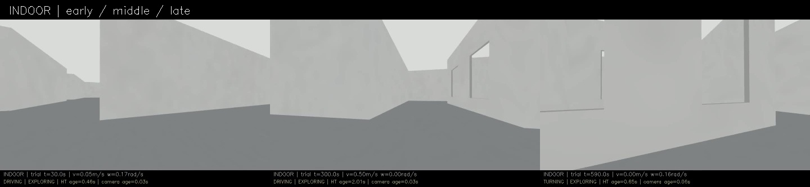
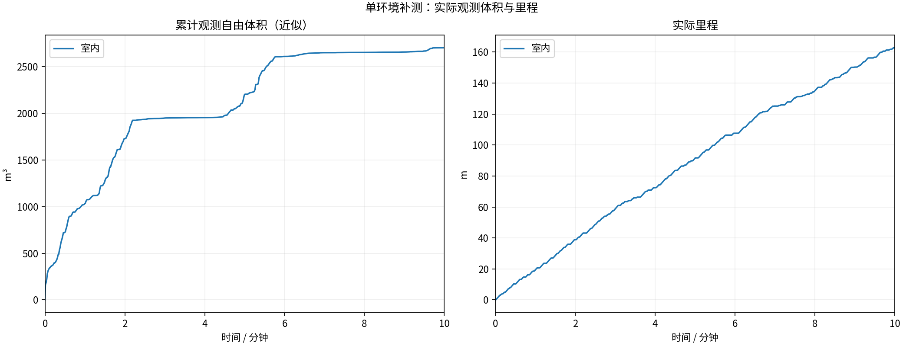
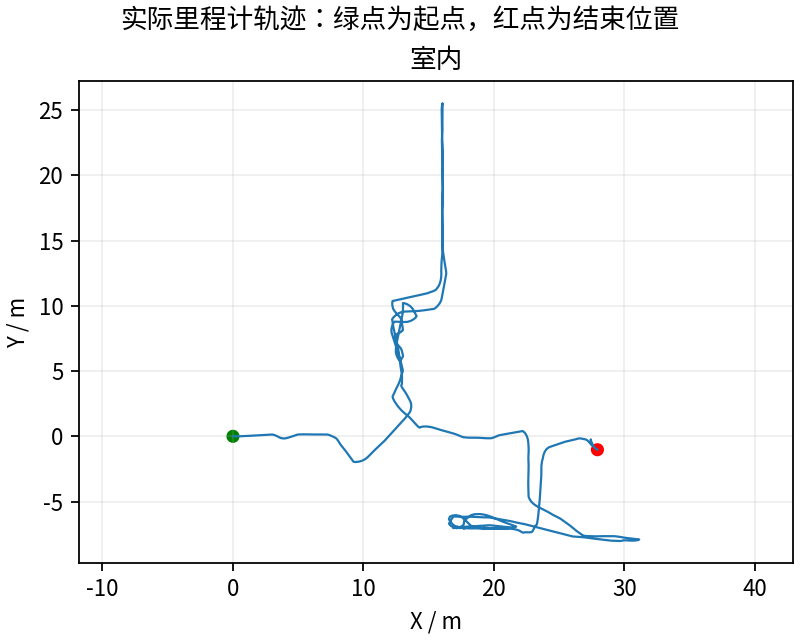
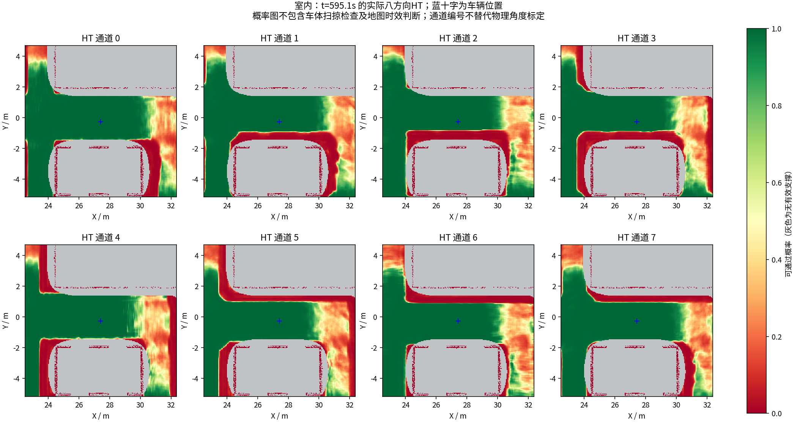
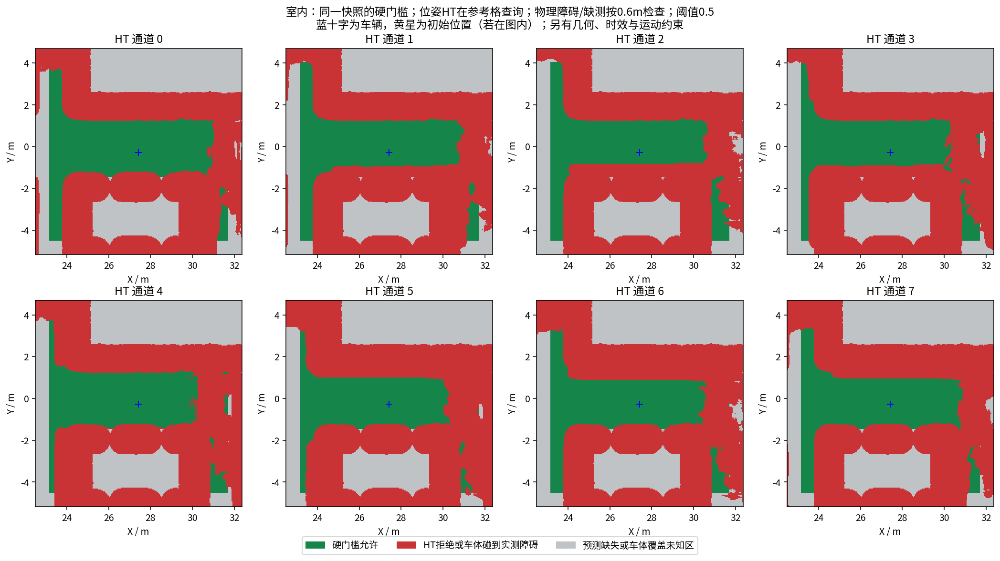

# 保留候选缺失时的有效收益：状态修正，单轮体积退步

**室内完整600秒162.71m、2703.875m³，任务仍EXPLORING。** 比阶段30的169.57m/3321.25m³体积减少约18.6%，不能称为性能提升。最后60秒行驶12.462m，最后平移指令598.501秒；结束瞬间EMPTY_PATH、零速度，缺后续观测，不能把探索状态说成车一直在动，也不能仅凭最后1.5秒判长期卡死。

## 修改及旧失败复现

实测`b05ed9e`。HT模式中记住现有候选确认达到原收益阈值、且属于EXPLORING的单元。候选暂时缺失保持待复查，新的有效候选评估确认收益降到原阈值以下后才解除收益登记。仅导航的零收益占位、已覆盖滞回、非HT模式保持；外部明确覆盖/禁行和Reset清除记录。未解决有效收益存在时，不能仅因当前全局无巡游/局部完成就锁存为完整完成。

两项真实C++旧失败（首次访问无图节点、重复访问近车）现在通过；新增恢复后核销、零收益导航、外部覆盖/Reset清除等回归。全部4个CTest目标通过，geometry_pose_test中18项回归通过。[前后日志](regression/) · [修改说明](../../fixes/2026-10-18_remembered_gain.md)。模型、概率阈值、未知规则、物理几何、跟踪余量、速度、搜索预算和地图时效均未改。

## 实际状态证据

6498条单元日志，19个单元出现NO_CANDIDATE_DEFERRED，未记录到带未核销收益且未经有效候选评估就被置COVERED的情况。有4个单元在延期后重新取得有效候选评估并解除收益登记，其中2个变COVERED，另2个仍为导航占位EXPLORING；不能把解除收益登记误说成四个区域全部完成物理覆盖。

[四次重新评估与全部延期记录](cell_coverage_audit/summary.json)。原“无候选→覆盖”转移本轮0次，普通候选收益低于阈值的覆盖16次，说明正常核销未被全部关闭。全局仍有当前图未连接的任务；它们不等于已经证明永久物理不可达。

本轮没有出现global_return与local_complete同时为真且仍有有效收益待办的组合，新增完成守卫没有在这个闭环中触发；仅以回归和源码规则支持，不声称已完成该分支的动态场景验证。

## 同场景完整600秒比较

| 版本 | 里程m | 近似自由体积m³ | 状态 |
|---|---:|---:|---|
| 阶段23 | 134.00 | 3170.500 | 最终BLOCKED |
| 阶段29 | 133.17 | 2025.125 | 内部完成返航 |
| 阶段30 | 169.57 | 3321.250 | EXPLORING，末刻移动 |
| 本轮阶段31 | 162.71 | 2703.875 | EXPLORING，末刻EMPTY_PATH零速度 |

BLOCKED健康抽样22/600，上一轮49/600；最长全零3.700s，上一轮17.499s；最长无平移7.600s，上一轮21.100s。停顿减少但本轮近似新增体积更少，包含回访和不同分支轨迹，不是独立因果收益估计。体积为600个源秒扫描的0.5m自由体素并集近似，跳过0，不是场景真值覆盖率。

## 仍有的问题

813次搜索723次REACHED、81次TIME_LIMIT、2次EXHAUSTED、7次INVALID_START。几何查询约占搜索时间93.2%，搜索最大0.414秒超过0.15秒单目标配置；周期截止检查/单次查询耗时及保持同判定的优化需继续核查。468个runtime样本P95约1.505s、最大2.092s，不能忽略源数据与控制周期延迟。

控制器仍有7次HT_MAP_STALE、1次PATH_STALE和394条EMPTY_PATH反馈，都是20Hz状态记录而非394个独立停滞事件。健康1Hz抽样图龄P95约2.010s、最大3.061s。实际58次晚HT拒绝与2次几何指令拒绝均配对全零Twist，未匹配0；469份录制几何样本未发现既有安全半径重叠。这不等于所有时刻/动态障碍/物理真值保证。

下一步须同一导航二进制重复，分清任务/路径波动与修改收益；再按每环境600秒发布。保留不可观察证据可能显露真正不可达或暂时图不连通任务，需要审计最后观察位置及连通，避免无限无效回访。独立覆盖真值、窄通道、完整动力学及实车尚未验收。

58份神经上下文与同源输出一致、三份冻结模型重算差0；13项采集/冻结/退出核验全部通过，视频实际8999帧、599.933333秒、15fps，完整解码并满足600秒时长容差。[视频](indoor/camera_h264.mp4) · [有效参数](indoor/planner_parameters.yaml) · [实际拦截核查](indoor/blocked_commands.json)。

本轮测量全部结束之后，为解决磁盘门槛清理了约20.2GB可重新下载的pip HTTP缓存，保留安装环境、模型和本地构建wheel，实验数据未删除。[维护回执](post_run_http_cache_cleanup.json)。后续同源码复跑可用磁盘更多，是环境差异，不能把后续任何时延改善都归于导航代码。旧27/28原始目录仍完整保存在逐文件校验的本地无损包及GitHub，恢复见[本地数据说明](../../experiments/LOCAL_DATA.md)。整轮原始MCAP/CSV/日志/周期图/模型输入输出/源码与视频均经Release保存；激光源秒抽样，不是全传感器无损采集。

---

# HT 室内10分钟补测

每组测量 600 秒，从首个具备里程计和激光输入的TARE运行周期开始计时；初始化不计入。
每个场景独立启动、独立高程历史，上一组完全退出且视频处理结束后再启动下一组。车速上限均为0.5m/s，HT硬约束与3秒时效保护相同。
采用对应场景TARE参数；车库沿用历史配对起点，其余使用各自仿真原生起点。因此这不是相同场景的算法优劣对照。
相机原生960×540、15fps，视频含状态条并裁去初始化；重复帧代表真实图像更新间隔，不做插帧。

| 环境 | 状态 | 实际里程(m) | 近似观测体积(m³) | 末尾任务状态 | 视频 |
|---|---|---:|---:|---|---|
| 室内 | RECORDED | 162.71 | 2703.88 | EXPLORING | [播放/下载](indoor/camera_h264.mp4) |

[全部视频播放列表](videos.m3u) · [实时状态与校验](suite.json)

每个场景仅一次10分钟测试，不能据此证明更长时间、所有环境或实车稳定。定时记录完成不等于探索完成。观测体积是抽样激光射线的自由体素并集近似，不是真值覆盖率；跨场景体积不可直接作为算法优劣排名。

## 实际出现的问题

下表保留暂停和地图延迟，不把“节点未崩溃”当作“没有问题”。地图年龄为1Hz抽样，完整控制消息保留在本地MCAP中。全零指令表示既不平移也不转向；原地转向单独统计。

| 环境 | HT年龄P95/最大(s) | 年龄>3s样本 | 全零指令占比 | 最长全零指令(s) | 全局引导无进展释放 | 验证失败项 |
|---|---:|---:|---:|---:|---:|---|
| 室内 | 2.01 / 3.06 | 1 | 20.7% | 3.70 | 5 | 无 |

遇到旧HT地图时仍执行3秒时效保护；没有为让车持续前进而放宽硬约束。全局引导释放说明该段目标没有持续接近，不能解释为该目标已经到达或覆盖完成。

| 环境 | 实收激光/600s | 平均频率(Hz) | 最大接收间隔(s) | 同源对齐检查点 | 观察器与建图器计数差恒定 |
|---|---:|---:|---:|---:|---|
| 室内 | 2985 | 4.97 | 0.43 | 12 | True |

计数差恒定只支持这些对齐区间内没有新增相对漏收；不能证明源端始终连续发布，也不能排除两个订阅者同时漏收。各场景均保留完整扫描计数和原始时间戳检查点。

### 室内末段实际HT

[同期接收的相机画面](indoor/late_camera.jpg) · [原始图层快照](indoor/late_map_snapshot.npz) · [时间与坐标元数据](indoor/late_map_snapshot.json)

全部视频按15fps、600秒裁剪，时长校验允许1帧误差，完整解码通过；实际帧数和时长见各组video_validation.json。各组共有源文件的63项哈希一致，各组自身冻结文件核验见suite_validation.json。

相机年龄是图像接收后的年龄；相机仿真时间戳与导航墙钟不同，不能把该数值解释为传感器端到端延迟。原始MCAP、全高程历史和输入诊断保存在suite.json所列本地目录；本次只发布选取的数据与视频。
