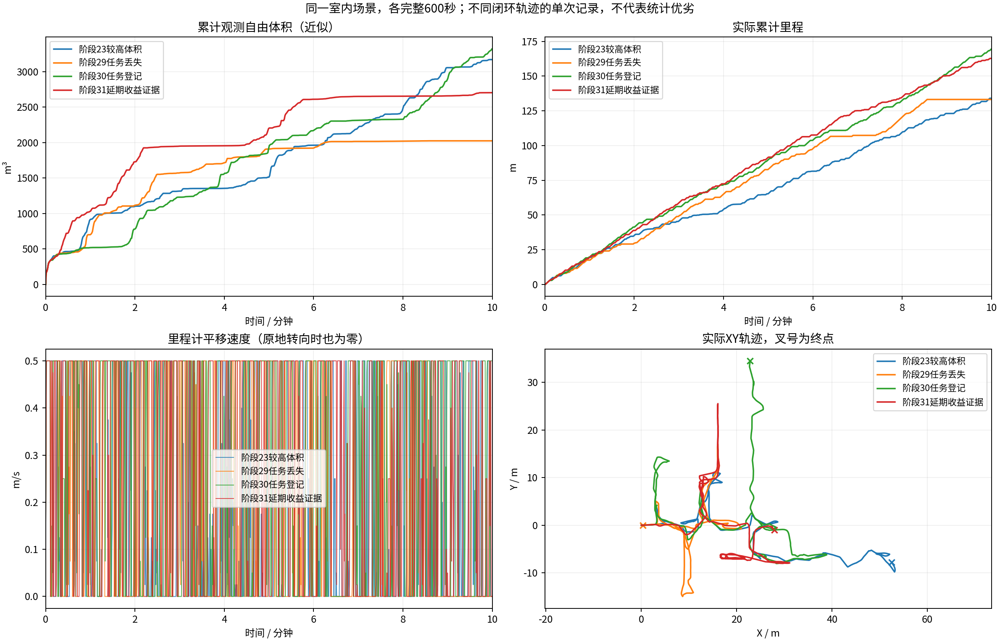

# 同场景版本10分钟对比

各组600秒；同场景原生起点、相同速度上限和体积统计定义。计时起点允许5cm/0.02rad差异，实际位姿保存在JSON中。不同闭环轨迹的单次试验，不能独立归因或证明普遍优劣。
体积是0.5m自由体素并集近似，不是真值覆盖率。平移速度为零也可能是在原地转向。

| 版本 | 代码 | 里程(m) | 观测自由体积(m³) | 最终状态 | BLOCKED抽样占比 | 规划P95(s) |
|---|---|---:|---:|---|---:|---:|
| 阶段23较高体积 | `149566d` | 134.00 | 3170.500 | BLOCKED | 7.8% | 1.616 |
| 阶段29任务丢失 | `b601015` | 133.17 | 2025.125 | COMPLETED | 15.5% | 1.567 |
| 阶段30任务登记 | `ce7202b` | 169.57 | 3321.250 | EXPLORING | 8.2% | 1.469 |
| 阶段31延期收益证据 | `b05ed9e` | 162.71 | 2703.875 | EXPLORING | 3.7% | 1.505 |

原始目录、输入CSV和记录校验文件的哈希保存在[comparison.json](comparison.json)。
视频、原始MCAP与地图快照在各运行目录；历史结果中的精选归档可能只含视频、CSV和末段快照。

- 阶段23较高体积：`/home/lzz/my test/HT_Explo-fixposition/docs/results/ht_configuration_gate_10min_2026-10-18/indoor`

- 阶段29任务丢失：`/home/lzz/my test/HT_Explo-fixposition/docs/results/ht_cell_audit_10min_2026-10-18/indoor`

- 阶段30任务登记：`/home/lzz/my test/HT_Explo-fixposition/docs/results/ht_pending_gain_tasks_10min_2026-10-18/indoor`

- 阶段31延期收益证据：`/home/lzz/my test/HT_Explo-fixposition/docs/results/ht_deferred_gain_tasks_10min_2026-10-19/indoor`
