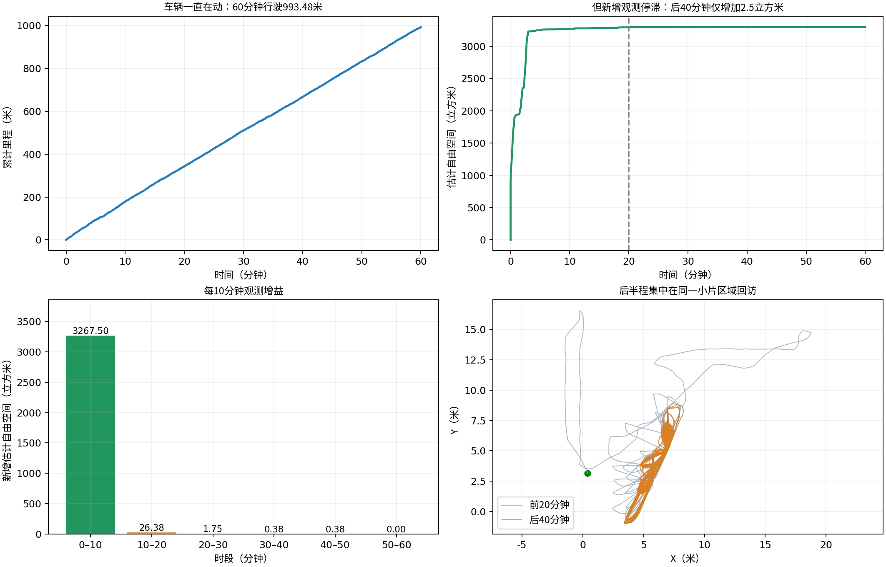
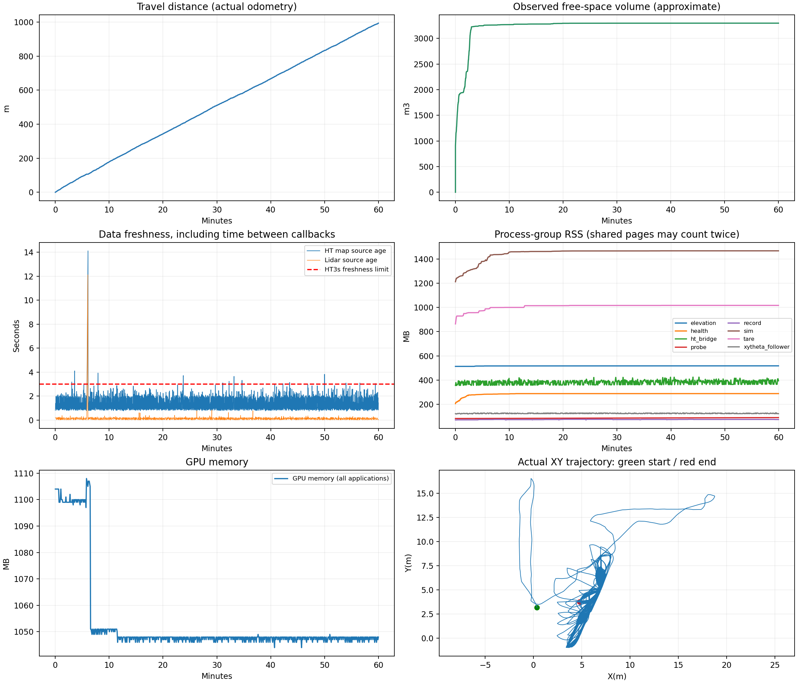
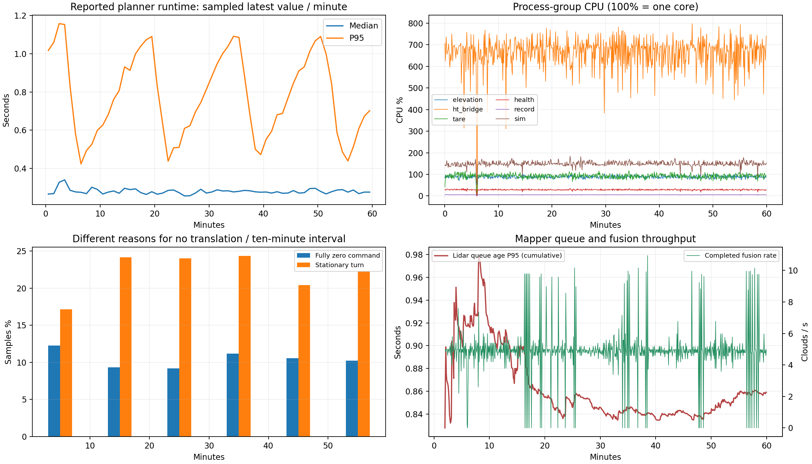

# 当前HT长测：进程持续运行，探索长期停滞

Garage仿真连续记录60分钟，中途不重启建图、规划或跟踪节点，不修改控制参数。日期：2026-10-16；代码基线07ab006；前进上限0.5m/s。

**结论：没有崩溃或明显内存失控，但没有通过“持续有效探索”的检验。** 车辆走了993.48米，后40分钟又走约650米，却只新增2.5立方米估计自由空间，最后10分钟新增为0；探索完成信号始终为否。这是长期重复回访，不能当作已完成探索。

## 关键结果

| 检查项 | 结果 |
|---|---|
| 运行连续性 | 60分钟，无被测父进程意外退出、无节点重启；最后60秒仍行驶14.39米 |
| 探索进展 | 累计估计自由空间3296.375m³；前10分钟3267.50m³，后50分钟仅新增28.875m³ |
| 停车与转向 | 全量控制记录：完全零速占10.62%，原地转向占22.17%；最长连续完全零速约12.40秒 |
| 实时性 | 1Hz检查的HT地图年龄P95为2.32秒，最大14.12秒；3600个检查点中32个超过3秒 |
| 规划耗时 | TARE报告的runtime中位数0.283秒、P95为0.928秒；不是整条感知控制链路耗时 |
| 内存 | 第5–10分钟到最后5分钟中位数：建图516→517MB、HT桥接380→391MB、规划999→1016MB；无明显失控增长 |
| 输入传输 | 139个源时间戳对齐检查点的外部探针/建图接收计数差恒定；未发现匹配窗口内的净相对漏收 |
| 拒绝反馈 | 规划器确认处理4次运动段拒绝并设置6秒冷却，随后恢复；未演变为原来的持续停车循环 |

## 发现的问题

1. **全局引导没有随长期无进展而退出。** 从约第5分钟起，日志长期指向同一引导点(18.97,0.17)，局部目标反复轮换。轨迹和观测并集证实后期在已知区域回访。代码中的引导保留和局部恢复逻辑是优先排查对象，尚未做修复消融，不能把全部原因归于单一分支。已承诺目标的gain=0是占位值，不能只凭该日志判断收益。
2. **发生一次上游输入中断。** 激光接收间隔最大13.08秒；约第353–365秒出现SCAN_STALE/PATH_STALE/ODOM_STALE，地图年龄达到14.12秒。内核同时记录enp3s0掉线约13秒，并提示链路从1Gbps降到100Mbps、检查线缆；Gazebo出现多播网络不可达和设置姿态失败。时间吻合，且CMU模拟器每轮串行调用3个最长300ms的Gazebo服务，支持“仿真通信受网络抖动影响”的判断，仍需隔离网络后的对照验证。另有点云仍新鲜时的短暂HT地图过期，不能全归于网卡。
3. **资源稳定性结论有范围限制。** 历史瓦片数很早停在约104，后期没有持续探索新区域。因此这轮验证了反复回访下的长时运行，尚未验证地图持续扩张时的内存上界。

## 下一步优先项

- 给全局引导加入累计无进展检测、失败引导冷却和替代目标选择，以新增观测或实际引导推进验收，避免靠重复短距离恢复维持运动。
- 将Gazebo本机通信限定到稳定接口后单独复测，排除物理网卡抖动；同时检查其他短暂地图过期的建图/推理调度。Gazebo提供[GZ_IP接口选择](https://gazebosim.org/api/transport/13/envvars.html)，本轮没有中途更改。
- 修复后重复同等60分钟测试，再加入持续扩展新区域的场景；不能仅凭“走得久”判定通过。

## 运行曲线与证据

每10分钟的里程与观测增益：

| 分钟 | 里程(m) | 新增估计自由空间(m³) |
|---|---:|---:|
| 0–10 | 178.73 | 3267.500 |
| 10–20 | 164.78 | 26.375 |
| 20–30 | 167.56 | 1.750 |
| 30–40 | 155.35 | 0.375 |
| 40–50 | 166.50 | 0.375 |
| 50–60 | 160.56 | 0.000 |

[全程相机视频（H.264）](camera_h264.mp4) · [源时间戳计数审计](input_delivery_audit.json) · [目标与拒绝反馈审计](target_selection_audit.json) · [机器网卡日志](host_network_kernel_events.txt) · [数据核验](validation_checks.json)

视频2fps，含约53秒初始化，检查运行过程用；不能用其帧率评价车辆控制流畅度。保留72000条控制指令、原始状态/里程计；点云按源时间每秒抽样，地图约每10秒保存精确同时间戳三图。抽样录包不等于完整传感器录包。

自由空间用0.5m体素、0.25m光线步长、15m距离截断累计，是近似外部观测指标，不是真值或官方覆盖率。二次按测量秒筛选使用3267帧，部分秒无样本；相对净接收一致也不能排除上游停发或双方共同漏收。内存按进程组RSS相加，可能重复计算共享页；显存总量包含桌面。

完整MCAP、348组同步地图快照、CSV、资源采样和日志保存在本机：`/home/lzz/my test/HT_Explo-fixposition/presentations/scheduled_results/ht_endurance_2026-10-16_19-23-16`。大体积原始数据未上传。

复现入口：`presentations/run_ht_endurance.py --duration 3600`；健康记录：`endurance_probe.py`；结束后用`watch_ht_endurance.py`或`summarize_ht_endurance.py`整理。仅对本次Garage仿真负责，不据此推断实车可靠性。
