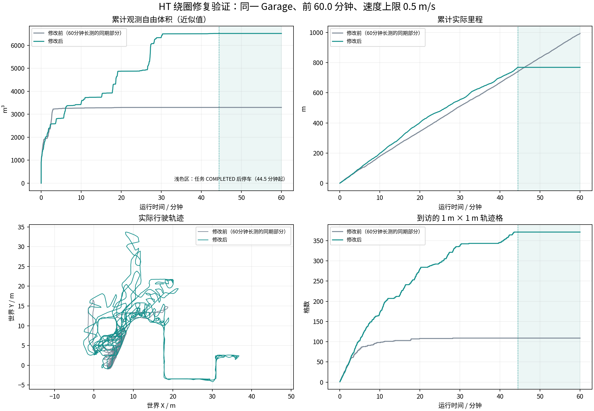
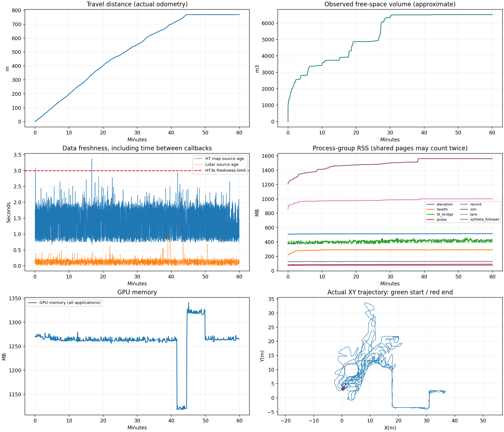

# 最新HT：60分钟长测与旧版对照

本轮完整记录60分钟，使用此前25分钟试跑相同的程序和14项配置/源码/可执行文件哈希；不重启节点、不改控制参数。场景为Garage，速度上限0.5m/s。核心导航代码c85ad1f，运行树0a2d544。

**本轮任务状态达到COMPLETED，约44.46分钟返回起点并停稳；随后约15.5分钟继续记录完成后的等待。** 这验证了本场景一次任务的返回完成，不代表场景真值覆盖率100%，也不等同于持续主动探索满60分钟。

| 指标 | 旧HT长测 | 最新HT长测 |
|---|---:|---:|
| 累计里程(m) | 993.48 | 768.57 |
| 累计观测自由体积(m³，近似) | 3296.375 | 6513.750 |
| 到访1米轨迹格 | 109 | 371 |
| 任务返回完成 | 否 | 是 |

每10分钟的里程与新增观测：

| 分钟 | 里程(m) | 新增估计自由体积(m³) |
|---|---:|---:|
| 0–10 | 198.62 | 3491.963 |
| 10–20 | 203.74 | 1379.787 |
| 20–30 | 151.81 | 1483.145 |
| 30–40 | 146.03 | 145.105 |
| 40–50 | 68.37 | 13.750 |
| 50–60 | 0.00 | 0.000 |

后段曲线变平需要分阶段解释：COMPLETED之后的停车是正常等待；完成之前仍有回访和阶段性观测停滞。最长未到访新轨迹格的活动期区间约7.38分钟，行驶106.17米，对应新增估计观测2.125m³，详见[回访区间](revisit_intervals.json)。
返航：约44.17分钟触发，约44.46分钟COMPLETED；最终里程计位置距开始记录位置约0.291米，返航搜索失败日志0条。任务完成状态包含到家范围、低速及停稳确认，不是简单的exploration_finish标志。

实时性与问题：1Hz采样的HT地图年龄P95 1.98秒、最大3.37秒，超过3秒3个采样点。仍有短时地图过期和回访，不能称所有问题已经消失。完整窗口的停车比例包含完成后的等待；请同时看活动期统计和任务状态。

关停仍有问题：跑满60分钟、主动发送SIGINT之后，CMU的vehicleSimulator、terrainAnalysisExt和sensorScanGeneration出现退出异常；CuPy日志以KeyboardInterrupt结束。报错发生在测量结束约0.52秒后，属于关停清理问题，不是本轮运行中崩溃，也没有在本轮修改外部工作区源码，详见[关停审计](shutdown_event_audit.json)。

过程没有被测父进程意外退出或资源保护中止记录；源时间戳对齐的相对接收审计、内存和排队统计见下方JSON。地图过期不等于输入掉包，抽样录包帧数也不能用来判定掉包。

[完整视频（H.264，2fps）](camera_h264.mp4) · [任务状态](mission_audit.json) · [输入送达审计](input_delivery_audit.json) · [数据与视频核验](validation_checks.json) · [运行审计](endurance_audit.json)

限制：本轮单次Garage，无实车或跨场景验收。自由体积是0.5m体素、15m射线范围、每秒最多一帧的自由空间并集近似，不是官方覆盖率。MCAP按原频率录制控制/状态/里程计、点云每秒抽样及地图约每10秒一组；完整本地数据见manifest和validation中的目录。运行中两次使用已封闭分片做离线核算，没有改变控制程序。视频2fps不能用于判断控制流畅度。完成后跟踪器可能显示PATH_STALE，因为任务已停止更新路径；本轮此时任务状态为COMPLETED且命令为零。

该结果说明本次返回闭环走通，早先尚未验证的返航修正获得一次实仿真证据；中途重复回访仍值得继续改进。

活动期全量控制指令：完全零速占9.1%，原地转向占19.2%，倒车占2.9%。COMPLETED之后的指令全部保持零线速度/零角速度，详见[活动期与等待期控制统计](control_phase_audit.json)。

本轮完整观测体积使用3600帧，对照旧记录使用3267帧；两者采用相同抽样/体素/射线口径，但实际入选帧数不同，是近似单轮比较，不是严格统计基准。
