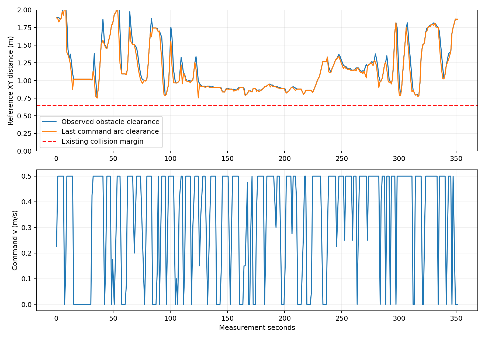
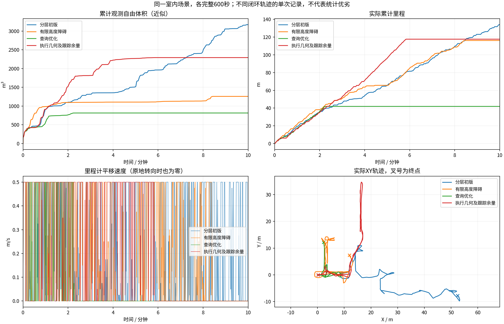
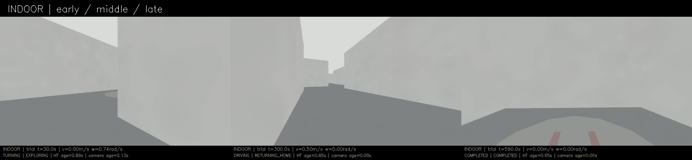
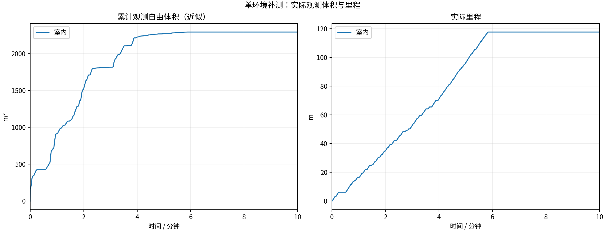
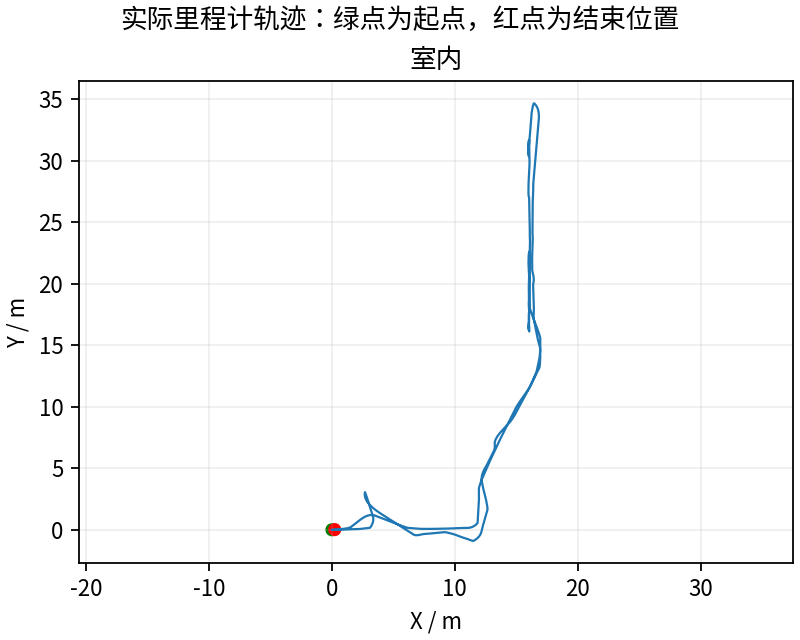
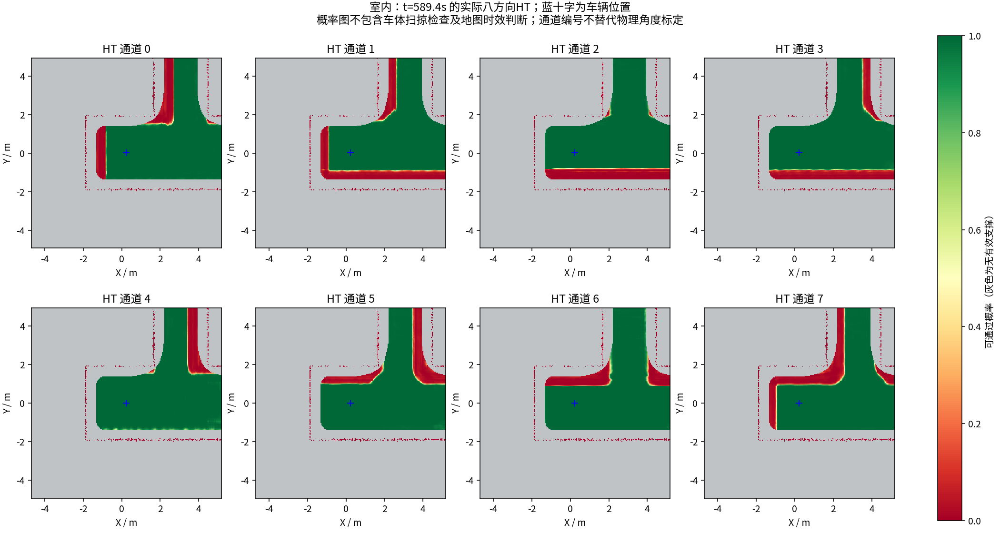
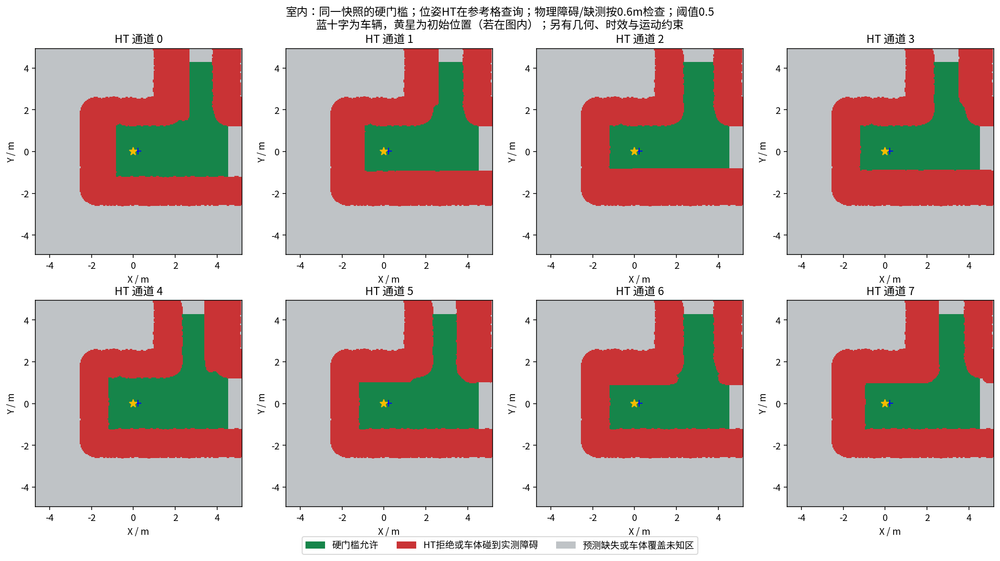

# 执行几何一致性与跟踪余量：本轮完成返航，覆盖仍待核验

**室内完整600秒，117.66m、2292.750m³，最终COMPLETED。** 约272.004秒触发内部探索结束，352.425秒完成返航；最后距离起点0.228m，并通过低速和停留检查。后面的曲线变平主要是完成后的停车，不能与上一轮长期BLOCKED混为一谈。

## 改动与证据边界

实测代码`65efef7`。规划器原来检查几何+HT，控制器只重新检查HT；现在执行端可靠读取同一collision_cloud，对实际参考点、前1m路线、反应/制动时间内指令圆弧重新做既有几何检查。场景的安全半径/高度参数显式传入follower，几何过期、坐标系不符或重叠时发全零Twist并按既有机制反馈失败边。名义平移与目标端点额外预留0.12m，对应现有控制器采样点到达容差，仍需标定实际跟踪误差上界。

基础半径仍为0.641421m；当前根位姿和原地转向仍用该基础边界，绝不放行已重叠根节点。HT模型、0.5阈值、未知规则、3秒时效、速度、动作和搜索预算保持。额外余量可能拒绝窄通道，不把保守限制藏起来。[修改说明](../../fixes/2026-10-18_execution_geometry.md)

全部4个CTest目标、16项控制器ROS回归通过，包括HT全绿却几何拒绝时实际发零、路径反馈身份、错误坐标系/过期停止、高处点不误拒绝、指令圆弧离开名义线时实际发全零。[完整日志](regression/)

## 本轮实际效果

307份录到的几何点云按当时最近里程计检查，没有发现参考点进入既有安全半径。上一轮首次重叠约136.426秒后长期停；本轮走到新区域后返回起点。本轮额外几何拒绝分支触发0次，不能把效果单独归于执行拦截；规划余量和闭环轨迹也变了。该检查是录包到达顺序关联/约1Hz采样，不是连续时刻物理真值。

3次晚HT指令拒绝全部配对全零Twist、未匹配0。没有把“几何分支未触发”说成完成了所有动态障碍测试。58份神经上下文与同源11图层逐值一致，三份冻结模型重算最大差均0；只证明记录一致，不代表物理模型正确。

## 与历史版本比较

| 版本 | 里程m | 近似自由体积m³ | 最终状态 |
|---|---:|---:|---|
| 分层首次阶段23 | 134.00 | 3170.500 | BLOCKED |
| 有限高度障碍阶段26 | 116.15 | 1258.000 | BLOCKED |
| 查询优化阶段27 | 41.90 | 815.625 | BLOCKED |
| 本轮阶段28 | 117.66 | 2292.750 | COMPLETED |

比上一轮体积增加约181.1%，比阶段26增加约82.3%；仍比阶段23少约27.7%。这些是单次同场景闭环记录的差异，不是排除轨迹/时序影响后的独立因果估计。117.66m含返航里程，不能全当作新区域探索。

## 为什么还不能宣称全部问题解决

内部完成判据是global_return与local_complete同时成立，约272秒日志中全局探索单元/局部未覆盖点与frontier计数都变0，之后返航。**这仅证明内部状态机完成，不能证明整个场景真值已覆盖。** 全局单元如何由候选收益/访问状态变成COVERED仍需逐单元核对，并与相同场景覆盖基准比较；本轮体积低于阶段23，也没有独立场景覆盖率真值。

HT年龄健康抽样P95约1.998s、最大3.563s，实时性长尾仍存在。runtime P95约1.433s、最大1.689s；与上一轮大量瞬时根拒绝的周期不能直接比较提速。内部结束后跳过部分覆盖计算，不能拿后半程轻负载冒充持续探索实时性。

下一步需要同源码重复与多环境验证，并核查全局完成判据和地图长尾；0.12m不是动力学误差保证，窄通道、实车定位与完整动力学仍未验收。

13项采集/冻结/退出核验全部通过。视频实际9000帧、600.000000秒、15fps，完整解码通过并满足600秒实验时长容差。[视频](indoor/camera_h264.mp4) · [有效规划参数](indoor/planner_parameters.yaml) · [有效控制参数](indoor/follower_parameters.yaml) · [任务状态审计](indoor/mission_audit.json)。整轮已录制目录、MCAP、模型上下文、CSV、周期地图、冻结外部源码和视频经Release保存；激光仍按源秒抽样，不是全传感器无损采集。

---

# HT 室内10分钟补测

每组测量 600 秒，从首个具备里程计和激光输入的TARE运行周期开始计时；初始化不计入。
每个场景独立启动、独立高程历史，上一组完全退出且视频处理结束后再启动下一组。车速上限均为0.5m/s，HT硬约束与3秒时效保护相同。
采用对应场景TARE参数；车库沿用历史配对起点，其余使用各自仿真原生起点。因此这不是相同场景的算法优劣对照。
相机原生960×540、15fps，视频含状态条并裁去初始化；重复帧代表真实图像更新间隔，不做插帧。

| 环境 | 状态 | 实际里程(m) | 近似观测体积(m³) | 末尾任务状态 | 视频 |
|---|---|---:|---:|---|---|
| 室内 | RECORDED | 117.66 | 2292.75 | COMPLETED | [播放/下载](indoor/camera_h264.mp4) |

[全部视频播放列表](videos.m3u) · [实时状态与校验](suite.json)

每个场景仅一次10分钟测试，不能据此证明更长时间、所有环境或实车稳定。定时记录完成不等于探索完成。观测体积是抽样激光射线的自由体素并集近似，不是真值覆盖率；跨场景体积不可直接作为算法优劣排名。

## 实际出现的问题

下表保留暂停和地图延迟，不把“节点未崩溃”当作“没有问题”。地图年龄为1Hz抽样，完整控制消息保留在本地MCAP中。全零指令表示既不平移也不转向；原地转向单独统计。

| 环境 | HT年龄P95/最大(s) | 年龄>3s样本 | 全零指令占比 | 最长全零指令(s) | 全局引导无进展释放 | 验证失败项 |
|---|---:|---:|---:|---:|---:|---|
| 室内 | 2.00 / 3.56 | 1 | 50.9% | 249.65 | 3 | 无 |

遇到旧HT地图时仍执行3秒时效保护；没有为让车持续前进而放宽硬约束。全局引导释放说明该段目标没有持续接近，不能解释为该目标已经到达或覆盖完成。

| 环境 | 实收激光/600s | 平均频率(Hz) | 最大接收间隔(s) | 同源对齐检查点 | 观察器与建图器计数差恒定 |
|---|---:|---:|---:|---:|---|
| 室内 | 2992 | 4.99 | 0.36 | 45 | True |

计数差恒定只支持这些对齐区间内没有新增相对漏收；不能证明源端始终连续发布，也不能排除两个订阅者同时漏收。各场景均保留完整扫描计数和原始时间戳检查点。

### 室内末段实际HT

[同期接收的相机画面](indoor/late_camera.jpg) · [原始图层快照](indoor/late_map_snapshot.npz) · [时间与坐标元数据](indoor/late_map_snapshot.json)

全部视频按15fps、600秒裁剪，时长校验允许1帧误差，完整解码通过；实际帧数和时长见各组video_validation.json。各组共有源文件的63项哈希一致，各组自身冻结文件核验见suite_validation.json。

相机年龄是图像接收后的年龄；相机仿真时间戳与导航墙钟不同，不能把该数值解释为传感器端到端延迟。原始MCAP、全高程历史和输入诊断保存在suite.json所列本地目录；本次只发布选取的数据与视频。
