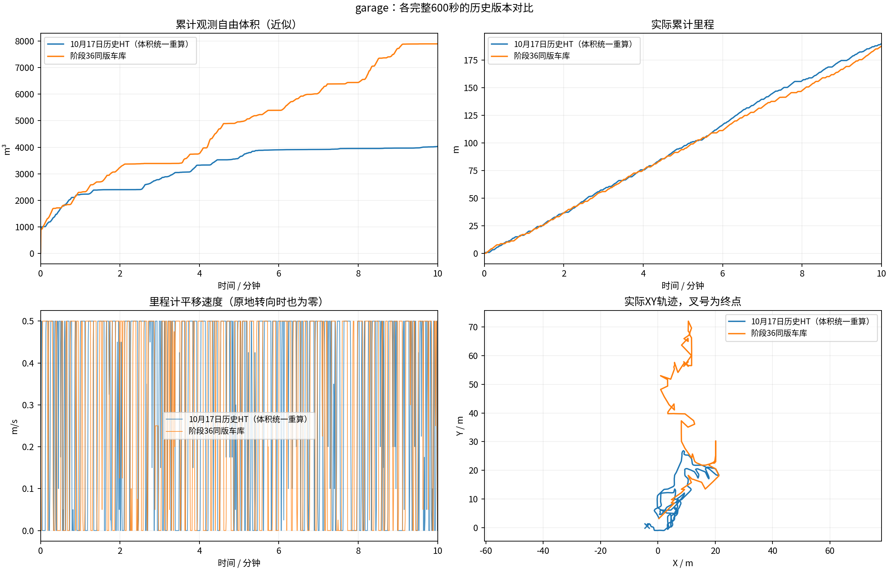
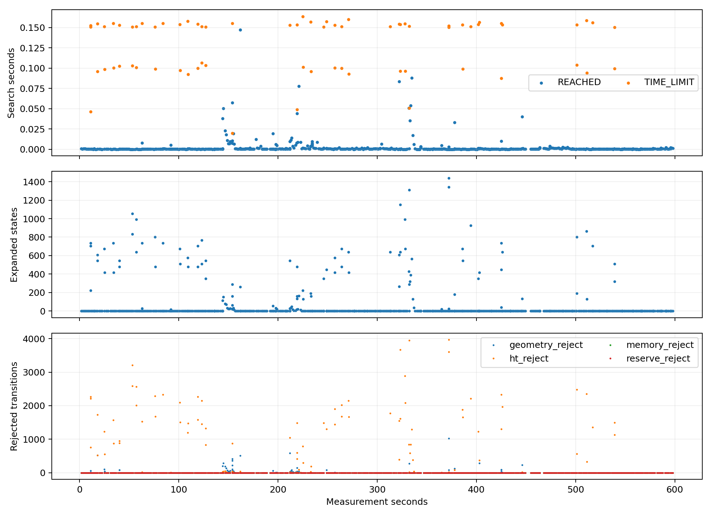
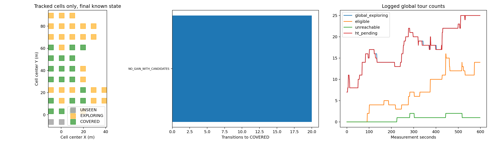
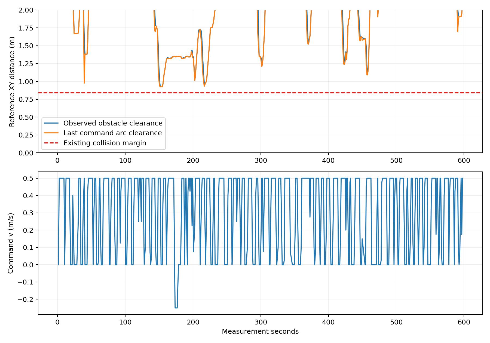
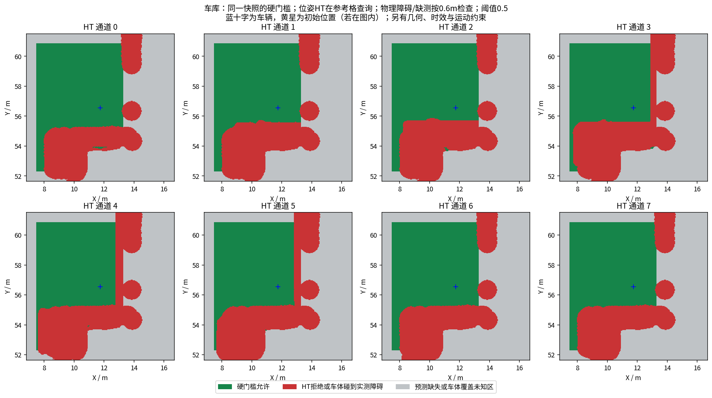
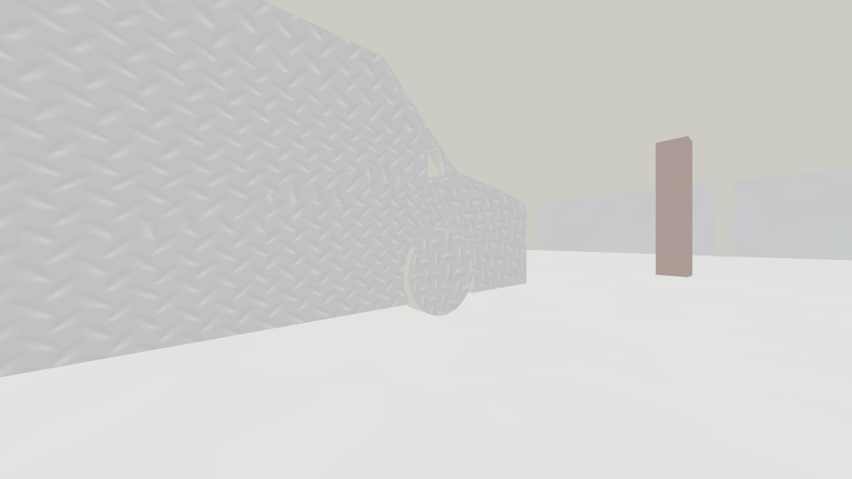
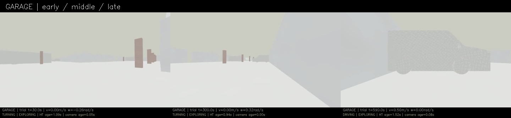
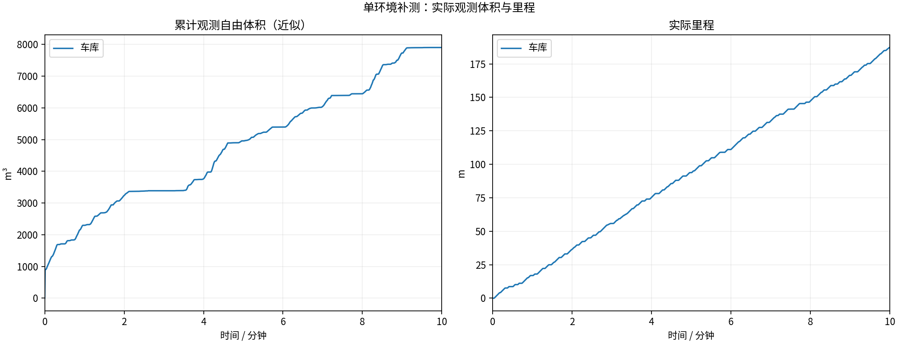
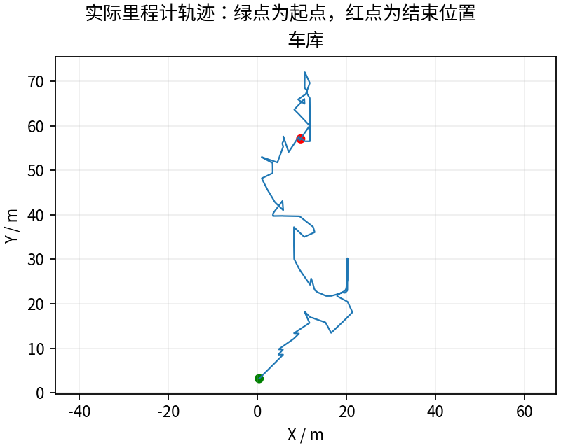
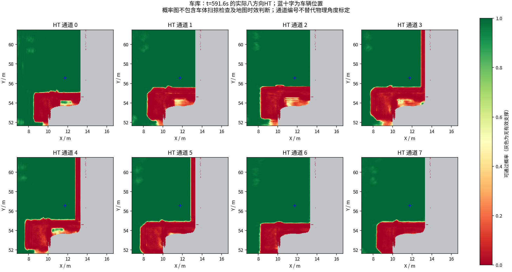

# 同一冻结版本：车库完整600秒验证

**187.25米 / 7900.375立方米，末尾任务EXPLORING。** 最后一分钟20.805米，最长全零4.950秒。计时到600秒结束，不代表环境已经全部探索完。

## 本轮测什么

实测提交`7b4c358`，导航控制391fa0f、桥接445b5c1，与阶段35室内相同。共同冻结清单的62项全部相同，仅另选车库世界和场景配置，没有再修改控制、建图、模型或搜索预算。源文件/参数/二进制冻结核验全部通过。[配置及历史差异](configuration_comparison.json)。

速度上限0.5m/s，HT概率硬门槛0.5、3秒地图时效保护；车库实际几何余量为0.7m，加半个0.2m格对角线后参考半径0.841421m，规划另有0.12m跟踪预留。几何离线分析读取本轮实际参数，不沿用室内0.5m余量。HT物理支撑半径仍0.6m。该分析使用记录接收顺序/最新位姿和点云，未重建精确回调、局部网格裁剪或物理碰撞真值。

## 历史同场景对照

| 版本 | 实测代码 | 里程m | 近似自由体积m³ | 最终状态 |
|---|---|---:|---:|---|
| 10月17日历史HT | 6d6998f | 189.57 | 4028.250 | EXPLORING |
| 本轮阶段36 | 7b4c358 | 187.25 | 7900.375 | EXPLORING |

自由体积相对历史为+96.1%，请同时看轨迹、停车和任务状态。历史到当前有多项建图/语义/规划/任务管理修正，不能把差异归因于某一项修改。对比工具核对相同场景、0.5m/s速度、体积定义和起始位姿容差。每版本一次闭环试验，不是统计优越性证明，也没有用室内体积与车库排名。

历史原报告按相对测量秒再次抽样，仅用了569帧；本轮从未修改的旧MCAP统一按源秒重算600帧，旧体积4027.375→4028.250m³，原历史报告不覆盖。[重算来源、原始MCAP哈希与旧口径](historical_garage_comparable/PROVENANCE.json) · [完整重算结果](historical_garage_metric/comparison.json)。图中历史曲线使用重算值。轨迹显示本轮向更远北侧推进，旧轮主要在起点附近回访；这能解释观测量与里程不同比例变化，但没有隔离哪项修改促成路线选择。

体积由600个源秒激光计算0.5m自由体素并集近似，跳过0，不是真值覆盖率。[指标定义](garage/metric_definition.json)。

## 实际问题与完整性

本轮793次搜索，终止{'REACHED': 722, 'TIME_LIMIT': 71}，其中680次通过逐段检查的简单连接；搜索最大0.163868秒。全零停顿的时间和对应搜索见[停车记录](garage/stop_episodes.json)，完整控制拦截配对见[指令核查](garage/blocked_commands.json)。零平移可能包含原地旋转，不能都叫卡死；搜索超时也不证明地形本身不可通行。

仍有实际问题：完整20Hz控制记录出现20条HT_MAP_STALE、26条PATH_STALE、2次几何晚拒绝与1次HT路径晚拒绝；这些晚拒绝均配对零指令，无未配对拦截或被拦截后非零指令。最长无平移7.45s包含原地旋转，完全停车近似按|v|<0.01、|ω|<0.05统计为4.95s；全停7.0%、原地转向21.7%，不能说运动已经平滑。

健康1Hz采样HT年龄P95 2.115s、最大4.117s。HT回调开始时源图已老的P95为1.579s、最大3.744s；融合与推理仍需时间（回调整体P95 0.524s，网络推理P95 0.272s）。说明延迟部分在进入HT回调之前，不能只归咎于HT推理；这些独立分位数不可直接相加，也不证明唯一根因。整体规划P95 0.933s，表示层P95 0.871s；不是每轮都能按快速直连的毫秒级完成。[各阶段计时与锁重叠证据](latency_audit/audit.json)。

542份记录碰撞云未发现当前参考点或所用恒定指令圆弧落入0.841421m余量；它是采样/近似检查，不能当作连续时刻物理无碰撞证明。搜索调度核查未见阶段32那类主要目标耗尽预算、恢复目标一直未尝试的循环。

13/13项录制、冻结、退出检查通过。视频8999帧/599.933333秒完整解码（允许一帧误差）。60份最终上下文ZIP和历史图CRC通过，坏文件0、遗留partial 0；58份窗口内上下文与同源图、三份冻结模型重算通过。仅验证保存的周期样本，不等于每一帧模型或物理真值都正确。[文件完整性](garage/context_integrity.json) · [输入/模型核查](garage/context_consistency.json)。

参数首查误用了不存在的/tare_planner名称，空YAML保留；节点列表确认后从/tare_planner_node成功获取参数。这是人工诊断查询错误，不是运行节点消失。[查询说明](garage/parameter_capture_attempts.json)。

单次完整记录不保证无限时间、多环境或实车稳定；仍需区分地图/路径时效、规划预算、全局目标回访和真正物理不可达。当前只证明所列条件下实际测得的结果，不是独立真值覆盖或完整轮胎/滑移动力学验收。

## 数据与视频

[完整600秒视频](garage/camera_h264.mp4) · [全部已录制数据及SHA256](https://github.com/CQULzz/HT_Explo/releases/tag/ht-stage-20261019-frozen-garage)。完整数据是发布HT/控制/位姿/状态、源秒激光和周期地图/上下文，不是全部原始传感器无损采集。GitHub完整保留，本机保留最近两轮；上传校验后再清理旧录包，报告视频不删。

---

# HT 车库10分钟补测

每组测量 600 秒，从首个具备里程计和激光输入的TARE运行周期开始计时；初始化不计入。
每个场景独立启动、独立高程历史，上一组完全退出且视频处理结束后再启动下一组。车速上限均为0.5m/s，HT硬约束与3秒时效保护相同。
采用对应场景TARE参数；车库沿用历史配对起点，其余使用各自仿真原生起点。因此这不是相同场景的算法优劣对照。
相机原生960×540、15fps，视频含状态条并裁去初始化；重复帧代表真实图像更新间隔，不做插帧。

| 环境 | 状态 | 实际里程(m) | 近似观测体积(m³) | 末尾任务状态 | 视频 |
|---|---|---:|---:|---|---|
| 车库 | RECORDED | 187.25 | 7900.38 | EXPLORING | [播放/下载](garage/camera_h264.mp4) |

[全部视频播放列表](videos.m3u) · [实时状态与校验](suite.json)

每个场景仅一次10分钟测试，不能据此证明更长时间、所有环境或实车稳定。定时记录完成不等于探索完成。观测体积是抽样激光射线的自由体素并集近似，不是真值覆盖率；跨场景体积不可直接作为算法优劣排名。

## 实际出现的问题

下表保留暂停和地图延迟，不把“节点未崩溃”当作“没有问题”。地图年龄为1Hz抽样，完整控制消息保留在本地MCAP中。全零指令表示既不平移也不转向；原地转向单独统计。

| 环境 | HT年龄P95/最大(s) | 年龄>3s样本 | 全零指令占比 | 最长全零指令(s) | 全局引导无进展释放 | 验证失败项 |
|---|---:|---:|---:|---:|---:|---|
| 车库 | 2.11 / 4.12 | 6 | 7.0% | 4.95 | 4 | 无 |

遇到旧HT地图时仍执行3秒时效保护；没有为让车持续前进而放宽硬约束。全局引导释放说明该段目标没有持续接近，不能解释为该目标已经到达或覆盖完成。

| 环境 | 实收激光/600s | 平均频率(Hz) | 最大接收间隔(s) | 同源对齐检查点 | 观察器与建图器计数差恒定 |
|---|---:|---:|---:|---:|---|
| 车库 | 2987 | 4.98 | 0.40 | 14 | True |

计数差恒定只支持这些对齐区间内没有新增相对漏收；不能证明源端始终连续发布，也不能排除两个订阅者同时漏收。各场景均保留完整扫描计数和原始时间戳检查点。

### 车库末段实际HT

[同期接收的相机画面](garage/late_camera.jpg) · [原始图层快照](garage/late_map_snapshot.npz) · [时间与坐标元数据](garage/late_map_snapshot.json)

全部视频按15fps、600秒裁剪，时长校验允许1帧误差，完整解码通过；实际帧数和时长见各组video_validation.json。各组共有源文件的65项哈希一致，各组自身冻结文件核验见suite_validation.json。

相机年龄是图像接收后的年龄；相机仿真时间戳与导航墙钟不同，不能把该数值解释为传感器端到端延迟。本导出目录只含精选数据与视频；原始MCAP、全高程历史和输入诊断见suite.json所列目录，GitHub完整备份状态以本轮Release及发布校验回执为准。
