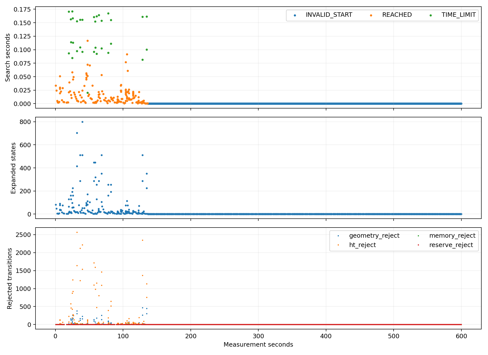
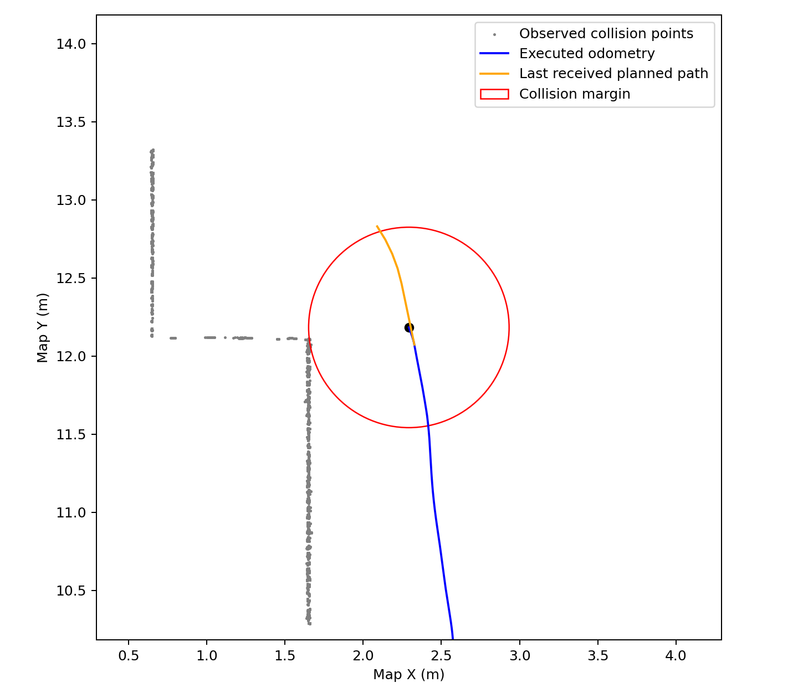
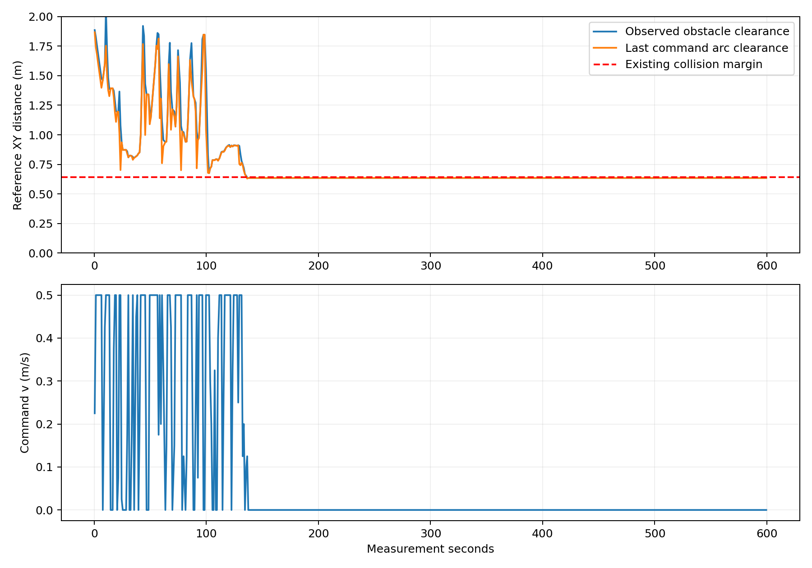
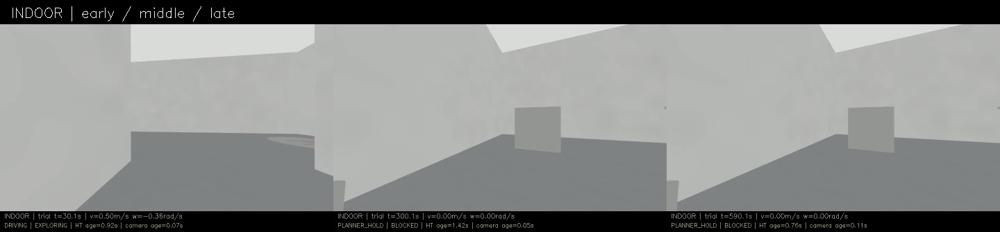
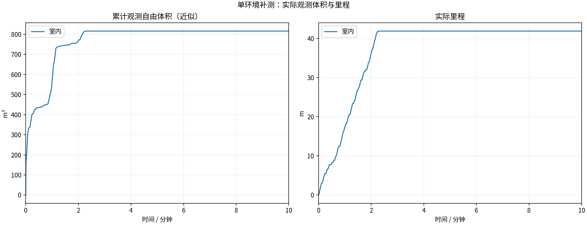
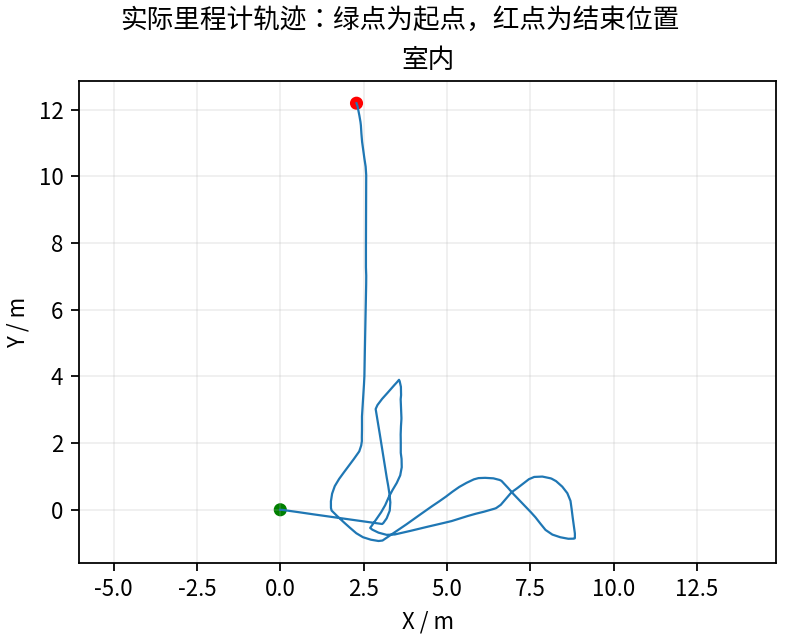
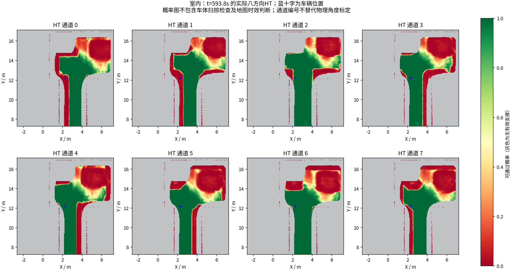
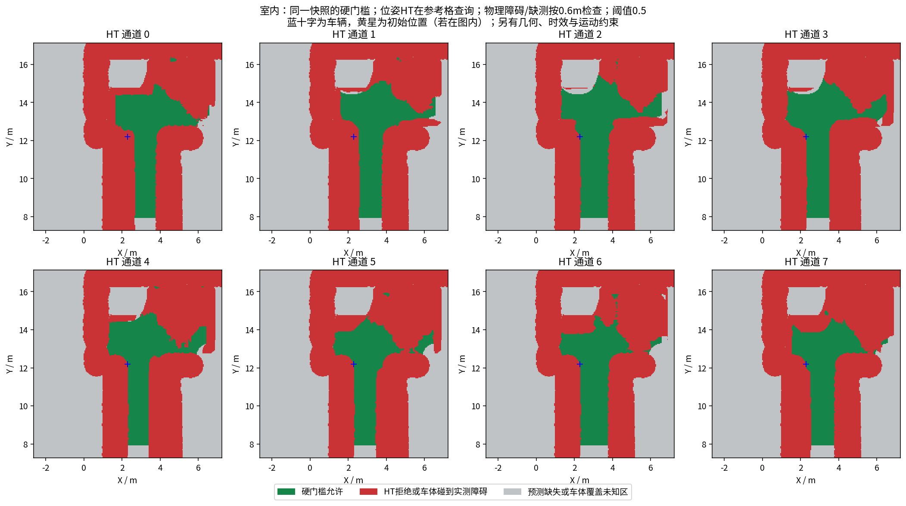

# 查询提速保持判定；真实执行仍进入安全边界

**完整600秒41.90m、815.625m³，最终BLOCKED；最后移动136.501秒。** 比阶段26的116.15m/1258m³退步，不能以微基准提速宣称探索改善。

实测代码`4721764`。在相同碰撞标准下，车体高度预筛选+XY最近邻代替重复三维邻域遍历；不同高度与浮点边界回退原判定。6561个真实点云查询重复3次逐字节一致，微基准平均3.68倍；800组高度/半径边界对照及全部CTest通过。[证据](regression/)。HT阈值、速度、动作分辨率与搜索预算未改。

## 停滞的证据与不能下的结论

新增3719条搜索记录：167次REACHED、32次TIME_LIMIT、3520次INVALID_START。最后60秒480次全部几何拒绝起点、展开0；本次长期停车不是预算耗尽。[分项数据](search_audit/summary.json)

第一份出现安全半径重叠的点云约136.426秒：参考点到障碍0.63736m，小于原有0.641421m半径；车还收到0.125m/s指令。实际停止后最近点约0.63475m。可靠订阅和整轮MCAP均收到了原始碰撞点云、候选及碰撞视点。[完整捕获](geometry_capture/metadata.json)

最后发布路线约136.306秒，对当时最近已收到的几何点云最小间距0.64908m，略大于边界；首次重叠时实际参考点到路线线段约0.01189m。规划路径与真实车位置不是同一条线，贴边路线仅有毫米级余量，控制偏差/观测变化足以耗尽。控制器代码仅重新验证HT命令圆弧，未重新验证TARE几何；规划器同时验证二者，因此存在约束不一致。

这不是车身已经接触障碍的证明。点云/里程计/指令按录包到达顺序关联，不是精确回调重放；采样未发现首次重叠前常速预测圆弧已穿界的事件，不能断言仅加执行拦截必然防止此停车，不能排除地形缓存/噪声与时延贡献。下一候选应将规划和执行的几何约束对齐，并给跟踪误差留明确安全余量，而不是放行已碰撞的根节点。

## 同条件版本比较

| 版本 | 里程m | 近似自由体积m³ | 最终状态 |
|---|---:|---:|---|
| 阶段23 | 134.00 | 3170.500 | BLOCKED |
| 阶段25 | 65.80 | 1959.875 | BLOCKED |
| 阶段26 | 116.15 | 1258.000 | BLOCKED |
| 本轮阶段27 | 41.90 | 815.625 | BLOCKED |

13项采集核验、600秒9000帧完整视频解码通过。59份神经上下文与同源时间戳11层输出逐值一致，三份模型重算最大差0；晚HT拦截无实际非零指令。HT图龄健康抽样P95约1.874s，最大3.399s；规划runtime P95 0.952s，但多数周期根状态立即失败，不能与持续搜索的历史轮次直接作速度收益结论。

[600秒视频](indoor/camera_h264.mp4) · [有效参数](indoor/planner_parameters.yaml) · [修改说明](../../fixes/2026-10-18_geometry_index.md)。本轮原始目录、MCAP、CSV、网络输入/输出、周期地图、视频、独立工作区源码均经Release发布；激光源秒抽样不是全传感器无损记录。多环境/重复稳定性、建图长尾、低收益绕行、完整动力学与物理标定仍未通过。

---

# HT 室内10分钟补测

每组测量 600 秒，从首个具备里程计和激光输入的TARE运行周期开始计时；初始化不计入。
每个场景独立启动、独立高程历史，上一组完全退出且视频处理结束后再启动下一组。车速上限均为0.5m/s，HT硬约束与3秒时效保护相同。
采用对应场景TARE参数；车库沿用历史配对起点，其余使用各自仿真原生起点。因此这不是相同场景的算法优劣对照。
相机原生960×540、15fps，视频含状态条并裁去初始化；重复帧代表真实图像更新间隔，不做插帧。

| 环境 | 状态 | 实际里程(m) | 近似观测体积(m³) | 末尾任务状态 | 视频 |
|---|---|---:|---:|---|---|
| 室内 | RECORDED | 41.90 | 815.62 | BLOCKED | [播放/下载](indoor/camera_h264.mp4) |

[全部视频播放列表](videos.m3u) · [实时状态与校验](suite.json)

每个场景仅一次10分钟测试，不能据此证明更长时间、所有环境或实车稳定。定时记录完成不等于探索完成。观测体积是抽样激光射线的自由体素并集近似，不是真值覆盖率；跨场景体积不可直接作为算法优劣排名。

## 实际出现的问题

下表保留暂停和地图延迟，不把“节点未崩溃”当作“没有问题”。地图年龄为1Hz抽样，完整控制消息保留在本地MCAP中。全零指令表示既不平移也不转向；原地转向单独统计。

| 环境 | HT年龄P95/最大(s) | 年龄>3s样本 | 全零指令占比 | 最长全零指令(s) | 全局引导无进展释放 | 验证失败项 |
|---|---:|---:|---:|---:|---:|---|
| 室内 | 1.87 / 3.40 | 3 | 80.3% | 463.30 | 8 | 无 |

遇到旧HT地图时仍执行3秒时效保护；没有为让车持续前进而放宽硬约束。全局引导释放说明该段目标没有持续接近，不能解释为该目标已经到达或覆盖完成。

| 环境 | 实收激光/600s | 平均频率(Hz) | 最大接收间隔(s) | 同源对齐检查点 | 观察器与建图器计数差恒定 |
|---|---:|---:|---:|---:|---|
| 室内 | 2991 | 4.99 | 0.25 | 6 | True |

计数差恒定只支持这些对齐区间内没有新增相对漏收；不能证明源端始终连续发布，也不能排除两个订阅者同时漏收。各场景均保留完整扫描计数和原始时间戳检查点。

### 室内末段实际HT

[同期接收的相机画面](indoor/late_camera.jpg) · [原始图层快照](indoor/late_map_snapshot.npz) · [时间与坐标元数据](indoor/late_map_snapshot.json)

全部视频按15fps、600秒裁剪，时长校验允许1帧误差，完整解码通过；实际帧数和时长见各组video_validation.json。各组共有源文件的62项哈希一致，各组自身冻结文件核验见suite_validation.json。

相机年龄是图像接收后的年龄；相机仿真时间戳与导航墙钟不同，不能把该数值解释为传感器端到端延迟。原始MCAP、全高程历史和输入诊断保存在suite.json所列本地目录；本次只发布选取的数据与视频。
