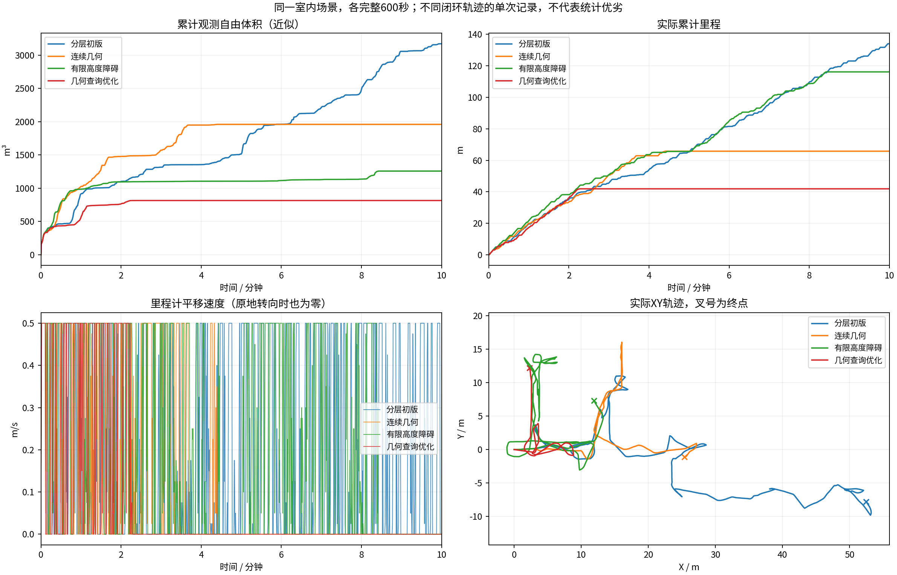

# 同场景版本10分钟对比

各组600秒；同场景原生起点、相同速度上限和体积统计定义。计时起点允许5cm/0.02rad差异，实际位姿保存在JSON中。不同闭环轨迹的单次试验，不能独立归因或证明普遍优劣。
体积是0.5m自由体素并集近似，不是真值覆盖率。平移速度为零也可能是在原地转向。

| 版本 | 代码 | 里程(m) | 观测自由体积(m³) | 最终状态 | BLOCKED抽样占比 | 规划P95(s) |
|---|---|---:|---:|---|---:|---:|
| 分层初版 | `149566d` | 134.00 | 3170.500 | BLOCKED | 7.8% | 1.616 |
| 连续几何 | `43069a7` | 65.80 | 1959.875 | BLOCKED | 63.7% | 1.386 |
| 有限高度障碍 | `22c2749` | 116.15 | 1258.000 | BLOCKED | 27.7% | 1.081 |
| 几何查询优化 | `4721764` | 41.90 | 815.625 | BLOCKED | 77.8% | 0.952 |

原始目录、输入CSV和记录校验文件的哈希保存在[comparison.json](comparison.json)。
视频、原始MCAP与地图快照在各运行目录；历史结果中的精选归档可能只含视频、CSV和末段快照。

- 分层初版：`/home/lzz/my test/HT_Explo-fixposition/docs/results/ht_configuration_gate_10min_2026-10-18/indoor`

- 连续几何：`/home/lzz/my test/HT_Explo-fixposition/docs/results/ht_continuous_geometry_10min_2026-10-18/indoor`

- 有限高度障碍：`/home/lzz/my test/HT_Explo-fixposition/docs/results/ht_postfilter_obstacles_10min_2026-10-18/indoor`

- 几何查询优化：`/home/lzz/my test/HT_Explo-fixposition/docs/results/ht_geometry_index_10min_2026-10-18/indoor`
