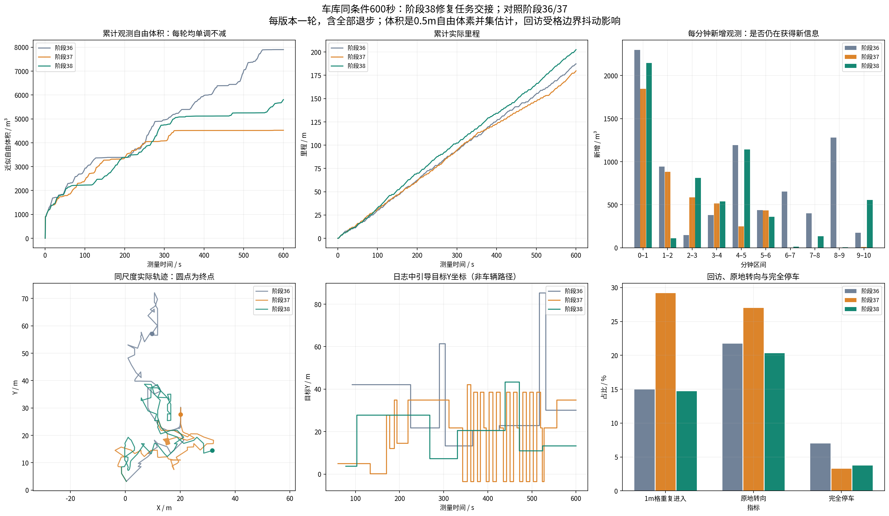
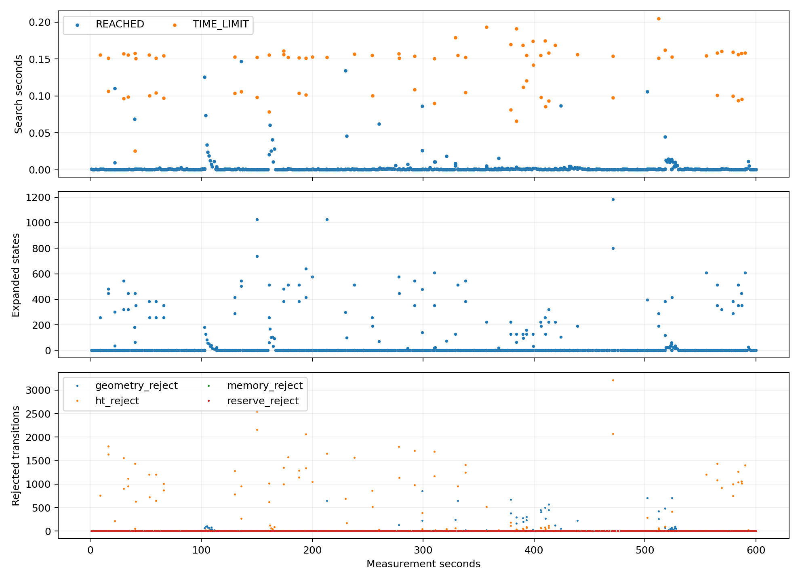
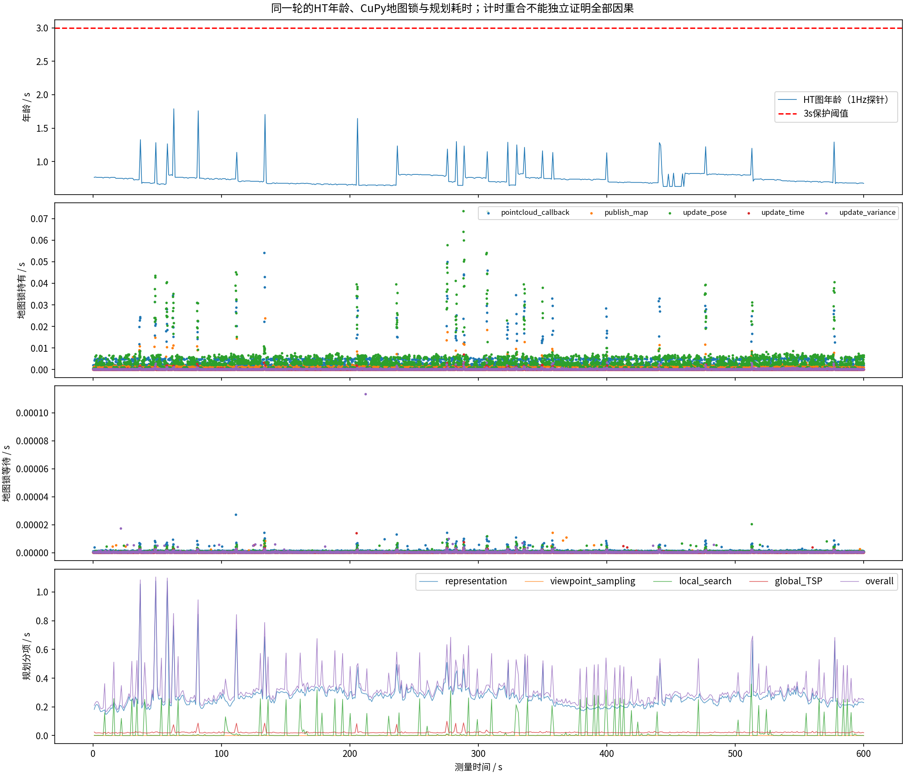
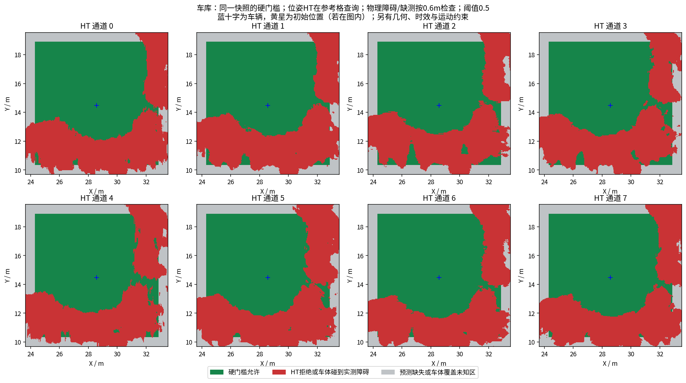
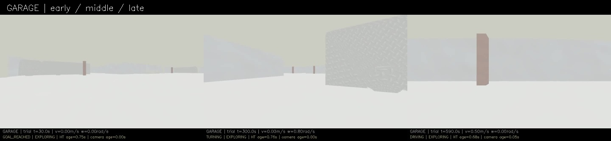
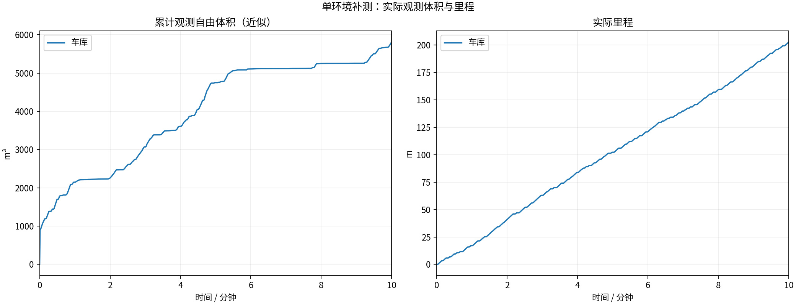
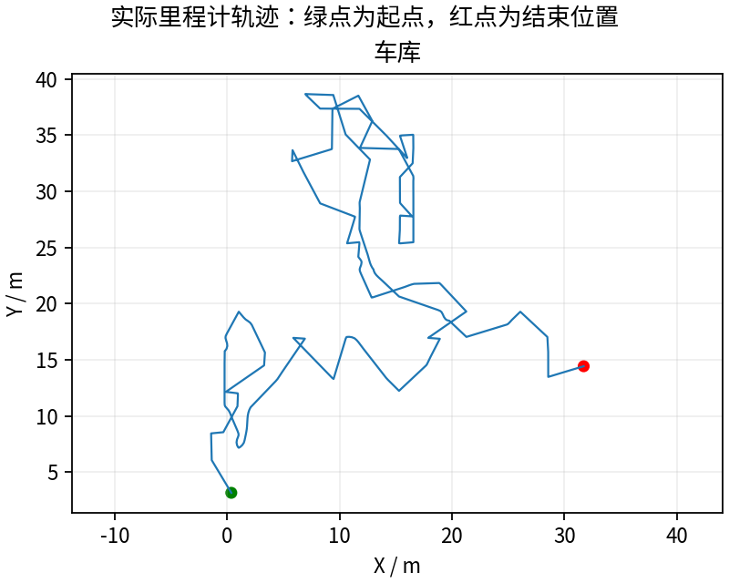
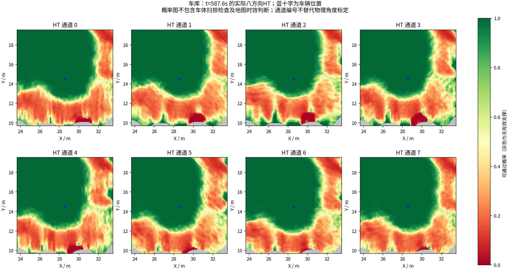

# 体积为什么变动，以及阶段38的修改和实测

**已修复一个确定的任务交接错误，并在同车库完整运行600秒：202.58米、5807.000m³。** 对比阶段37，体积提高28.4%、里程提高12.7%；仍低于阶段36，不能宣称所有波动消失。

## 为什么会波动

1. **单轮累计体积没有减少。** 阶段36/37/38的累计观测自由体素并集均单调不减；7900.375、4522.625、5807.000m³是不同实验结果。滚动局部地图有效面积/本帧数量本来会变化，不能与累计体积混用。[原始审计](regression/volume_monotonicity.json)、[本轮曲线证据](comparison/plot_evidence.json)。
2. **车辆走了不同路线。** 走回已经观察过的路，即使持续运动，新增体积也很少；之前37末分钟22.735米仅增8.375m³。输入/执行时序可能改变后续目标分支，单轮对照不能把全部差异归为某一改动。
3. **代码确实有任务交接错误。** TARE会从全局巡游中暂时移除委派局部窗口的任务，旧HT代码把“不在巡游列表”当作放弃当前引导的理由。目标未完成也被切换，继而拒绝当前局部承诺，导致反复折返。[原因、反例与回归](../../fixes/2026-10-19_guide_handoff.md)。

## 这次改了什么

全局引导携带单元任务ID，以全局EXPLORING状态决定是否继续，不单看巡游列表。真正任务解除时释放；保留到达、无进展60秒/静止12秒超时、冷却和每轮实际路线重搜，HT硬门槛/几何/速度/运动约束不变。

实测版本`16bdbe4`，相对37只有4项导航源文件/头文件和规划二进制改变，其余60项冻结条目相同；实际导航与控制参数一致。[冻结与参数对照](configuration_comparison.json)、[实际源代码差异](tested_source.patch)。四项CTest通过，包含交接保持、任务解除与超时反例；验证采集完整与验证导航性能分别统计。

## 三轮同条件对比

| 指标 | 阶段36 | 阶段37 修改前 | 阶段38 本轮 |
|---|---:|---:|---:|
| 累计近似观测自由体积m³ | 7900.375 | 4522.625 | 5807.000 |
| 实际里程m | 187.25 | 179.78 | 202.58 |
| 最后60秒新增m³ | 174.625 | 8.375 | 553.750 |
| 最后60秒里程m | 20.805 | 22.735 | 21.660 |
| 1m轨迹格重复进入占比 | 15.0% | 29.2% | 14.7% |
| 原地转向指令占比 | 21.7% | 27.0% | 20.3% |
| 完全停车占比 | 7.0% | 3.25% | 3.73% |
| 最长完全停车s | 4.95 | 1.15 | 1.40 |
| HT地图年龄P95 / 最大s | 2.115 / 4.117 | .842 / 1.840 | .822 / 1.790 |
| 搜索TIME_LIMIT次数 | 71 | 47 | 81 |
| 全程末尾任务 | EXPLORING | EXPLORING | EXPLORING |

同车库、近似相同起点、0.5m/s上限、相同0.5m自由体素并集、600个源秒激光且跳过0。每轮独立历史，累计体积是射线近似而非物理覆盖真值。回访按去除连续静止重复采样后的1m格进入序列，受边界抖动影响。

相对37，记录到的引导切换34→6次，300–540秒27→4次。新增日志有221个规划周期`in_tour=0,pending=1`，实际保持引导；仍有2次无进展超时，说明没有无限锁定目标。旧日志无任务ID，单元状态按最近中心推断，不冒充精确内部状态重放。待办仍在时到达旧连接点/超时也可合法换目标，不把所有切换算错误。

**退步与限制：** 体积仍比36低26.5%；搜索超时47→81，最大搜索.205s，最长停车1.15→1.40s。车辆末尾仍在探索，600秒到点停止录制，未完成整个环境。当前只验证这一轮车库，不保证不同随机时序/其他环境/实车稳定。

## 数据完整性与图册

13/13采集核验通过，四项CTest通过；9000帧/600秒视频完整解码。61份最终上下文及历史图CRC通过，无坏文件/partial，保存样本同源与三份冻结模型重算通过。577份记录几何样本未见名义余量重叠；1次几何晚拦截、1次HT晚拦截均配对零指令，未配对/拦截非零为0。这不是连续物理安全证明。

600个源帧匹配全trace，计数偏置恒143，3084个收到/处理回调与trace一致；只支持窗口内没有净相对漏收，不能排除源头漏发或共同漏收。真实参数第一次启动前发现失败，空文件保留，启动后成功获取且与37一致。

[历次多角度图册](history/index.html) · [合并PDF](history/all_comparisons.pdf) · [各轮指标和来源](history/measurements.csv)。每版改动、功能、已知缺陷全部列入，失败轮不隐藏。

## 视频和完整数据

[600秒视频](garage/camera_h264.mp4) · [GitHub完整记录、视频和SHA256](https://github.com/CQULzz/HT_Explo/releases/tag/ht-stage-20261019-guide-handoff)。记录为全部发布HT/控制/位姿/状态、源秒激光、周期地图/上下文；不是全频原始传感器无损录制。发布完成以仓库`stage38.json`远端校验回执为准。GitHub保留全部，本机只在远端核对后保留最近两轮完整录包，图文/视频/回归样本保留。

---

# HT 车库10分钟补测

每组测量 600 秒，从首个具备里程计和激光输入的TARE运行周期开始计时；初始化不计入。
每个场景独立启动、独立高程历史，上一组完全退出且视频处理结束后再启动下一组。车速上限均为0.5m/s，HT硬约束与3秒时效保护相同。
采用对应场景TARE参数；车库沿用历史配对起点，其余使用各自仿真原生起点。因此这不是相同场景的算法优劣对照。
相机原生960×540、15fps，视频含状态条并裁去初始化；重复帧代表真实图像更新间隔，不做插帧。

| 环境 | 状态 | 实际里程(m) | 近似观测体积(m³) | 末尾任务状态 | 视频 |
|---|---|---:|---:|---|---|
| 车库 | RECORDED | 202.58 | 5807.00 | EXPLORING | [播放/下载](garage/camera_h264.mp4) |

[全部视频播放列表](videos.m3u) · [实时状态与校验](suite.json)

每个场景仅一次10分钟测试，不能据此证明更长时间、所有环境或实车稳定。定时记录完成不等于探索完成。观测体积是抽样激光射线的自由体素并集近似，不是真值覆盖率；跨场景体积不可直接作为算法优劣排名。

## 实际出现的问题

下表保留暂停和地图延迟，不把“节点未崩溃”当作“没有问题”。地图年龄为1Hz抽样，完整控制消息保留在本地MCAP中。全零指令表示既不平移也不转向；原地转向单独统计。

| 环境 | HT年龄P95/最大(s) | 年龄>3s样本 | 全零指令占比 | 最长全零指令(s) | 全局引导无进展释放 | 验证失败项 |
|---|---:|---:|---:|---:|---:|---|
| 车库 | 0.82 / 1.79 | 0 | 3.7% | 1.40 | 2 | 无 |

遇到旧HT地图时仍执行3秒时效保护；没有为让车持续前进而放宽硬约束。全局引导释放说明该段目标没有持续接近，不能解释为该目标已经到达或覆盖完成。

| 环境 | 实收激光/600s | 平均频率(Hz) | 最大接收间隔(s) | 同源对齐检查点 | 观察器与建图器计数差恒定 |
|---|---:|---:|---:|---:|---|
| 车库 | 2994 | 4.99 | 0.54 | 0 | False |

计数差恒定只支持这些对齐区间内没有新增相对漏收；不能证明源端始终连续发布，也不能排除两个订阅者同时漏收。各场景均保留完整扫描计数和原始时间戳检查点。

### 车库末段实际HT

[同期接收的相机画面](garage/late_camera.jpg) · [原始图层快照](garage/late_map_snapshot.npz) · [时间与坐标元数据](garage/late_map_snapshot.json)

全部视频按15fps、600秒裁剪，时长校验允许1帧误差，完整解码通过；实际帧数和时长见各组video_validation.json。各组共有源文件的65项哈希一致，各组自身冻结文件核验见suite_validation.json。

相机年龄是图像接收后的年龄；相机仿真时间戳与导航墙钟不同，不能把该数值解释为传感器端到端延迟。本导出目录只含精选数据与视频；原始MCAP、全高程历史和输入诊断见suite.json所列目录，GitHub完整备份状态以本轮Release及发布校验回执为准。
