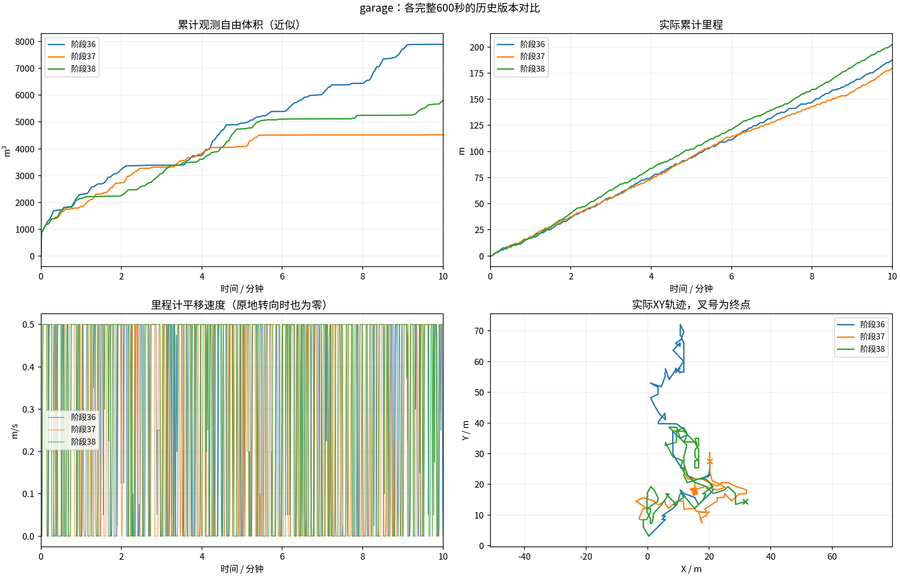

# 同场景版本10分钟对比

各组600秒；同场景原生起点、相同速度上限和体积统计定义。计时起点允许5cm/0.02rad差异，实际位姿保存在JSON中。不同闭环轨迹的单次试验，不能独立归因或证明普遍优劣。
体积是0.5m自由体素并集近似，不是真值覆盖率。平移速度为零也可能是在原地转向。

| 版本 | 代码 | 里程(m) | 观测自由体积(m³) | 最终状态 | BLOCKED抽样占比 | 规划P95(s) |
|---|---|---:|---:|---|---:|---:|
| 阶段36 | `7b4c358` | 187.25 | 7900.375 | EXPLORING | 2.2% | 0.911 |
| 阶段37 | `d6d8787` | 179.78 | 4522.625 | EXPLORING | 0.0% | 0.491 |
| 阶段38 | `16bdbe4` | 202.58 | 5807.000 | EXPLORING | 0.0% | 0.533 |

原始目录、输入CSV和记录校验文件的哈希保存在[comparison.json](comparison.json)。
视频、原始MCAP与地图快照在各运行目录；历史结果中的精选归档可能只含视频、CSV和末段快照。

- 阶段36：`/home/lzz/my test/HT_Explo-fixposition/docs/results/ht_frozen_garage_10min_2026-10-19/garage`

- 阶段37：`/home/lzz/my test/HT_Explo-fixposition/docs/results/ht_serial_mapper_10min_2026-10-19/garage`

- 阶段38：`/home/lzz/my test/HT_Explo-fixposition/presentations/scheduled_results/ht_guide_handoff_10min_2026-10-19_14-37-26/garage`
