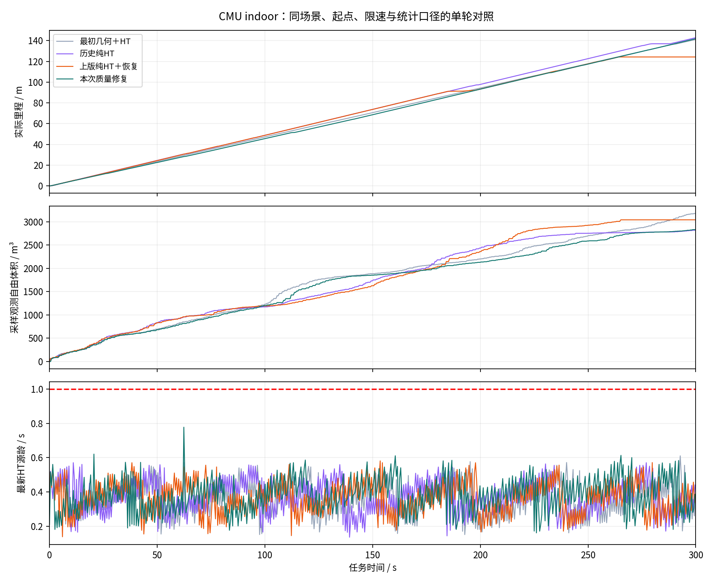
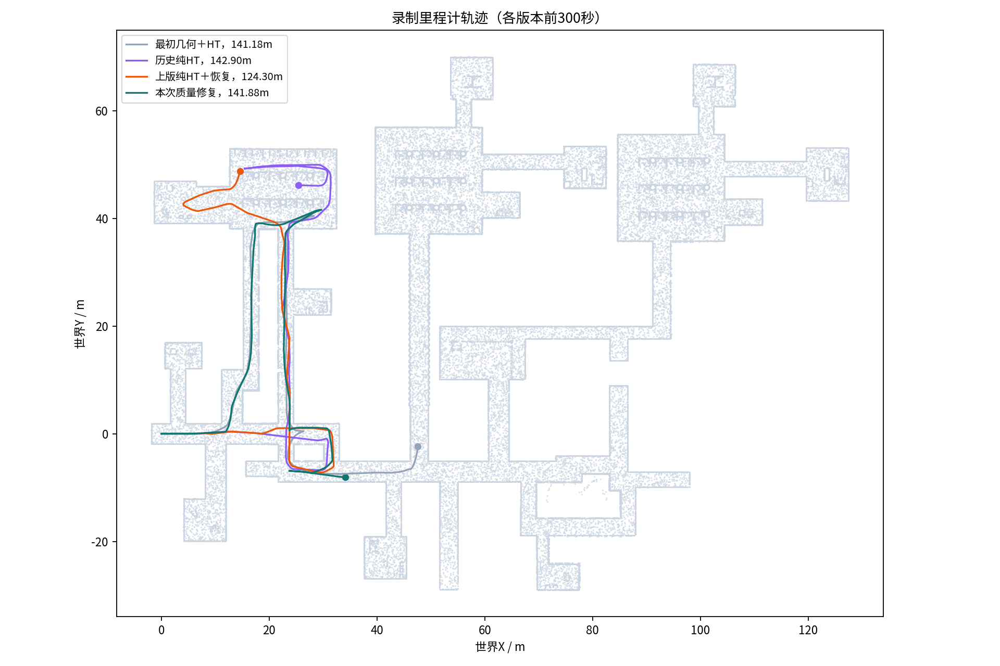

**高程质量一致性修复与纯HT局部通行测试｜2026-11-11**

已完成独立分支修改和一次完整CMU indoor五分钟测试。原生TARE保持不变，CMU局部判定继续使用ht_only；本轮修正了mapper的统计门限、点密度依赖和高度/质量配对。新测试结束仍行驶，未复现上版末段持续停车。这个结论只覆盖本次300秒与已列离线回归。

分支 `sim/ht-height-quality-20261111`，父提交 `1b378f8`；导航实现 `2cd376d`，正式测试入口提交 `4fbb65e42a77d86815826a9fbef9ad507c2408bc`（只修正runner启动检查的字符串引用）。最终附加报告提交不改变已测导航实现。`main=649dad0479a47bf6ba32980c1c73d235bf2c84da`、`real/scout-helios32=b97d0fad5d15c0c7c37cec0499312f74afe6dd1d`远端保持原值。

**具体修改与理由**

1. 原融合把高度残差（米）与方差乘常数（平方米）直接比较。确定性CUDA后端现改成 `residual² > k² × (prior_variance + measurement_variance)` 判离群；边缘保留容差采用最后一次接受高度的标准差，避免累计不确定度逐渐把已观测高边缘抹低。
2. 同一格一帧全部回波被拒绝时，`outlier_variance`只加一次，避免点数越多、同一冲突被重复放大。过程/冲突累计`variance`继续保存和发布。
3. 新增`observation_variance`：只在真正接受新高度时，与高度和真实观测时间一起更新；滚动、清空同步。HT实验入口显式要求这个层，以对应观测的质量进行筛选。拒绝回波或时间推进不会冒充新的好观测；缺层/损坏输入仍拒绝。

这是观测质量语义的明确调整：HT不再把“保留高度、但后来累计了冲突/过程方差”当作这份高度刚刚被观测到的质量。它不等于解决所有地形冲突；重复冲突仍保留在总variance，原观测时间、表面一致性、上下文、未知与占用规则继续有效。没有加入HT分数的扰动采样或μ−σ判据。

HT概率门限0.5、地图TTL 1秒、车体半径0.45米加栅格裕量、缺测/上下文/硬占用、任务边界、局部恢复控制参数和TARE目标/完成逻辑保持原值。原mapper源树与安装不覆盖；新mapper独立安装在 `/home/lzz/ht_quality_20261111/install_mapper`。既有部署的decoder默认行为保持，只有本实验显式启用新层。补丁只覆盖配置启用的deterministic后端，legacy融合核未改。

**旧停车现场与回归**

旧失败单元在264.129秒的一帧有115个有效回波被拒绝，旧实现因此把约0.0006的方差推到约1.15m²。新生产CUDA核用同批真实扫描、同一初始格做局部回放：263.929秒接受16点后高度0.83003米，观测方差0.00034362m²；下一帧全拒绝后总方差0.01044362m²，观测方差仍与已接受高度配对。把该帧复制1、2、4份，输出高度与总方差相同。后续低回波连续被拒绝，已知高边缘仍保留。

该探针只给一个单元播种、每扫描增加一次指定过程方差，不是完整mapper调度/历史重放，也没有证明旧停车单元实际上可供整车通过。现场点云含明显高差；保留障碍的回归是必要条件。本轮在线轨迹发生分叉，没有回到完全相同的旧失败位姿，因此不能宣称已闭环穿过旧现场。

55项选定CUDA/质量/历史/输入链回归通过；另有24项门禁/边界检查通过。覆盖创新门限、重复回波不放大、已接受观测配对、滚动/清空/发布身份、缺层拒绝、坏观测仍拒绝、高障碍保留40帧、缺测规则及发布采样顺序。旧wrapper的按订阅需求发布测试在原基线与新wrapper均失败，未作为本轮通过项；依赖稀疏检出中缺失历史存档的逐字节模型比较被排除，模型权重SHA保持不变。构建依赖缺失、测试夹具类型/配置错误和一次启动检查字符串错误均保留原失败日志，修正后才正式冻结。未重跑会写入旧数据目录的恢复夹具；恢复代码/二进制保持不变。

**完整五分钟结果与历史窗口**

正式采集 `300.004706` 秒，实际里程 **141.878米**，观测自由体积代理 **2836.250m³**，`finish=false`。最后允许非零命令在299.991秒，末30秒移动14.73米；本轮没有触发局部恢复。下面统一插值至300秒，避免旧600秒结果混入比较。

| 版本（各取前300秒） | 里程/m | 观测自由体积/m³ | 末30秒里程/m |
|---|---:|---:|---:|
| 最初几何＋HT | 141.18 | 3177.38 | 13.86 |
| 历史纯HT | 142.90 | 2824.31 | 10.23 |
| 上版纯HT＋恢复 | 124.30 | 3041.88 | 0.00 |
| 本次质量修复 | 141.88 | 2836.19 | 14.73 |

相对上版，里程增加14.1%，自由体积代理下降6.8%。与最初几何＋HT相比里程接近，自由体积代理下降10.7%。因此本轮可确认“当前300秒仍能走”，不能确认“覆盖效率全面提升”。各轮同官方indoor、起点、传感器入口、0.5m/s上限与指标口径，但轨迹和ROS/GPU调度不同，未作多种子配对统计。自由体积是0.5米体素的采样传感器射线并集，属于观测代理，不是真值覆盖率。

**八方向约束是否生效**

逐图独立检查14994条命令候选：14936条非零放行候选，0越限、0原图未匹配；最小完整扫掠分数0.583817，最大允许源龄0.997293秒。校验包括反应时间和制动扫掠、实际朝向对应的八方向通道、车体膨胀、缺测/上下文/占用与1秒TTL。

录制非零输出14937条全部关联并核对通过。原关联报告保留1条未匹配：输出里程计头在窗口内、控制/审计时间在窗口结束后9.512毫秒，原工具按两个不同时钟截断。补充读取窗口外原始审计，24微秒接收差匹配同一v/w，并对对应原始HT图完整扫掠重新检查通过；没有扩大性能窗口或删除原失败回执。重复相同速度时，接收邻近关联不能证明唯一发布身份。

有623条“当前方向<0.5、至少另一方向≥0.5”的路径拒绝全部匹配原图。例如启动后14.646秒，通道2分数0.184718、另一方向最高0.999890，该方向被拒绝。窗口内命令另拒绝20次方向低分和8次源图过期；HT并未被绕开。局部选择事件明确记录`mode=ht_only, geometry_used=false`。

源图检查1199帧：四个必需层均在，有限高度缺少对应质量/年龄的单元为0。不同帧累计有247个“总variance>0.25但接受观测variance≤0.25”的格帧记录，说明两种质量确有区别；该计数不是独立位置数，也不表示这些点均被车辆通过。按HT到达事件计算源龄P95为0.3726秒，按0.5秒控制采样时刻计算最新HT源龄P95为0.5463秒，二者时刻/采样口径不同。

这些审计证明实现遵守自己的HT通行约束，不证明模型预测与实际接触动力学真值一致。CMU测试采用原运动学车辆模拟，未做阿克曼或真实底盘接触验证。

**交付与剩余范围**

232个冻结文件前后哈希一致，源码、独立安装与审核补丁相符。完整录包15个MCAP加metadata共7,275,128,090字节，逐文件SHA在RAW_SHA256.json。本批只用1次正式300秒启动，账本已关闭，不自动追加候选。采集、mapper和模型正常结束；launch顶层返回0，但SIGINT停机后多个CMU/C++子节点出现RCLError并以-6退出，静态TF/robot_state_publisher为-2，属于留存的退出清理缺陷，不能称所有子节点正常退出。采集期间无子节点提前死亡，bag在清理前完成关闭。仿真和本批Xvfb均已停止。

当前保留这次修复作为已通过本次短测的候选。它解决已证实的方差量纲、回波密度和观测配对问题；不保证在线地图再无反转，也不保证永不停滞。HT仍可能因真实障碍、未知、上下文、方向、时效及表面变化拒绝当前位置；当前入口没有“原地无条件放行”。未完成全场景探索、长时稳定性或用户地图新闭环验收。

完整证据保留本机 `/home/lzz/ht_quality_20261111`：`runs/cmu_quality_300s_01/`含MCAP、参数、命令、冻结与日志；`analysis/`含真实扫描探针及源图检查；`delivery/quality_300s_10x.mp4`是10倍速实测轨迹可视化（不是相机/RViz录像），H.264已完整解码核验。代码、图表和精简回执推送到独立分支；大MCAP/视频没有远端备份，不创建Release，不部署实车，不清理任何旧/新未备份数据。
