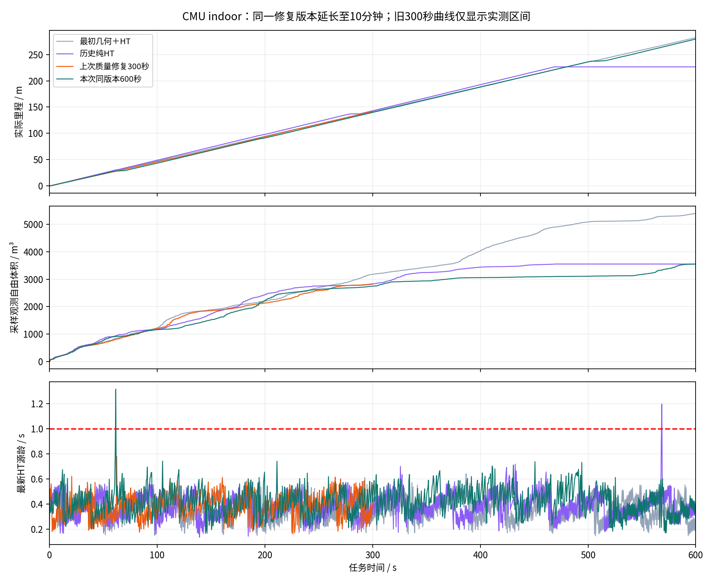
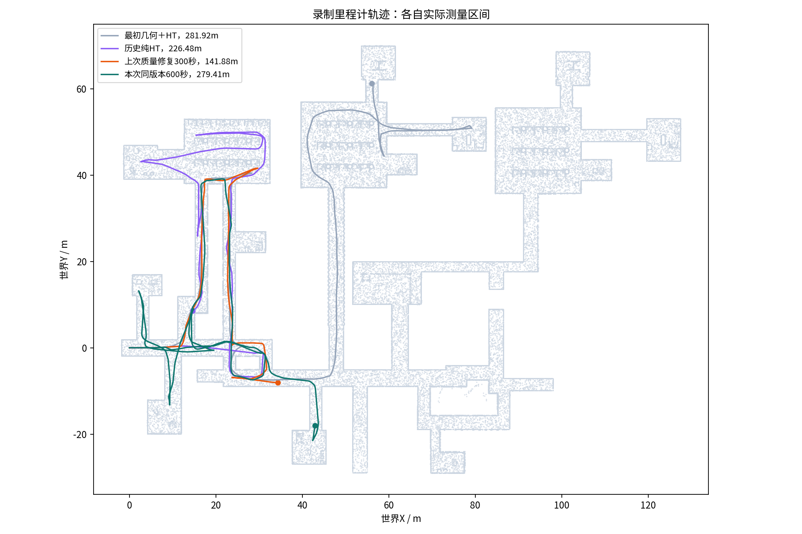

**原TARE＋八方向HT：10分钟复测报告｜2026-11-12**

本批两次启动：首轮受主机时间跳变、GPU驱动异常及重启影响，在339.252秒中断，现存原始文件全部保留，未当作完整实验；第二轮完整采集 **600.031926秒**，行驶 **279.408米**，观测自由体积代理 **3556.750m³**，`finish=false`。最后30秒移动14.767米；最后一条允许非零审计在600.026秒，末次控制原因`HT_ALLOWED`。

正式版本提交`9efd70b32c191cd99c4231ef0f19b6b066cfc357`，分支`sim/ht-height-quality-20261111`。这是上一轮修复的同版本复测，上一轮232个冻结文件逐一匹配；没有新增导航优化。运行入口只是另开数据/账本并将采集延长到600秒。官方CMU indoor、起点、传感器、0.5m/s上限、HT-only局部模式、0.5门限、1秒TTL、车体/未知/占用规则、TARE策略和恢复参数沿用。

**有没有问题：首轮发生了明确的基础设施故障**

首轮在时间跳变前就已偏慢：截至131.583秒仅15.719米，按控制采样计算的最新HT源龄P50=1.090秒、P95=3.492秒，259个采样中145个超过1秒。日志中网络耗时曾升到1秒以上，不能把此前的全部低速只归于后来的跳变。观测到主机使用电池、内存交换和CPU负载压力；缺乏同一负载下消融，不能把某个条件单独认定为全部根因。

131.583至143.077秒两个采样之间，系统墙钟相对单调计时多前进了8145.650秒。系统日志存在休眠/唤醒、合盖/开盖事件；随后NVIDIA内核连续报告`NV_ERR_INVALID_STATE`、MMU映射错误和驱动调用栈，`nvidia-smi`阻塞，mapper/HT进程仍存活但不再提供新图。控制器持续拒绝过期地图，车辆停车，未通过放宽TTL继续行驶。之后主机重启，首次采集终止。时间和驱动证据支持挂起/恢复后的运行环境故障，不足以把这次停车归为HT地形判定错误。

首轮缺少正常关闭的SUMMARY/MCAP metadata，CSV包含780个NUL字节。诊断只在内存中去除NUL解析到339.252秒；原字节未修改。12个原始MCAP片段保留，未声称全部片段可完整回放。首轮不能当作合格600秒成绩，也没有用重试覆盖它。

重启后已观察到显卡查询恢复、外接电源接通。第二轮启动使用仅覆盖本次进程寿命的`systemd-inhibit sleep:idle`，运行结束释放；没有修改主机永久电源策略。第二轮采样中外接电源online值为['1']；时间轴检测到的大于1秒跳变0次。

软件仍有一个运行保障缺口：现有runner只检查进程退出，无法及时把“进程存活、GPU调用卡住、HT不再更新”识别为推理故障。控制门禁可以停车保护，但没有独立的GPU/推理进展恢复机制。建议后续单独增加基于单调时钟的进度看门狗、明确的推理失活诊断和有限次重建流程；驱动内核挂死时应报基础设施故障，不能只不断重启Python。本轮按用户要求只做实验及报告，未加入新的导航候选。

**与历史结果比较**

| 版本 | 窗口/s | 里程/m | 采样观测自由体积/m³ | 末30秒里程/m |
|---|---:|---:|---:|---:|
| 最初几何＋HT | 300 | 141.18 | 3177.38 | 13.86 |
| 最初几何＋HT | 600 | 281.92 | 5407.91 | 14.05 |
| 历史纯HT | 300 | 142.90 | 2824.31 | 10.23 |
| 历史纯HT | 600 | 226.48 | 3555.38 | 0.00 |
| 上次质量修复300秒 | 300 | 141.88 | 2836.19 | 14.73 |
| 本次同版本600秒 | 300 | 139.80 | 2746.62 | 14.59 |
| 本次同版本600秒 | 600 | 279.40 | 3556.59 | 14.77 |

同600秒，相对最初几何＋HT，里程变化-0.9%，采样观测体积变化-34.2%；相对历史纯HT，里程变化+23.4%，观测体积变化+0.0%。里程与新增观测应分别判断，行驶更多不能直接等同于探索效率更高。

本轮前300秒移动139.80米、增加观测体积2746.62m³；后300秒移动139.59米、仅增加809.96m³。轨迹图显示回访和绕行，持续行驶尚未转化为相同程度的新观测。后半程1354/1354次局部选择均有可行模板，故该阶段低增量不能解释为一直无局部路可走。这仍不足以锁定某一个全局目标/局部路径代价为根因，需要后续单独对照TARE目标、HT否决与实际路线；本轮未修改候选筛选或完成判据。

所有历史值按各自CSV插值到指定窗口，没有将上次300秒数据延长冒充600秒。各轮同场景/起点/限速/统计口径，但轨迹、运行时调度和首轮供电状态不同，单次结果不能证明普遍优劣。自由体积是固定采样射线的0.5米体素并集，属于观测代理，不是真值覆盖率。

本轮按约0.5秒采样识别到1段至少1秒的零命令区间，最长1.003秒；这些是采样估计，原地转向本身不算零命令。本轮恢复启动2次，其中记录COMPLETED的2次。恢复实际起止和净位移见DIAGNOSTICS.json，不混入后续正常行驶。任务状态来自原生`/exploration_finish`，没有以停车代替完成。

恢复1：61.919至69.954秒、耗时8.036秒、净位移0.816米；恢复2：504.136至515.998秒、耗时11.862秒、净位移0.818米

恢复执行仍较保守：这两次约0.82米的净位移分别耗时8至12秒，包含转向与短移，不能当作持续直线行驶速度。两次合计约19.90秒，占600秒的3.3%；本轮沿用原恢复控制，未优化这一项。

**HT约束和数据一致性核对**

逐图独立命令审计：30013条候选，非零放行29650条；独立越限0条、找不到对应原图0条。最小完整扫掠分数0.504415，最大允许图龄0.993213秒。检查使用对应原始八通道HT图、车体膨胀、上下文/缺测/占用、实际朝向及反应＋制动扫掠。

录制非零输出29651条，完成关联并独立核对29651条，最终核对`passed=True`。原工具未匹配1条，原回执保留。原未匹配输出的控制时间在窗口末端后16.726毫秒，按相同v/w及12.4微秒接收差关联到原始审计，并对相应原图完整扫掠核验通过；补充核验不改变性能窗口。相同速度重复时，接收邻近关联不能保证唯一发布身份。

方向差异拒绝记录1230条，匹配原图1223条：当前方向低于0.5、另一方向达到0.5，说明八方向并未退化为任一方向通过就整点通过。剩余7条未完成原图配对，不计入独立核验通过数。末次局部选择`mode=ht_only, geometry_used=False`。

源图核对2400帧，配对层检查`passed=True`，有限高度缺少有效观测质量/年龄的格数最大值0。累计总variance与接受观测observation_variance仍分别发布，未放松真实观测质量阈值。HT到达事件的源龄P95=0.4310秒；控制采样时最新HT源龄P95=0.6035秒，两个采样时刻口径不同。

本轮源码和参数未变，沿用上一轮55项质量/输入链回归、24项门禁/边界检查，不冒称本轮重新运行这些测试。门禁审计只证明实现遵守自己的HT约束，不证明模型可通过性与接触动力学真值完全一致。CMU使用既有运动学车辆模型，未验证真实底盘动力学。

**数据、停机与验收范围**

本轮233个冻结文件一致性`matches=True`，上一轮232文件继续一致`True`。第二轮采集完整性`True`；bag/model/mapper/launch/observer顶层退出码为`{'bag': 0, 'model': 0, 'mapper': 0, 'simulation': 0, 'observer': 0}`。SIGINT停机后仍有多个C++子节点RCLError并以-6退出，另有-2中断退出；均发生在正式采集与录包结束之后。这个清理缺陷仍存在，顶层0不能代替所有子进程正常退出，逐节点回执在CLEANUP.json。

本批两个启动名额已结束，不再启动第三轮。完整原始数据、失败记录、日志、参数、冻结与SHA保存在`/home/lzz/ht_quality_600s_20261112`；大MCAP和视频留本机，没有完整远端备份，不清理。代码及精简报告推送到独立分支，不创建Release，不部署实车。

视频`delivery/quality_600s_10x.mp4`为录制里程计轨迹的10倍速可视化，非相机/RViz录像，已完整解码检查。上次300秒基线在300秒后标记“已结束”，没有伪造后续车辆状态。

这次报告给出一次实际完整600秒测试及一轮基础设施失败；是否完成全场景探索按finish如实记录。单次短测、非零输出门禁通过以及没有末段停车，都不能证明永久无误判或实车完全可用。
