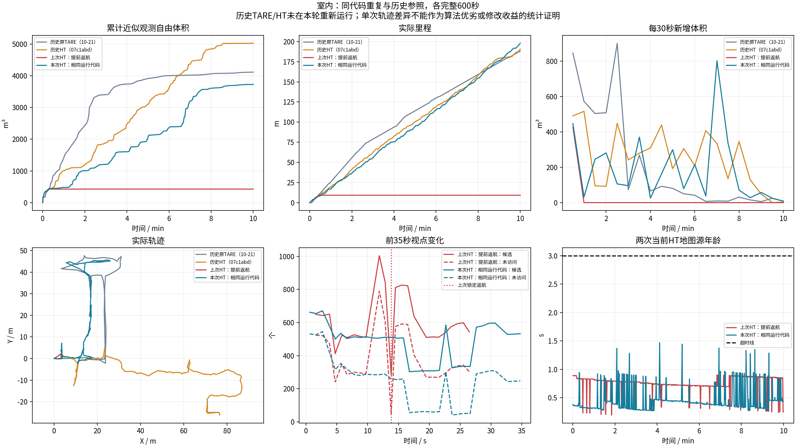
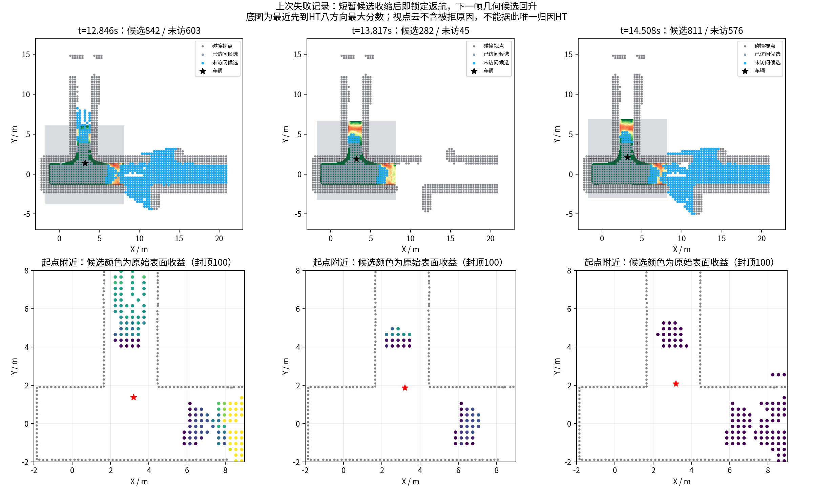
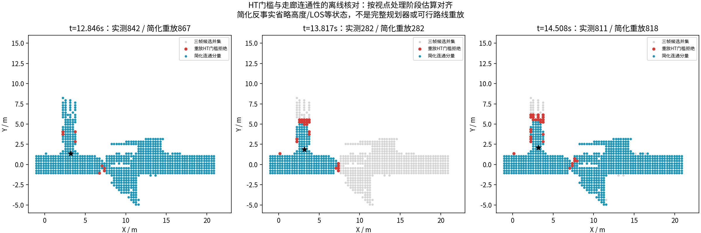

# 室内复跑：为什么上次提前结束

**本次未改导航代码，完整600秒行驶197.88m，近似观测自由体积3728m³，末状态EXPLORING；上次提前返航未在本轮重现，问题不能视为已修好。**

测试标签`ht-sim-20261022-indoor-repeat`，实测提交`0087a008f9d8beb26f2efa636f65fbf3e940a268`；运行算法继承`develop@8b10207`。相较上次e640c0c，133个运行文件及72项原manifest输入/二进制哈希一致。三个节点实际参数JSON逐键一致。实车代码/外参未参与。

| 单次记录（均600s） | 实际里程/m | 近似观测自由体积/m³ | 说明 |
|---|---:|---:|---|
| 历史原TARE（10-21） | 188.19 | 4116.125 | 历史参照 |
| 历史HT（07c1abd） | 190.53 | 5027.125 | 历史参照 |
| 上次HT：提前返航 | 9.16 | 427.250 | 同一运行代码，不同闭环轨迹 |
| 本次HT：相同运行代码 | 197.88 | 3728.000 | 同一运行代码，不同闭环轨迹 |

本次体积相对历史原TARE为-9.43%，相对历史HT为-25.84%。车辆能持续行驶不等于覆盖效率已恢复。相同场景、原生起点、速度上限和体积定义；初始yaw相差约0.0015rad，在预设0.02rad容差内。不是锁定随机种子的确定性重复，更不是多次统计对照。

## 可确认的触发链

上次t=12.846s有842个候选、603个未访问；t=13.817s骤降到282/45。全局返回标记已为1，局部选择此时给出complete=1，程序立即将exploration_finished置为true。全局标记本身从首轮即为1，附近目标由局部层处理，不能单独解读为全局TSP故障。

下一帧t=14.508s候选恢复到811个、未访问576个，但完成标记已经锁定；后续覆盖更新分支停止并清空视点收益，车辆继续返航，约27.6s进入COMPLETED。候选数量恢复不等于收益队列已恢复，不能把后续被清零的收益当成“确实没有可探索区域”。

565个原候选位置消失，仅3个被同期碰撞视点云直接标记。按日志阶段耗时估计视点检查结束时间，再取之前接收的HT图，简化8邻接图重放得到282个位置，与该帧实际候选集合完全一致（误加0、漏掉0）。去掉HT顶点筛选、保留录下的碰撞顶点，连通位置为872；仅保留最新物理车体障碍门槛为867。

切断连通分量的边界中，有9个位置在最新物理车体掩码上未受阻，但HT八方向最高分仅0.295–0.409，低于0.5门槛。结合代码，证据有力支持“短时HT地形拒绝→走廊连接被切断→远端候选被整体排除→无目标判定被永久当作探索完成”这一机制。

## 证据边界与仍待确认项

上述重放只使用三帧已发布候选的并集、录下的碰撞顶点和HT地形规则；高度约束、LOS及其他被拒节点没有完整重建。阶段结束时间由日志耗时推算，不是直接记录的内部地图指针。关键帧位置集合完全吻合增强了机制证据，但不能据此声称唯一源级根因已得到严格反事实证明。

不能直接用视点发布时最新HT图：本例该图已比视点处理阶段更新约一帧，简单重放反而得到823个连通位置。这个未对齐的检查不复现失败；保留在诊断文件中，不能拿它充当成功验证。

为什么HT在这些位置给出低分、低分是否符合真实地形，尚未用同一输入下的模型/支撑/高程方差逐项隔离；物理掩码未受阻也不证明地形一定可走。不能把问题直接归因于激光噪声、GPU、某个最近输入修正或特定阈值。

本次相同代码没有重现早停，且原版视点采样每次以random_device初始化随机数。随机选点、传感器与调度差异可产生不同轨迹；不能只凭两次试验判定哪个因素决定了这次分叉，也不能承诺下一次不早退。

## 本次完整采集与剩余问题

地图源年龄P95为0.927s，最大1.468s；超过3秒采样0次。600个任务采样均EXPLORING，未触发返航。12,000条实际指令；上限审计通过，常规加速度超限0次（显式全零停止单列，属于运动指令审计，不是完整动力学验证）。

XYθ搜索日志523次，终止原因{'REACHED': 513, 'TIME_LIMIT': 1, 'EXPANSION_LIMIT': 9}。完整指令审计中最长全零停车约2.30s，另有原地转向；末60秒行驶约21.55m。13项采集检查通过；视频实际8999帧/15fps/599.933s，完整解码通过，落在600s目标允许1帧误差内；退出后无本轮残留子进程。采集通过不等于全部场景或实车验收。

建议下一候选先把“暂时无可达收益目标”与“任务完成”分开核验：保留TARE顺序与HT执行硬约束，检查未解决探索单元、等待连续地图复核并记录每个候选的拒绝原因；在同条件多次600秒实验中检验是否减少早退。单纯降低HT阈值、取消碰撞限制或强行让车前进都不能证明原因已修复。本轮没有实施这些行为修改。

## 数据、视频与复现

[GitHub完整视频](https://github.com/CQULzz/HT_Explo/releases/download/ht-sim-20261022-indoor-repeat/ht-sim-20261022-indoor-repeat-indoor.mp4) · [GitHub前60秒双视频对比](https://github.com/CQULzz/HT_Explo/releases/download/ht-sim-20261022-indoor-repeat/ht-sim-20261022-indoor-repeat-first60.mp4) · [本机完整视频](indoor/camera_h264.mp4) · [本机双视频](first60_comparison.mp4)

[采集检查](indoor/suite_validation.json) · [运行/参数一致性](repeat_equivalence.json) · [关键帧重放数据](diagnosis/previous_early_candidates/connectivity_audit.json)

GitHub发布目标：https://github.com/CQULzz/HT_Explo/releases/tag/ht-sim-20261022-indoor-repeat；上传完成以stage50.json的远端大小/SHA256校验回执为准。完整MCAP、周期地图/模型上下文、CSV、日志与视频放Release，仓库保存报告和索引。激光按源秒抽样，不能称为全频原始传感器无损录制。体积是0.5m自由体素并集近似，不是真值覆盖率。

运行命令、诊断范围与源码定位见validation/indoor_repeat_2026-10-22/REPRODUCE.md；历史图来自已有记录，原TARE没有在本轮重新运行。
