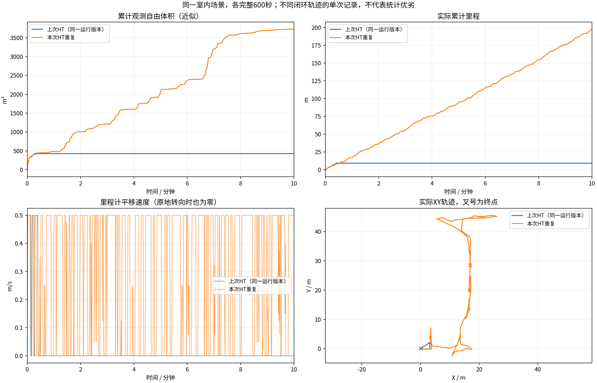

# 同场景版本10分钟对比

各组600秒；同场景原生起点、相同速度上限和体积统计定义。计时起点允许5cm/0.02rad差异，实际位姿保存在JSON中。不同闭环轨迹的单次试验，不能独立归因或证明普遍优劣。
体积是0.5m自由体素并集近似，不是真值覆盖率。平移速度为零也可能是在原地转向。

| 版本 | 代码 | 里程(m) | 观测自由体积(m³) | 最终状态 | BLOCKED抽样占比 | 规划P95(s) |
|---|---|---:|---:|---|---:|---:|
| 上次HT（同一运行版本） | `e640c0c` | 9.16 | 427.250 | COMPLETED | 0.0% | 0.403 |
| 本次HT重复 | `0087a00` | 197.88 | 3728.000 | EXPLORING | 0.0% | 0.980 |

原始目录、输入CSV和记录校验文件的哈希保存在[comparison.json](comparison.json)。
视频、原始MCAP与地图快照在各运行目录；历史结果中的精选归档可能只含视频、CSV和末段快照。

- 上次HT（同一运行版本）：`/home/lzz/my test/HT_Explo-sim-check/docs/results/ht_sim_check_2026-10-22/indoor`

- 本次HT重复：`/home/lzz/my test/HT_Explo-sim-check/docs/results/ht_indoor_repeat_2026-10-22/indoor`
