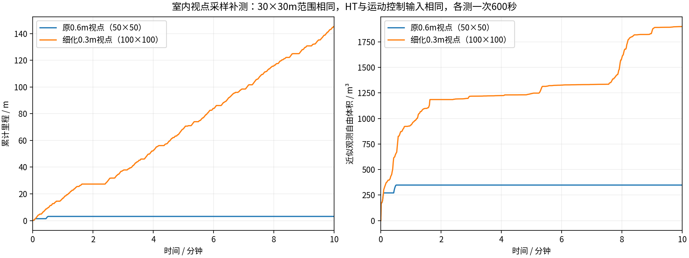

# 室内视点采样修改前后：各10分钟

仅把室内视点从50×50、0.6m改为100×100、0.3m，物理范围均为30×30m。两轮冻结输入只有源码与独立安装目录的indoor.yaml哈希不同，其他共同输入一致。HT栅格分辨率、阈值0.5、足迹0.6m、3秒时效、运动学搜索、跟踪器和速度上限均保持原配置。

原轮次在约3m处持续停车：0.6m候选网格漏掉窄HT支撑带中的可用目标。补测单独重启，原失败视频与地图均保留。

| 指标 | 原0.6m视点 | 细化0.3m视点 |
|---|---:|---:|
| 实际里程(m) | 3.11 | 145.28 |
| 近似观测自由体积(m³) | 347.875 | 1900.250 |
| 全零指令占比 | 98.2% | 23.0% |
| 最长全零指令(s) | 567.18 | 39.80 |
| 倒车指令占比 | 0.0% | 2.3% |
| 规划耗时P95(s) | 0.562 | 1.576 |
| HT年龄P95/最大(s) | 2.30 / 6.17 | 2.21 / 4.67 |
| 最后任务状态 | BLOCKED | EXPLORING |

补测仍有低收益回访：第6至7.5分钟行驶22.94m，近似新增观测仅8.375m³。最长停车约40秒，不是连续顺畅探索。原组大多没有目标可搜，补测有活跃搜索，因此耗时差不能全部归因于视点数。

[原参数完整视频](../ht_multiscene_10min_2026-10-17/indoor/camera_h264.mp4) · [补测完整视频](../ht_indoor_viewpoint_10min_2026-10-17/indoor/camera_h264.mp4) · [实际参数读取](../ht_indoor_viewpoint_10min_2026-10-17/indoor/effective_parameters.json)

每种配置仅一次，不能据此证明普遍性能提升或所有问题解决。视点数为原来的四倍，表中保留计算代价与后段任务状态；行驶距离不能当作覆盖率，观测自由体积是抽样射线体素并集近似。隧道返航未知支撑问题属于另一项失败，未由本修改解决。
