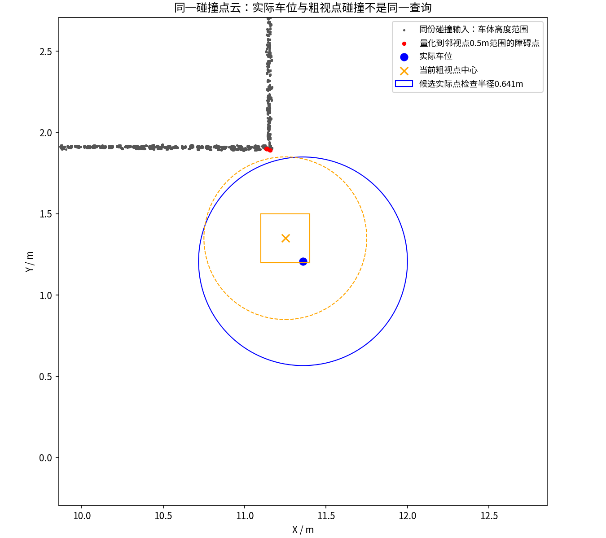
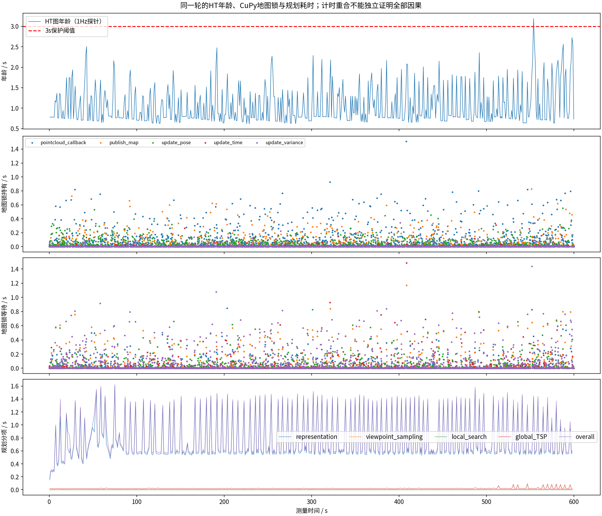
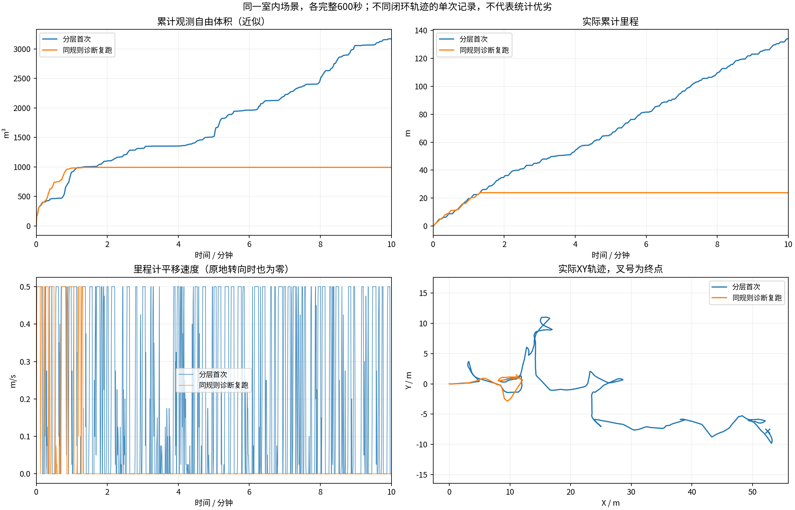
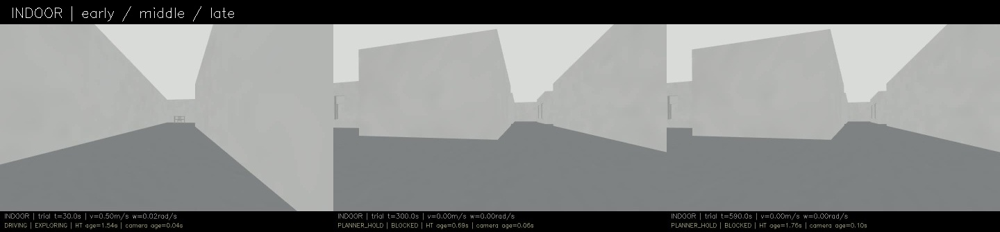
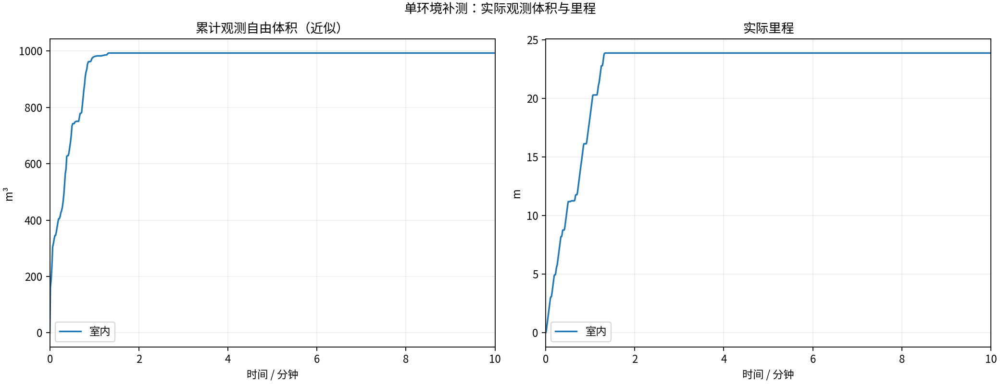
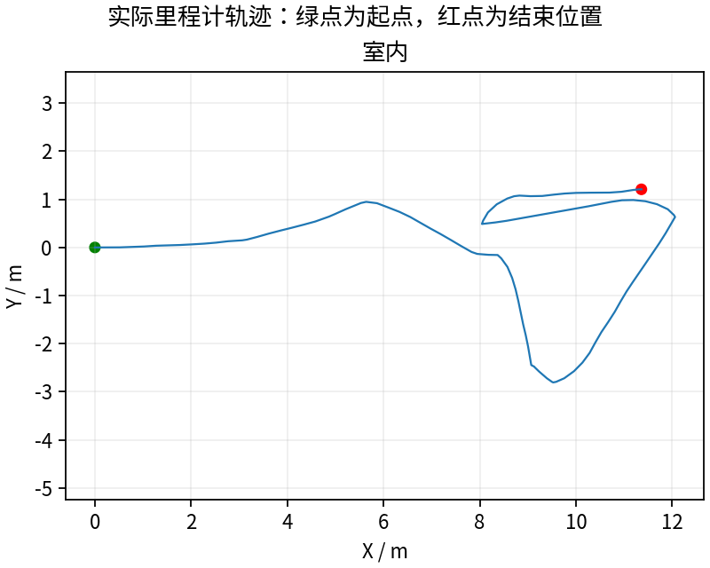
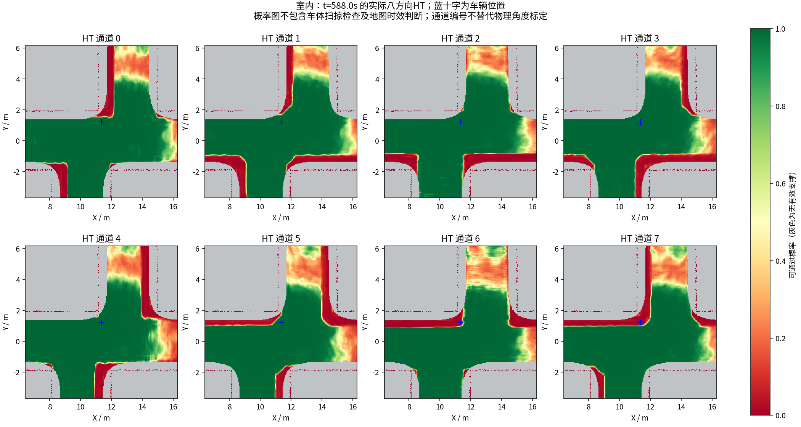
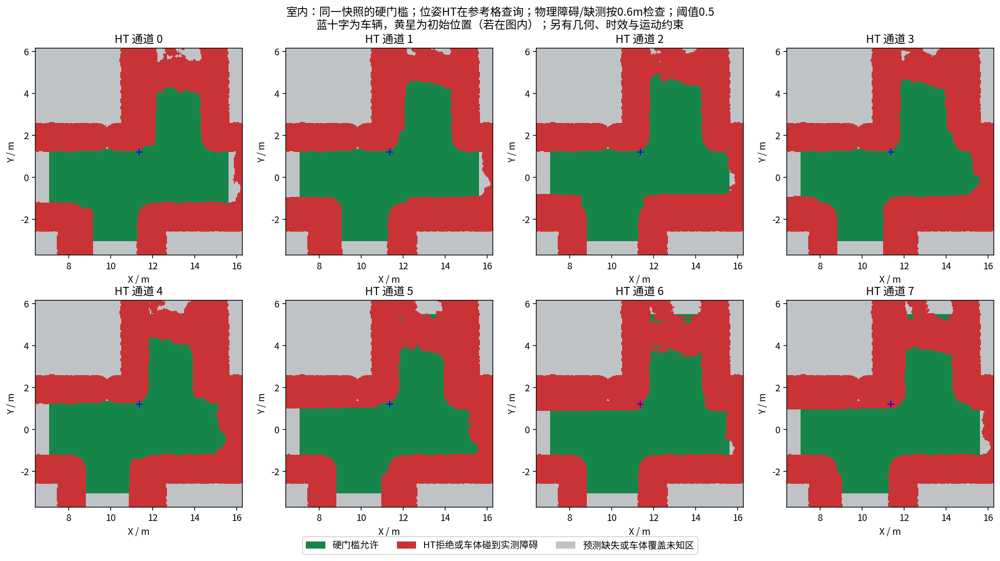

# 同导航规则诊断复跑：发现第二类持续停滞

**600秒完整记录，23.86m、993.125m³，最终BLOCKED，未完成探索。** 上一轮134.00m不是稳定复现。本轮只增加CuPy计时包装器和已有规划分项消息的记录，未修改规划、融合、HT模型、门槛、队列或时效策略；包装器自身存在记录开销，不能把两轮差异归因为某项算法优劣。

## 发现了什么

车辆最后一次明显平移在79.503秒，随后停止推进，停在(11.3585,1.2080)m附近。后续日志反复显示`HT_start=0 collision=1`，搜索`expanded=0 geometry_reject=1 ht_reject=0`：搜索首先被TARE几何碰撞门槛拒绝。最终HT图对同位姿仍为KNOWN，没有把这次停滞归因于地图过期或HT低分。

实际采集同位置激光、地形、碰撞输入：车体高度范围最近障碍点距实际车位0.71286m。旧查询不是直接在该车位检查点云，而是将位置归入0.3m视点，再使用0.2m碰撞栅格预计算的标记。按保存栅格相位、原0.5m门槛重建，粗视点被障碍击中；按实际位置、原0.5m加0.1414m栅格余量查询则无点击中。这是下一轮修改候选的依据，不是物理通行真值，也未在此轮改动导航。

[重建数值与限制](geometry_capture/quantization_audit.json) · [保存点云和坐标](geometry_capture/metadata.json) · [原始CSV](geometry_capture/collision_points.csv)

另发现旧`GetCollisionViewPointVisCloud`实际返回候选点云，虽然话题名叫`viewpoint_in_collision_cloud_`。本次未用该话题内容当作已碰撞证明；直接几何拒绝日志与真实碰撞输入才是证据。这个显示错误与规划错误分别记录。

## 耗时记录说明了什么

原有规划分项本轮总体P95 1.448s，其中地图/视点/覆盖表示更新P95 1.421s；不能笼统认定XYθ A*耗时1.4秒。还发现HT专用搜索没有写入旧local_search计时项，因此这部分的0值不代表完全没搜索；下一轮补计时，不伪造历史数据。

CuPy锁记录确认一次`update_time`等待1.486s，几乎完全与扫描融合持锁1.511s重合；该持锁线程CPU0.0678s。锁等待确实存在，但墙钟与线程CPU之差还包含GPU同步、调度等，不能直接宣称GPU计算慢。本轮HT年龄抽样最大3.192s、1次>3秒；唯一超时抽样发生在持续停车很久以后，不能解释约80秒开始的阻塞。

[所有计时分布、重合持锁者和限制](latency_audit/audit.json) · [完整计时JSONL](indoor/cupy_timing.jsonl)

## 对比与数据

13项采集/退出/冻结校验通过，21次晚HT拒绝全部配对实际零速度。视频600秒、9000帧、15fps，完整解码通过。[视频](indoor/camera_h264.mp4)。完整记录包将发布到本轮独立Release，包含MCAP、周期地图、几何捕获、锁计时和独立CuPy源码快照；激光仍按源秒抽样，并非全频无损记录。本轮未另行在线导出全部ROS参数，冻结输入配置和哈希保留，不把它们说成在线参数服务转储。

## 下一轮要改与未解决问题

先用保存点云做同源旧/新查询回归，再将XYθ连续位置的物理碰撞检查与覆盖视点缓存分离，保留障碍、未知区、HT硬门槛和原安全距离。修正误标话题并补搜索/表示更新计时，然后再做完整600秒对照。地图长尾延迟、表示更新耗时、动力学与方向/参考点实车标定仍未解决。不能为离开当前点而跳过真正发生碰撞的根状态。

---

# HT 室内10分钟补测

每组测量 600 秒，从首个具备里程计和激光输入的TARE运行周期开始计时；初始化不计入。
每个场景独立启动、独立高程历史，上一组完全退出且视频处理结束后再启动下一组。车速上限均为0.5m/s，HT硬约束与3秒时效保护相同。
采用对应场景TARE参数；车库沿用历史配对起点，其余使用各自仿真原生起点。因此这不是相同场景的算法优劣对照。
相机原生960×540、15fps，视频含状态条并裁去初始化；重复帧代表真实图像更新间隔，不做插帧。

| 环境 | 状态 | 实际里程(m) | 近似观测体积(m³) | 末尾任务状态 | 视频 |
|---|---|---:|---:|---|---|
| 室内 | RECORDED | 23.86 | 993.12 | BLOCKED | [播放/下载](indoor/camera_h264.mp4) |

[全部视频播放列表](videos.m3u) · [实时状态与校验](suite.json)

每个场景仅一次10分钟测试，不能据此证明更长时间、所有环境或实车稳定。定时记录完成不等于探索完成。观测体积是抽样激光射线的自由体素并集近似，不是真值覆盖率；跨场景体积不可直接作为算法优劣排名。

## 实际出现的问题

下表保留暂停和地图延迟，不把“节点未崩溃”当作“没有问题”。地图年龄为1Hz抽样，完整控制消息保留在本地MCAP中。全零指令表示既不平移也不转向；原地转向单独统计。

| 环境 | HT年龄P95/最大(s) | 年龄>3s样本 | 全零指令占比 | 最长全零指令(s) | 全局引导无进展释放 | 验证失败项 |
|---|---:|---:|---:|---:|---:|---|
| 室内 | 1.97 / 3.19 | 1 | 88.5% | 519.72 | 30 | 无 |

遇到旧HT地图时仍执行3秒时效保护；没有为让车持续前进而放宽硬约束。全局引导释放说明该段目标没有持续接近，不能解释为该目标已经到达或覆盖完成。

| 环境 | 实收激光/600s | 平均频率(Hz) | 最大接收间隔(s) | 同源对齐检查点 | 观察器与建图器计数差恒定 |
|---|---:|---:|---:|---:|---|
| 室内 | 2984 | 4.97 | 0.26 | 33 | True |

计数差恒定只支持这些对齐区间内没有新增相对漏收；不能证明源端始终连续发布，也不能排除两个订阅者同时漏收。各场景均保留完整扫描计数和原始时间戳检查点。

### 室内末段实际HT

[同期接收的相机画面](indoor/late_camera.jpg) · [原始图层快照](indoor/late_map_snapshot.npz) · [时间与坐标元数据](indoor/late_map_snapshot.json)

全部视频按15fps、600秒裁剪，时长校验允许1帧误差，完整解码通过；实际帧数和时长见各组video_validation.json。各组共有源文件的60项哈希一致，各组自身冻结文件核验见suite_validation.json。

相机年龄是图像接收后的年龄；相机仿真时间戳与导航墙钟不同，不能把该数值解释为传感器端到端延迟。原始MCAP、全高程历史和输入诊断保存在suite.json所列本地目录；本次只发布选取的数据与视频。
