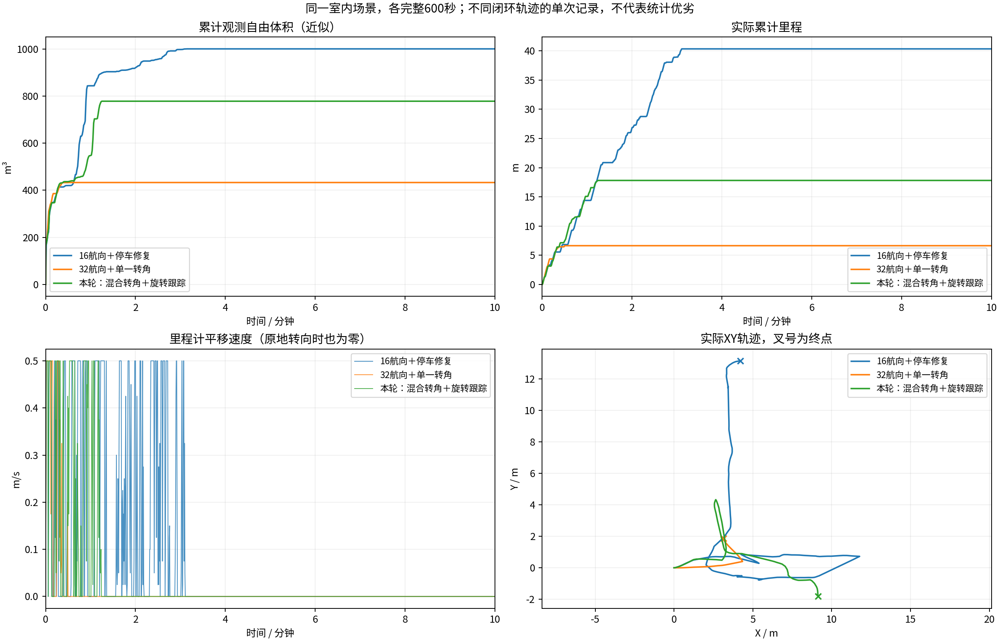
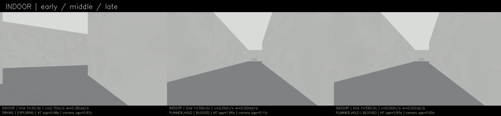
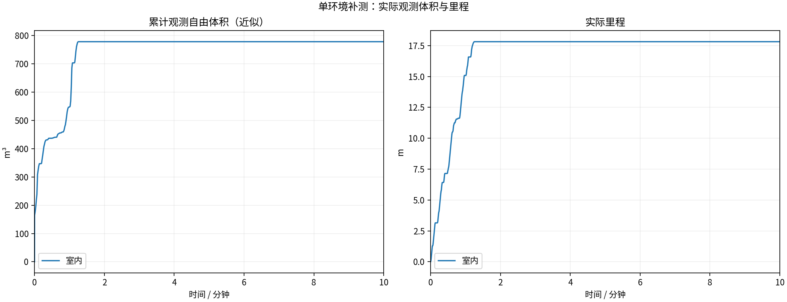
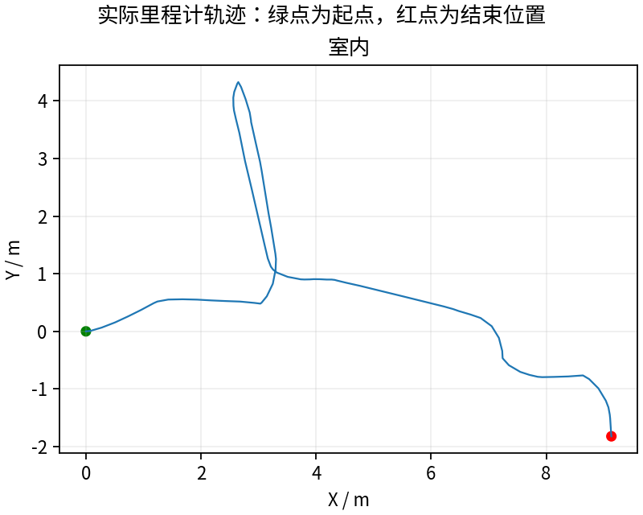
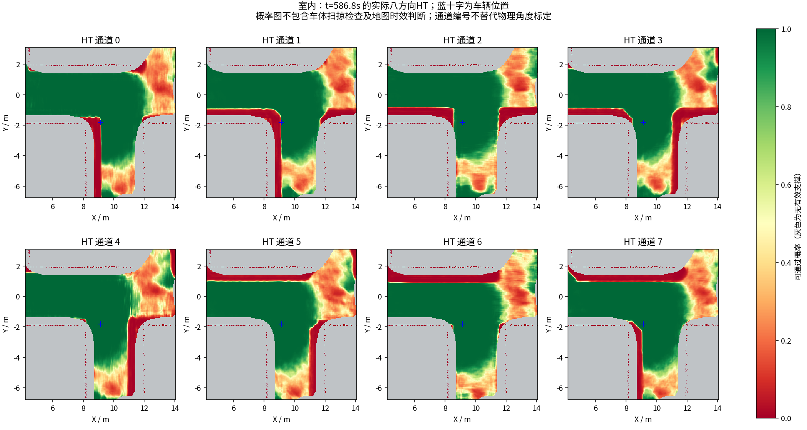
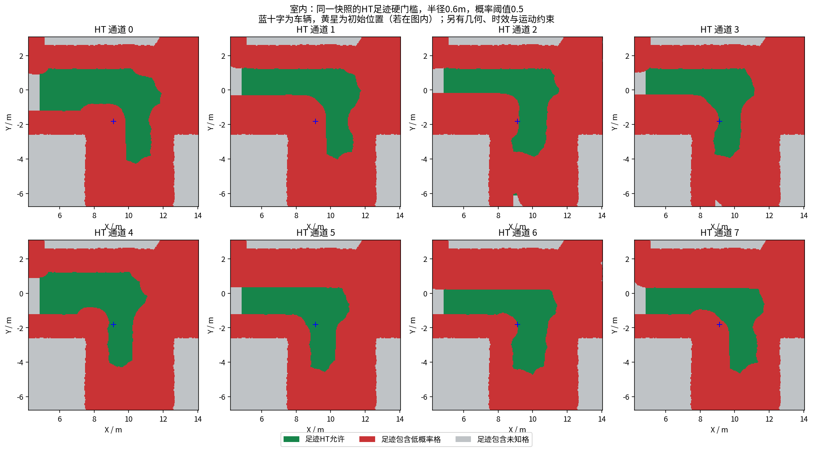

# 本轮修改与实际结论

**完整记录600秒，室内探索仍失败。** 本轮比上一次32航向单转角那轮多走了一些，但没有超过此前16航向那轮，不能称为室内问题已经修复。

| 同一室内场景，均600秒 | 实际里程(m) | 近似观测自由体积(m³) | 最终状态 |
|---|---:|---:|---|
| 16航向＋正确停车，37f0d42 | 40.34 | 1000.125 | BLOCKED |
| 32航向＋单一11.25°转角，67ade71 | 6.64 | 432.875 | BLOCKED |
| **本轮混合转角＋旋转跟踪，12d85d8** | **17.82** | **778.000** | **BLOCKED** |

这些是不同闭环轨迹的单次记录，说明这三轮实测结果的次序，不能独立量化某一处代码的因果贡献。体积为同一源秒采样、0.5m自由体素并集近似，不是真值覆盖率。没有用降低HT阈值、缩小车体足迹或放行过期图来换里程。

本轮完成的修改：

- 搜索保持32航向，动作同时提供11.25°和22.5°转弯，避免细化航向时删除原来约1.02m半径的圆弧。
- 原地旋转跟踪整段目标，角度容差约2.29°；指令及实测角速度均降至0.06rad/s以内才进入后续平移。中间方向和实际指令弧仍受HT检查。
- 390项核心检查、21个ROS地图/规划用例、10个跟踪器用例通过，四个历史快照未跳过；日志在[regression](regression/)。
- 新建[每轮至少600秒的记录规范](../../experiments/ht_iteration_protocol.md)及自动版本对比脚本，并写入仓库AGENTS.md，后续行为修改按同样规则执行。

这里仍是运动学搜索，状态没有速度、加速度；执行端保留已有加速度限制，不能表述成完整动力学可行性已得到证明。HT八方向预测、0.5门槛、0.6m足迹和实验3秒时效均未修改。

[三轮CSV与来源](comparison/REPORT.md) · [本轮完整视频](indoor/camera_h264.mp4) · [实际生效的规划参数](indoor/planner_parameters.yaml) · [实际生效的控制参数](indoor/follower_parameters.yaml)

## 仍然卡在哪里

最后一次明显平移在约74.0秒，之后停在(9.133,−1.822)m附近；后段曲线变平是阻塞，并非探索完成。没有触发探索结束或返航。全部600秒有528个BLOCKED任务抽样；任务抽样状态与即时控制状态有不同更新频率，不能逐行视为严格同步。

约86秒的保存快照显示：当前朝向所属通道6允许，车体范围没有物理缺测；其他部分方向被低概率邻格的足迹聚合拒绝。通道3、4、5、6虽在车位处允许，沿各通道中心角的直线前进约0.10、0.32、0.50、0.05m就遇到拒绝。这只是固定图上的直线检查，不等于已经证明所有曲线路径都走不通。

测量及仿真进程完全结束后，再用实际C++硬门槛与同一组11.25°/22.5°动作做离线复核：6种XY分辨率/步长/航向配置，查询8个距车2m的环形目标及1个历史远目标，共54次，均未到达。每次仅展开17～140个状态、最长约1.2ms，未耗尽0.7s/80000次预算。**在这些查询中，进一步细化搜索也没找到出口；不能只继续调小转角就宣称解决。** 这不是连续空间无路的数学证明，也不能证明HT低分就代表真实物理危险。

[离线54次查询及范围限制](offline_audit/resolution_audit.json) · [原始日志](offline_audit/resolution_audit.log) · [实际停止快照](indoor/stopped_snapshot.npz) · [逐方向足迹统计](indoor/stopped_direction_audit.json)

HT模型的运动标签、参考位置和车体足迹聚合接口仍待进一步验证，本轮未借此绕过硬约束。

[停滞时的实际相机画面](indoor/stopped_camera.jpg) · [末段八方向HT](indoor/late_ht.png) · [足迹硬门槛图](indoor/late_ht_footprint.png)

## 数据和录像核验

- 600秒完整记录，13项采集/退出/冻结校验全部通过；没有节点重启。
- 20次晚HT拦截全部配对到实际零速度，非零0次、未配对0次，见[控制消息复核](indoor/blocked_commands.json)。
- 与上一轮32航向版本共有57项源文件哈希，其中51项不变；HT权重、桥接与CuPy输入链路未变，见[源文件差异](comparison/source_differences.json)。
- 实收激光2990帧，体积评估处理600帧源秒采样、跳过0帧；这不证明全频原始激光从未漏包。
- 地图年龄1Hz抽样最大2.943秒；此次持续停滞不能归因于3秒地图超时。
- 视频15fps，9000帧、600秒，H.264完整解码通过。
- 仓库归档包含视频、CSV、末段与停滞地图、实际参数、测试日志、候选源码和哈希。原始MCAP、完整周期快照和融合历史仍保存在本机独立运行目录，具体路径和实际字节数见[EXPERIMENT.json](EXPERIMENT.json)，未复制为Git文件。

下面保留自动采集报告、图表与检查明细。

---

# HT 室内10分钟补测

每组测量 600 秒，从首个具备里程计和激光输入的TARE运行周期开始计时；初始化不计入。
每个场景独立启动、独立高程历史，上一组完全退出且视频处理结束后再启动下一组。车速上限均为0.5m/s，HT硬约束与3秒时效保护相同。
采用对应场景TARE参数；车库沿用历史配对起点，其余使用各自仿真原生起点。因此这不是相同场景的算法优劣对照。
相机原生960×540、15fps，视频含状态条并裁去初始化；重复帧代表真实图像更新间隔，不做插帧。

| 环境 | 状态 | 实际里程(m) | 近似观测体积(m³) | 末尾任务状态 | 视频 |
|---|---|---:|---:|---|---|
| 室内 | RECORDED | 17.82 | 778.00 | BLOCKED | [播放/下载](indoor/camera_h264.mp4) |

[全部视频播放列表](videos.m3u) · [实时状态与校验](suite.json)

每个场景仅一次10分钟测试，不能据此证明更长时间、所有环境或实车稳定。定时记录完成不等于探索完成。观测体积是抽样激光射线的自由体素并集近似，不是真值覆盖率；跨场景体积不可直接作为算法优劣排名。

## 实际出现的问题

下表保留暂停和地图延迟，不把“节点未崩溃”当作“没有问题”。地图年龄为1Hz抽样，完整控制消息保留在本地MCAP中。全零指令表示既不平移也不转向；原地转向单独统计。

| 环境 | HT年龄P95/最大(s) | 年龄>3s样本 | 全零指令占比 | 最长全零指令(s) | 全局引导无进展释放 | 验证失败项 |
|---|---:|---:|---:|---:|---:|---|
| 室内 | 1.89 / 2.94 | 0 | 89.8% | 525.23 | 25 | 无 |

遇到旧HT地图时仍执行3秒时效保护；没有为让车持续前进而放宽硬约束。全局引导释放说明该段目标没有持续接近，不能解释为该目标已经到达或覆盖完成。

| 环境 | 实收激光/600s | 平均频率(Hz) | 最大接收间隔(s) | 同源对齐检查点 | 观察器与建图器计数差恒定 |
|---|---:|---:|---:|---:|---|
| 室内 | 2990 | 4.98 | 0.44 | 35 | True |

计数差恒定只支持这些对齐区间内没有新增相对漏收；不能证明源端始终连续发布，也不能排除两个订阅者同时漏收。各场景均保留完整扫描计数和原始时间戳检查点。

### 室内末段实际HT

[同期接收的相机画面](indoor/late_camera.jpg) · [原始图层快照](indoor/late_map_snapshot.npz) · [时间与坐标元数据](indoor/late_map_snapshot.json)

全部视频按15fps、600秒裁剪，时长校验允许1帧误差，完整解码通过；实际帧数和时长见各组video_validation.json。各组共有源文件的58项哈希一致，各组自身冻结文件核验见suite_validation.json。

相机年龄是图像接收后的年龄；相机仿真时间戳与导航墙钟不同，不能把该数值解释为传感器端到端延迟。原始MCAP、全高程历史和输入诊断保存在suite.json所列本地目录；本次只发布选取的数据与视频。
