# HT 五环境各10分钟实验

每组测量 600 秒，从首个具备里程计和激光输入的TARE运行周期开始计时；初始化不计入。
每个场景独立启动、独立高程历史，上一组完全退出且视频处理结束后再启动下一组。车速上限均为0.5m/s，HT硬约束与3秒时效保护相同。
采用对应场景TARE参数；车库沿用历史配对起点，其余使用各自仿真原生起点。因此这不是相同场景的算法优劣对照。
相机原生960×540、15fps，视频含状态条并裁去初始化；重复帧代表真实图像更新间隔，不做插帧。

| 环境 | 状态 | 实际里程(m) | 近似观测体积(m³) | 末尾任务状态 | 视频 |
|---|---|---:|---:|---|---|
| 车库 | RECORDED | 189.57 | 4027.38 | EXPLORING | [播放/下载](garage/camera_h264.mp4) |
| 校园 | RECORDED | 199.76 | 9336.62 | EXPLORING | [播放/下载](campus/camera_h264.mp4) |
| 室内 | RECORDED | 3.11 | 347.88 | BLOCKED | [播放/下载](indoor/camera_h264.mp4) |
| 森林 | RECORDED | 168.09 | 13452.50 | EXPLORING | [播放/下载](forest/camera_h264.mp4) |
| 隧道 | RECORDED | 26.33 | 402.88 | BLOCKED | [播放/下载](tunnel/camera_h264.mp4) |

[全部视频播放列表](videos.m3u) · [实时状态与校验](suite.json)

每个场景仅一次10分钟测试，不能据此证明更长时间、所有环境或实车稳定。定时记录完成不等于探索完成。观测体积是抽样激光射线的自由体素并集近似，不是真值覆盖率；跨场景体积不可直接作为算法优劣排名。

## 实际出现的问题

下表保留暂停和地图延迟，不把“节点未崩溃”当作“没有问题”。地图年龄为1Hz抽样，完整控制消息保留在本地MCAP中。全零指令表示既不平移也不转向；原地转向单独统计。

| 环境 | HT年龄P95/最大(s) | 年龄>3s样本 | 全零指令占比 | 最长全零指令(s) | 全局引导无进展释放 | 采集/进程验证失败项 |
|---|---:|---:|---:|---:|---:|---|
| 车库 | 2.64 / 5.60 | 15 | 11.5% | 5.00 | 3 | 无 |
| 校园 | 2.18 / 3.03 | 1 | 9.8% | 2.05 | 1 | 无 |
| 室内 | 2.30 / 6.17 | 8 | 98.2% | 567.18 | 9 | 无 |
| 森林 | 2.21 / 4.04 | 7 | 17.5% | 5.00 | 1 | 无 |
| 隧道 | 2.38 / 5.59 | 13 | 84.8% | 496.37 | 1 | 无 |

遇到旧HT地图时仍执行3秒时效保护；没有为让车持续前进而放宽硬约束。全局引导释放说明该段目标没有持续接近，不能解释为该目标已经到达或覆盖完成。

| 环境 | 实收激光/600s | 平均频率(Hz) | 最大接收间隔(s) | 同源对齐检查点 | 观察器与建图器计数差恒定 |
|---|---:|---:|---:|---:|---|
| 车库 | 2988 | 4.98 | 0.25 | 30 | True |
| 校园 | 2921 | 4.87 | 0.38 | 30 | True |
| 室内 | 2990 | 4.98 | 0.26 | 16 | True |
| 森林 | 2411 | 4.02 | 1.16 | 9 | True |
| 隧道 | 2990 | 4.98 | 0.26 | 10 | True |

计数差恒定只支持这些对齐区间内没有新增相对漏收；不能证明源端始终连续发布，也不能排除两个订阅者同时漏收。各场景均保留完整扫描计数和原始时间戳检查点。

室内组出现持续无可执行路线：原0.6m视点采样没有提供距车0.8m以外且满足HT支撑的目标。地图持续更新，节点未崩溃，不能把这组称为探索成功。详见[只读诊断及原始证据](indoor/diagnostics/README.md)。这五组保留原参数，修改后的补测另列。

隧道组触发返航后受阻：目标周围的车体足迹范围仍包含未知格，严格HT检查拒绝，未到家。详见[返航快照与诊断](tunnel/diagnostics/README.md)。没有放宽硬门槛来掩盖失败。

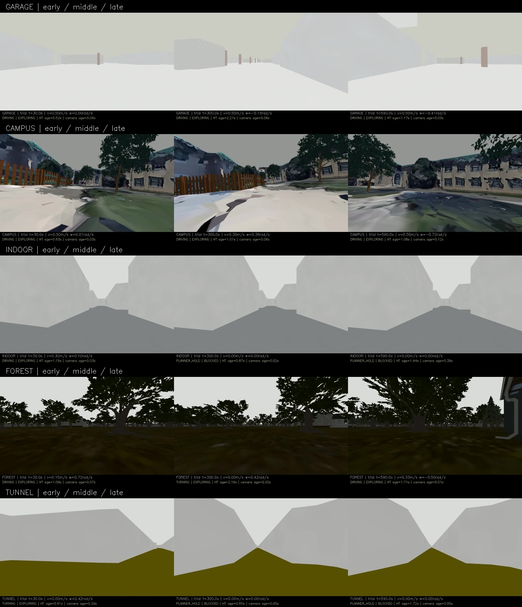

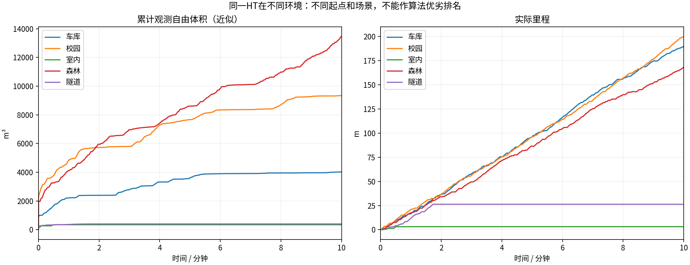

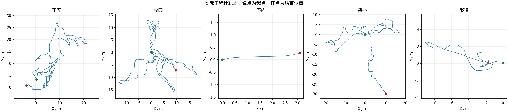

### 车库末段实际HT

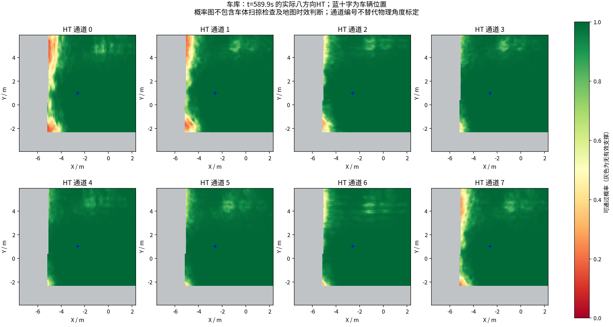

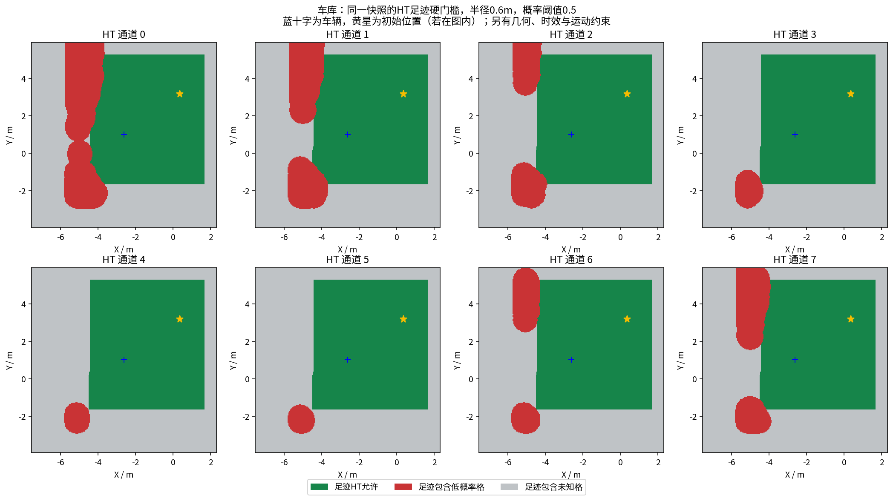

[同期接收的相机画面](garage/late_camera.jpg) · [原始图层快照](garage/late_map_snapshot.npz) · [时间与坐标元数据](garage/late_map_snapshot.json)

### 校园末段实际HT

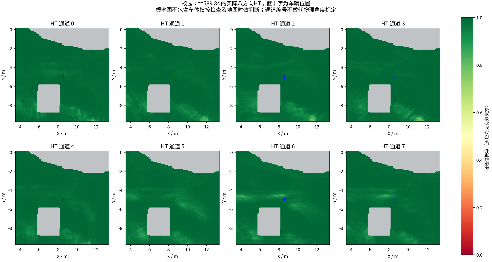

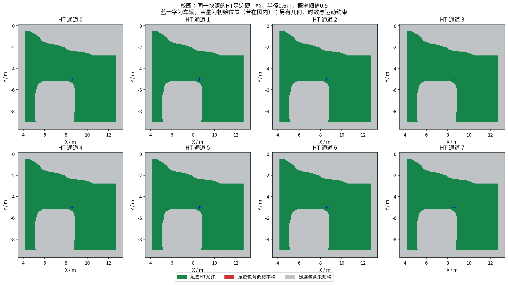

[同期接收的相机画面](campus/late_camera.jpg) · [原始图层快照](campus/late_map_snapshot.npz) · [时间与坐标元数据](campus/late_map_snapshot.json)

### 室内末段实际HT

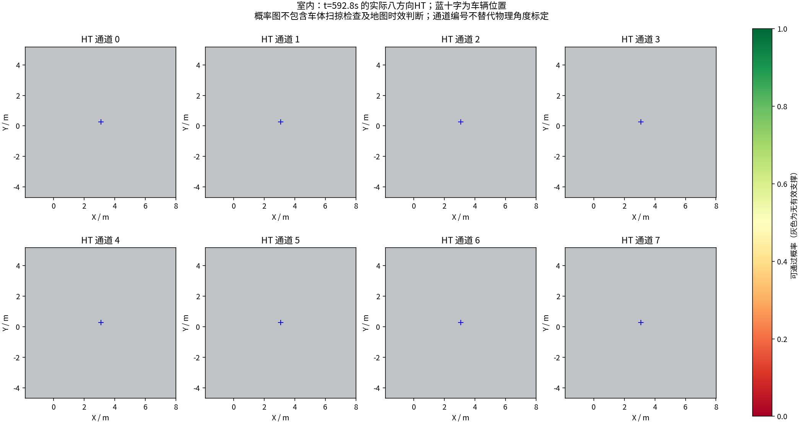

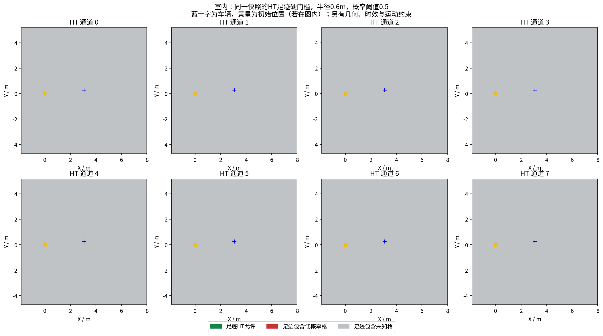

[同期接收的相机画面](indoor/late_camera.jpg) · [原始图层快照](indoor/late_map_snapshot.npz) · [时间与坐标元数据](indoor/late_map_snapshot.json)

### 森林末段实际HT

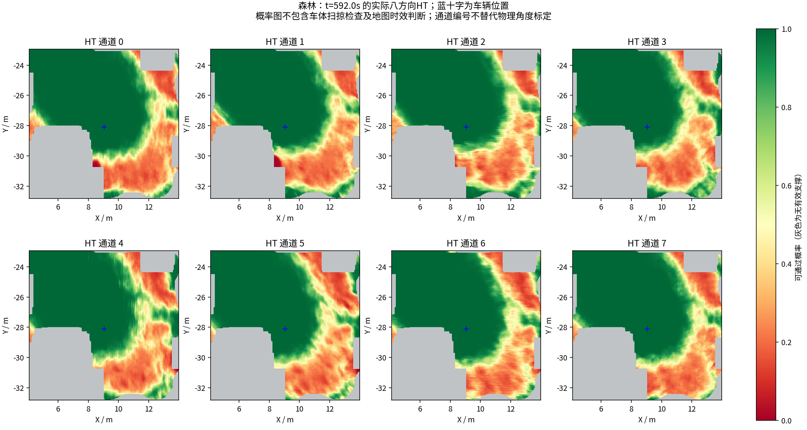

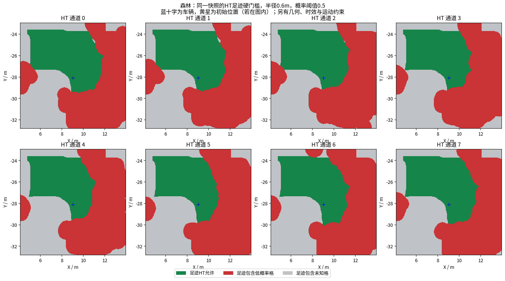

[同期接收的相机画面](forest/late_camera.jpg) · [原始图层快照](forest/late_map_snapshot.npz) · [时间与坐标元数据](forest/late_map_snapshot.json)

### 隧道末段实际HT

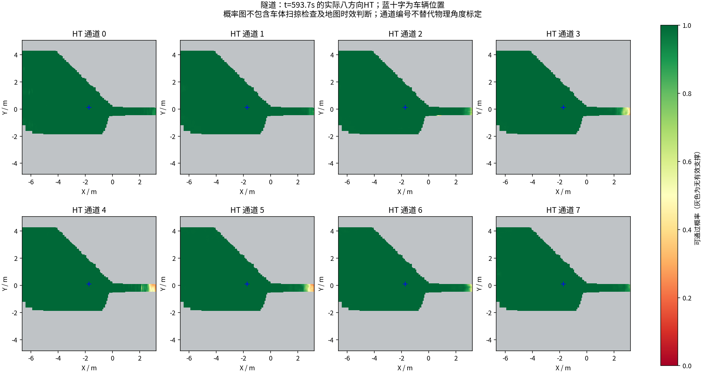

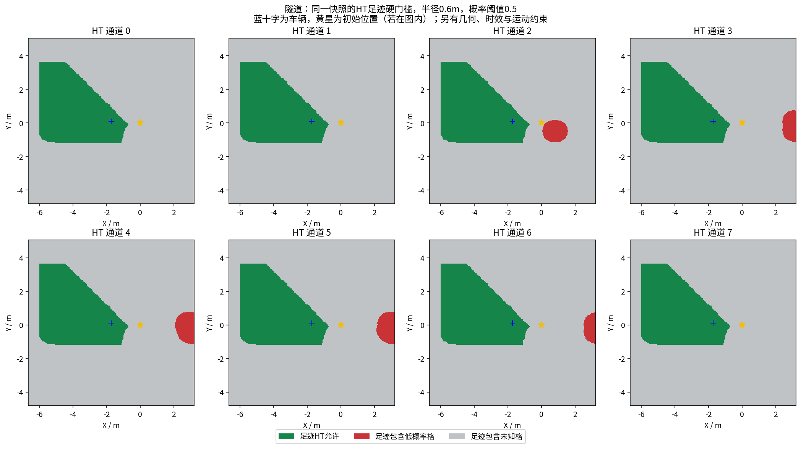

[同期接收的相机画面](tunnel/late_camera.jpg) · [原始图层快照](tunnel/late_map_snapshot.npz) · [时间与坐标元数据](tunnel/late_map_snapshot.json)

全部视频按15fps、600秒裁剪，时长校验允许1帧误差，完整解码通过；实际帧数和时长见各组video_validation.json。各组共有源文件的42项哈希一致，各组自身冻结文件核验见suite_validation.json。

相机年龄是图像接收后的年龄；相机仿真时间戳与导航墙钟不同，不能把该数值解释为传感器端到端延迟。原始MCAP、全高程历史和输入诊断保存在suite.json所列本地目录；本次只发布选取的数据与视频。

## 室内修正后补测（另一次完整10分钟）

[修改前后曲线、完整视频及问题](../ht_indoor_sampling_comparison_2026-10-17/REPORT.md)：将视点采样细化为0.3m并保持30×30m范围。里程3.11→145.28m，近似观测347.875→1900.25m³。仍有最长39.8秒停车、低收益回访和地图尾延迟，未证明任务完成；隧道返航受阻未解决。播放列表共六段视频，保留原室内失败轮。
