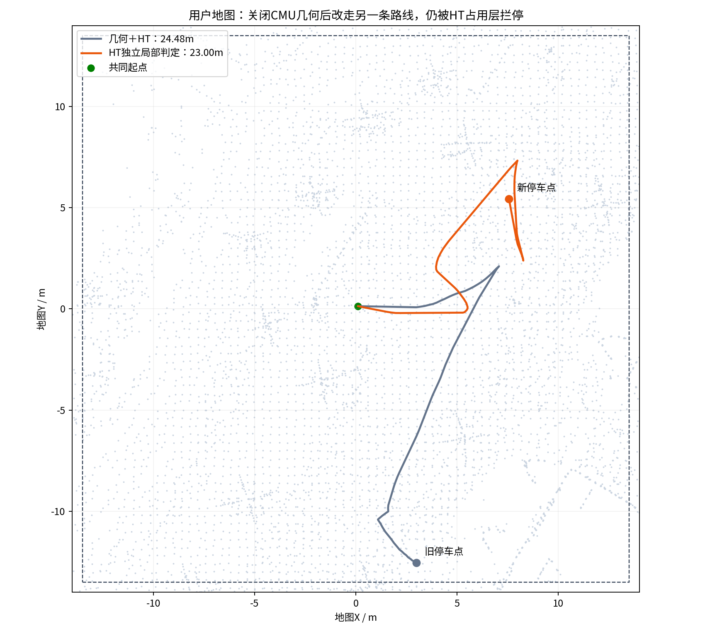
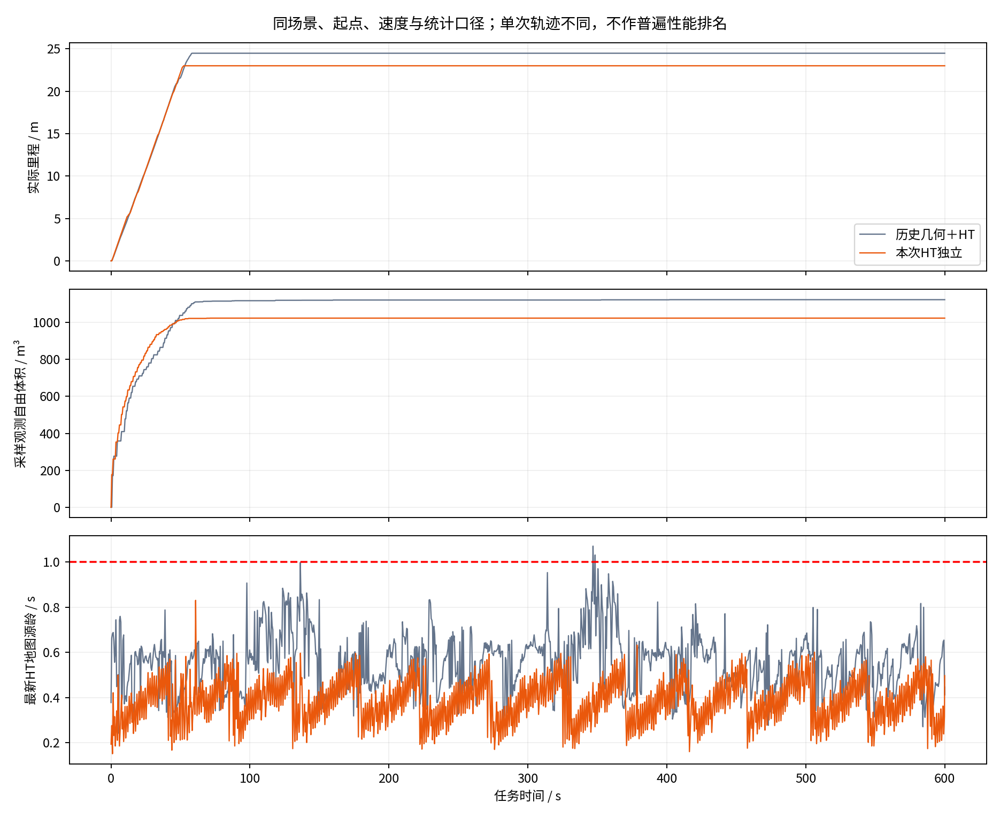
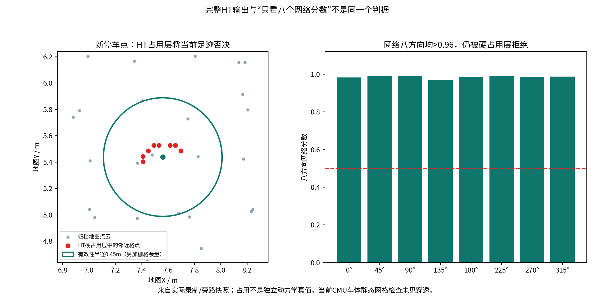
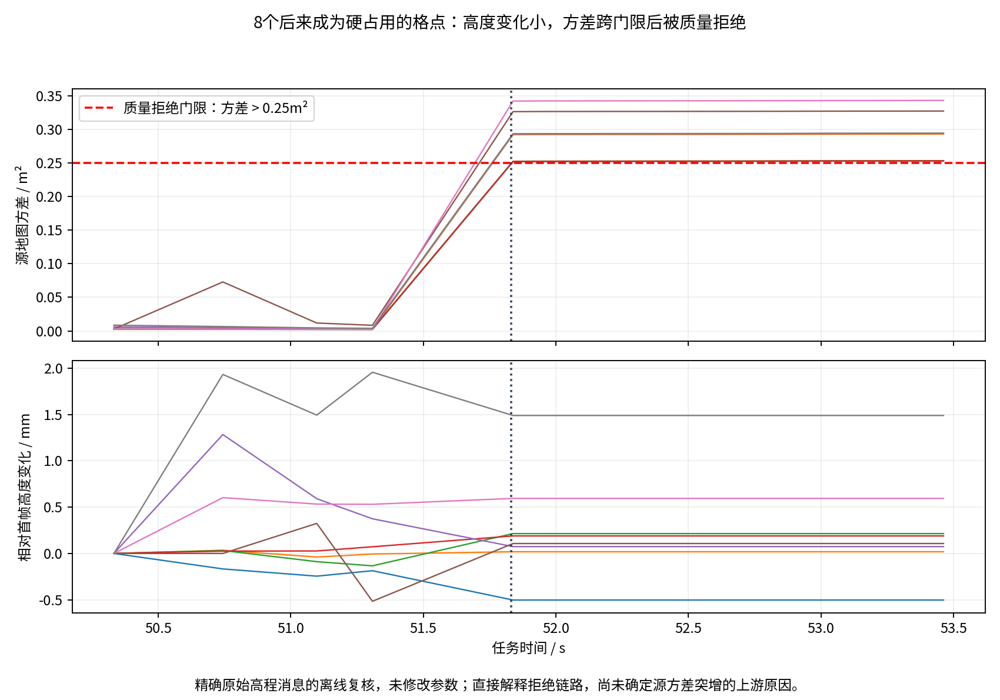
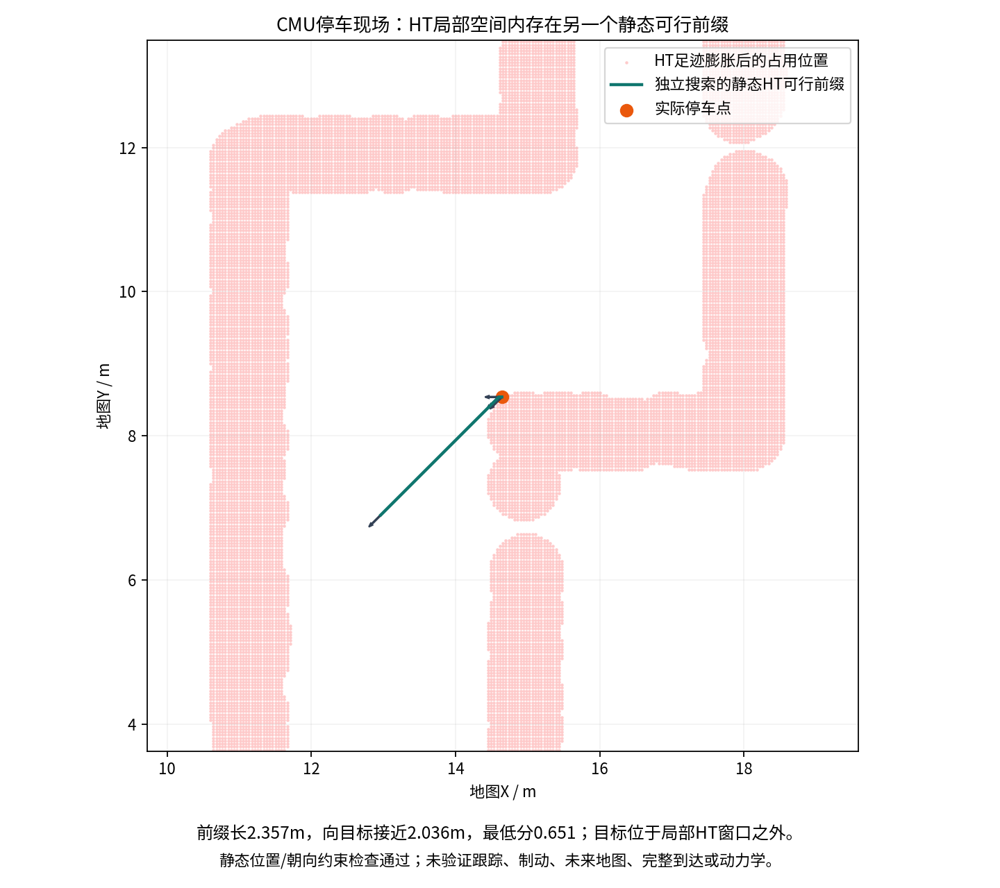
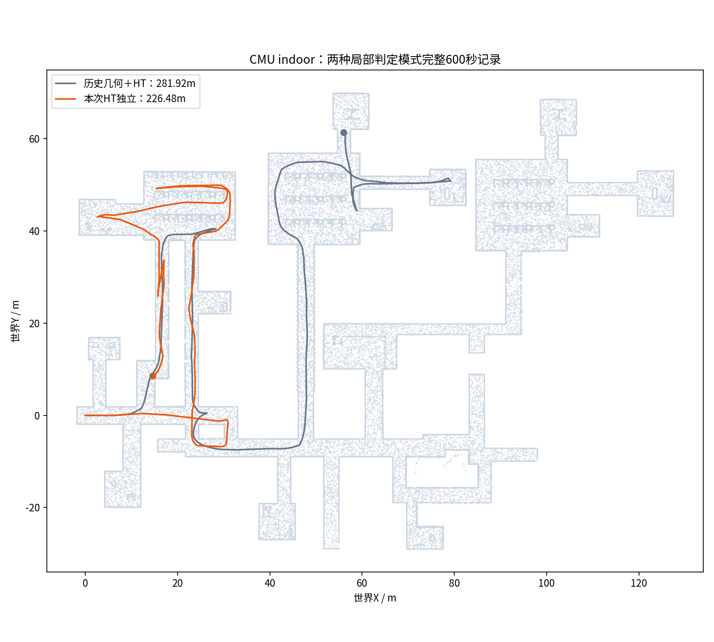
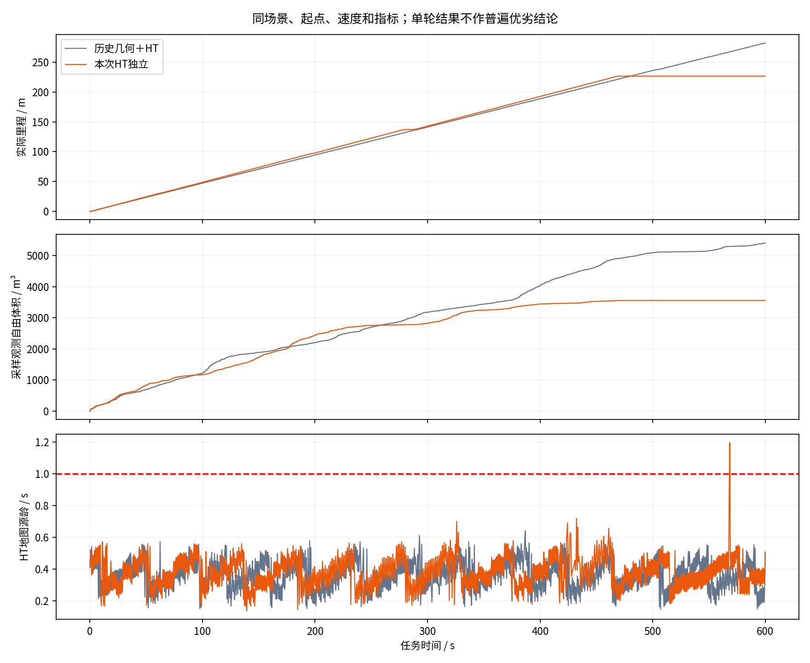

# 关闭 CMU 局部几何、由 HT 独立判定：实验报告

日期：2026-11-11。分支 `sim/ht-only-local-20261111`。结论：**关闭几何能解除原停车快照中的交集阻塞，但没有解决连续探索；本轮不能验收为“删几何后可靠可跑”。**

## 实际执行范围

从 `1747921c6be99cd8dad7d471045090c46a0e03a2` 新建工作树。用户地图测试代码 `f93535ab6277fb008c2456bb962fc86f9e7dc229`；CMU indoor 测试 `8248a95`，两者导航源码/二进制相同，后者只修复启动依赖预检、无缓存参数发现和环境记录。原生 TARE、模型权重、HT 输入处理和门限未修改。

`localPlanner` 新增 `geometry_only / geometry_and_ht / ht_only`。本次两场景正式测试都使用 `ht_only`：点云路径障碍投票、几何旋转约束、地形惩罚均不参与局部判定；路径库、目标方向偏好和跟踪器仍保留。`/check_obstacle`、手柄只影响旧几何开关，不能改变判定模式。新增日志明确记录 `geometry_used=false`。HT-only 可视化只显示实际选中并经过 HT 检查的路径。

HT 门限 **0.5**、地图时效 **1秒**、有效性半径 **0.45米＋栅格余量**，反应/制动检查沿用原值。用户地图的任务边界移为独立的足迹约束，规划与最终命令均检查。非空外加禁行点云若进入此实验，会显式停车并报 `EXTERNAL_NO_GO_UNSUPPORTED`，不静默忽略。

这里的 HT 是完整管线：八方向网络分数＋硬占用＋物理观测/上下文有效性＋时效。**本轮没有关闭 HT 自己的硬占用层，也没有删除原生 TARE 内部的视点可见性/碰撞/连通性逻辑。不能称为“整个系统不使用几何”或“纯八个网络分数”。**

## 预算与过程完整性

| 尝试 | 场景 | 结果 |
| --- | --- | --- |
| 01 | 用户地图 | mapper 未导入安装前缀，启动失败，尚未开始探索；完整保留并计数 |
| 02 | 用户地图 | 600.000607秒，冻结未变化 |
| 03 | CMU indoor | 600.000420秒，冻结未变化 |

3/3 正式启动名额已用完。执行了一个导航候选。用户地图停车时当前姿态已被 HT 硬占用否决，不满足同门禁下恢复的起点条件；后来在 indoor 找到静态可行前缀时，正式预算已耗尽，因此未实现/闭环测试第二个恢复候选。没有把离线搜索当成恢复成功，也没有擅自开第4次。

24项 HT/边界回归通过；新增覆盖模式不能关闭HT、缺失/错误坐标系任务边界、足迹越界等。首次 colcon 参数位置错误的日志也保留，发生在正式仿真前，不是额外仿真。新工作树初次自动拉取完整内容已取消，随后使用稀疏检出；原工作树不改。

## 同一原停车现场的回放

使用旧用户地图约59秒的原始地形、精确HT地图、原位置/车头和目标，回放本地规划器＋跟踪器，不连接车辆执行。忽略模型尚未收到的启动帧后：

| 判定模式 | 路径输出 | 非零命令 |
| --- | --- | --- |
| 几何单独 | 101点路径 | 有 |
| 几何＋HT | 仅原点停车路径 | 无 |
| HT单独 | 101点路径 | 有 |

HT单独情况下不必预先把车头设成135°，原152.2°姿态就能得到非零控制命令。假设135°的另一组回放也有路径。回放只证明该静态输入下交集造成阻塞，并不证明整条路线能执行、始终新鲜或实际无碰撞。`ht_checked_groups` 是原有择优流程实际检查的组数，不能当作对全部候选组的穷举统计。

## 两场景完整闭环结果

| 场景/版本 | 时长/s | 实际里程/m | 采样观测自由体积/m³ | 末30秒里程/m | 任务完成 |
| --- | ---: | ---: | ---: | ---: | --- |
| 用户地图，历史几何＋HT | 600.004 | 24.482 | 1123.375 | 0 | false |
| 用户地图，本次HT独立 | 600.001 | 23.004 | 1023.500 | 0 | false |
| indoor，历史几何＋HT | 600.003 | 281.925 | 5408.000 | 历史记录13.868 | false |
| indoor，本次HT独立 | 600.000 | 226.480 | 3555.375 | 0 | false |

同场景、起点、传感器、速度、评价口径；原生TARE策略未改，但轨迹、观测及由此产生的目标序列会不同。ROS/GPU调度也非确定性复现。不能把单轮差值当成普遍性能排名，或据此称降低几何约束必然提高探索效率。自由体积是统一采样射线体素并集，不是覆盖真值。用户地图新轨迹没有重访原停车区域，因此“旧现场解除”来自同帧回放，而不是本次闭环真的穿过了旧位置。

### 用户地图：HT输入质量拒绝变成了硬占用

约51.82秒后无非零命令，位置约52.32秒后不再变化，停在 `(7.55990, 5.43790)`，持续约548秒，finish=false。目标仍在任务区域内，没有把阻塞报成探索完成。

停车快照的8个网络分数为 `[0.9835, 0.9925, 0.9915, 0.9688, 0.986, 0.9923, 0.9854, 0.9869]`，全部高于0.96。观测支撑与上下文有效，但附近8格被 `ht_obstacle` 标为占用，足迹膨胀后包含当前车位。因此所有朝向都被同一个硬占用条件否决；不是网络八方向分数低。

精确原始高程帧、质量过滤参考实现与最终历史缓存共同确认：这8格高度在所检查窗口中最多变化 **1.96毫米**，源方差由约0.002–0.012跳到约0.252–0.342m²，越过质量过滤的0.25m²上限，被记作新的拒绝观测；其有限高度被保留为障碍上下文，最终形成硬占用。源地图整体仍持续更新，不是地图1秒TTL持续过期。

直接链路是 `preprocess_elevation → record_rejections(有限拒绝高度) → history.window/prepare_ht_context(occupied) → Gate足迹膨胀/拒绝`。已解释为何停车；**尚未查清上游方差为何突增，不能将此称为已修复，也不能把不可信数据直接改成自由地面。**

### CMU indoor：存在HT静态前缀，当前执行链仍卡住

约469.60秒后持续停车，位置 `(14.64168, 8.53807)`，到600秒仍finish=false。当前姿态HT允许；局部选出的路径不能保证跟踪器生成的实际转向/制动轨迹通过。日志中非零候选命令及所有现有角速度投影持续被 `HT_OCCUPIED` 拒绝。

停车快照独立全分辨率八朝向搜索，包含前进、倒车、原地转向，找到 **2.3566米**的静态前缀，向TARE目标接近 **2.0357米**，总车身旋转约98.12°，最低分0.6506；以1厘米/1°重新连续检查通过。说明当前路径库/跟踪组合没有充分利用该快照中的HT可行空间。目标在局部窗口之外；该结果不验证完整到达、反应/制动、未来地图更新或接触动力学。下一候选应在这个固定反例上设计恢复，不应靠关闭HT门禁绕过。

## HT约束与实际输出核验

| 项目 | 用户地图 | indoor |
| --- | ---: | ---: |
| 独立检查的命令候选审计记录 | 29999 | 57652 |
| 非零放行候选 | 2588 | 23022 |
| 独立HT门禁越限 | 0 | 0 |
| 找不到候选引用的原始HT地图 | 0 | 0 |
| 放行扫掠最低网络分数 | 0.836435 | 0.539078 |
| 放行时最大地图源龄/s | 0.724318 | 0.757361 |
| HT接收源龄P95/s | 0.367219 | 0.353856 |

按每条候选引用的精确原图，独立重算车身朝向、观测/占用包络、方向门限及反应/制动轨迹。该结论描述当时控制器持有的姿态和地图，不证明模型地形真值、车辆实际制动性能或里程计总是新鲜。

另做发布输出关联：indoor的23022条非零输出全部与100ms内同速度的已通过候选关联。用户地图2587条非零输出中，2586条满足此严格接收时间关联，1条未满足。针对该条的±1秒原始窗口发现唯一同速度已放行候选，审计与命令录包接收相差约328ms，审计时刻比命令里程计头时间晚约29ms；这是补充关联证据，保留严格关联器失败结果，不把它说成全部100ms核验通过。其余关联还发现9条控制时刻距命令里程计头超过150ms，最大约329ms。未验证每条命令在仿真执行端的确切接收时刻，不能把候选审计升级为全部实际连续运动无越限保证。

## 独立接触/物理检查的实际边界

使用原始地面/障碍网格，在录制的完整CMU位置、滚转、俯仰和偏航上放置与其可视车体相同的0.6×0.4×0.3米箱体（相对传感器Z=-0.5），旁路检查接触，绝不回写导航。

| 记录轨迹 | 采样姿态 | 地面最大重叠 | 障碍网格最大重叠 |
| --- | ---: | ---: | ---: |
| 历史几何＋HT用户地图 | 2955 | 40.48mm | 0.00mm |
| 本次HT独立用户地图 | 2612 | 25.43mm | 0.00mm |

因此两版都不能称为“无接触物理通过”；两条不同路径也不能用于归因几何删除对重叠的改善。新停车点本身未发现车体穿透，邻近8格射线命中地面而非障碍网格。此检查仅按CMU可视尺寸构造接触箱体，**不是轮地接触动力学，也不证明轮子始终有支撑或采样间隙无碰撞**。CMU仍是直接积分速度/设置模型姿态的运动学仿真，不能以画面走过当实车通行证明。未对indoor进行同等网格接触审计。

补充用归档Scout真实接触动力学模型，在用户地图新停车点固定朝向做1个平面控制、3个中心保持、6个1.6米正/倒车穿越：平面通过，3个中心保持干净且偏移不足8mm；穿越5次干净通过，1次在0.4摩擦倒车时偏离指定中心，失败保留。此Scout尺寸/动力学与CMU车辆不同，结果单列，不用于替代CMU模型验收，更不是实车结论。

## 剩余问题与收敛结论

1. CMU局部几何与HT的重复否决确实能造成交集阻塞，原停车快照已复现并解除。
2. 完整HT管线内部仍有独立硬占用/有效性判据；用户地图的新阻塞来自方差质量拒绝转硬占用。需核对源方差、观测时刻及拒绝证据语义，不能简单去掉保护。
3. indoor给出了HT静态可行但执行链停住的新反例。恢复需要能生成并跟踪位置与朝向的进退组合，还要检查最终命令；当前只调角速度的投影不足。
4. 保留未知、阈值、时效和任务边界，本轮未通过“两个场景持续探索”的交付验收。该分支用于实验，不替换已测原分支。

## 运行、数据与停机记录

完整数据位于 `/home/lzz/ht_only_20261111`：每次attempt的FREEZE、frozen_runtime、COMMANDS、实际参数、MCAP、指标CSV、事件日志；源质量拒绝的13帧原始CDR；两个停车快照；独立命令审计/发布关联、箱体接触和10次Scout探测均保留。两个成功录包分别约18.74GB和15.47GB，逐文件SHA256在 `evidence/A_RAW_SHA256.json`、`evidence/INDOOR_RAW_SHA256.json`，这是十进制字节口径。新分支与精简证据推送GitHub，**完整新录包/视频仅在本机，没有宣称完整远端备份，不清理实验原始数据，不创建Release或部署实车。**

为容纳两份完整录包，只删除了可重新下载的pip HTTP wheel缓存4,135,310,503字节，删除前记录包名、版本、大小和SHA；未卸载依赖，未删源数据或历史实验。回收明细在 `evidence/DOWNLOAD_CACHE_RECLAIM.json`。

正式采集期间无被检测到的导航子进程早退，录包/mapper/model/observer/launch顶层都返回0，冻结保持。停止之后，CMU控制器/地形节点仍出现context退出-6、sensorScanGeneration退出-11；这是已知停机清理缺陷，不能用顶层0宣称各子进程正常退出。未提供的相机插件依赖错误也保留，LiDAR链路正常。失败尝试01的录包被强停，不能算完整录包。回放中同类context退出错误也保留。

本批仿真及专用Xvfb已停止，三次预算关闭。原main、实车与历史实验分支引用核对见 `REMOTE_REFS_FINAL.txt`。

## 可直接查看的图和视频

- 视频本机路径：`/home/lzz/ht_only_20261111/delivery/pcd_recorded_comparison_10x.mp4`
- 视频本机路径：`/home/lzz/ht_only_20261111/delivery/indoor_recorded_comparison_10x.mp4`

两段均为真实记录的轨迹可视化，非相机/RViz录像；各601帧、10fps、60.1秒，H264，完整解码核验。实验源码和复现说明见 `tools/ht_only/README.md`。
