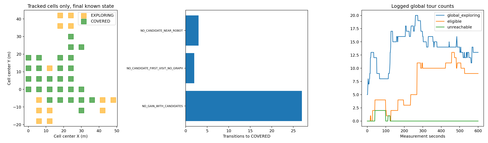
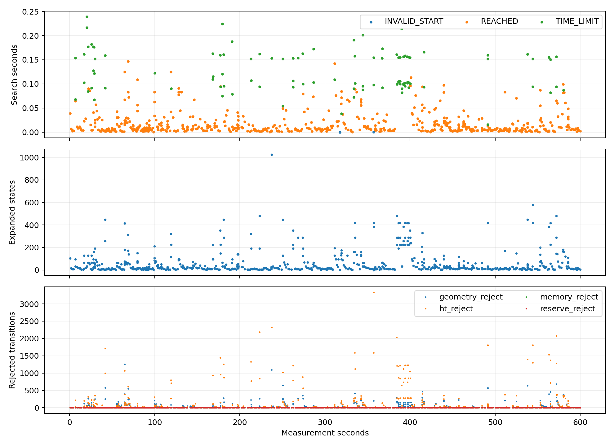
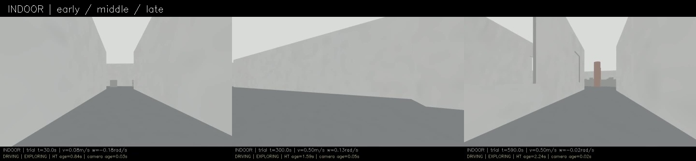
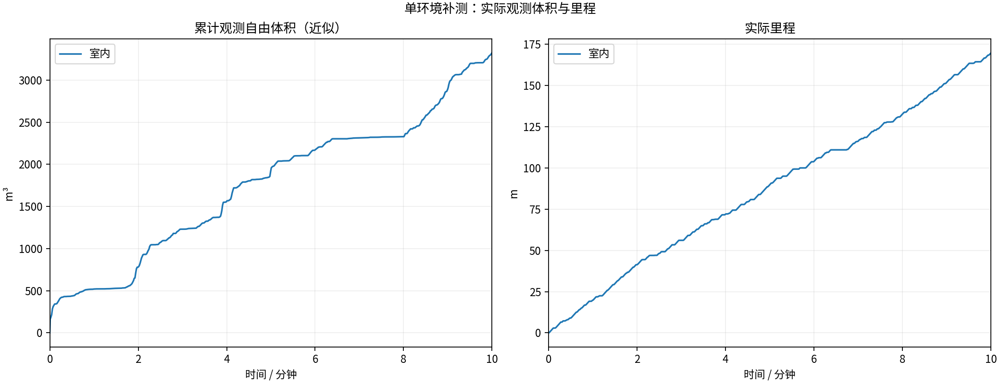
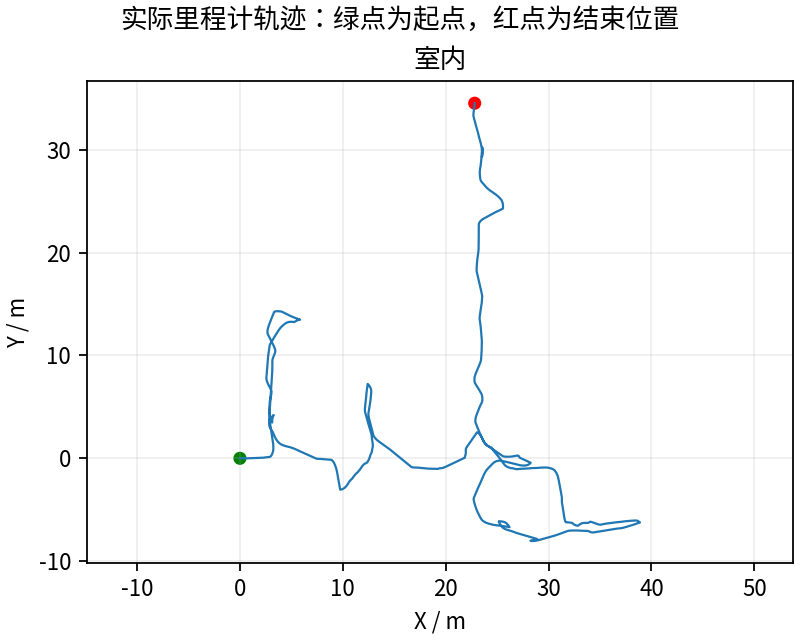
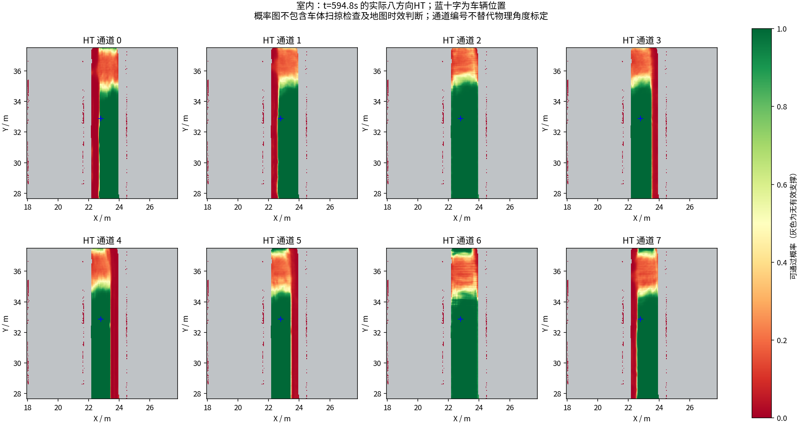
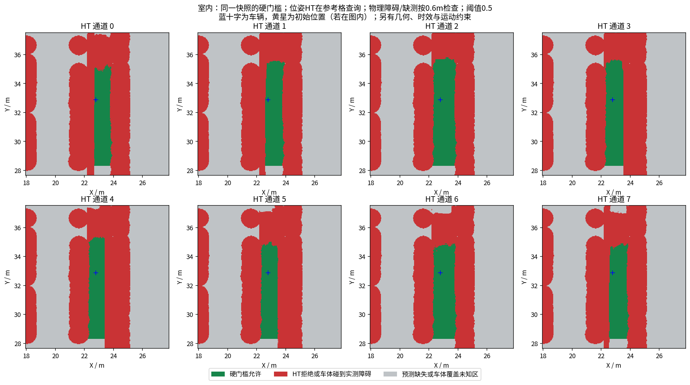

# 正收益任务保留：10分钟末仍探索，仍有新的状态分支待修正

**完整600秒169.57m、3321.250m³，最后状态EXPLORING，最后60秒17.829m，结束时约0.5m/s。** 本次由600秒测试计时器结束，不是探索完成或卡死。体积比阶段29增加约64.0%，比此前阶段23增加约4.75%；单次闭环记录不能证明统计优势或排除轨迹/调度影响。

## 修改与回归

实测`ce7202b`。HT模式中，达到原覆盖/前沿阈值的未访问候选会将UNSEEN登记为EXPLORING；仍有收益的EXPLORING从almost_covered删除，移出邻域仍保留全局待办。原零收益覆盖、已覆盖单元重新激活滞回、非HT模式保持。HT阈值、物理边界、跟踪余量、速度、模型和搜索预算未改。

两个旧实现失败的实际C++任务状态用例现在通过；另覆盖前沿收益、零收益、已访问、无候选、其他目标选中、覆盖归零、滞回和非HT模式。全部4个CTest目标通过，geometry_pose_test内13项回归、其中10项新状态回归通过。[前后日志](regression/) · [修改说明](../../fixes/2026-10-18_pending_gain_tasks.md)

## 本轮验证了什么

5829条单元记录中，“有收益仍保持UNSEEN”从阶段29的33个单元降到0；因ALMOST_LEFT_NEIGHBOUR置COVERED从5次降到0。全局巡游实际出现global_return=0和多条global=1引导；最后还有13个EXPLORING任务，局部继续给出路线，而不是因窗口移走就结束。

| 版本 | 里程m | 近似自由体积m³ | 结束状态 |
|---|---:|---:|---|
| 较高体积阶段23 | 134.00 | 3170.500 | BLOCKED |
| 阶段28 | 117.66 | 2292.750 | 内部返航COMPLETED |
| 阶段29 | 133.17 | 2025.125 | 内部返航COMPLETED |
| 本轮阶段30 | 169.57 | 3321.250 | EXPLORING，计时结束 |

600个源秒扫描用于同口径近似体积、跳过0；体积不是场景真值覆盖率。车辆1m轨迹格到访163个，最后60秒仍前进17.829m。最长全零指令17.499秒，最长无平移21.100秒，BLOCKED健康抽样49/600；不能说一路不停。

## 剩余问题与新证据

743次搜索638次REACHED、102次TIME_LIMIT、3次INVALID_START；几何查询占搜索实测时间约92.6%，需继续做保持同一判定的提速，而不是降低阈值。6分钟附近阻塞恢复后继续探索；手工6秒点云是在恢复期间采到，不能当作最严重预算耗尽那次回调的完整复现。[逐目标搜索](search_audit/summary.json)

原先本轮没有改的“无候选就覆盖”分支实际执行5次，其中3次前一条约1～3秒前仍有正收益，例如(30,-6)单元此前11个候选、6个覆盖收益视点，随后因首次访问无图节点且候选消失被置COVERED；(18,6)此前290候选/37覆盖收益视点/266前沿收益视点，随后因无候选且近车置COVERED。**候选暂时不可见/不可规划不等于收益已被观测核销。** [逐次记录](cell_coverage_audit/no_candidate_transitions.json)。下一步需要记住最后一次有效收益证据，在候选缺失时保留待复查，并防止未解决待办被“全局暂无路线”伪装为完整完成；同时核查是否确实不可达，避免盲目无限重试。

健康1Hz抽样HT年龄P95约1.912s、最大2.848s，但20Hz控制器仍有1次HT_MAP_STALE，**不能由抽样最大值宣称全时刻都低于3秒**。4次PATH_STALE、runtime P95约1.469s/最大2.241s仍需核查。HT晚拒绝59次全部配对全零，新增几何指令拒绝1次也配对全零，未匹配0；471份几何样本未见既有安全半径重叠。58份神经上下文同源图逐值一致、3份重算最大差0；不作为物理真值。

[600秒视频](indoor/camera_h264.mp4) · [有效参数](indoor/planner_parameters.yaml) · [实际指令拦截核查](indoor/blocked_commands.json)。13项采集/冻结/退出检查通过，视频9000帧/600.000000秒完整解码。整轮MCAP、地图/模型上下文、CSV、日志、视频及冻结外部源码经Release保存，激光仍为源秒抽样，不是全传感器无损记录。尚无重复/多环境、独立覆盖真值或完整动力学验收。

---

# HT 室内10分钟补测

每组测量 600 秒，从首个具备里程计和激光输入的TARE运行周期开始计时；初始化不计入。
每个场景独立启动、独立高程历史，上一组完全退出且视频处理结束后再启动下一组。车速上限均为0.5m/s，HT硬约束与3秒时效保护相同。
采用对应场景TARE参数；车库沿用历史配对起点，其余使用各自仿真原生起点。因此这不是相同场景的算法优劣对照。
相机原生960×540、15fps，视频含状态条并裁去初始化；重复帧代表真实图像更新间隔，不做插帧。

| 环境 | 状态 | 实际里程(m) | 近似观测体积(m³) | 末尾任务状态 | 视频 |
|---|---|---:|---:|---|---|
| 室内 | RECORDED | 169.57 | 3321.25 | EXPLORING | [播放/下载](indoor/camera_h264.mp4) |

[全部视频播放列表](videos.m3u) · [实时状态与校验](suite.json)

每个场景仅一次10分钟测试，不能据此证明更长时间、所有环境或实车稳定。定时记录完成不等于探索完成。观测体积是抽样激光射线的自由体素并集近似，不是真值覆盖率；跨场景体积不可直接作为算法优劣排名。

## 实际出现的问题

下表保留暂停和地图延迟，不把“节点未崩溃”当作“没有问题”。地图年龄为1Hz抽样，完整控制消息保留在本地MCAP中。全零指令表示既不平移也不转向；原地转向单独统计。

| 环境 | HT年龄P95/最大(s) | 年龄>3s样本 | 全零指令占比 | 最长全零指令(s) | 全局引导无进展释放 | 验证失败项 |
|---|---:|---:|---:|---:|---:|---|
| 室内 | 1.91 / 2.85 | 0 | 20.1% | 17.50 | 6 | 无 |

遇到旧HT地图时仍执行3秒时效保护；没有为让车持续前进而放宽硬约束。全局引导释放说明该段目标没有持续接近，不能解释为该目标已经到达或覆盖完成。

| 环境 | 实收激光/600s | 平均频率(Hz) | 最大接收间隔(s) | 同源对齐检查点 | 观察器与建图器计数差恒定 |
|---|---:|---:|---:|---:|---|
| 室内 | 2981 | 4.97 | 0.53 | 50 | True |

计数差恒定只支持这些对齐区间内没有新增相对漏收；不能证明源端始终连续发布，也不能排除两个订阅者同时漏收。各场景均保留完整扫描计数和原始时间戳检查点。

### 室内末段实际HT

[同期接收的相机画面](indoor/late_camera.jpg) · [原始图层快照](indoor/late_map_snapshot.npz) · [时间与坐标元数据](indoor/late_map_snapshot.json)

全部视频按15fps、600秒裁剪，时长校验允许1帧误差，完整解码通过；实际帧数和时长见各组video_validation.json。各组共有源文件的63项哈希一致，各组自身冻结文件核验见suite_validation.json。

相机年龄是图像接收后的年龄；相机仿真时间戳与导航墙钟不同，不能把该数值解释为传感器端到端延迟。原始MCAP、全高程历史和输入诊断保存在suite.json所列本地目录；本次只发布选取的数据与视频。
