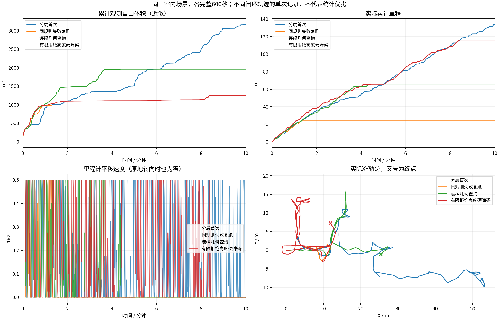
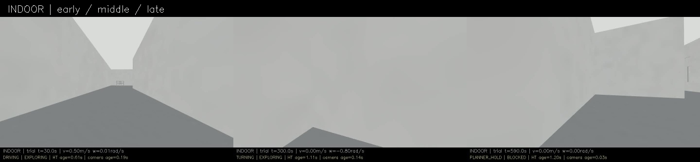
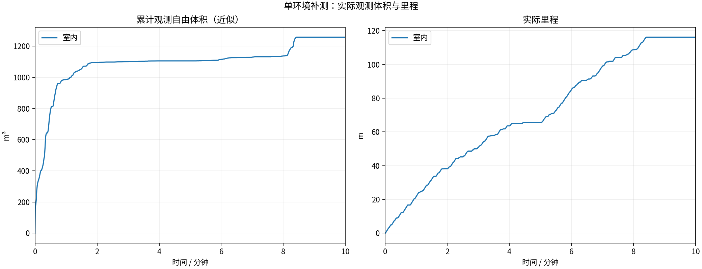
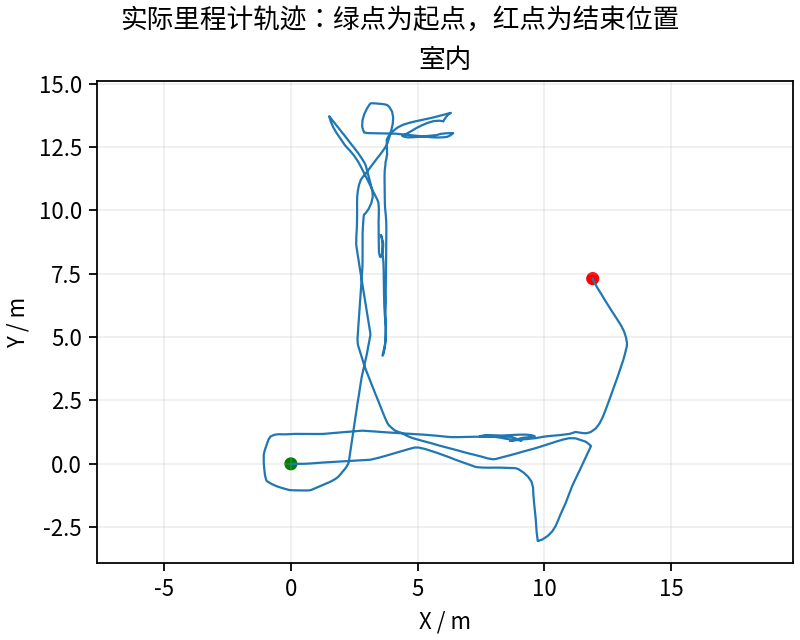
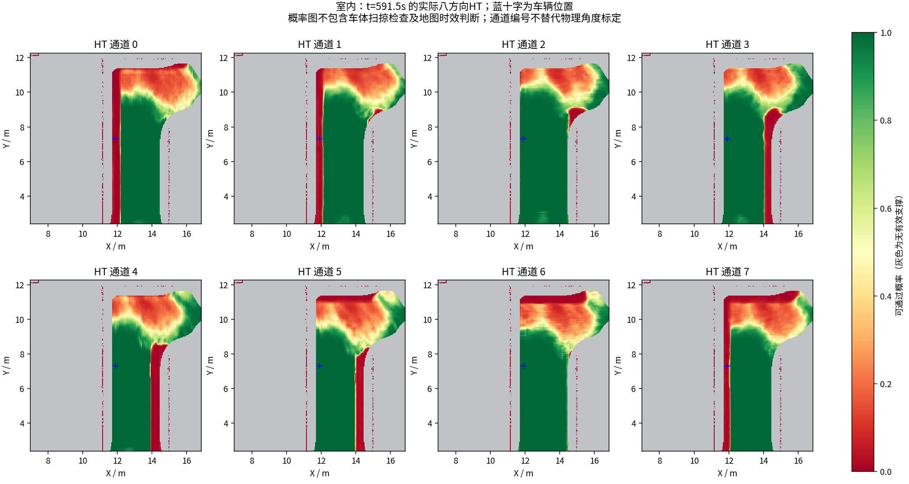
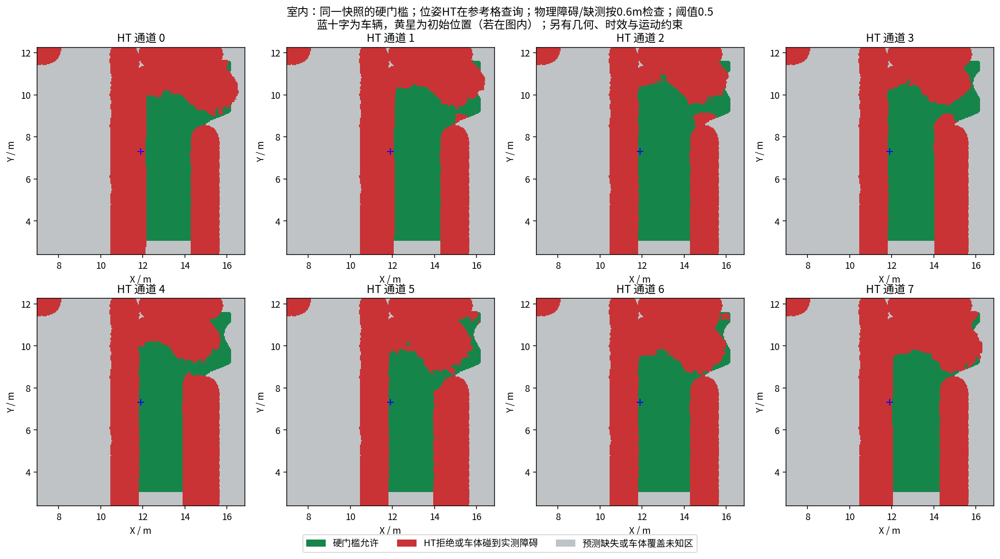

# 有限拒绝高度保留为硬障碍：修正接口，末段仍停滞

**完整600秒116.15m、1258.000m³，最终BLOCKED。** 上一轮65.80m、1959.875m³。本轮走得更多，但观测自由体积反而下降约35.8%，存在回访；不能把里程增加当作探索收益增加。不同闭环轨迹的单次记录不提供独立因果收益估计。

## 改了什么、验证了什么

实测代码`22c2749`。源输入质量拒绝与融合后质量拒绝统一：有限拒绝高度保留为实际高度障碍上下文，该格八方向概率强制0；没有高度的拒绝格仍保持未知和网络窗口否决。没有把拒绝点补成自由地面，没有改变0.5概率、物理足迹、3秒时效、模型权重或历史观测时间。

[修改说明](../../fixes/2026-10-18_postfilter_obstacles.md) · [七项支撑回归、真实学生网络/ROS一帧集成检查与旧失败](regression/)。本轮新保存完整网络输入与实际输出，每10秒一份。测量源时间窗口内58份输入全部与同时间戳发布的11个HT图层逐值一致；首、中、尾三份输入用同一冻结权重重算，最大绝对差均为0。[一致性核验与限制](indoor/context_consistency.json) · [三份可重放样例](inference_examples/)。这证明记录/处理一致，不能代替物理可通过真值。

原来导致约1m未知遮罩的有限融合后拒绝格现在保留为硬障碍，7项规则测试及实际桥接的八方向强制零均通过。原始高程/拒绝标记仍保留，真正未知仍不能通行。

## 实际结论与新停车

最后平移指令约505秒，最长全零指令95.02秒，最后60秒里程0。最后位姿约(11.912,7.310)m，HT参考方向概率约0.99916，当前方向及反向均允许，几何层也允许根状态；日志为搜索后没有可执行目标。这次不是前两轮的根状态几何拒绝或HT UNKNOWN。

用实际编译的HtCostMap对最后冻结图做只含HT的检查：匹配本轮0.3m格/0.4m动作/32航向/0.15s/8000展开/0.35m到达半径/7m搜索范围，在0.8m、2m两圈共16个目标中10个可达。放宽预算、细化XY/车头键或减小步长仍为10个。**不能仅凭末尾BLOCKED就说所有HT路线都不存在，也不能直接认定继续细化转角能修好。**

[离线数值与范围限制](offline_audit/resolution_audit.json) · [实际C++日志](offline_audit/resolution_audit.log)。这是HT必要条件检查，没有复原TARE几何、目标短名单和临时失败记忆。6秒临时点云捕获收到了地形、扫描和碰撞视点，但没收到`collision_cloud`；这个缺失如实保留，不把重建地形当成完整原始几何输入。下一轮须补可靠几何记录和逐目标搜索终止原因。

连续几何查询对每次位姿查询做3D半径搜索并遍历邻点，其代价也需单独核查；不能把所有目标失败归为物理无路。任何优化都必须保持同一碰撞判断，再做600秒实测。

## 版本比较

| 同场景600秒 | 里程(m) | 近似自由体积(m³) | 最终状态 |
|---|---:|---:|---|
| 分层首次 `149566d` | 134.00 | 3170.500 | BLOCKED |
| 同规则诊断复跑 `bada7ba` | 23.86 | 993.125 | BLOCKED |
| 连续几何查询 `43069a7` | 65.80 | 1959.875 | BLOCKED |
| 有限拒绝高度硬障碍 `22c2749` | 116.15 | 1258.000 | BLOCKED |

HT年龄抽样P95 2.071s、最大3.336s，晚HT拒绝128次全部配对实际零速度。13项采集/冻结/退出核验通过；600个源秒扫描用于体积评估，跳过0。视频600秒、9000帧、15fps完整解码通过。[视频](indoor/camera_h264.mp4) · [参数](indoor/planner_parameters.yaml)。新网络上下文写盘开销单列于EXPERIMENT.json，不隐藏记录成本。

原始MCAP、周期地图、全部网络上下文、输入质量诊断及独立工作区源码快照均保留并发布整轮Release；激光仍为源秒抽样，不是全传感器无损数据。尚无重复、多环境、完整动力学或独立物理标定验收。

---

# HT 室内10分钟补测

每组测量 600 秒，从首个具备里程计和激光输入的TARE运行周期开始计时；初始化不计入。
每个场景独立启动、独立高程历史，上一组完全退出且视频处理结束后再启动下一组。车速上限均为0.5m/s，HT硬约束与3秒时效保护相同。
采用对应场景TARE参数；车库沿用历史配对起点，其余使用各自仿真原生起点。因此这不是相同场景的算法优劣对照。
相机原生960×540、15fps，视频含状态条并裁去初始化；重复帧代表真实图像更新间隔，不做插帧。

| 环境 | 状态 | 实际里程(m) | 近似观测体积(m³) | 末尾任务状态 | 视频 |
|---|---|---:|---:|---|---|
| 室内 | RECORDED | 116.15 | 1258.00 | BLOCKED | [播放/下载](indoor/camera_h264.mp4) |

[全部视频播放列表](videos.m3u) · [实时状态与校验](suite.json)

每个场景仅一次10分钟测试，不能据此证明更长时间、所有环境或实车稳定。定时记录完成不等于探索完成。观测体积是抽样激光射线的自由体素并集近似，不是真值覆盖率；跨场景体积不可直接作为算法优劣排名。

## 实际出现的问题

下表保留暂停和地图延迟，不把“节点未崩溃”当作“没有问题”。地图年龄为1Hz抽样，完整控制消息保留在本地MCAP中。全零指令表示既不平移也不转向；原地转向单独统计。

| 环境 | HT年龄P95/最大(s) | 年龄>3s样本 | 全零指令占比 | 最长全零指令(s) | 全局引导无进展释放 | 验证失败项 |
|---|---:|---:|---:|---:|---:|---|
| 室内 | 2.07 / 3.34 | 3 | 38.4% | 95.02 | 10 | 无 |

遇到旧HT地图时仍执行3秒时效保护；没有为让车持续前进而放宽硬约束。全局引导释放说明该段目标没有持续接近，不能解释为该目标已经到达或覆盖完成。

| 环境 | 实收激光/600s | 平均频率(Hz) | 最大接收间隔(s) | 同源对齐检查点 | 观察器与建图器计数差恒定 |
|---|---:|---:|---:|---:|---|
| 室内 | 2991 | 4.99 | 0.46 | 11 | True |

计数差恒定只支持这些对齐区间内没有新增相对漏收；不能证明源端始终连续发布，也不能排除两个订阅者同时漏收。各场景均保留完整扫描计数和原始时间戳检查点。

### 室内末段实际HT

[同期接收的相机画面](indoor/late_camera.jpg) · [原始图层快照](indoor/late_map_snapshot.npz) · [时间与坐标元数据](indoor/late_map_snapshot.json)

全部视频按15fps、600秒裁剪，时长校验允许1帧误差，完整解码通过；实际帧数和时长见各组video_validation.json。各组共有源文件的62项哈希一致，各组自身冻结文件核验见suite_validation.json。

相机年龄是图像接收后的年龄；相机仿真时间戳与导航墙钟不同，不能把该数值解释为传感器端到端延迟。原始MCAP、全高程历史和输入诊断保存在suite.json所列本地目录；本次只发布选取的数据与视频。
