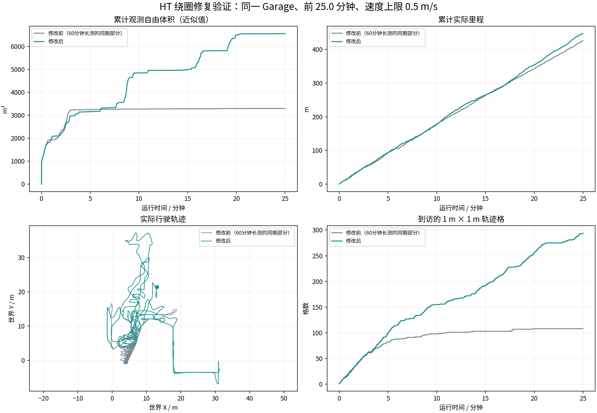

# HT绕圈问题：修改与复测

已修改找路逻辑，两轮分别记录20分钟和25分钟。没有放宽HT通行门槛、未知区域策略或0.5m/s速度上限。

主要改动：全局引导连续60秒没有进一步接近便更换，并冷却180秒；这个计时不再被局部小目标完成重置。恢复目标加入世界坐标重复访问记忆，并修正“负收益除以时间会偏爱长绕路”的评分。

第一轮探索增益明显改善，但约18.9分钟触发返航后停在距起点约5.2米处，最终BLOCKED。随后补上返航检查点与搜索/跟踪到达容差的一致性修正，返航不再重复做探索目标搜索。0.328米检查点死区已有明确回归用例；第一轮没有保存具体返航检查点，不能仅凭这项代码缺陷认定当次停车只有这个原因。

同一Garage前20分钟，按完全相同的自由体素并集口径比较：

| 指标 | 原长测同期 | 修复引导后 | 最新修正后 |
|---|---:|---:|---:|
| 累计里程(m) | 343.50 | 364.73 | 354.14 |
| 累计观测自由体积(m³，近似) | 3293.88 | 5673.38 | 6498.00 |
| 第10–20分钟新增观测(m³) | 26.38 | 2092.42 | 1654.12 |
| 到访1米轨迹格 | 108.00 | 235.00 | 255.00 |

最新一轮25分钟：行驶447.50米，到访294格，累计估计观测6556.38m³；最后任务状态为 **EXPLORING**（HT_ASSISTED）。
本轮没有达到任务COMPLETED。返航容差修正通过回归检查，但不能宣称返航闭环验证通过。

[最新视频（H.264，2fps）](return_fix_trial/camera_h264.mp4) · [第一轮视频](guide_fix_trial/camera_h264.mp4) · [第一轮对比图](guide_fix_trial/comparison.png) · [CSV与指标](same_duration_metrics.json)

验证：242项核心检查、15项ROS接口测试和5项跟踪测试通过；两段视频均完成全文件解码。最新运行的14项源码/配置/程序哈希保持不变，进程异常或资源保护事件为0。

仍有的限制：本次最长25分钟，不能替代修复后的60分钟稳定性复测。HT地图年龄P95为2.36秒、最大4.17秒，1Hz检查中超过3秒14次；没有宣称地图延迟已经消除。这里只是单场景有限次数复测，没有真值全域覆盖率或实车验证。

体积为每秒最多一帧点云、0.5米体素、15米射线截断得到的近似自由空间并集；不是官方覆盖率。第一轮与第二轮是不同代码版本和独立启动，不能当作单一改动的严格消融。视频2fps只用于看过程，不能据此判断20Hz控制是否卡顿。

两轮完整MCAP、地图快照、资源与状态日志均留在本机，公开目录保留CSV、曲线、审计和视频。另一次ROS域编号超限发生在测量前，已修正并加前置校验，详见[启动失败记录](initialization_failure.json)。

[第一轮详细报告](guide_fix_trial/REPORT.md) · [最新详细报告](return_fix_trial/REPORT.md) · [最新任务状态审计](return_fix_trial/mission_audit.json) · [数据核验](return_fix_trial/validation_checks.json)
