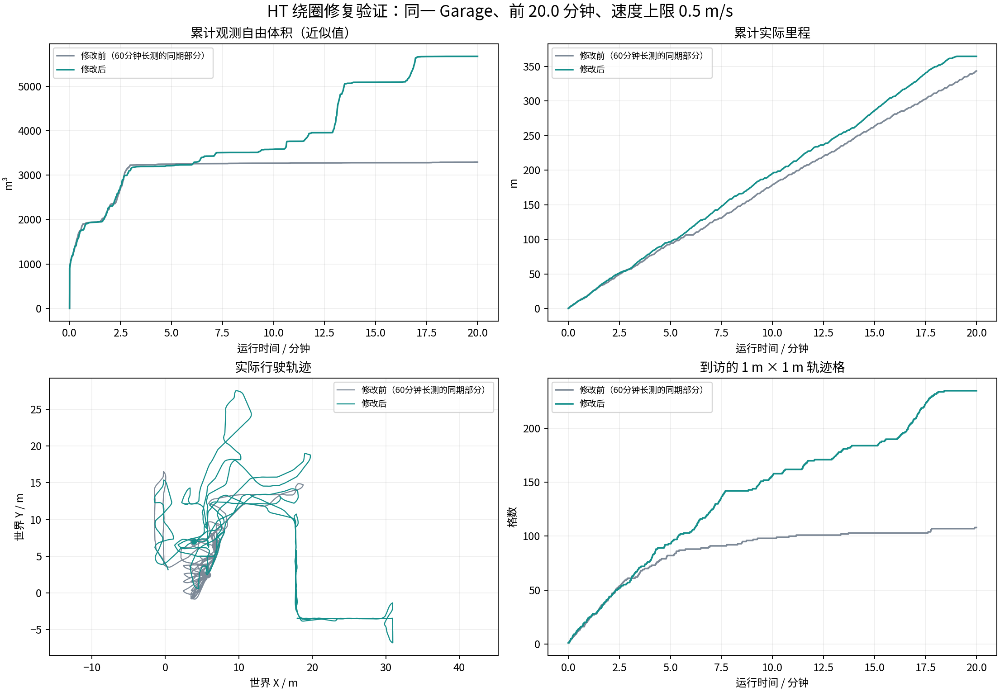

# HT 绕圈修复：同场景等时长比较

比较前 20.0 分钟；修改前截取上一轮60分钟长测的同期数据。两次独立启动Garage，前进速度上限均为0.5m/s。

| 指标 | 修改前 | 修改后 |
|---|---:|---:|
| 累计实际里程(m) | 343.50 | 364.73 |
| 累计观测自由体积(m³，近似) | 3293.88 | 5673.38 |
| 到访1米轨迹格 | 108.00 | 235.00 |
| 最后10分钟新增观测(m³) | 26.38 | 2092.42 |
| 最后10分钟里程(m) | 164.78 | 169.36 |

这是单次仿真回归比较，不代表所有环境或60分钟稳定性验证完成。观测体积按同一0.5m体素、15m射线范围和每秒最多1帧计算，属于累计自由空间近似，并非官方覆盖率。
算法收益日志、完整控制状态、数据新鲜度和失败事件需同时参照本轮endurance_audit.json。
