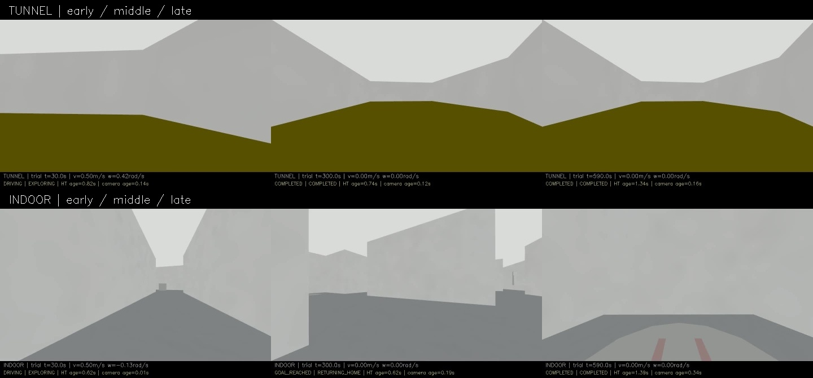
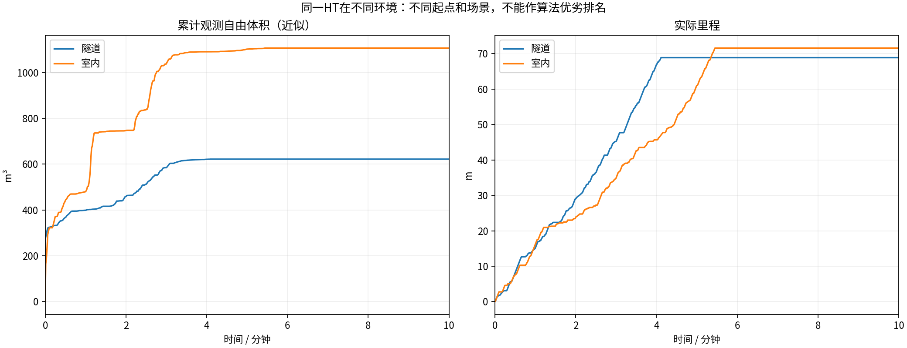
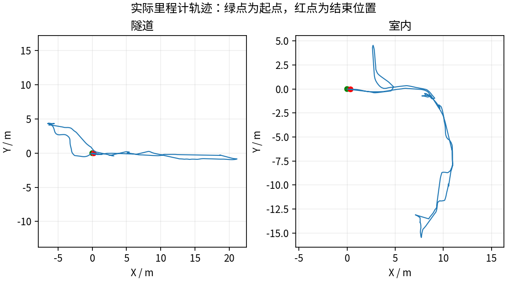
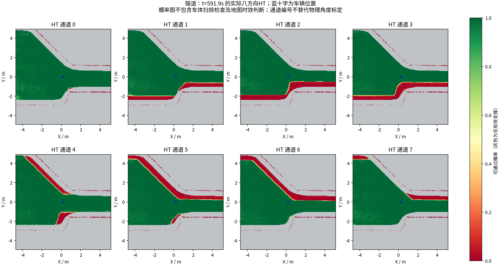
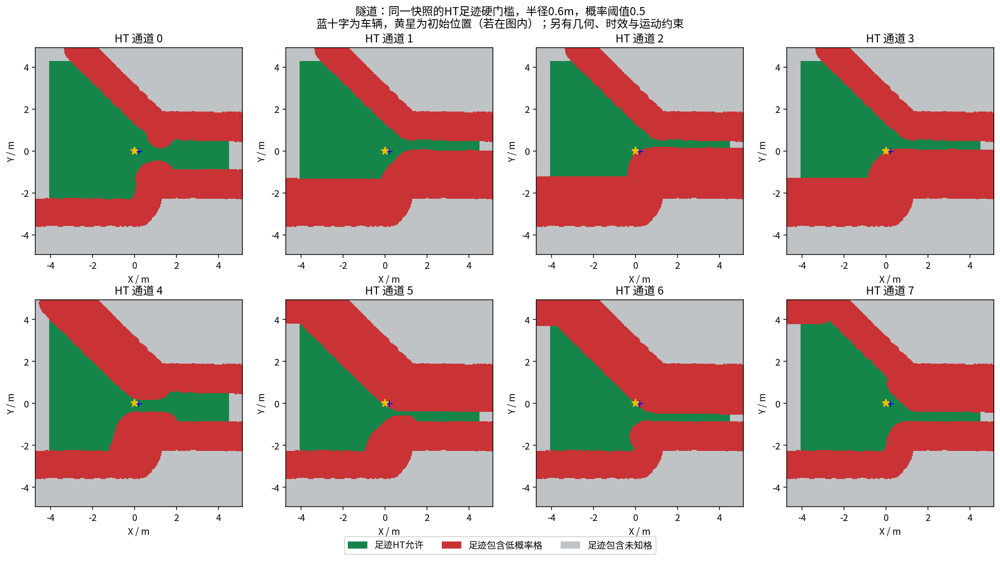
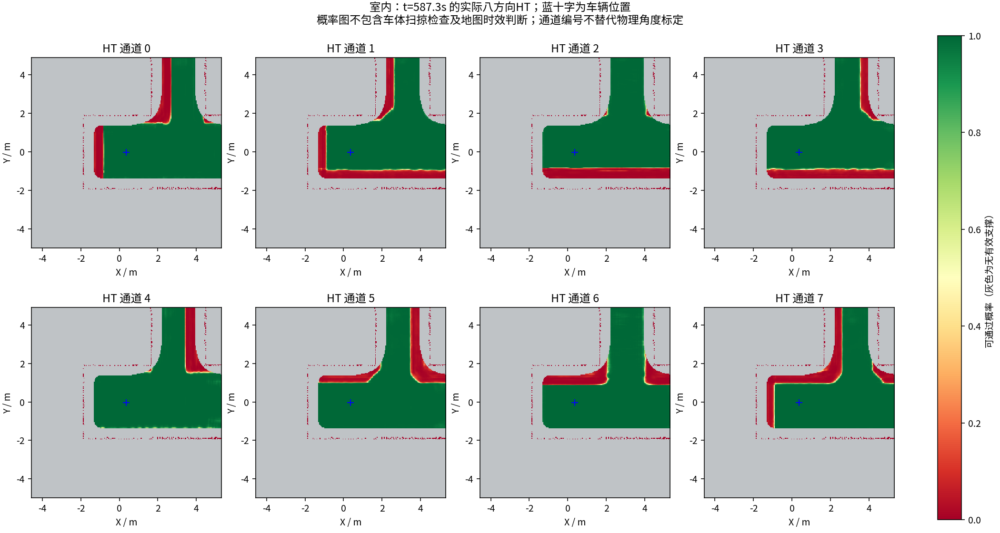
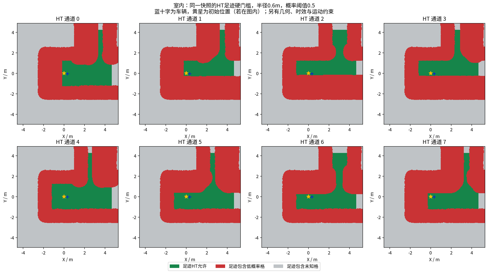

# HT 隧道、室内10分钟补测

本轮测量代码为`dee873d`（C++修改来自`73cae0b`）。两组均记录满600秒并完成返航；后半段静止为完成后停车，不是卡住。

| 任务阶段统计 | 隧道 | 室内 |
|---|---:|---:|
| 首次COMPLETED原始消息(s) | 249.58 | 328.43 |
| 完成前最长全零指令(s) | 4.30 | 4.65 |
| 完成后保持停车(s) | 350.42 | 271.57 |
| 完成后最大线/角速度指令 | 0 / 0 | 0 / 0 |
| 完成后2Hz位姿样本最大位移(m) | 0 | 0 |

统计来自原始MCAP控制消息：[隧道](tunnel/mission_commands.json)、[室内](indoor/mission_commands.json)。下方通用表的“最长全零指令”包含正常完成后停车，不能直接当成卡停时间。视频实际解码各8999帧、599.933秒，满足600秒±一帧的协议。

**仍有退步和未解决项：** 室内约215秒就触发TARE返航，总近似观测体积低于前轮；地图也仍有超过3秒的尾延迟。详见[同场景修改前后比较](../ht_recovery_comparison_2026-10-17/REPORT.md)。本轮只重新测试隧道、室内，未把旧车库、校园和森林录像冒充新代码结果。

每组测量 600 秒，从首个具备里程计和激光输入的TARE运行周期开始计时；初始化不计入。
每个场景独立启动、独立高程历史，上一组完全退出且视频处理结束后再启动下一组。车速上限均为0.5m/s，HT硬约束与3秒时效保护相同。
采用对应场景TARE参数；车库沿用历史配对起点，其余使用各自仿真原生起点。因此这不是相同场景的算法优劣对照。
相机原生960×540、15fps，视频含状态条并裁去初始化；重复帧代表真实图像更新间隔，不做插帧。

| 环境 | 状态 | 实际里程(m) | 近似观测体积(m³) | 末尾任务状态 | 视频 |
|---|---|---:|---:|---|---|
| 隧道 | RECORDED | 68.86 | 622.00 | COMPLETED | [播放/下载](tunnel/camera_h264.mp4) |
| 室内 | RECORDED | 71.57 | 1106.75 | COMPLETED | [播放/下载](indoor/camera_h264.mp4) |

[全部视频播放列表](videos.m3u) · [实时状态与校验](suite.json)

每个场景仅一次10分钟测试，不能据此证明更长时间、所有环境或实车稳定。定时记录完成不等于探索完成。观测体积是抽样激光射线的自由体素并集近似，不是真值覆盖率；跨场景体积不可直接作为算法优劣排名。

## 实际出现的问题

下表保留暂停和地图延迟，不把“节点未崩溃”当作“没有问题”。地图年龄为1Hz抽样，完整控制消息保留在本地MCAP中。全零指令表示既不平移也不转向；原地转向单独统计。

| 环境 | HT年龄P95/最大(s) | 年龄>3s样本 | 全零指令占比 | 最长全零指令(s) | 全局引导无进展释放 | 验证失败项 |
|---|---:|---:|---:|---:|---:|---|
| 隧道 | 2.30 / 4.24 | 8 | 64.1% | 353.34 | 0 | 无 |
| 室内 | 2.09 / 5.01 | 8 | 54.0% | 273.13 | 1 | 无 |

遇到旧HT地图时仍执行3秒时效保护；没有为让车持续前进而放宽硬约束。全局引导释放说明该段目标没有持续接近，不能解释为该目标已经到达或覆盖完成。

| 环境 | 实收激光/600s | 平均频率(Hz) | 最大接收间隔(s) | 同源对齐检查点 | 观察器与建图器计数差恒定 |
|---|---:|---:|---:|---:|---|
| 隧道 | 2990 | 4.98 | 0.25 | 8 | True |
| 室内 | 2992 | 4.99 | 0.24 | 20 | True |

计数差恒定只支持这些对齐区间内没有新增相对漏收；不能证明源端始终连续发布，也不能排除两个订阅者同时漏收。各场景均保留完整扫描计数和原始时间戳检查点。

### 隧道末段实际HT

[同期接收的相机画面](tunnel/late_camera.jpg) · [原始图层快照](tunnel/late_map_snapshot.npz) · [时间与坐标元数据](tunnel/late_map_snapshot.json)

### 室内末段实际HT

[同期接收的相机画面](indoor/late_camera.jpg) · [原始图层快照](indoor/late_map_snapshot.npz) · [时间与坐标元数据](indoor/late_map_snapshot.json)

全部视频按15fps、600秒裁剪，时长校验允许1帧误差，完整解码通过；实际帧数和时长见各组video_validation.json。各组共有源文件的47项哈希一致，各组自身冻结文件核验见suite_validation.json。

相机年龄是图像接收后的年龄；相机仿真时间戳与导航墙钟不同，不能把该数值解释为传感器端到端延迟。原始MCAP、全高程历史和输入诊断保存在suite.json所列本地目录；本次只发布选取的数据与视频。
