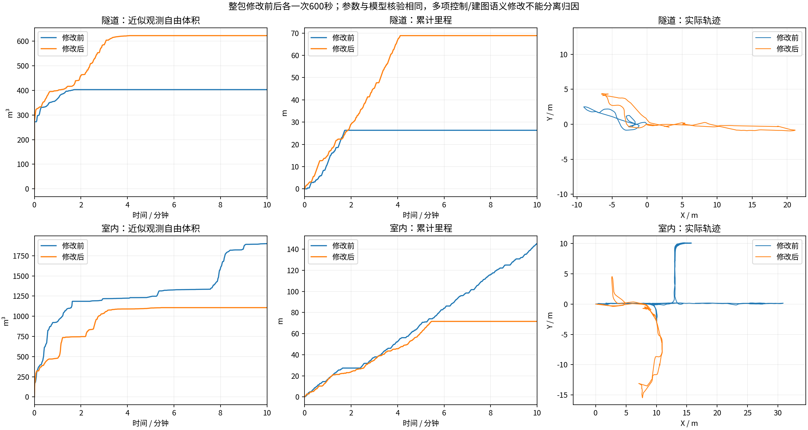

# 停滞修复前后：隧道、室内各10分钟

本轮同时修改了HT观测支撑语义、拒绝观测的历史记录、停滞恢复与搜索预算，并调整CPU推理布局。它是整包修改前后各一次的同场景试跑，不是单因素消融或重复统计。

两场景均沿用原生起点、0.5m/s速度上限、0.5概率阈值、0.6m足迹及3秒时效保护。室内前后都使用0.3m视点采样，不能把此前0.6m采样失败轮当成本次比较基线。观测体积为同口径激光射线自由体素并集近似，不是真值覆盖率。

## 隧道

| 指标 | 修改前 | 修改后 |
|---|---:|---:|
| 实际里程(m) | 26.33 | 68.86 |
| 近似观测自由体积(m³) | 402.875 | 622.000 |
| 全零指令占比（含完成后停车） | 84.8% | 64.1% |
| 任务期间最长全零指令(s) | 496.37 | 4.30 |
| 等长前缀内最长全零指令(s) | 145.95 | 4.30 |
| 倒车指令占比 | 0.0% | 3.6% |
| 整轮规划耗时P95(s) | 0.133 | 0.482 |
| HT年龄P95(s) | 2.377 | 2.302 |
| HT年龄最大(s) | 5.587 | 4.239 |
| 末尾距起点(m) | 1.723 | 0.214 |
| 最后任务状态 | BLOCKED | COMPLETED |
| 首次COMPLETED消息(s) | None | 249.58204674720764 |

停车比较另取两轮相同的前249.58秒，截止于新轮首次COMPLETED；没有把新轮完成后主动停车算成卡死。全600秒原始停车统计仍保留在CSV和原报告中。

第6至7.5分钟，修改前行驶0.00m、新增0.000m³；修改后行驶0.00m、新增0.000m³。这是预先沿用的固定区间，只能描述该区间，不能代表全程效率。

## 室内

| 指标 | 修改前 | 修改后 |
|---|---:|---:|
| 实际里程(m) | 145.28 | 71.57 |
| 近似观测自由体积(m³) | 1900.250 | 1106.750 |
| 全零指令占比（含完成后停车） | 23.0% | 54.0% |
| 任务期间最长全零指令(s) | 39.80 | 4.65 |
| 等长前缀内最长全零指令(s) | 39.80 | 4.65 |
| 倒车指令占比 | 2.3% | 3.0% |
| 整轮规划耗时P95(s) | 1.576 | 1.004 |
| HT年龄P95(s) | 2.208 | 2.093 |
| HT年龄最大(s) | 4.672 | 5.009 |
| 末尾距起点(m) | 16.426 | 0.356 |
| 最后任务状态 | EXPLORING | COMPLETED |
| 首次COMPLETED消息(s) | None | 328.4280757904053 |

停车比较另取两轮相同的前328.43秒，截止于新轮首次COMPLETED；没有把新轮完成后主动停车算成卡死。全600秒原始停车统计仍保留在CSV和原报告中。

第6至7.5分钟，修改前行驶22.94m、新增8.375m³；修改后行驶0.00m、新增0.000m³。这是预先沿用的固定区间，只能描述该区间，不能代表全程效率。

**结论与剩余问题：** 隧道本轮成功返航，室内任务期间长停车缩短，但室内总观测体积由1900.250降为1106.750m³（约下降41.8%）。新轮约215秒触发返航，而原轮600秒末仍在探索，轨迹也选择了不同支路，不能宣称探索效率全面提升。代码中的收尾条件是TARE无可连通全局探索任务且局部覆盖队列为空；它不是真值全覆盖判断。新轮触发前最后一条日志仍在追踪远处局部导航引导，提示任务与HT导航的收尾衔接仍需专门验证；没有据此直接把所有未知区说成可达，也没有强制延长行驶来掩盖条件。

地图尾延迟仍有问题：本轮室内1Hz抽样年龄最大约5.01秒，较前轮4.67秒更差；每组都有8个超过3秒的抽样。森林约4Hz的输入问题本轮没有重测，不能说已经解决。

一轮目标搜索共享0.35秒预算只约束Hybrid A*查询，不限制视点更新、地图转换及整轮规划时间；表中报告完整规划耗时。3秒时效保护保持生效，仍可能因过期或无安全路线停车。COMPLETED只确认返航检查通过，不等于场景真值全覆盖。

[本轮完整视频与地图](../ht_recovery_10min_2026-10-17/REPORT.md) · [失败诊断与离线回归](../ht_context_diagnostics_2026-10-17/REPORT.md)
