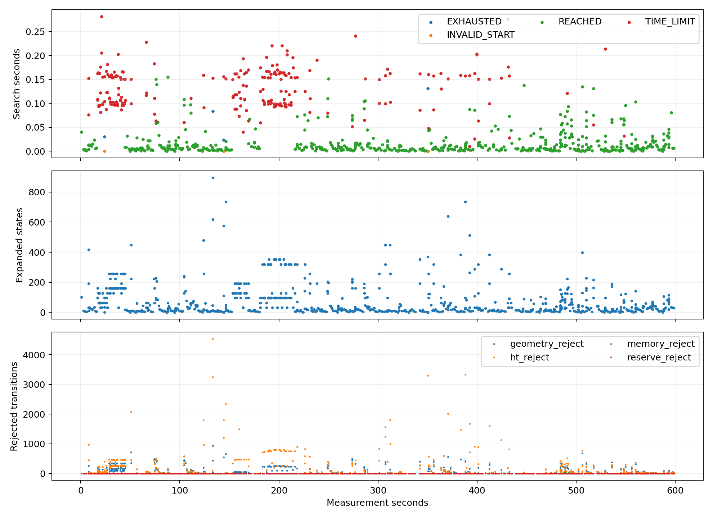
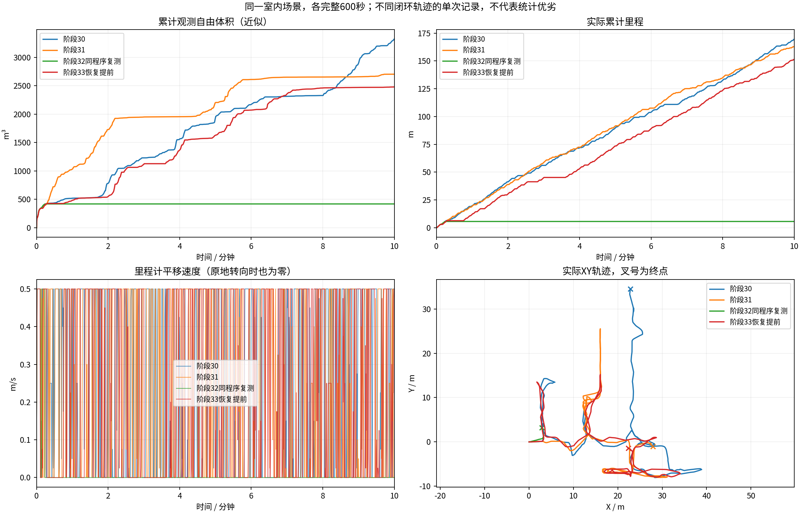
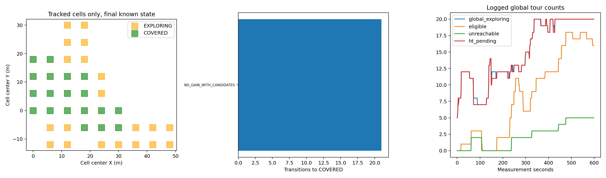
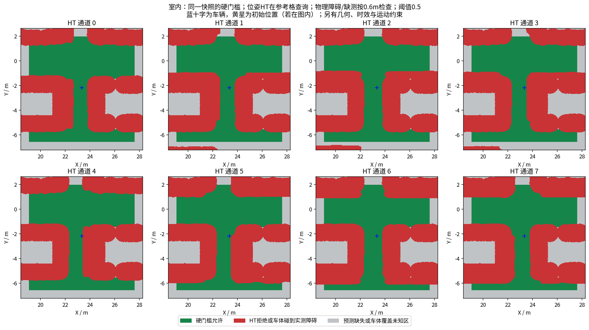
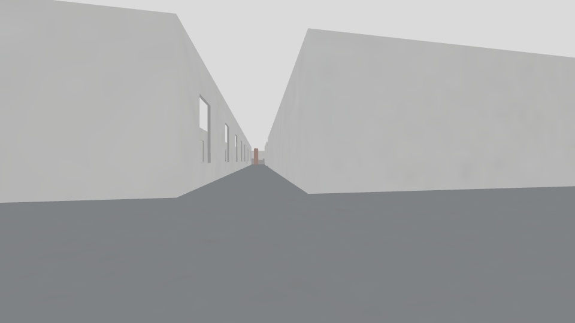
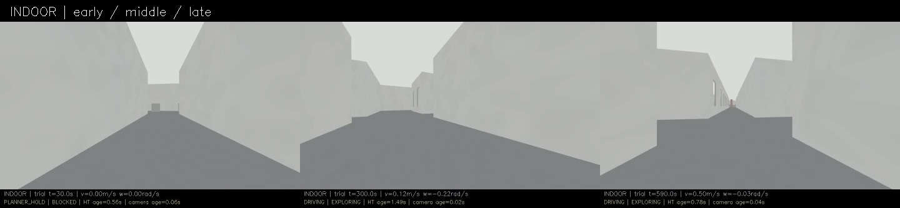
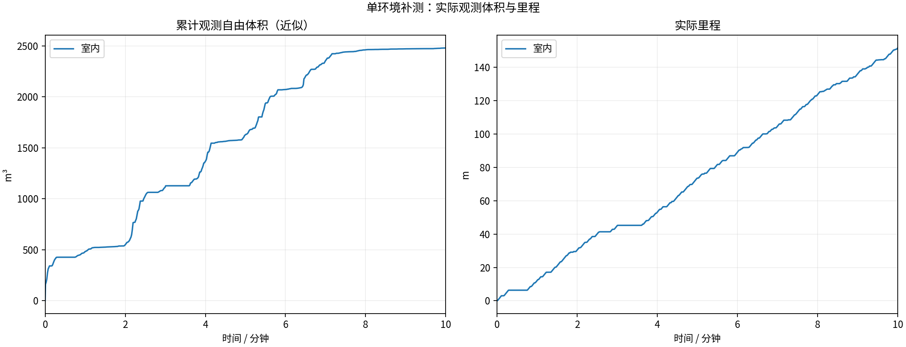
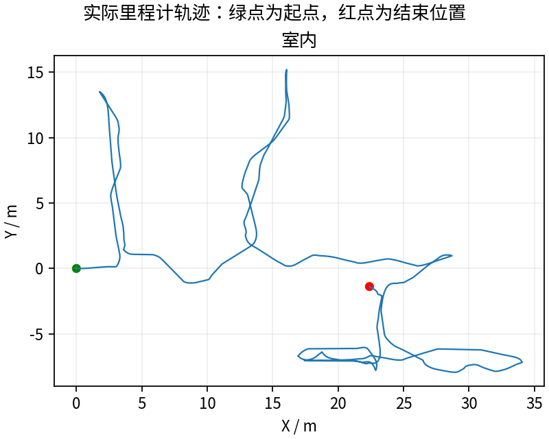
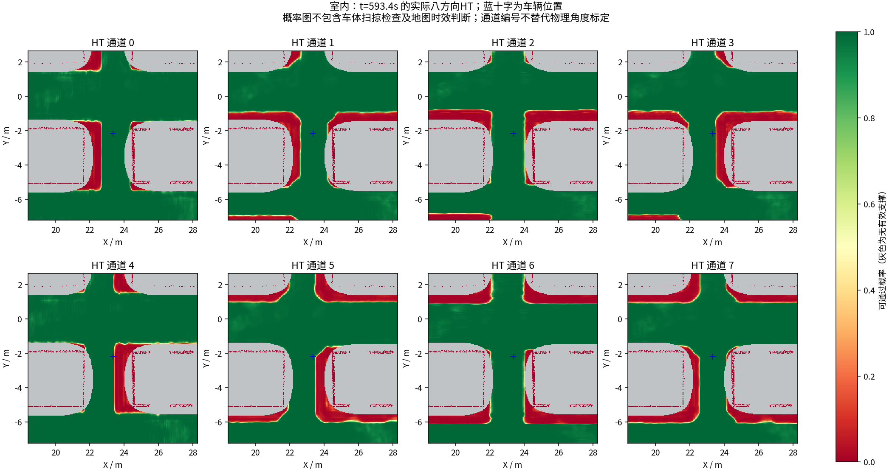

# 普通恢复目标提前搜索：完整600秒实测

**151.57米 / 2480.000立方米，末尾任务EXPLORING。** 最后60秒15.525米，最后平移指令600.001秒，最长全零35.800秒。相比阶段30，体积减少约25.3%；相比阶段31，减少约8.3%。最长全零35.8秒仍是明显缺陷，不能仅凭比前轮卡死改善就标为稳定。

## 为什么改、改了哪里

前轮阶段32相同导航二进制600秒仅5.66m/419.750m³，14秒后长期停车。482轮存在主要目标全超时、尚有替代目标但未尝试恢复的调度问题。新实测`ba7942c`，首个主要目标后安排首个普通恢复目标，防止所有机会被主要目标超时挤占。已有正收益路线时跳过恢复、继续主要比较；已承诺目标成功仍优先；backtrack仍放末尾并保留既有预算。目标池、得分、速度、HT和几何硬门槛、0.15秒单目标/0.35秒周期配置未改。

[完整原因和代码边界](../../fixes/2026-10-19_recovery_scheduling.md) · [实际配置/哈希对照](configuration_comparison.json)。改动的4份清单项仅为导航程序、队列头文件、实际HT路由源码、把新头文件加入冻结清单的实验脚本；其余既有清单项一致。实际planner/follower参数均一致。

## 回归与实测调度

生产队列函数的旧顺序等价提取版在新增确定性预算用例中失败，新版通过；用例只隔离搜索机会，不假装重放真实车辆可达性。全部4个CTest目标通过，原有HT、几何与执行拒绝发零回归保留。[前后检查日志](regression/)。

本轮455个调度周期，“主要全超时且排队替代未尝试”0轮（前轮482）；60秒后恢复/回退搜索机会180次。[调度逐周期](scheduling_audit/cycles.csv)。搜索860次，退出原因{'REACHED': 610, 'TIME_LIMIT': 232, 'EXHAUSTED': 4, 'INVALID_START': 14}。几何查询墙钟约占93.5%，包括调度等待；最大搜索0.281605秒，原预算检查长尾仍需分析。

实际12个周期在主要目标失败后找到了恢复路线并被选为输出，确认改动在闭环中使用；不证明后续路线全部完成。[逐次证据](indoor/recovery_wins.json)。

## 同场景对比

| 版本 | 里程m | 近似自由体积m³ | 状态 |
|---|---:|---:|---|
| 阶段30 | 169.57 | 3321.250 | 定时结束，仍移动 |
| 阶段31 | 162.71 | 2703.875 | 末刻EMPTY_PATH |
| 阶段32同程序复测 | 5.66 | 419.750 | 早期长期停滞 |
| 本轮阶段33 | 151.57 | 2480.000 | EXPLORING |

单轮闭环路线不同，不能把这张图当统计显著性或单因素因果证明；更不能只挑较差前轮宣布普遍提升。体积是600个源秒激光的0.5m自由体素并集近似、跳过0，不是真值覆盖率。

## 最长停车没有被解决

20Hz指令审计最长全零35.7999秒；0.5秒CSV近似定位180.504～216.503秒，位置约(13.108,5.561)、航向1.814rad。该区间记录68次TIME_LIMIT和1次REACHED，其中恢复/回退也有43次TIME_LIMIT，说明本轮已不是“恢复完全没机会”这一种原因。最后找到(12.45,6.15)的回退路线，随后恢复。

反复尝试的恢复目标主要在(12.75,2.85)，部分回退在(13.05,2.25)，另有主要目标(15.15,9.75)。需要冻结实际HT、几何和候选范围，核对搜索耗时与目标/运动启发式；当前仅凭TIME_LIMIT不能宣布无路，更不能直接放宽约束。[最长五段停车、全部对应搜索](indoor/stop_episodes.json)。0.5秒估计的35.999秒与全频35.7999秒采样不同，不混用精度。

## 采集核验与仍需检查

13/13项冻结/采集/退出检查通过。视频9000帧、600.000000秒完整解码。[视频](indoor/camera_h264.mp4) · [采集检查](indoor/suite_validation.json)。任务状态、完成触发与返航核查见[任务审计](indoor/mission_audit.json)。新增收益完成守卫不是场景真值覆盖证明。

58份上下文与同源发布图核对、三份冻结模型重算见[模型记录](indoor/context_consistency.json)。[实际拦截发零](indoor/blocked_commands.json)和[几何采样](execution_geometry_audit/summary.json)保留；这些检查不证明全时刻、动态障碍或实车安全。

地图/路径时效、搜索预算长尾、全局未连接/不可观察待办仍需逐项分析。提前给一次恢复机会不保证恢复目标可达，也不保证所有时刻都能在预算内完成；未增加绝对实时保证。重复与多环境、独立覆盖真值及完整动力学仍未验收。完整已录制数据/视频按Release保存，激光源秒抽样、地图周期快照，不是全频全部传感器无损记录。

---

# HT 室内10分钟补测

每组测量 600 秒，从首个具备里程计和激光输入的TARE运行周期开始计时；初始化不计入。
每个场景独立启动、独立高程历史，上一组完全退出且视频处理结束后再启动下一组。车速上限均为0.5m/s，HT硬约束与3秒时效保护相同。
采用对应场景TARE参数；车库沿用历史配对起点，其余使用各自仿真原生起点。因此这不是相同场景的算法优劣对照。
相机原生960×540、15fps，视频含状态条并裁去初始化；重复帧代表真实图像更新间隔，不做插帧。

| 环境 | 状态 | 实际里程(m) | 近似观测体积(m³) | 末尾任务状态 | 视频 |
|---|---|---:|---:|---|---|
| 室内 | RECORDED | 151.57 | 2480.00 | EXPLORING | [播放/下载](indoor/camera_h264.mp4) |

[全部视频播放列表](videos.m3u) · [实时状态与校验](suite.json)

每个场景仅一次10分钟测试，不能据此证明更长时间、所有环境或实车稳定。定时记录完成不等于探索完成。观测体积是抽样激光射线的自由体素并集近似，不是真值覆盖率；跨场景体积不可直接作为算法优劣排名。

## 实际出现的问题

下表保留暂停和地图延迟，不把“节点未崩溃”当作“没有问题”。地图年龄为1Hz抽样，完整控制消息保留在本地MCAP中。全零指令表示既不平移也不转向；原地转向单独统计。

| 环境 | HT年龄P95/最大(s) | 年龄>3s样本 | 全零指令占比 | 最长全零指令(s) | 全局引导无进展释放 | 验证失败项 |
|---|---:|---:|---:|---:|---:|---|
| 室内 | 1.91 / 3.24 | 2 | 29.5% | 35.80 | 9 | 无 |

遇到旧HT地图时仍执行3秒时效保护；没有为让车持续前进而放宽硬约束。全局引导释放说明该段目标没有持续接近，不能解释为该目标已经到达或覆盖完成。

| 环境 | 实收激光/600s | 平均频率(Hz) | 最大接收间隔(s) | 同源对齐检查点 | 观察器与建图器计数差恒定 |
|---|---:|---:|---:|---:|---|
| 室内 | 2982 | 4.97 | 0.41 | 14 | True |

计数差恒定只支持这些对齐区间内没有新增相对漏收；不能证明源端始终连续发布，也不能排除两个订阅者同时漏收。各场景均保留完整扫描计数和原始时间戳检查点。

### 室内末段实际HT

[同期接收的相机画面](indoor/late_camera.jpg) · [原始图层快照](indoor/late_map_snapshot.npz) · [时间与坐标元数据](indoor/late_map_snapshot.json)

全部视频按15fps、600秒裁剪，时长校验允许1帧误差，完整解码通过；实际帧数和时长见各组video_validation.json。各组共有源文件的64项哈希一致，各组自身冻结文件核验见suite_validation.json。

相机年龄是图像接收后的年龄；相机仿真时间戳与导航墙钟不同，不能把该数值解释为传感器端到端延迟。原始MCAP、全高程历史和输入诊断保存在suite.json所列本地目录；本次只发布选取的数据与视频。
