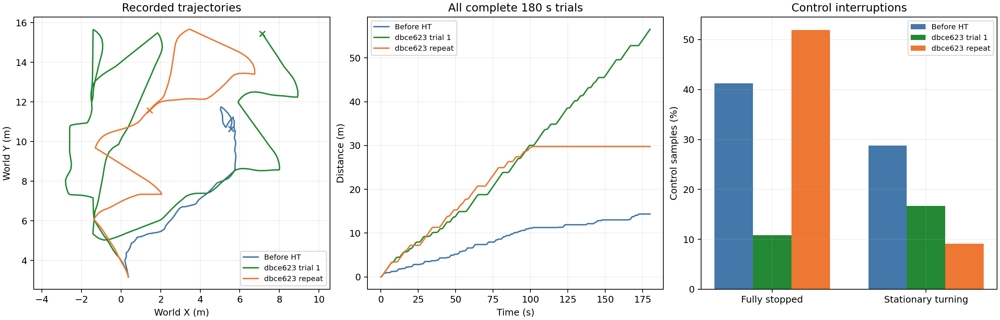
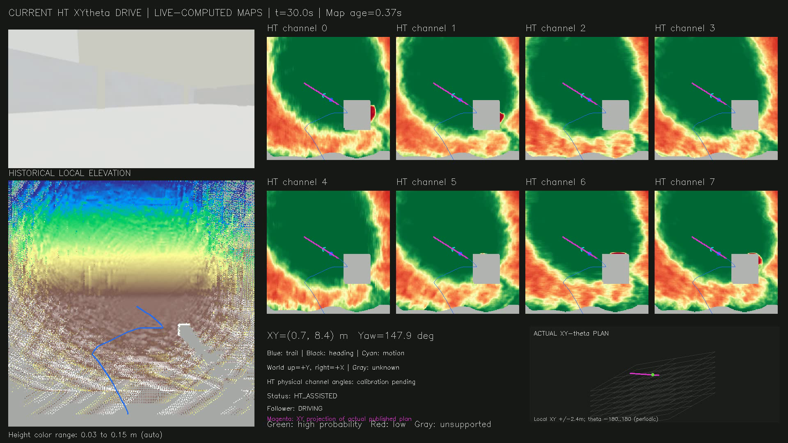
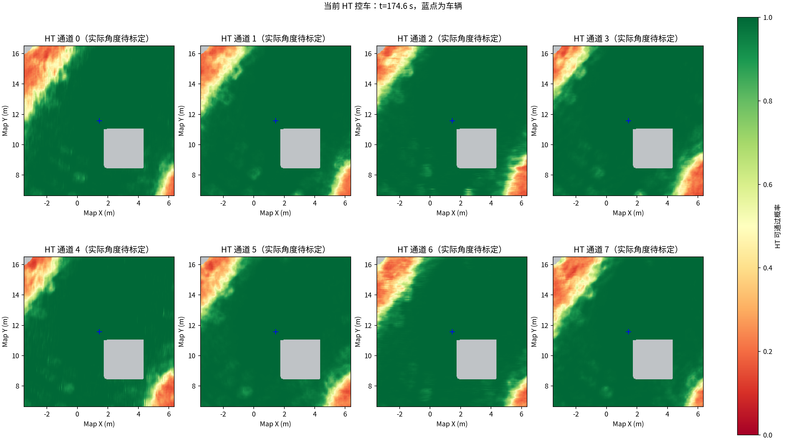

# Garage 新一轮复跑：完整视频与原始数据

**结论：当前版本仍未通过持续探索验证。** 本轮运行180秒、行驶29.76米，约第102秒后停止平移。执行端主要报告 `HT_PATH_BLOCKED`，上层多数仍显示 `HT_ASSISTED`。这说明上层路径与最新HT执行校验之间仍存在需要排查的一致性问题，不能将上一轮56.54米作为稳定性能结论。

## 实验条件

- 实际控车代码：`dbce623161087fcaac865b1d4db5305d1cfe2c9c`，本轮没有修改规划器或调节速度、HT门限。
- CMU Garage，新启动仿真，180秒正式采样；速度上限0.5m/s，HT阈值及严格未知区策略保持原配置。
- 初始位置约(0.370, 3.167)m，车头角约1.653rad；完整起点、代码与控制程序哈希见manifest.json。
- 当前HT/XYθ实时规划与跟踪器实际控车；视频事后按录包时间合成，包含环境、历史高程、8通道HT、实际XYθ路径和执行端状态。

## 三轮结果均保留

| 指标 | 修改前HT | 同版本上一轮 | 本次复跑 |
| --- | ---: | ---: | ---: |
| 行驶距离 | 14.35m | 56.54m | 29.76m |
| 到访1米轨迹格 | 13 | 55 | 32 |
| 完全停车指令比例 | 41.22% | 10.86% | 51.96% |
| 原地转向指令比例 | 28.75% | 16.69% | 9.11% |

到访格是车辆轨迹覆盖的位置格，不等于探索面积或体积。三轮均为180秒，后两轮使用同一规划代码；轨迹不同，不是同一录包的离线配对。当前数据不能证明算法稳定改善或复杂场景的探索完整性。



## 本次停车证据

- 最后记录到平移：102.001秒；最后60秒行驶距离为0.00米。
- 完全零速指令1871/3601，按接收顺序关联的执行状态中，`HT_PATH_BLOCKED`对应1562条。这是指令样本数，不是故障次数，话题顺序在状态切换附近存在一帧误差。
- HT上层状态消息：{'HT_ASSISTED': 314, 'NO_EXECUTABLE_ROUTE': 6, 'HT_MAP_STALE': 3}。上层找到候选路径，不代表执行端已允许行驶。
- 对应源时间窗口录包987帧点云，建图端接收987帧；成功融合窗口录包987帧、融合987帧。该窗口未发现接收缺帧，不能仅用掉包解释长期停车。
- 点云接收排队中位数0.040秒，P95 0.787秒。程序持续发布规划与控制状态，按预设180秒主动结束，没有把中途停止运动当作探索完成。

这些数据尚不能判断被拒绝的是实际障碍、HT误报还是路径执行衔接问题，需用原始地图和姿态路径逐格复核。完整数据一并发布，避免将推测当作根因。

## 视频、数据与复现

- [完整180秒H.264视频](https://github.com/CQULzz/HT_Explo/releases/download/ht-garage-repeat-20261015-1225/garage_ht_xytheta_180s.mp4)，保留后段停车，没有剪掉失败过程。
- [实验数据包](https://github.com/CQULzz/HT_Explo/releases/download/ht-garage-repeat-20261015-1225/garage_ht_experiment_results.zip)：CSV、指标、日志、全部同步地图快照、高程历史、运行代码快照与录包metadata。
- [原始ROS2录包](https://github.com/CQULzz/HT_Explo/releases/download/ht-garage-repeat-20261015-1225/original_bag_0.mcap)，含点云、里程计、相机、HT、高程、路径与控制话题。
- [文件大小及SHA-256校验值](https://github.com/CQULzz/HT_Explo/releases/download/ht-garage-repeat-20261015-1225/release_files.json)。

解压数据包后，将单独下载的 `original_bag_0.mcap` 放入其中的 `ht_repeat_publish_2026-10-15/original_bag/`，与metadata.yaml放在一起。ROS2 Jazzy及相关消息类型安装后，可用 `ros2 bag info` / `ros2 bag play` 检查和回放。

再次运行：

```bash
python3 presentations/run_ht_validation.py --duration 180
```





[本轮指标](summary.json) · [执行及接收审计](delivery_and_pause_audit.json) · [对比指标](comparison.json)

发布校验：H.264转码前后均为1920×1080、10fps、1800帧；已检查开头、中段、结尾可解码。数据ZIP全部成员CRC检查通过；222组同步高程/历史/HT快照时间戳偏差均为0。

GitHub发布已完成，4个附件的服务器SHA-256及大小均与本机一致；另从GitHub下载完整视频，确认SHA-256一致且首、中、末帧可解码。[上传校验记录](github_upload_verification.json)。
